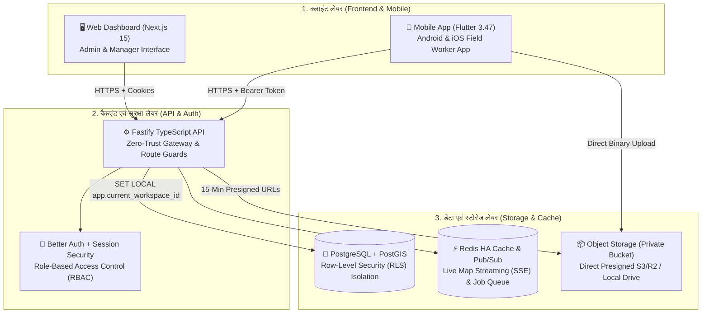
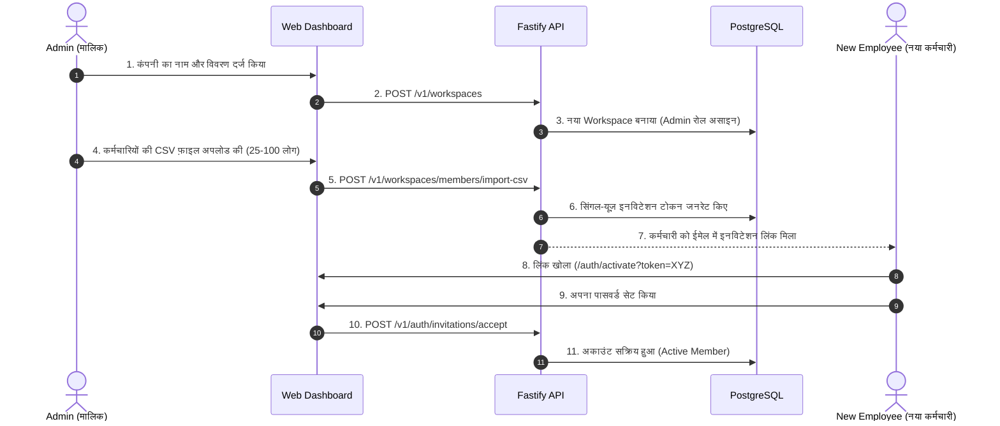
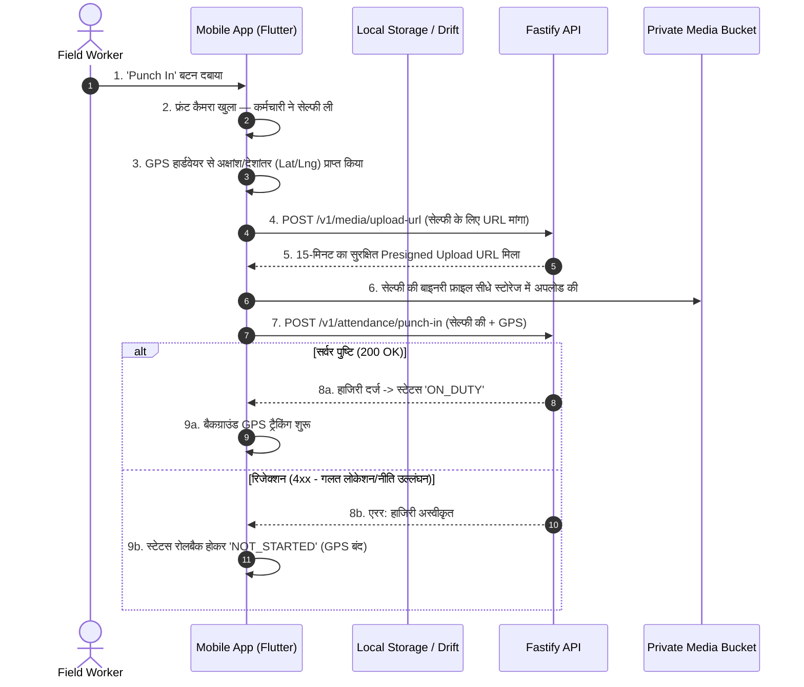
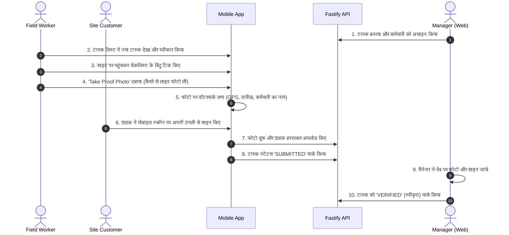
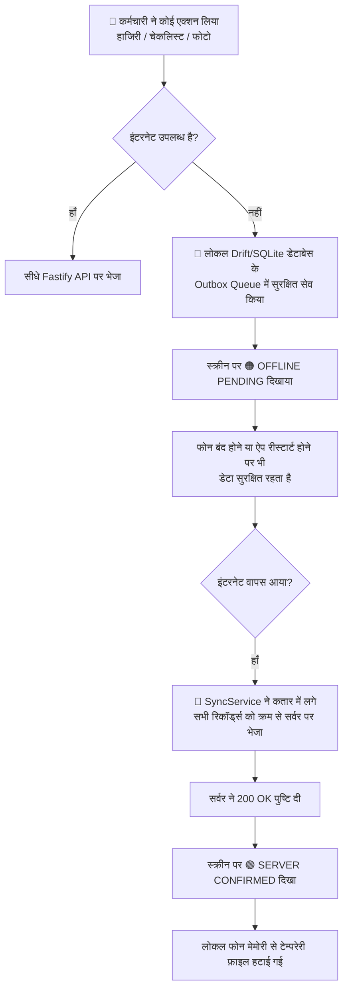

# Oprino — सम्पूर्ण सिस्टम एवं कार्यप्रणाली गाइड (Complete System Guide — Hindi)

> **यह Oprino का सबसे विस्तृत और संपूर्ण व्यावहारिक गाइड है। इसमें पूरे सिस्टम की तकनीकी संरचना, डेटा प्रवाह (Data Flow) और सभी व्यावसायिक कार्यप्रणालियों (Workflows) को आरेखों (Diagrams) और सरल उदाहरणों के साथ समझाया गया है।**

---

## 1. सिस्टम का संपूर्ण आर्किटेक्चर (Full System Architecture)

Oprino एक आधुनिक, तीन-स्तरीय (3-Tier) सुरक्षित आर्किटेक्चर पर बना है:



---

## 2. डेटाबेस और सुरक्षा कैसे काम करती है? (Multi-Tenant RLS Security)

Oprino में एक ही डेटाबेस में सैकड़ों कंपनियों का डेटा रह सकता है, लेकिन **कंपनी A का कर्मचारी या मालिक कभी भी कंपनी B का डेटा नहीं देख सकता**। 

इसे तकनीकी भाषा में **5-Stage Zero-Trust Verification** और **Row-Level Security (RLS)** कहते हैं:
1. **गेटवे जांच:** जब कोई रिक्वेस्ट आती है, तो सर्वर चेक करता है कि टोकन असली है या नहीं।
2. **कंपनी की जांच (Tenant Check):** क्या यह यूज़र वास्तव में इस कंपनी (Workspace) का सक्रिय सदस्य है?
3. **रोल और अनुमति (RBAC):** क्या इस यूज़र को यह काम करने की अनुमति (Permission) है? (उदाहरण: Employee कभी कंपनी की सेटिंग्स नहीं बदल सकता)।
4. **डेटाबेस स्तर पर सुरक्षा (PostgreSQL RLS):** हर डेटाबेस क्वेरी से पहले सर्वर डेटाबेस को कमांड देता है:
   ```sql
   SET LOCAL app.current_workspace_id = 'company-123';
   ```
   इसके बाद डेटाबेस खुद बाकी सभी कंपनियों के डेटा पर ताला लगा देता है। अगर कोड में कोई गलती भी हो, तब भी डेटाबेस शून्य रिकॉर्ड (0 rows) लौटाएगा।
5. **ट्रांजेक्शन स्कोप:** जैसे ही रिक्वेस्ट पूरी होती है, कनेक्शन पूल में कनेक्शन साफ हो जाता है ताकि अगली रिक्वेस्ट में कोई डेटा लीक न हो।

---

## 3. मुख्य कार्यप्रणालियाँ (Detailed Operational Workflows)

### कार्यप्रणाली 1: कंपनी ऑनबोर्डिंग और कर्मचारी जोड़ना (Admin Onboarding)



---

### कार्यप्रणाली 2: बायोमेट्रिक हाजिरी और ऑन-ड्यूटी ट्रैकिंग (Attendance & GPS)



---

### कार्यप्रणाली 3: फील्ड टास्क, फोटो प्रूफ और डिजिटल सिग्नेचर (Task Execution)



---

### कार्यप्रणाली 4: ऑफलाइन सिंक और नेटवर्क रिकवरी (Offline Resilience)

जब कर्मचारी किसी बेसमेंट, लिफ्ट या दूरदराज के इलाके में होता है जहां इंटरनेट बिल्कुल नहीं है:



---

### कार्यप्रणाली 5: ड्यूटी समाप्ति और प्राइवेसी सुरक्षा (Punch Out & Zero GPS)

कर्मचारियों के मानवाधिकार और डेटा सुरक्षा (GDPR/Privacy Invariants) के तहत:

1. जैसे ही कर्मचारी मोबाइल पर **'Punch Out'** दबाता है:
   - ऐप तुरंत Android OS के Foreground Location Service को टर्मिनेट (Kill) कर देता है।
   - मोबाइल की स्क्रीन पर स्टेटस **OFF DUTY** हो जाता है।
2. यदि डिवाइस के नेटवर्क लैग या किसी बग के कारण कोई पुराना GPS पॉइंट Punch Out के बाद सर्वर पर पहुंचे:
   - सर्वर कर्मचारी का एक्टिव सेशन चेक करता है।
   - एक्टिव सेशन न मिलने पर सर्वर उस डेटा को डेटाबेस में लिखे बिना तुरंत **403 Forbidden (`OFF_DUTY_TRACKING_PROHIBITED`)** के साथ ड्रॉप कर देता है।
3. **30-दिन का स्वतः डेटा प्रूनिंग (Retention Policy):**
   - डेटाबेस में एक ऑटोमैटिक जॉब चलता है जो 30 दिन से पुराने GPS ब्रेडक्रम्ब्स को हमेशा के लिए डिलीट कर देता है, ताकि कंपनियों को अनावश्यक डेटा स्टोरेज का खर्च न उठाना पड़े और प्राइवेसी कानून का पालन हो।

---

## 4. तकनीकी शब्दों का सरल शब्दकोश (Glossary for Owners)

| तकनीकी शब्द | सरल हिंदी में मतलब | Oprino में इसका महत्व |
|---|---|---|
| **Multi-Tenancy** | बहु-किरायेदारी (एक ही सॉफ्टवेयर में कई कंपनियों का अलग-अलग डेटा) | आपके सर्वर का खर्च 90% कम होता है क्योंकि हर कंपनी के लिए अलग सर्वर नहीं खरीदना पड़ता। |
| **Row-Level Security (RLS)** | डेटाबेस में पंक्ति स्तर पर सुरक्षा | कंपनी का डेटा लीक होने से रोकने की दुनिया की सबसे मजबूत डेटाबेस सुरक्षा तकनीक। |
| **Offline-First** | पहले लोकल में सेव, फिर इंटरनेट पर | भारत या अन्य देशों में जहां इंटरनेट कटता रहता है, वहां ऐप कभी हैंग या क्रैश नहीं होता। |
| **Presigned URL** | पूर्व-हस्ताक्षरित सुरक्षित लिंक | आपका मुख्य सर्वर फोटो अपलोड से धीमा नहीं होता; मोबाइल सीधे क्लाउड स्टोरेज पर फोटो भेजता है। |
| **ForeGround Service** | Android की निरंतर चलने वाली सेवा | जब मोबाइल की स्क्रीन बंद होती है, तब भी ड्यूटी के दौरान लोकेशन ट्रैक होती रहती है। |
| **Doze Mode** | Android का बैटरी सेवर सिस्टम | फोन की बैटरी बचाने के लिए Android बैकग्राउंड ऐप्स को रोकता है; Oprino की सर्विस इसे बायपास करने के लिए अधिकृत है। |
