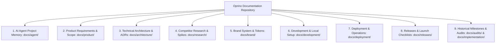

# OPRINO — Documentation Information Architecture & Governance

**Document Status:** AUTHORITATIVE & PERMANENT  
**Classification:** Documentation Map, Information Architecture, Reorganization Plan  
**Repository:** `djsushilkumar/oprino`  
**Last Updated:** October 2026  

---

## 1. Information Architecture Overview

The Oprino documentation suite is organized into 9 logical domains designed to eliminate duplication, guarantee traceability, and maintain single sources of truth:

---

## 2. Directory Structure & Canonical Sources of Truth

| Category | Primary Directory | Canonical Source of Truth | Purpose & Rules |
|---|---|---|---|
| **AI Agent Memory** | `docs/agent/` | [`OPRINO-PROJECT-BRAIN.md`](./agent/OPRINO-PROJECT-BRAIN.md) | Single persistent context for all incoming agents; contains mission, current state, decision log, session handoff, and open issues. |
| **Product Specifications** | `docs/product/` | [`OPRINO-MASTER-PRD.md`](./product/OPRINO-MASTER-PRD.md) | Authoritative frozen PRD; scope boundaries governed by [`V1-SCOPE.md`](./product/V1-SCOPE.md) and backlog by [`GAP-ANALYSIS-AND-ROADMAP.md`](./product/GAP-ANALYSIS-AND-ROADMAP.md). |
| **Technical Architecture** | `docs/architecture/` | [`OPRINO-TECHNICAL-ARCHITECTURE.md`](./architecture/OPRINO-TECHNICAL-ARCHITECTURE.md) | Authoritative technical system architecture; changes governed by [`ADR/README.md`](./architecture/ADR/README.md) (ADR-001 through ADR-021). |
| **Competitor Research** | `docs/research/` | [`README.md`](./research/README.md) | Authoritative index of TaskOPad & Unolo reverse engineering (`competitor-reverse-engineering/00` to `25`) and architectural spikes. |
| **Brand System & Design** | `docs/brand/` | [`OPRINO-BRAND-SYSTEM.md`](./brand/OPRINO-BRAND-SYSTEM.md) | Canonical brand tokens, typography, and color systems derived from `Oprino-Brand-Kit/`. |
| **Development & Setup** | `docs/development/` | [`LOCAL-SETUP.md`](./development/LOCAL-SETUP.md) | Developer onboarding, environment configuration, testing guides, and troubleshooting. |
| **Cloud Deployment** | `docs/deployment/` | [`FREE-CLOUD-DEPLOYMENT-GUIDE.md`](./deployment/FREE-CLOUD-DEPLOYMENT-GUIDE.md) | Production cloud provisioning (Render, Vercel, Neon, Upstash) and environment matrices. |
| **Releases & Launch Gates**| `docs/releases/` | [`V1-COMMERCIAL-LAUNCH-CHECKLIST.md`](./releases/V1-COMMERCIAL-LAUNCH-CHECKLIST.md) | Authoritative launch gating checklist, rollback plans, and release candidate reports. |
| **Historical Milestones** | `docs/audits/` & `docs/implementation/` | Individual reports | Immutable historical records of past development and security audits (not current status dashboards). |

---

## 3. Comprehensive Document Inventory & Classification

All 117+ documents across the repository are categorized according to the 8 standard document lifecycle classifications:

### Class 1: AUTHORITATIVE (Frozen Approved Decisions & Invariant Specifications)
- `AGENTS.md` — Supreme agent instructions and invariant rules.
- `docs/product/OPRINO-MASTER-PRD.md` — Authoritative master product requirements document.
- `docs/product/V1-SCOPE.md` — Authoritative frozen functional boundaries (MUST, SHOULD, LATER, OUT-OF-SCOPE).
- `docs/product/PRODUCT-DEFINITION.md` — High-level product definition and non-goals.
- `docs/architecture/OPRINO-TECHNICAL-ARCHITECTURE.md` — Authoritative core technical architecture.
- `docs/architecture/PRIVACY-ARCHITECTURE.md` — Invariant duty-hours tracking and privacy controls.
- `docs/architecture/SECURITY-ARCHITECTURE.md` — 5-tier security model and RLS tenant isolation.
- `docs/architecture/ADR/README.md` & `ADR-001` through `ADR-021` — Approved Architecture Decision Records.
- `docs/brand/OPRINO-BRAND-SYSTEM.md` — Approved design tokens and visual standards.
- `docs/releases/V1-COMMERCIAL-LAUNCH-CHECKLIST.md` — Authoritative commercial launch gate checklist.

### Class 2: ACTIVE (Currently Maintained Operational Documentation)
- `docs/agent/OPRINO-PROJECT-BRAIN.md` — Persistent system brain.
- `docs/agent/OPRINO-CURRENT-STATE.md` — Live verification dashboard and cloud state.
- `docs/agent/OPRINO-DECISION-LOG.md` — Architecture decisions and competitor trade-offs.
- `docs/agent/OPRINO-SESSION-HANDOFF.md` — Incoming session restoration and historical handoff log.
- `docs/agent/OPRINO-OPEN-ISSUES.md` — Tracked commercial launch blockers and active engineering items.
- `docs/product/ROADMAP.md` — High-level product evolution roadmap (V1, V1.5, V2, V3).
- `docs/product/GAP-ANALYSIS-AND-ROADMAP.md` — Zero-duplicate gap analysis and prioritized backlog.
- `docs/product/APP-SURFACES.md` — Matrix of mobile and web surfaces.
- `docs/product/ROLES-AND-PERMISSIONS-PLAN.md` — RBAC permissions specification.
- `docs/architecture/LOCATION-PIPELINE.md` — Telemetry pipeline specification (read with ADR-021).
- `docs/architecture/SYNC-CONFLICT-MATRIX.md` — Offline-first sync conflict resolution matrix.
- `docs/architecture/CONTRACT-STRATEGY.md` — Zod contract and OpenAPI strategy.
- `docs/architecture/INFRA-COST-MODEL.md` — Zero-cost and low-cost infrastructure economics.
- `docs/deployment/FREE-CLOUD-DEPLOYMENT-GUIDE.md` — Cloud provisioning guide.
- `docs/deployment/STAGING-ENVIRONMENT-SETUP.md` — Staging setup guide.
- `docs/deployment/RELEASE-PROCESS.md` — Release process.
- `docs/development/LOCAL-SETUP.md` — Local developer environment guide.
- `docs/development/ENVIRONMENT-CONFIGURATION.md` — Environment variables reference.
- `docs/development/TESTING.md` — Monorepo test execution instructions.
- `docs/development/TROUBLESHOOTING.md` — Common setup issues and fixes.
- `docs/releases/V1-ROLLBACK-PLAN.md` — Production rollback protocols.
- `README.md` & `CONTRIBUTING.md` — Repository entry point and contribution guidelines.

### Class 3: RESEARCH (External Competitor Deconstruction & Architectural Spikes)
- `docs/research/README.md` — Canonical research index.
- `docs/research/competitor-reverse-engineering/00-RESEARCH-INDEX.md` through `25-PRODUCTION-ENVIRONMENT-VERIFICATION-REPORT.md` (26 documents) — TaskOPad & Unolo product audits, workflows, UI/UX, technical behavior, and empirical validation.
- `research/archived-spikes/spike_c_auth/` — Mobile authentication spike.
- `research/archived-spikes/spike_d_openapi/` — OpenAPI generation spike.
- `research/archived-spikes/spike_e_security/` — Device identity spike.

### Class 4: HISTORICAL (Past Milestone Verifications & Point-in-Time Audits)
- `docs/handoff/CODEX-CLOUD-HANDOFF.md` — Historical handoff document from October 15 milestone.
- `docs/architecture/PHASE-01A-FREEZE-CHECKLIST.md` — Milestone signoff.
- `docs/architecture/PHASE-01B-GATE-CHECKLIST.md` — Milestone signoff.
- `docs/architecture/PHASE-01B-VALIDATION-REPORT.md` — Spike validation report.
- `docs/architecture/PHASE-01C-SCAFFOLDING-REPORT.md` — Scaffolding verification.
- `docs/implementation/PHASE-02A-IDENTITY-TENANCY-REPORT.md` — Milestone completion report.
- `docs/implementation/PHASE-02B-TASK-ATTENDANCE-REPORT.md` — Milestone completion report.
- `docs/implementation/PHASE-02C-LOCATION-PIPELINE-REPORT.md` — Milestone completion report.
- `docs/implementation/PHASE-03-FIELD-OPERATIONS-REPORT.md` — Milestone completion report.
- `docs/implementation/PHASE-04-ADVANCED-OPERATIONS-REPORT.md` — Milestone completion report.
- `docs/implementation/PHASE-05-PRODUCTION-HARDENING-REPORT.md` — Milestone completion report.
- `docs/releases/V1-RELEASE-CANDIDATE-REPORT.md` — RC candidate milestone report.
- `docs/audits/` (19 historical audit reports):
  - `BRANCH-INVENTORY.md`
  - `BUG-REGISTER.md`
  - `CURRENT-DEPLOYMENT-STATUS.md`
  - `DOCUMENTATION-AUDIT.md`
  - `FEATURE-INVENTORY.md`
  - `FEATURE-VERIFICATION-MATRIX.md`
  - `INTEGRATION-STRATEGY.md`
  - `NEXT-STEPS-ROADMAP.md`
  - `PR-DEPENDENCY-MATRIX.md`
  - `PRODUCTION-LAUNCH-CHECKLIST.md`
  - `PRODUCTION-READINESS-AUDIT.md`
  - `PROJECT-INVENTORY.md`
  - `PROJECT-STATUS.md`
  - `RELEASE-BLOCKERS.md`
  - `REPOSITORY-STRUCTURE-AUDIT.md`
  - `SECURITY-AUDIT.md`
  - `SECURITY-FINDINGS.md`
  - `TEST-EVIDENCE.md`
  - `V1-FEATURE-COVERAGE.md`

### Class 5: DUPLICATE & OVERLAPPING (Content Preserved for Traceability, Canonical Pointer Established)
- Multiple historical audits in `docs/audits/` (such as `PROJECT-STATUS.md`, `CURRENT-DEPLOYMENT-STATUS.md`, and `BRANCH-INVENTORY.md`) describe earlier branches that have since been merged into `main`.
- **Policy:** In accordance with the non-destructive documentation standard, these files are **retained** without deletion. Their status is marked as HISTORICAL, and incoming agents are instructed via `AGENTS.md` and `docs/agent/` to consult `docs/agent/OPRINO-CURRENT-STATE.md` as the single canonical source of truth for current deployment reality.

### Class 6: SUPERSEDED
- Early speculative backlogs in `docs/research/competitor-reverse-engineering/08` and `09` are superseded by the verified implementation matrices in `16` and the deduplicated backlog in `docs/product/GAP-ANALYSIS-AND-ROADMAP.md`.

### Class 7: INCOMPLETE
- Live Cloudflare R2 presigned tests in `services/api/test/proof-storage.live.test.ts` (requires production credentials).
- Multi-OEM battery test reports (requires additional physical device testbed passes).

### Class 8: MISSING
- None. All referenced architectural decisions (ADR-001 through ADR-021) and competitor research files (00 through 25) exist in the repository.

---

## 4. Documentation Governance & Maintenance Rules

To prevent documentation decay and future confusion:
1. **Never Silently Rewrite Frozen Requirements:** Changes to PRD or V1 scope require explicit owner sign-off.
2. **One Canonical Document per Concern:**
   - Current deployment state → `docs/agent/OPRINO-CURRENT-STATE.md`
   - Active backlog & gaps → `docs/product/GAP-ANALYSIS-AND-ROADMAP.md`
   - Agent session handoff → `docs/agent/OPRINO-SESSION-HANDOFF.md`
   - Launch gating checklist → `docs/releases/V1-COMMERCIAL-LAUNCH-CHECKLIST.md`
3. **No Unilateral Deletions:** Historical reports and audits must remain preserved for traceability.
4. **Mandatory Link Verification:** Any documentation reorganization or edit must verify all relative markdown links remain intact.
