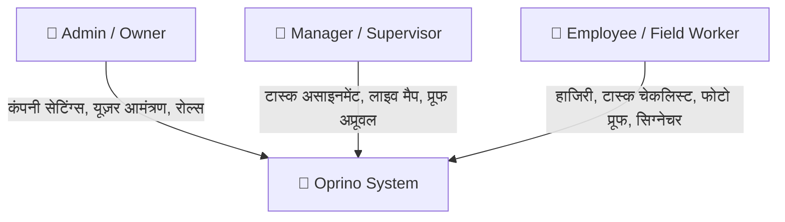
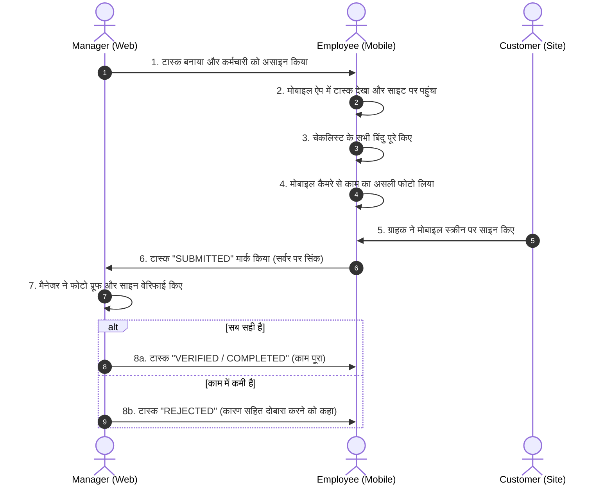

# Oprino — प्रोजेक्ट ओनर स्टार्ट गाइड (Owner Start Here)

> **नमस्ते! यह गाइड खास तौर पर Oprino के ओनर और गैर-तकनीकी (Non-Technical) स्टेकहोल्डर्स के लिए सरल हिंदी में तैयार की गई है, ताकि आप बिना किसी कोड को पढ़े पूरे सिस्टम, इसकी कार्यप्रणाली और इसके वर्तमान स्टेटस को आसानी से समझ सकें।**

---

## 1. Oprino क्या है और इसका बिज़नेस उद्देश्य (Business Purpose) क्या है?

**Oprino** छोटे और मध्यम व्यवसायों (SMBs — 5 से 500 कर्मचारी, मुख्य रूप से 10 से 200 कर्मचारियों वाली टीमों) के लिए बनाया गया एक आधुनिक **Task Management + Field Workforce Management + Operations Platform** है।

### यह किन समस्याओं को हल करता है?
1. **फील्ड कर्मचारियों की वास्तविक ट्रैकिंग:** फ़ील्ड में काम करने वाले कर्मचारी (जैसे सोलर इंस्टॉलर, HVAC तकनीशियन, डिलीवरी या सर्विस एजेंट्स) समय पर साइट पर पहुंचे या नहीं।
2. **सच्ची हाजिरी (Selfie-Verified Attendance):** केवल बटन दबाने से हाजिरी नहीं लगती; कर्मचारी को ऑन-साइट लाइव सेल्फी और GPS लोकेशन देनी होती है।
3. **काम का पुख्ता सबूत (Proof of Work):** काम पूरा होने पर फ़ील्ड से लाइव फोटो प्रूफ (जिस पर ऑटोमैटिक टाइमस्टैम्प, GPS और वॉटरमार्क लगे होते हैं) और ग्राहक के स्क्रीन पर डिजिटल हस्ताक्षर (Customer On-Glass Signature)।
4. **ड्यूटी प्राइवेसी (Duty-Hours-Only Tracking):** Oprino का सबसे बड़ा नैतिक और कानूनी सिद्धांत है कि **ड्यूटी समाप्त (Punch Out) होते ही GPS ट्रैकिंग 100% तुरंत बंद हो जाती है**। कर्मचारी की निजी जिंदगी में कभी ट्रैकिंग नहीं होती।
5. **ऑफलाइन काम (Offline-First):** अगर फ़ील्ड में इंटरनेट चला जाए (No Network), तब भी ऐप बंद नहीं होता। सारा डेटा मोबाइल के सुरक्षित लोकल डेटाबेस में सेव रहता है और इंटरनेट आते ही ऑटोमैटिक सर्वर पर सिंक हो जाता है।

---

## 2. सिस्टम में कौन क्या करता है? (Roles & Responsibilities)

Oprino में तीन मुख्य भूमिकाएँ (Roles) हैं:



### 1. Admin / Company Owner (मालिक)
* कंपनी का खाता (Workspace) बनाता है।
* कर्मचारियों को ईमेल द्वारा इनवाइट करता है या CSV फ़ाइल से एक साथ 25-100 कर्मचारियों को जोड़ता है।
* कंपनी की नीतियां तय करता है (जैसे हाजिरी के लिए सेल्फी अनिवार्य है या नहीं, GPS डेटा कितने दिन रखना है — डिफ़ॉल्ट 30 दिन)।
* कर्मचारियों के रोल तय करता है (किसे मैनेजर बनाना है, किसे सस्पेंड करना है)।

### 2. Manager / Field Supervisor (मैनेजर)
* अपनी टीम के कर्मचारियों को टास्क और ग्राहक साइट्स (Visits) असाइन करता है।
* वेब डैशबोर्ड पर लाइव मैप (Live Map) देखकर यह जांचता है कि कौन-सा कर्मचारी अभी ड्यूटी पर है और कहां है।
* कर्मचारी द्वारा भेजे गए काम के फोटो प्रूफ और ग्राहक हस्ताक्षर की जांच करके टास्क को **APPROVE** (स्वीकार) या **REJECT** (अस्वीकार) करता है।
* रिपोर्ट्स और हाजिरी हिस्ट्री देखता है।

### 3. Employee / Field Worker (फील्ड कर्मचारी)
* मोबाइल ऐप में लॉगिन करता है।
* दिन की शुरुआत में **Punch In** करता है (सेल्फी और GPS के साथ)।
* अपने असाइन किए गए टास्क्स और कस्टमर साइट्स की लिस्ट देखता है।
* साइट पर पहुंचकर चेकलिस्ट पूरी करता है, काम की फोटो खींचता है, ग्राहक के डिजिटल साइन लेता है।
* दिन का काम खत्म होने पर **Punch Out** करता है (जिसके तुरंत बाद GPS पूरी तरह बंद हो जाता है)।

---

## 3. सिस्टम के दो मुख्य हिस्से: Web Dashboard और Mobile App

| हिस्सा | किसके लिए है? | तकनीक | मुख्य काम |
|---|---|---|---|
| **Web Dashboard** | Admin और Managers | Next.js (ब्राउज़र में चलता है) | कंपनी प्रबंधन, टीम रोस्टर, लाइव मैप ट्रैकिंग, टास्क मैनेजमेंट, रिपोर्ट्स डाउनलोड |
| **Mobile App** | Field Workers और Managers | Flutter (Android / iOS) | मोबाइल लॉगिन, सेल्फी हाजिरी, टास्क चेकलिस्ट, कैमरा फोटो प्रूफ, डिजिटल सिग्नेचर, ऑफलाइन सिंक |

---

## 4. एक टास्क का पूरा जीवन चक्र (Task Lifecycle)

फील्ड ऑपरेशन में एक काम कैसे शुरू होकर खत्म होता है:



---

## 5. हाजिरी और GPS कैसे काम करते हैं? (Attendance & GPS Rules)

1. **सच्ची हाजिरी (Biometric Punch In):** कर्मचारी जब Punch In दबाता है, तो फ्रंट कैमरा खुलता है। कर्मचारी सेल्फी लेता है, ऐप बैकग्राउंड में डिवाइस की सटीक GPS लोकेशन जोड़ता है और सर्वर पर भेजता है।
2. **आशावादी सुरक्षा (Optimistic UI with Rollback):** अगर नेटवर्क धीमा है, तो ऐप तुरंत दिखाता है "हाजिरी सर्वर पुष्टि के लिए प्रतीक्षारत (Pending Verification)"। यदि सर्वर किसी कारणवश (जैसे गलत लोकेशन या अवैध सेशन) हाजिरी रिजेक्ट करता है, तो ड्यूटी तुरंत रोलबैक होकर **NOT STARTED** हो जाती है।
3. **ड्यूटी के दौरान लोकेशन (On-Duty Breadcrumbs):** जब तक कर्मचारी ऑन-ड्यूटी है, मोबाइल का बैकग्राउंड सर्विस हर 15-30 सेकंड में लोकेशन पॉइंट्स सुरक्षित रखता है।
4. **ड्यूटी समाप्ति पर तुरंत कटऑफ (Punch Out Cutoff):** जैसे ही कर्मचारी Punch Out करता है:
   - मोबाइल की लोकेशन सर्विस तुरंत बंद (Kill) हो जाती है।
   - यदि कोई पुराना पॉइंट बाद में सर्वर पर पहुंचे भी, तो सर्वर उसे **403 Forbidden** के साथ रिजेक्ट कर देता है।

---

## 6. बिना इंटरनेट के काम (Offline Sync) कैसे होता है?

* **लोकल डेटाबेस (Drift / SQLite):** जब इंटरनेट नहीं होता, तो ऐप क्रैश नहीं होता। सारा डेटा (हाजिरी, चेकलिस्ट, फोटो) मोबाइल की सुरक्षित मेमोरी में कतार (Outbox Queue) में लग जाता है।
* **ऑटोमैटिक रीकनेक्शन:** जैसे ही फोन को 4G/5G या वाई-फाई मिलता है, ऐप बैकग्राउंड में एक-एक करके सारे पेंडिंग रिकॉर्ड्स सर्वर पर भेज देता है।
* **सफल सिंक के बाद ही लोकल डिलीट:** जब सर्वर पुष्टि (200 OK) कर देता है कि फोटो और डेटा क्लाउड पर सुरक्षित पहुंच गए हैं, केवल तभी मोबाइल से लोकल टेम्परेरी फ़ाइल हटाई जाती है ताकि फोन की मेमोरी न भरे और डेटा का नुकसान भी न हो।

---

## 7. अपने कंप्यूटर पर सिस्टम को कैसे चलाएं और टेस्ट करें? (Quick Run)

प्रोजेक्ट में एक पूरी तरह से आइसोलेटेड (Zero-Cost Local Pilot Server) मौजूद है, जिसे आप बिना किसी बाहरी क्लाउड खर्च या डेटाबेस के तुरंत चलाकर देख सकते हैं:

### 1. पायलट सर्वर शुरू करें:
```bash
pnpm pilot:server
```
यह आपके कंप्यूटर पर `http://localhost:3001` पर एक सुरक्षित टेस्ट सर्वर शुरू कर देता है।

### 2. ऑटोमैटिक टेस्ट चलाएं (11 मुख्य परिदृश्य):
दूसरे टर्मिनल में चलाएं:
```bash
pnpm pilot:test
```
यह कुछ ही सेकंड में लॉगिन, हाजिरी, जीपीएस कटऑफ, फोटो अपलोड और मैनेजर अप्रूवल की 100% ऑटोमेटेड जांच करके हरी टिक (PASSED) दिखा देगा।

### 3. Android Debug APK बनाना:
```bash
cd apps/mobile/android
.\gradlew.bat :app:assembleDebug
```
तैयार APK आपको `apps/mobile/build/app/outputs/flutter-apk/app-debug.apk` में मिल जाएगी, जिसे आप किसी भी Android फ़ोन पर डालकर देख सकते हैं।

---

## 8. आगे क्या पढ़ना चाहिए?

* **प्रोजेक्ट का वर्तमान स्टेटस और कमियां:** पढ़ें [`docs/PROJECT-STATUS-HI.md`](./PROJECT-STATUS-HI.md)
* **पूरी प्रणाली का विस्तृत टेक्निकल गाइड:** पढ़ें [`docs/COMPLETE-SYSTEM-GUIDE-HI.md`](./COMPLETE-SYSTEM-GUIDE-HI.md)
* **तकनीकी आर्किटेक्चर (अंग्रेजी):** पढ़ें [`docs/architecture/SYSTEM-OVERVIEW.md`](./architecture/SYSTEM-OVERVIEW.md)
* **कमर्शियल लॉन्च चेकलिस्ट:** पढ़ें [`docs/releases/V1-COMMERCIAL-LAUNCH-CHECKLIST.md`](./releases/V1-COMMERCIAL-LAUNCH-CHECKLIST.md)
