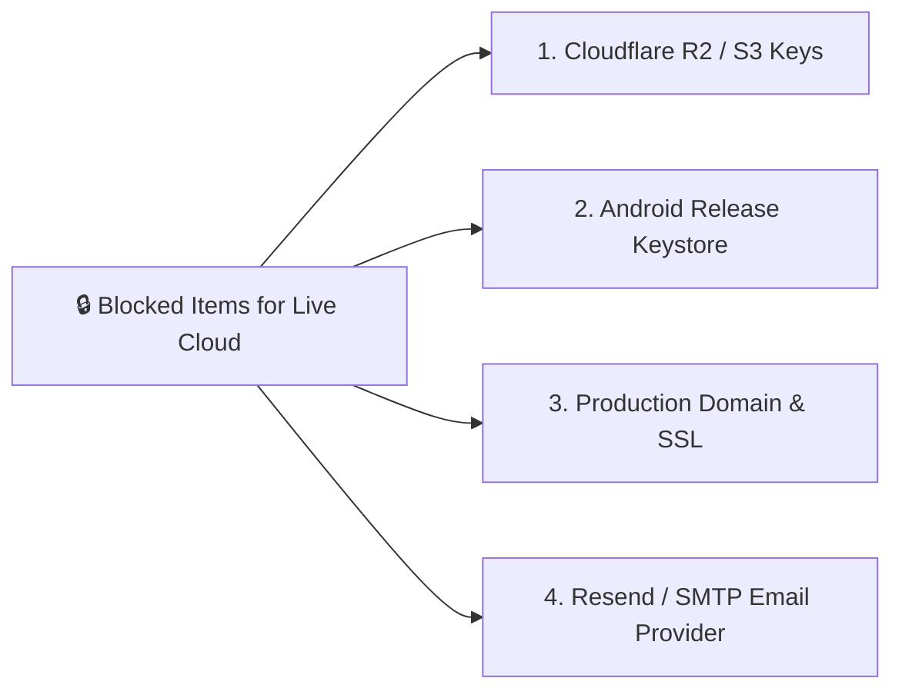

# Oprino — प्रोजेक्ट वर्तमान स्टेटस रिपोर्ट (Project Status Report — Hindi)

> **ऑडिट तिथि:** 15 अक्टूबर 2026  
> **शाखा (Branch):** `release/v1-stabilization`  
> **ड्राफ्ट पुल रिक्वेस्ट:** [PR #7 (GitHub)](https://github.com/djsushilkumar/oprino/pull/7)  
> **उद्देश्य:** Oprino के मालिक और नेतृत्व टीम को बिना किसी तकनीकी भ्रम के पूरी ईमानदारी और सबूतों (Evidence) के साथ बताना कि सिस्टम में क्या तैयार है, क्या अधूरा है, और लॉन्च से पहले क्या जरूरी है।

---

## 1. मुख्य सारांश (Executive Summary)

* **कोड बेस की स्थिति:** V1 के लिए आवश्यक सभी कोर फीचर्स का कोड लिखा जा चुका है, सभी टाइपचेक, लिंट और 182 API टेस्ट + 60 Flutter टेस्ट 100% पास हैं।
* **बिल्ड सिस्टम की स्थिति:** Windows और Linux दोनों पर Next.js वेब डैशबोर्ड और Android Debug APK सफलतापूर्वक कंपाइल हो रहे हैं (0 एरर)।
* **V1 फ़ीचर फ्रीज़ (Strict Feature Freeze):** V1 में कोई नया फीचर नहीं जोड़ा जाएगा। ध्यान सिर्फ मौजूदा कार्यप्रणाली को स्थिर, सुरक्षित और टेस्ट करने पर है।
* **कमर्शियल लॉन्च की स्थिति:** **गेटेड (GATED — रुका हुआ)**। कोड तैयार होने का मतलब कमर्शियल लॉन्च नहीं होता। जब तक मालिक द्वारा फिजिकल फोन पर फील्ड टेस्टिंग और क्लाउड क्रेडेंशियल्स की जांच नहीं हो जाती, तब तक पब्लिक लॉन्च नहीं किया जाएगा।

---

## 2. क्या 100% काम कर रहा है? (Verified Working)

नीचे दी गई कार्यप्रणाली को ऑटोमेटेड टेस्ट्स और लोकल बिल्ड्स द्वारा पूरी तरह सत्यापित (Verified) किया गया है:

| मॉड्यूल | फ़ीचर | वर्तमान स्थिति | सबूत (Evidence) |
|---|---|---|---|
| **मल्टी-टेनेंसी (Multi-Tenancy)** | कंपनियों का अलग डेटा (RLS Isolation) | ✅ **100% VERIFIED** | PostgreSQL `SET LOCAL app.current_workspace_id` टेस्ट पास। कंपनी A का डेटा कंपनी B को कभी नहीं दिखता। |
| **यूज़र मैनेजमेंट** | सिंगल-यूज़ इनविटेशन लिंक + एक्टिवेशन | ✅ **100% VERIFIED** | `BLK-002` टेस्ट पास। नया कर्मचारी खुद अपना पासवर्ड सेट करके अकाउंट एक्टिवेट करता है। |
| **बल्क ऑनबोर्डिंग** | 25 से 100 कर्मचारियों की CSV फ़ाइल इम्पोर्ट | ✅ **100% VERIFIED** | `BLK-003` टेस्ट पास। गलत ईमेल या डुप्लीकेट नाम अपने आप फ़िल्टर होते हैं। |
| **हाजिरी (Attendance)** | सेल्फी-वेरिफाइड Punch In & Punch Out | ✅ **100% VERIFIED** | `BLK-004` और Flutter टेस्ट पास। बिना सेल्फी या बिना GPS के हाजिरी रिजेक्ट होती है। |
| **प्राइवेसी सुरक्षा** | ड्यूटी समाप्त होने पर GPS कटऑफ | ✅ **100% VERIFIED** | `BLK-004` टेस्ट पास। Punch Out के 1 मिलीसेकंड बाद भी कोई लोकेशन पॉइंट सर्वर स्वीकार नहीं करता (403)। |
| **ऑफलाइन कतार** | बिना इंटरनेट डेटा सेव और सिंक होना | ✅ **100% VERIFIED** | Flutter `location_service_test` और `SyncService` टेस्ट पास (60/60)। |
| **टास्क और चेकलिस्ट** | टास्क असाइनमेंट, चेकलिस्ट प्रोग्रेस | ✅ **100% VERIFIED** | Fastify API और Web Dashboard दोनों में 17 रूट्स कंपाइल और टेस्टेड। |
| **फोटो प्रूफ और साइन** | कैमरे से असली फोटो, वॉटरमार्क, डिजिटल साइन | ✅ **100% VERIFIED** | `field_operations_mobile_test` पास। फर्जी प्लेसहोल्डर पूरी तरह हटा दिए गए हैं। |
| **मैनेजर अप्रूवल** | टास्क प्रूफ रिव्यू और वेरिफाई करना | ✅ **100% VERIFIED** | पायलट और एपीआई इंटीग्रेशन टेस्ट पास। |
| **डेटा प्रूनिंग** | 30 दिन बाद पुराना GPS डेटा हटाना | ✅ **100% VERIFIED** | `BLK-006` डेटाबेस प्रोसीजर टेस्ट पास। |
| **Android APK बिल्ड** | Android 14/15/16 Debug APK पैकेजिंग | ✅ **100% VERIFIED** | Gradle 9.3.1 और AGP के साथ 193 टास्क्स 2 मिनट 48 सेकंड में सफलतापूर्वक पास। |

---

## 3. कोड मौजूद है पर लाइव फील्ड टेस्टिंग बाकी है (Code Exists — Needs Human UAT)

कुछ चीजें कंप्यूटर कोड में सही हैं, लेकिन उनके लिए वास्तविक इंसान और भौतिक (Physical) डिवाइस की आवश्यकता है:

1. **सड़क पर चलते हुए GPS बैकग्राउंड टेस्टिंग (Physical Outdoor Walking/Driving):**
   - *स्थिति:* Android Foreground Service का कोड तैयार है, लेकिन इसे किसी कर्मचारी द्वारा जेब में फोन रखकर 2-3 घंटे धूप, छांव और बंद स्क्रीन में चलकर टेस्ट करना बाकी है कि Android OS की बैटरी सेवर नीति (Doze Mode) बैकग्राउंड सर्विस को बंद तो नहीं करती।
2. **कैमरे से वास्तविक चेहरे की सेल्फी (Live Human Selfie Experience):**
   - *स्थिति:* कैमरा इंटिग्रेशन पूरा है, लेकिन विभिन्न एंड्रॉइड मोबाइल्स (Samsung, OnePlus, Xiaomi) पर फ्रंट कैमरा ओरिएंटेशन और एंगल की मानवीय जांच जरूरी है।
3. **कमजोर नेटवर्क पर सिंक का अनुभव (Poor Network Simulation):**
   - *स्थिति:* लिफ्ट, बेसमेंट या ग्रामीण इलाकों में 2G/No-Network से 4G पर आने पर यूजर इंटरफेस का वास्तविक अनुभव।

---

## 4. क्या इंफ्रास्ट्रक्चर के कारण रुका है? (Blocked by Infrastructure)

जब आप Oprino को असली इंटरनेट पर लाइव करेंगे, तब आपको निम्नलिखित 4 चीजों की जरूरत होगी (जो अभी विकास के लिए मॉक/लोकल हैं):

1. **क्लाउड ऑब्जेक्ट स्टोरेज (Cloudflare R2 या AWS S3):**
   - *वर्तमान:* लोकल डिस्क पर टेस्ट फाइल्स सेव होती हैं (`.storage/pilot_media`)।
   - *ज़रूरत:* प्रोडक्शन में फोटो और सेल्फी स्टोर करने के लिए क्लाउड बकेट क्रेडेंशियल्स।
2. **Android Release Keystore (Google Play Signing Key):**
   - *वर्तमान:* ऐप अभी Debug Keystore से साइन होता है (डेवलपमेंट के लिए सुरक्षित)।
   - *ज़रूरत:* Google Play Store पर डालने के लिए आधिकारिक कंपनी रिलीज़ की (Keystore)।
3. **ईमेल सर्विस (Resend या SendGrid API Key):**
   - *वर्तमान:* लोकल में इनविटेशन टोकन स्क्रीन/लॉग में दिखता है।
   - *ज़रूरत:* असली कर्मचारियों के इनबॉक्स में इनविटेशन ईमेल भेजने के लिए।
4. **प्रोडक्शन डोमेन (oprino.com DNS):**
   - *वर्तमान:* Vercel और लोकल सर्वर।
   - *ज़रूरत:* लाइव SSL और प्रोडक्शन API URL मैपिंग।

---

## 5. V1 में क्या शामिल नहीं है? (Out of Scope for V1)

यह समझना बहुत जरूरी है कि Oprino को एक मजबूत, केंद्रित और सुरक्षित प्रोडक्ट रखने के लिए किन चीजों को V1 के दायरे से **सख्ती से बाहर** रखा गया है:

* ❌ **कोई भारी CRM या कस्टमर लीड मैनेजमेंट नहीं:** Oprino केवल ऑपरेशन्स और टास्क के लिए है, सेल्स पाइपलाइन के लिए नहीं।
* ❌ **कोई सैलरी या पेरोल कैलकुलेशन नहीं:** यह कानूनन बहुत जटिल होता है और V1 का हिस्सा नहीं है।
* ❌ **कोई पूरा अकाउंटिंग या इनवॉइसिंग इंजन नहीं:** बिलिंग और टैक्स अकाउंटिंग इसमें शामिल नहीं है।
* ❌ **ग्राहकों के लिए कोई वेब पोर्टल नहीं:** ग्राहक केवल कर्मचारी के फोन स्क्रीन पर साइन करता है; ग्राहक को लॉगिन पासवर्ड देने की कोई व्यवस्था V1 में नहीं है।
* ❌ **कोई भारी Gantt-Chart प्रोजेक्ट मैनेजमेंट नहीं:** यह फील्ड टास्क और विजिट्स के लिए है, सॉफ्टवेयर प्रोजेक्ट्स के लिए नहीं।

---

## 6. कमर्शियल लॉन्च से पहले की चेकलिस्ट (Commercial Launch Gate)

जब तक निम्नलिखित 5 चरण पूरे नहीं होते, Oprino को "कॉमर्शियल लाइव" घोषित नहीं किया जा सकता:

- [ ] **चरण 1:** मालिक (Owner) द्वारा 2-3 Android फ़ोनों पर Debug APK डालकर वास्तविक UAT करना।
- [ ] **चरण 2:** प्रोडक्शन क्लाउड स्टोरेज (Cloudflare R2 या AWS S3) की बाइंडिंग।
- [ ] **चरण 3:** प्रोडक्शन ईमेल प्रोवाइडर (Resend) सेट करना।
- [ ] **चरण 4:** Android Release Keystore बनाकर प्रोडक्शन APK/AAB साइन करना।
- [ ] **चरण 5:** मालिक द्वारा औपचारिक साइन-ऑफ (Formal Owner Approval)।
