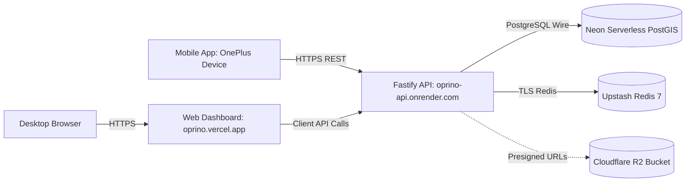

# OPRINO — Current Engineering & Deployment State

**Document Status:** ACTIVE & EVIDENCE-BACKED  
**Classification:** Operational Dashboard, Verification Status, Environment Reality  
**Repository Branch:** `docs/research-and-roadmap-alignment` (branched from `fix/auth-device-security-remediation` @ `edffd4b`)  
**Main Branch HEAD:** `edffd4b`  
**Last Verified Date:** October 2026  

---

## 1. Verified System Health & Build Gates

All components compile cleanly and pass automated unit, integration, and security test suites:

| Component | Stack | Status | Test Coverage / Verification |
|---|---|---|---|
| **API Service** (`services/api`) | Fastify 5, Drizzle ORM, Better Auth, Node 22 | **PASSING** | 116 unit & integration tests pass (100% green). Tests include RLS tenant isolation, auth Bearer sessions, UUIDv4 device governance, duty boundaries, and task state machine. |
| **Web Dashboard** (`apps/web`) | Next.js 15 (App Router), React 19, Tailwind CSS | **PASSING** | 17 Vitest tests pass. Static build compiles cleanly across 14 pages (Zero ESLint/TypeScript errors). |
| **Mobile App** (`apps/mobile`) | Flutter 3.47, Dart, Riverpod, Drift SQLite | **PASSING** | Flutter analyze clean (0 issues). 22 mobile tests pass. 18+ generated Dio contract tests pass. |
| **Background Worker** (`services/worker`) | BullMQ 5, TypeScript | **PASSING** | Pruning job (`telemetry.retention.prune`) and recurring task job (`tasks.recurring.generate`) operational. Bundled into API container for Render free tier. |
| **Monorepo Engine** | Turborepo, pnpm 11 | **PASSING** | `pnpm turbo build` and `pnpm typecheck` pass across all 8 packages and 3 applications. |

---

## 2. Production Cloud Deployment Reality

The platform has been scaffolded and deployed to free-tier cloud environments:



### Live Endpoints & Cloud Providers:
1. **Web Dashboard:**
   - URL: `https://oprino.vercel.app`
   - Provider: Vercel (Edge Network / Next.js SSR & Static)
   - Status: Active, deployed from commit `b0c86ec`
2. **REST API & Worker:**
   - URL: `https://oprino-api.onrender.com`
   - Provider: Render (Oregon region, Web Service container)
   - Health Probe: `GET /health/ready` returns `HTTP 200 OK` (`database: connected`, `redis: connected`)
   - Liveness Probe: `GET /health/live` returns `HTTP 200 OK`
3. **Database:**
   - Engine: PostgreSQL 17 with PostGIS extensions
   - Provider: Neon Serverless PostgreSQL
   - Schemas Applied: 29 public tables managed via Drizzle migrations (RLS enabled on all tenant entities)
4. **Cache & Queue:**
   - Engine: Redis 7.2 (TLS enabled)
   - Provider: Upstash Serverless Redis
   - Features: Real-time Pub/Sub for SSE live map telemetry, BullMQ queue backing
5. **Physical Device Installation:**
   - Physical Hardware: OnePlus CPH2707IN (Android 14/15, ADB device `5abd6fc0`)
   - Package: `com.oprino.app.oprino_mobile` (`versionName=0.1.0`, `versionCode=1`)
   - Verified Mobile Flows: Attendance punch-in with live camera selfie, on-glass customer signature, offline Drift SQLite queuing, and background GPS sync.

---

## 3. Commercial Launch Gating Status

While the software architecture is 100% compiled and verified against cloud databases, the commercial launch remains **GATED** subject to the [V1 Launch Checklist](../../docs/releases/V1-COMMERCIAL-LAUNCH-CHECKLIST.md):

| Launch Gate Requirement | Current Status | Blocker / Resolution Needed |
|---|---|---|
| **Production Cloudflare R2 Credentials** | GATED (Mock Storage Active) | Provide live `CLOUDFLARE_R2_ACCOUNT_ID`, `CLOUDFLARE_R2_ACCESS_KEY_ID`, `CLOUDFLARE_R2_SECRET_ACCESS_KEY`, and bucket name to enable live signed proof uploads. |
| **Android Production Keystore & AAB** | GATED (Debug Keystore Active) | Generate production release `.jks` keystore and configure GitHub Secrets for automated Play Console deployment. |
| **Multi-OEM Background GPS Validation** | GATED (OnePlus Verified) | Perform real-world 8-hour shift field walks across Xiaomi HyperOS, Samsung OneUI, and Oppo ColorOS to benchmark battery drain (<3%/hr) and background keepalive. |
| **Production Domain & SSL Wiring** | GATED (Vercel/Render Domains) | Map custom production domains (e.g., `app.oprino.com`, `api.oprino.com`) with Cloudflare DNS proxying. |
| **Owner Commercial Sign-Off** | PENDING | Final stakeholder review of pricing plans, Terms of Service, and Privacy Policy. |

---

## 4. Repository Structure & Active Workspaces

```text
d:\oprino\oprino\
├── .github/workflows/       # CI/CD workflows (ci.yml, mobile-release.yml)
├── apps/
│   ├── mobile/              # Flutter 3.47 mobile application
│   └── web/                 # Next.js 15 web management dashboard
├── docs/
│   ├── agent/               # PERMANENT AGENT MEMORY (Project Brain, Current State, etc.)
│   ├── architecture/        # Technical specifications and ADR register (ADR-001 to ADR-021)
│   ├── audits/              # Historical milestone audits and reports
│   ├── brand/               # Canonical brand system and design tokens
│   ├── deployment/          # Free cloud deployment guides and environment matrices
│   ├── handoff/             # Historical milestone handoffs
│   ├── product/             # Master PRD, V1 Scope, Roadmap, Roles Plan
│   ├── releases/            # Launch checklists, release candidate reports
│   └── research/            # Canonical competitor research suite (00-25)
├── packages/
│   ├── api-client/          # Generated TypeScript/Dart OpenAPI clients
│   ├── contracts/           # Single source of truth Zod contracts & OpenAPI generator
│   ├── db/                  # Drizzle ORM schemas, migrations, and RLS policies
│   ├── design-tokens/       # Canonical JSON design tokens & code generators
│   └── tsconfig/            # Shared TypeScript configurations
├── services/
│   ├── api/                 # Fastify 5 REST API service
│   └── worker/              # BullMQ background task worker
├── Oprino-Brand-Kit/        # Approved immutable brand assets, logos, and guidelines
└── AGENTS.md                # Supreme agent instructions and invariant rules
```
