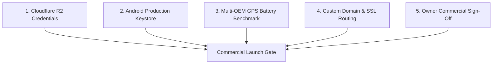

# OPRINO — Tracked Open Issues & Commercial Blockers

**Document Status:** ACTIVE & AUDITABLE  
**Classification:** Operational Blockers, Commercial Launch Gates, Open Engineering Tasks  
**Repository:** `djsushilkumar/oprino`  
**Last Updated:** October 2026  

---

## 1. Critical Commercial Launch Blockers (P0 Gate)

These 5 items are the verified gating prerequisites documented in [`docs/releases/V1-COMMERCIAL-LAUNCH-CHECKLIST.md`](../releases/V1-COMMERCIAL-LAUNCH-CHECKLIST.md) before Oprino can be commercially launched:

### Blocker 1: Production Cloudflare R2 Storage Credentials
- **Severity:** P0 — Commercial Blocker
- **Current State:** API runs with local filesystem fallback in development. In production on Render, mock storage is active; 4 live R2 contract tests in `services/api` are skipped because R2 credentials are not populated in the cloud environment.
- **Resolution Steps:**
  1. Create a production Cloudflare R2 bucket (`oprino-prod-proofs`).
  2. Configure CORS rules allowing `PUT` requests from `https://oprino.vercel.app` and mobile clients.
  3. Set `CLOUDFLARE_R2_ACCOUNT_ID`, `CLOUDFLARE_R2_ACCESS_KEY_ID`, `CLOUDFLARE_R2_SECRET_ACCESS_KEY`, and `CLOUDFLARE_R2_BUCKET_NAME` in Render environment variables.
  4. Run automated integration test `services/api/test/proof-storage.live.test.ts` to verify live presigned upload and retrieval.

### Blocker 2: Android Production Keystore & Google Play Console Setup
- **Severity:** P0 — Mobile Release Gate
- **Current State:** Release APK built using debug signing key (`android/app/build.gradle.kts`). `key.properties.example` template is present. Google Play requires an AAB (Android App Bundle) signed with a dedicated release keystore.
- **Resolution Steps:**
  1. Generate production keystore via `keytool -genkey -v -keystore oprino-release.jks -keyalg RSA -keysize 2048 -validity 10000 -alias oprino`.
  2. Base64-encode the keystore and populate GitHub Actions Secrets: `ANDROID_KEYSTORE_BASE64`, `ANDROID_KEYSTORE_PASSWORD`, `ANDROID_KEY_ALIAS`, `ANDROID_KEY_PASSWORD`.
  3. Execute `.github/workflows/mobile-release.yml` to generate the production AAB.
  4. Create internal testing track on Google Play Console and upload signed AAB.

### Blocker 3: Multi-OEM Real-Device Background GPS & Battery Benchmark
- **Severity:** P1 — Field Reliability Gate
- **Current State:** End-to-end duty punch, live camera photo, and on-glass signature verified on physical OnePlus CPH2707IN (Android 14/15). Aggressive battery-saving OEMs (Xiaomi HyperOS/MIUI, Samsung OneUI, Vivo FuntouchOS) have not been field-tested for 8-hour continuous shift keepalive.
- **Resolution Steps:**
  1. Install release build on at least 2 additional physical test devices (Xiaomi and Samsung).
  2. Execute continuous 8-hour field shift simulation with periodic 30-second GPS breadcrumbs.
  3. Verify that total battery consumption remains below 3.0% per hour.
  4. Verify that Android foreground service notification (`Oprino Field Operations — Active Shift`) remains sticky and prevents OS task killing.

### Blocker 4: Custom Production Domain & Cloudflare SSL Wiring
- **Severity:** P1 — Brand & Trust Gate
- **Current State:** Applications are currently served from platform default subdomains: `https://oprino.vercel.app` and `https://oprino-api.onrender.com`.
- **Resolution Steps:**
  1. Add DNS CNAME records in Cloudflare DNS pointing `app.oprino.com` to Vercel and `api.oprino.com` to Render.
  2. Configure SSL Full (Strict) mode in Cloudflare.
  3. Update `CORS_ORIGIN` in Render to authorize `https://app.oprino.com`.

### Blocker 5: Owner Commercial & Legal Sign-Off
- **Severity:** P0 — Governance Gate
- **Current State:** Product architecture and V1 scope frozen. Terms of Service, Privacy Policy, and initial pricing tier definitions require final business owner sign-off.
- **Resolution Steps:**
  1. Review pricing model (`docs/business/PRICING-STRATEGY.md`): Free Starter (up to 5 workers) vs Pro Tier ($3/worker/mo or ₹199/worker/mo).
  2. Finalize Privacy Policy certifying Duty-Hours-Only tracking and 30-day location retention.
  3. Obtain explicit stakeholder launch approval.

---

## 2. Active Engineering Backlog Items

These items are prioritized for post-launch stabilization (V1.1 / V1.5) and do not block V1 commercial launch:

| Issue ID | Feature / Component | Priority | Status | Description |
|---|---|---|---|---|
| **ENG-01** | Push Notifications (FCM) | P2 | Planned (V1.5) | Integrate Firebase Cloud Messaging for mobile alerts when dispatch stops or emergency tasks are assigned. (Currently using In-App Badge Drawer + SSE). |
| **ENG-02** | Geofence Auto-Punch Suggestion | P2 | Planned (V1.5) | Detect arrival at customer site and prompt the worker with a 1-tap check-in confirmation notification. |
| **ENG-03** | PDF Service Receipt Generator | P2 | Planned (V1.5) | Generate a branded PDF service report upon task completion including customer signature, checklist answers, and photos, delivered via email. |
| **ENG-04** | Offline Map Tile Caching | P3 | Planned (V2.0) | Pre-cache regional OpenStreetMap raster tiles in mobile app SQLite database for zero-reception forest/basement operations. |
