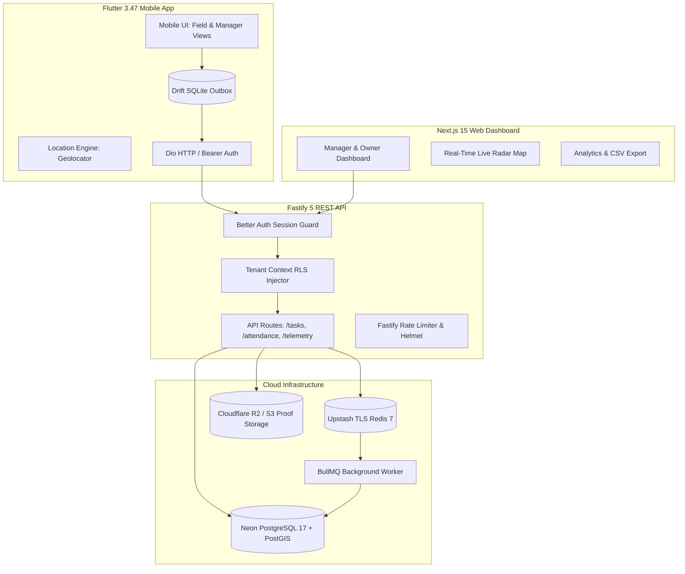
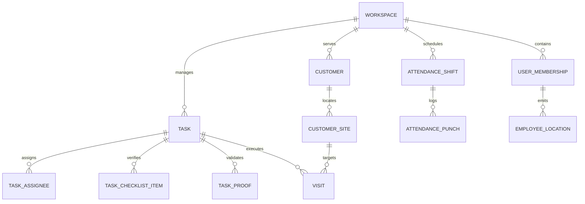

# OPRINO — Project Brain & Persistent Architectural Knowledge

**Document Status:** AUTHORITATIVE & PERMANENT  
**Classification:** Core System Knowledge, Invariants, Product Mission & System Boundaries  
**Audience:** All Autonomous and Assisted AI Coding Agents, Human Technical Leads  
**Repository:** `djsushilkumar/oprino`  
**Last Updated:** October 2026  

---

## 1. Product Mission & Value Proposition

**OPRINO** is a multi-industry, privacy-first SaaS platform unifying **Task Management**, **Workforce Attendance**, and **Field Operations** for Small-to-Medium Businesses (SMBs) with 5 to 500 employees (optimized specifically for teams of 10 to 200 workers).

### Target Industries
- HVAC, Electrical, and Mechanical Maintenance
- Facilities Management and Commercial Cleaning
- Telecom & Network Field Infrastructure
- Elevator and Escalator Inspection & Servicing
- Security Patrol and Guard Services
- Pest Control, Landscaping, and Specialized Field Services

### Core Value Drivers
1. **Zero-Cost Deployment Economics:** Built to run efficiently on free and low-cost modern serverless cloud infrastructure (Neon PostgreSQL, Upstash Redis, Render Fastify API, Vercel Next.js 15) without sacrificing enterprise-grade isolation.
2. **Offline-First Field Resilience:** Field workers often operate in basements, rural sites, or weak cellular environments. Oprino ensures 100% operational continuity via local Drift SQLite outbox queues and optimistic UI updates.
3. **Privacy-First Operational Tracking:** Unlike aggressive competitor surveillance platforms, Oprino strictly enforces **Duty-Hours-Only** location ingestion with zero off-duty database writes and peer location opacity.
4. **Tamper-Proof Proof of Work:** Verifiable service delivery using camera-captured geotagged photos, mandatory step-by-step checklists, on-glass customer signatures, and supervisor verification queues.

---

## 2. Core Invariants (Non-Negotiable Architectural Rules)

Every agent, engineer, and process working on Oprino must adhere strictly to these invariants:

### Invariant 1: Duty-Hours-Only Tracking
- **Rule:** Location coordinates must **NEVER** be tracked, ingested, or stored when an employee is off-duty.
- **Enforcement:**
  - **Client-Side:** Mobile `LocationService` immediately stops GPS hardware and flushes teardown synchronously upon `PUNCH_OUT`.
  - **Server-Side:** API endpoint `POST /v1/telemetry/points` performs an authoritative active shift verification. If the worker is off-duty or outside their authorized grace window, the point is dropped with HTTP 200 and **ZERO** database rows written.
  - **Peer Opacity:** Peer-to-peer location visibility is **OFF BY DEFAULT**. Only authorized managers/owners with `location.read` permission can view real-time field positions.

### Invariant 2: Multi-Tenant Database Isolation
- **Rule:** Data belonging to one workspace must never leak into another workspace under any circumstance.
- **Enforcement:**
  - PostgreSQL 17 Row-Level Security (RLS) is enabled across all tenant tables.
  - Every tenant-scoped query executes inside a transaction setting `SET LOCAL app.current_workspace_id = :workspaceId`.
  - **NEVER** issue session-level `SET app.current_workspace_id` to eliminate connection-pool reuse pollution.
  - Tenant verification follows a strict 5-stage pipeline: JWT validation -> Membership check -> Workspace status -> Local RLS configuration -> Repository execution.

### Invariant 3: Mandatory Checklist Completion Before Task Finalization
- **Rule:** A field task cannot transition to status `COMPLETED` if any mandatory checklist item remains uncompleted.
- **Enforcement:** The task state machine checks all items in `task_checklist_items` where `is_required = true`. Any pending item rejects the transition with HTTP 422 Unprocessable Entity.

### Invariant 4: On-Glass Signatures as Proof-of-Work (Not a Customer Portal)
- **Rule:** Customer signatures are captured directly on the mobile technician's physical touch device.
- **Enforcement:** Customer signatures are operational proof-of-work assets watermarked with GPS coordinates and timestamps. They do **NOT** require customer login accounts or standalone customer web portals.

### Invariant 5: Strict 30-Day Location Data Retention
- **Rule:** High-frequency GPS telemetry breadcrumbs are pruned after 30 days to protect worker privacy and minimize database bloat.
- **Enforcement:** BullMQ recurring worker job `telemetry.retention.prune` executes daily against `employee_locations`, retaining aggregated `daily_travel_summaries` for historical mileage reporting.

---

## 3. Strict System Boundaries & Anti-Features (Scope Discipline)

Oprino is an operational workforce and field execution platform. To prevent scope creep and maintain V1 commercial viability, the following features are strictly **PROHIBITED** from V1:

| Prohibited Domain | Rationale & Policy |
|---|---|
| **Full CRM & Sales Pipelines** | Oprino manages operational field work, not lead scoring, deal pipelines, or cold calling. |
| **Retail FMCG Order Booking (SFA)** | Unlike Unolo, Oprino does not build retail distributor order-taking or grocery inventory booking. |
| **Heavy Warehouse Inventory & ERP** | Oprino manages service tasks and customer locations; full ERP/MRP inventory valuation is out of scope. |
| **Statutory Payroll Engine** | Oprino generates verified attendance and overtime audit sheets, not tax deductions or salary disbursement. |
| **Complex Gantt Project Management** | Oprino is optimized for fast, discrete daily tasks, dispatches, and work orders, not multi-year construction Gantt charts. |
| **Standalone Customer Web Portals** | Customers interact via on-site digital signature and automated PDF service completion receipts, not logins. |

---

## 4. System Architecture & Tech Stack

### Key Frameworks & Decisions
- **Monorepo:** Turborepo + pnpm 11 workspace.
- **Backend API:** Fastify 5 + TypeScript + Drizzle ORM + Better Auth (ADR-003, ADR-006).
- **Database:** PostgreSQL 17 + PostGIS (geospatial calculations, ST_DWithin geofencing) (ADR-004).
- **Cache & Events:** Upstash Redis + BullMQ for queues and Redis Pub/Sub for SSE live telemetry (ADR-010, ADR-014).
- **Web App:** Next.js 15 (App Router) + Tailwind CSS + Vanilla CSS Tokens (ADR-002).
- **Mobile App:** Flutter 3.47 + Dart + Riverpod + Drift SQLite (offline-first outbox) + Dio (ADR-001, ADR-009).
- **Proof Storage:** Cloudflare R2 / AWS S3 presigned URLs with tenant key prefixes `/${workspace_id}/proofs/...` (ADR-012).
- **Design Tokens:** Canonical design tokens codified in `docs/brand/OPRINO-BRAND-SYSTEM.md` and compiled to Web CSS and Flutter Dart.

---

## 5. Primary Entity Domain Model

---

## 6. Development & Quality Gate Standard

1. **Zero Lint & Type Errors:** Monorepo must always pass `pnpm turbo build` and `pnpm typecheck`.
2. **Comprehensive Test Suites:** All API integration tests (Fastify/Drizzle), web tests (Vitest), and mobile tests (Flutter test) must pass before merging.
3. **Fail-Closed Security:** Routes must default to deny-all; tenant IDs must never be trusted from client request bodies.
4. **Idempotency Everywhere:** All mutation endpoints (punches, task state changes, sync batches) must accept idempotency keys or support safe re-execution.
