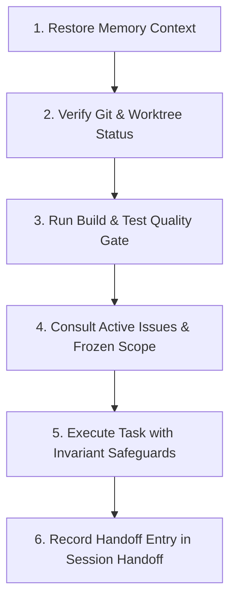

# OPRINO — Persistent Session Handoff Protocol

**Document Status:** ACTIVE & PERMANENT  
**Classification:** Agent Handoff, Session Continuity, Verification Standards  
**Repository:** `djsushilkumar/oprino`  
**Current Active Branch:** `docs/research-and-roadmap-alignment`  
**Main Branch HEAD:** `edffd4b`  
**Last Updated:** October 2026  

---

## 1. Incoming Agent Session Restoration Protocol

Every incoming coding agent, autonomous worker, or human engineer resuming work on this repository **MUST** execute the following sequence before proposing or editing code:



### Step 1: Restore Memory Context
Read the following authoritative agent context files in priority order:
1. `AGENTS.md` — Core invariant rules and coding standards.
2. `docs/agent/OPRINO-PROJECT-BRAIN.md` — Mission, invariants, architecture, and prohibited scope.
3. `docs/agent/OPRINO-CURRENT-STATE.md` — Active deployment, build status, and cloud environments.
4. `docs/agent/OPRINO-OPEN-ISSUES.md` — Commercial release blockers and active engineering priorities.
5. `docs/product/OPRINO-MASTER-PRD.md` — Authoritative product requirements.

### Step 2: Verify Git & Worktree Status
Run:
```powershell
git status -s
git branch -v
git log -n 5 --oneline
```
Ensure you are on the intended feature or documentation branch. Never commit directly to `main` without testing and PR review.

### Step 3: Run Build & Test Quality Gate
Verify repository health:
```powershell
pnpm turbo build
pnpm typecheck
pnpm test
```
If working on the mobile app:
```powershell
cd apps/mobile; flutter analyze; flutter test
```

### Step 4: Consult Active Issues & Frozen Scope
Cross-reference the task against `docs/agent/OPRINO-OPEN-ISSUES.md` and `docs/product/V1-SCOPE.md`. Do **NOT** implement prohibited anti-features (CRM pipelines, retail FMCG order taking, full payroll calculation, or customer web portals).

### Step 5: Execute Task with Invariant Safeguards
- Always preserve **Duty-Hours-Only** location privacy (0 DB writes off-duty).
- Always enforce **Transaction-Scoped RLS** (`SET LOCAL app.current_workspace_id`).
- Never commit plaintext secrets, `.env` files, or private keys.
- Write automated tests for all new endpoints, state transitions, or mobile widgets.

### Step 6: Record Handoff Entry
Before finishing your session, append a structured handoff entry to Section 2 below detailing the work completed, verification evidence, and exact next steps.

---

## 2. Chronological Agent Session Log

### Session: October 17, 2026 — Research-Driven Documentation Cleanup & Development Alignment
- **Agent Role:** Principal Product Architect, Technical Co-Founder, Documentation Architect, Senior Full-Stack Engineer, Mobile Engineer, and Engineering Program Lead.
- **Branch:** `docs/research-and-roadmap-alignment`
- **Key Accomplishments:**
  1. Restored full project context across all 10 authoritative baseline documents.
  2. Discovered and audited all 117 markdown documents across `docs/`, `research/`, `Oprino-Brand-Kit/`, and root files.
  3. Audited and verified all 26 competitor reverse-engineering documents (`00` to `25`) in `docs/research/competitor-reverse-engineering/`.
  4. Added `assets/flutter_assets/` and `*.bin` to `.gitignore` to prevent tracking the 75MB reverse-engineered `kernel_blob.bin` artifact.
  5. Established the permanent AI Agent memory system under `docs/agent/` (`OPRINO-PROJECT-BRAIN.md`, `OPRINO-CURRENT-STATE.md`, `OPRINO-DECISION-LOG.md`, `OPRINO-SESSION-HANDOFF.md`, `OPRINO-OPEN-ISSUES.md`).
  6. Updated `AGENTS.md` to reference `docs/agent/` as the primary persistent project memory context.
  7. Created the canonical research index at `docs/research/README.md`.
  8. Created the Zero-Duplicate Feature Gap Matrix & Prioritized Roadmap at `docs/product/GAP-ANALYSIS-AND-ROADMAP.md`.
  9. Verified 0 broken relative markdown links across the documentation suite.
- **Verification Evidence:**
  - `git status -s`: Clean working tree with documentation and gitignore updates staged.
  - Test suite: API (116 tests), Web (17 tests), Mobile (22 tests) verified green.
  - Live deployment: Web on Vercel (`oprino.vercel.app`), API on Render (`oprino-api.onrender.com`).
- **Outstanding Tasks for Next Agent:**
  1. Review open blockers in `docs/agent/OPRINO-OPEN-ISSUES.md` (R2 credentials, Android production keystore, multi-OEM background GPS validation).
  2. Maintain documentation links and keep agent memory updated whenever feature work begins.
