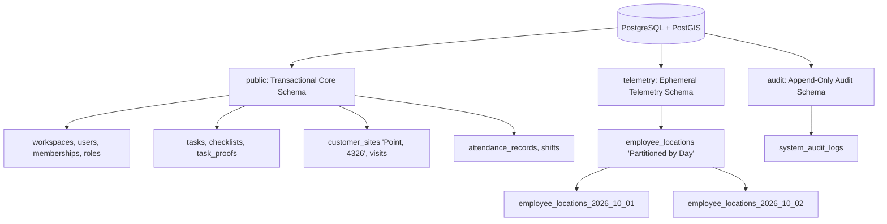

# ADR-004: Database Engine, Geospatial Architecture & Version Selection (Re-evaluated)

**Status:** Updated & Recommended for Phase 01A  
**Date:** October 2026 (Reconciled)  
**Deciders:** Lead Systems Architect, Database Engineering  
**Controlling Document:** Phase 00 Approved Product Baseline ([`docs/product/OPRINO-MASTER-PRD.md`](file:///workspace/oprino/docs/product/OPRINO-MASTER-PRD.md))

---

## 1. Context & Problem Statement

Oprino's workload spans two distinct domains:
1. **Transactional Domain (ACID Relational Core):** Highly normalized, strictly relational data: organizations, users, memberships, roles, permissions, tasks, checklists, customer sites, attendance punches, and proof-of-work records.
2. **Telemetry Domain (High-Frequency Append-Only Spatial Events):** Location observations, breadcrumb trails, geofence checks, and device telemetry recorded strictly during duty hours.

Key challenges include:
- Executing sub-millisecond geofence proximity checks (`ST_DWithin`).
- Calculating operational travel distances across duty routes for conveyance reimbursement.
- Ensuring high-frequency telemetry writes do not degrade core transactional query latencies.
- Implementing the frozen **30-day default location retention purge** cleanly and safely across primary tables, replicas, backups, and derived aggregates without granting application workers dangerous DDL privileges.

---

## 2. Production PostgreSQL & PostGIS Version Evaluation

Rather than defaulting arbitrarily to a single version, we evaluate current mature production combinations across cloud hosting support, backup/PITR tooling, and PostGIS extension stability:

| Evaluated Combination | Managed Cloud Support (AWS RDS/Aurora, Supabase, Neon) | Stable PostGIS Compatibility | Backup & PITR Tooling (pgBackRest, WAL-G, Cloud PITR) | Production Maturity & Extension Ecosystem | Assessment |
|---|:---:|:---:|:---:|:---:|---|
| **PostgreSQL 15 + PostGIS 3.3** | Universal (All clouds) | Stable | Fully supported | Mature legacy; lacks PG16/17 performance optimizations for logical replication and parallel aggregation. | Discard: Older generation. |
| **PostgreSQL 16 + PostGIS 3.4 (Stable)** | **Universal across all tier-1 cloud providers** | **Stable 3.4.x (GA)** | **Full mature support across pgBackRest, WAL-G, AWS RDS, Neon** | **Exceptional stability; optimized query planner, parallel aggregations, logical replication improvements.** | **Recommended Baseline.** |
| **PostgreSQL 17 + PostGIS 3.5 (Stable)** | Rapidly expanding (AWS RDS supported, Neon supported) | Stable 3.5.x (GA) | Supported in modern pgBackRest | Excellent memory management improvements in VACUUM and JSON operations; mature GA release. | **Permitted Upgrade Target at Scaffolding.** |
| **PostgreSQL 17 + PostGIS 3.5-rc/beta** | Experimental | **UNACCEPTABLE (Beta/RC)** | Untested | Unstable for production multi-tenant data. | **Strictly Prohibited.** |

### Version Policy Directive:
- **Baseline Engine:** **PostgreSQL 16 or 17 with PostGIS 3.4+ / 3.5+ (Stable GA only).**
- **Strict Rule:** Beta or Release Candidate (RC) builds of PostGIS are **strictly prohibited** in production architecture.
- **Selection Criterion:** Pin the latest mature GA combination supported natively by the selected managed cloud hosting provider and PITR backup infrastructure during Phase 01C scaffolding.

---

## 3. Database Engine Alternatives Evaluated

### Alternative A: PostgreSQL + PostGIS (Dual-Domain Schema with Partitioning)
- **Overview:** Unified relational database with native PostGIS extension for spatial queries (`geometry(Point, 4326)`). 
- **Domain Separation:** Separated into `public` (transactional core) and `telemetry` (range-partitioned by day on `recorded_at`).
- **Pros:** Single database technology stack; zero multi-database synchronization lag; native spatial operations (`ST_DWithin`, `ST_Distance`); fast partition pruning via metadata operations.
- **Cons:** Requires connection pooling configuration (PgBouncer) for high-frequency connections.

### Alternative B: PostgreSQL Core + Dedicated Time-Series DB (TimescaleDB / InfluxDB)
- **Overview:** Transactional entities in Postgres; location pings streamed to an external time-series database.
- **Pros:** Specialized compression for billions of continuous points.
- **Cons:** High operational overhead, doubled cloud hosting costs, separate backup pipelines, and complex cross-database joins for SMB fleets (10–200 employees) generating modest telemetry volumes.

### Alternative C: Document Store (MongoDB + 2dsphere)
- **Overview:** Storing tasks and coordinates as documents.
- **Pros:** Flexible JSON structure.
- **Cons:** Weak ACID guarantees across multi-company memberships; lacking PostGIS-grade geodesic math and spatial joins.

---

## 4. Decision & Detailed Architecture

**Selected Architecture: PostgreSQL (Mature Supported GA: 16 or 17) with Stable PostGIS (3.4+ / 3.5+ GA), utilizing Dual-Domain Schema Isolation.**



### 4.1 Schema Partitioning Strategy
- **Table:** `telemetry.employee_locations` partitioned by range on `recorded_at` (`PARTITION BY RANGE (recorded_at)`).
- **Partition Granularity:** **Daily partitions** (`employee_locations_YYYY_MM_DD`).
- **Primary Key:** `(workspace_id, recorded_at, id)`.
- **Spatial Index:** Local GiST index on each partition: `CREATE INDEX ON telemetry.employee_locations_YYYY_MM_DD USING GIST (coordinates);`.

### 4.2 Least-Privileged Partition Maintenance Architecture
Application workers and API containers must **NEVER** hold unrestricted DDL privileges (`DROP TABLE`).

**Implementation:**
1. A dedicated database stored procedure with `SECURITY DEFINER` is created under the administrative database role:
   ```sql
   CREATE OR REPLACE FUNCTION telemetry.prune_expired_partitions(retention_days INT)
   RETURNS TABLE(dropped_partition TEXT) AS $$
   ...
   $$ LANGUAGE plpgsql SECURITY DEFINER;
   ```
2. The BullMQ background maintenance worker connects via a restricted maintenance database role granted **only** `EXECUTE` privileges on `telemetry.prune_expired_partitions(INT)` and `telemetry.ensure_future_partitions(INT)`.
3. This completely prevents application vulnerabilities from issuing arbitrary `DROP TABLE` or `ALTER TABLE` commands.

### 4.3 Comprehensive Telemetry Retention Across All Layers
Retention enforcement extends beyond primary tables:
- **Primary Tables:** Expired daily partitions are dropped via the security definer maintenance procedure.
- **Indexes:** Automatically dropped alongside their parent daily partition table.
- **Replicas:** Streaming physical replication immediately applies the partition drop to read replicas.
- **Backups & PITR:** Documented in [`RETENTION-ARCHITECTURE.md`](file:///workspace/oprino/docs/architecture/RETENTION-ARCHITECTURE.md). Physical WAL backups expire on a rolling 35-day backup retention cycle.
- **Derived Operational Data:** Total daily duty travel mileage (for expense claims) is calculated and stored in a separate table (`daily_travel_summaries`). This derived data is governed by a distinct **3-year operational retention policy**, completely independent of the 30-day raw GPS coordinate purge.

---

## 5. Consequences & Trade-offs

- **Positive:**
  - Exceptional spatial query performance using industry-standard PostGIS.
  - Zero application-level DDL privilege risks.
  - High-speed daily partition drops execute in < 15ms.
  - No secondary database cluster required.
- **Negative:**
  - Requires spatial geometry helpers in the ORM/data access layer.
- **Mitigation:**
  - Standardized PostGIS utility functions in `@oprino/utils` for `ST_DWithin` and `ST_DistanceSphere`.

---

## 6. Compliance with Phase 00 Approved Scope

- Strictly enforces the approved 30-day default location history retention baseline.
- Focuses purely on operational workforce management; avoids scope creep into payroll or billing compliance.
- Preserves full multi-tenant isolation and security.
