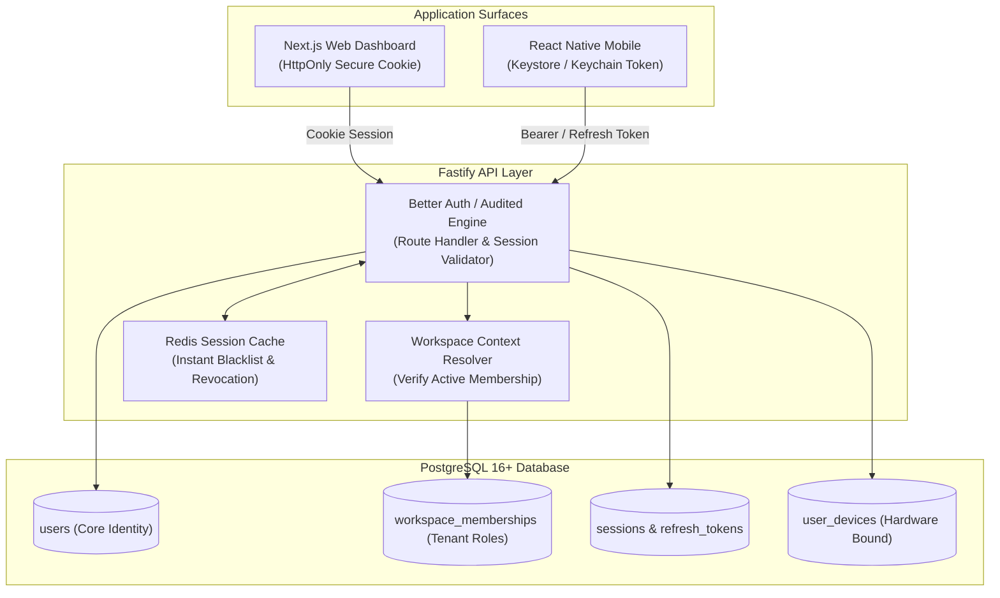

# ADR-006: Authentication, Session Management & Multi-Company Tenancy (Re-evaluated)

**Status:** Updated & Recommended for Phase 01A  
**Date:** October 2026 (Reconciled)  
**Deciders:** Lead Systems Architect, Security Engineering, Backend Engineering  
**Controlling Document:** Phase 00 Approved Product Baseline ([`docs/product/OPRINO-MASTER-PRD.md`](file:///workspace/oprino/docs/product/OPRINO-MASTER-PRD.md))

---

## 1. Context & Problem Statement

Oprino operates across mobile field personnel and desktop managers with diverse authentication and security requirements:
- **Zero-Friction Frontline Onboarding:** Field technicians, drivers, and auditors frequently lack corporate email addresses. They require fast onboarding via phone OTP, invitation links, or manager-provisioned activation codes.
- **Owner & Manager Signup:** Business owners register via email/password, immediately provisioning an organization workspace.
- **Multi-Tenant Identity Decoupling:** A user's canonical identity (`users`) must be distinct from company memberships (`memberships`). A single user can be a technician in Company A and an owner/manager in Company B without separate accounts.
- **Dual Surface Session Handling:**
  - **Web Dashboard:** Secure, HttpOnly, SameSite, encrypted session cookies protecting against XSS.
  - **Mobile Apps (Android & iOS):** Cryptographically bound tokens stored in hardware-backed secure storage (Android Keystore / iOS Keychain) with automatic, single-use refresh token rotation and offline resilience.
- **Device Governance & Instant Revocation:** Ability to bind sessions to device hardware, prevent simultaneous multi-device credential abuse, and immediately invalidate all sessions for a lost/compromised phone or terminated worker.
- **Enterprise Extensibility:** Seamless path to Two-Factor Authentication (TOTP) and future enterprise SSO (OIDC/SAML) without re-architecting the core identity model.

**Critical Stakeholder Review Directive:**  
Do **NOT** implement hand-written cryptographic or session primitives from scratch merely to avoid per-MAU vendor fees. The platform must use an established, audited framework while retaining application data ownership and operational control.

---

## 2. Alternatives Evaluated

### Alternative A: Application-Owned Authentication via Established Audited Framework (Better Auth / Audited Core Engine)
- **Architecture:** Auth logic runs directly inside the Fastify application backend using an established, audited open-source TypeScript authentication framework (**Better Auth** / audited Node crypto ecosystem) backed by PostgreSQL and Redis.
- **Data Model:** Core tables (`users`, `sessions`, `accounts`, `verifications`, `memberships`, `devices`) reside directly in the Oprino PostgreSQL database.
- **Key Features:** Built-in Argon2id password hashing, timing-safe token generation, CSRF protection, secure cookie handling, single-use refresh token rotation, device registration, Two-Factor Authentication (TOTP), and multi-organization/tenant plugins.
- **Pros:** 
  - Complete data sovereignty; zero data residency or vendor lock-in concerns.
  - Zero per-MAU SaaS fees ($0 marginal software cost).
  - Uses thoroughly tested, peer-reviewed cryptographic primitives rather than custom in-house code.
  - Seamless dual-mode session support (HttpOnly cookies for Web, Bearer/Header tokens for Mobile).
  - Built-in multi-organization support with active workspace context switching.
  - Ready for enterprise OIDC/SAML SSO extension in V3.
- **Cons:** Engineering team maintains SMTP/SMS integration hooks and database migration lifecycle for auth tables.

### Alternative B: Dedicated Self-Hosted Auth Service (SuperTokens / Keycloak / Zitadel)
- **Architecture:** Deploying a separate self-hosted authentication service container alongside the backend.
- **Pros:** Complete enterprise feature set out of the box (SAML, LDAP, social login, admin console).
- **Cons:** 
  - Substantial operational overhead: running Java (Keycloak) or Go/Node separate containers with dedicated databases.
  - High inter-service latency: every API request requires a network hop to the auth service or complex JWKS token caching.
  - Significant memory footprint disproportionate to SMB workloads.

### Alternative C: Fully Managed Identity SaaS (Clerk / Auth0 / WorkOS / Supabase Auth)
- **Architecture:** Outsourcing user authentication, MFA, and session state entirely to a cloud vendor.
- **Pros:** Hosted login UI widgets, zero database tables for auth, turnkey social login.
- **Cons:** 
  - Prohibitive per-MAU pricing ($0.05–$0.25/MAU). At 2,500 active employees, this adds $125–$625/month in pure authentication tax, severely degrading SMB margins.
  - Awkward support for custom SMS/OTP gateways in international markets.
  - Third-party data custody of employee and business owner credentials.
  - Complex session synchronization between external provider sessions and internal PostgreSQL multi-tenant RLS.

---

## 3. Comprehensive 14-Factor Evaluation Matrix

| Evaluation Criterion | Weight | Alt A: Application-Owned Audited Framework (Better Auth) | Alt B: Self-Hosted Service (SuperTokens/Keycloak) | Alt C: Managed SaaS (Clerk/Auth0) |
|---|:---:|:---:|:---:|:---:|
| **1. Password Security (Argon2id)** | 8% | **10 / 10** (Audited Argon2id engine) | 10 / 10 | 10 / 10 |
| **2. Password Reset / Recovery** | 6% | **9.5 / 10** (Built-in timed token flows) | 9 / 10 | 10 / 10 |
| **3. Email & Phone Verification** | 8% | **10 / 10** (Pluggable Resend/SMS hooks) | 8 / 10 | 8 / 10 (Restricted gateways) |
| **4. Mobile Sessions (Bearer/Token)** | 8% | **9.5 / 10** (Native mobile token support) | 9 / 10 | 8 / 10 |
| **5. Secure Web Sessions (Cookies)** | 8% | **10 / 10** (HttpOnly, SameSite, CSRF) | 9 / 10 | 9.5 / 10 |
| **6. Refresh-Token Rotation** | 8% | **10 / 10** (Single-use rotation & theft detect)| 9.5 / 10 | 9 / 10 |
| **7. Instant Session Revocation** | 8% | **10 / 10** (Direct Redis/DB invalidation) | 9 / 10 | 8 / 10 (Webhook propagation delay)|
| **8. Device Registration & Binding**| 7% | **10 / 10** (Hardware UUID binding) | 7 / 10 | 6 / 10 |
| **9. MFA (TOTP / SMS)** | 7% | **9.5 / 10** (Built-in TOTP plugin) | 9.5 / 10 | 10 / 10 |
| **10. Privilege & Role Changes** | 7% | **10 / 10** (Instant DB membership sync) | 7.5 / 10 | 6.5 / 10 (Token claim staleness)|
| **11. Compromised-Device Recovery**| 6% | **10 / 10** (Single-click revoke-all) | 9 / 10 | 8 / 10 |
| **12. Future SSO / OIDC / SAML** | 6% | **8.5 / 10** (Pluggable OIDC/SAML) | 10 / 10 | 10 / 10 |
| **13. Data Sovereignty & Lock-In** | 8% | **10 / 10** (Direct PostgreSQL ownership) | 8.5 / 10 | 3 / 10 (Proprietary lock-in) |
| **14. All-In SMB Cost Efficiency** | 8% | **10 / 10** ($0 per-user fees) | 6.5 / 10 (Infra overhead) | 3 / 10 ($0.15–$0.25/MAU fee) |
| **Weighted Total** | **100%** | **9.71 / 10** | **8.48 / 10** | **7.41 / 10** |

---

## 4. Decision & Rationale

**Selected Architecture: Alternative A — Application-Owned Authentication using an Established, Audited Framework (Better Auth / Audited Core Engine) with PostgreSQL Persistence and Redis Session Cache.**

### Rationale:
1. **No Hand-Written Primitives:** Avoids "hand-rolled" crypto, custom session hashing, or bespoke token-rotation logic. Utilizes battle-tested, peer-reviewed implementations for password hashing (Argon2id), secure random token generation, timing-safe string comparison, and cookie encryption.
2. **Data Sovereignty & Multi-Tenancy Synergy:** User records, credentials, multi-company organization memberships (`memberships`), and device bindings reside directly within Oprino's primary PostgreSQL database. This allows atomic transactions when a user is invited, deactivated, or switches active workspaces—impossible with third-party auth vendors without complex asynchronous webhook synchronization.
3. **Dual Surface Optimization:**
   - Web Dashboard communicates via standard secure HttpOnly, SameSite=Lax cookies, immune to JavaScript XSS token theft.
   - Mobile applications authenticate via Header tokens with single-use refresh token rotation, stored in Android Keystore / iOS Keychain.
4. **Economic Sustainability:** Eliminates per-MAU SaaS fees, directly preserving the target 90%+ gross margins required for SMB software.

---

## 5. Architecture & Implementation Guidelines



### 5.1 Identity & Multi-Company Tenancy Data Model
```sql
-- Canonical Global Identity
CREATE TABLE public.users (
    id UUID PRIMARY KEY DEFAULT gen_random_uuid(),
    email VARCHAR(255) UNIQUE,
    phone VARCHAR(32) UNIQUE,
    password_hash VARCHAR(255), -- Argon2id hash (null for OTP-only accounts)
    display_name VARCHAR(255) NOT NULL,
    avatar_url TEXT,
    is_active BOOLEAN NOT NULL DEFAULT TRUE,
    created_at TIMESTAMPTZ NOT NULL DEFAULT NOW(),
    updated_at TIMESTAMPTZ NOT NULL DEFAULT NOW()
);

-- Workspace Membership (Multi-Company Tenancy)
CREATE TABLE public.workspace_memberships (
    id UUID PRIMARY KEY DEFAULT gen_random_uuid(),
    workspace_id UUID NOT NULL REFERENCES public.workspaces(id) ON DELETE CASCADE,
    user_id UUID NOT NULL REFERENCES public.users(id) ON DELETE CASCADE,
    role_id UUID NOT NULL REFERENCES public.roles(id),
    status VARCHAR(32) NOT NULL DEFAULT 'ACTIVE', -- 'INVITED', 'ACTIVE', 'SUSPENDED'
    created_at TIMESTAMPTZ NOT NULL DEFAULT NOW(),
    UNIQUE(workspace_id, user_id)
);

-- Registered Devices & Hardware Binding
CREATE TABLE public.user_devices (
    id UUID PRIMARY KEY DEFAULT gen_random_uuid(),
    user_id UUID NOT NULL REFERENCES public.users(id) ON DELETE CASCADE,
    device_id VARCHAR(128) NOT NULL, -- Hardware UUID
    platform VARCHAR(16) NOT NULL, -- 'android' | 'ios' | 'web'
    push_token TEXT,
    app_version VARCHAR(32),
    last_active_at TIMESTAMPTZ NOT NULL DEFAULT NOW(),
    is_trusted BOOLEAN NOT NULL DEFAULT TRUE,
    UNIQUE(user_id, device_id)
);
```

### 5.2 Session Invalidation & Device Compromise Recovery
1. **Single-Device Enforcement:** When a field employee logs into a new mobile device, existing active mobile sessions for that user can be automatically revoked (configurable per company policy).
2. **Instant Termination:** An Owner/Manager deactivating an employee immediately executes:
   - Sets `workspace_memberships.status = 'SUSPENDED'`.
   - Flushes user session keys in Redis (`DEL session:{userId}:*`).
   - The employee's active mobile app is booted to the login screen on its next API call (< 1 second).

---

## 6. Consequences & Trade-offs

- **Positive:**
  - Audited security posture without custom crypto implementation.
  - Zero recurring per-MAU SaaS fees.
  - Seamless multi-organization switching natively integrated with PostgreSQL RLS.
  - Complete control over frontline worker phone/OTP onboarding.
- **Negative:**
  - Requires maintaining email delivery (Resend) and SMS provider configurations.
- **Mitigation:**
  - Standardized email templates and modular SMS gateway adapter pattern.

---

## 7. Compliance with Phase 00 Approved Scope

- Fully satisfies multi-company ownership and frontline employee accessibility.
- Enforces strict tenant boundaries and instant access revocation.
