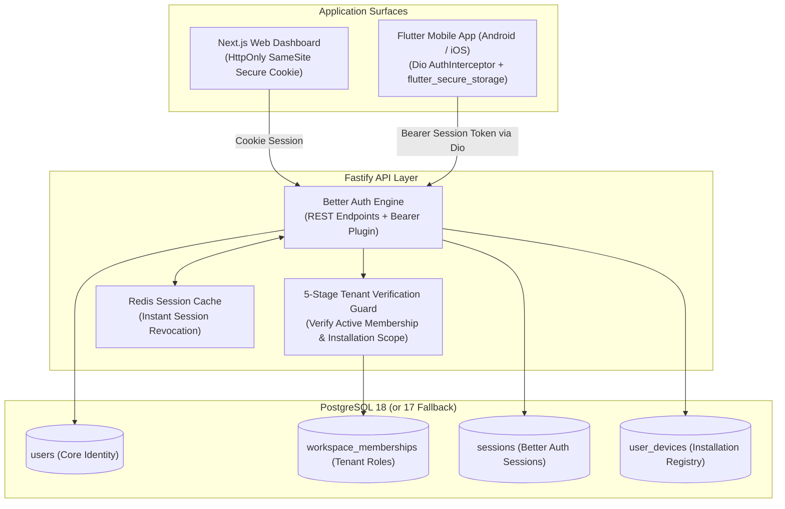

# ADR-006: Authentication, Session Management, Multi-Company Tenancy & Flutter Mobile Integration

**Status:** APPROVED (Updated for Final Flutter Baseline & Installation Identity)  
**Date:** October 2026 (Revised & Re-Architected)  
**Deciders:** Lead Systems Architect, Security Officer, Mobile Engineering  
**Controlling Document:** Phase 00 Approved Product Baseline ([`docs/product/OPRINO-MASTER-PRD.md`](../product/OPRINO-MASTER-PRD.md))\
**Underlying Framework:** Flutter Stable (Phase 01C Scaffolding; Reference Baseline: Flutter 3.47 / Stable Dart Toolchain) ([`ADR-001`](./ADR-001-mobile-framework.md))\
**Backend Auth Engine:** **Better Auth** (Fastify Plugin with Bearer Support, PostgreSQL Storage & Redis Session Cache)

---

## 1. Context & Problem Statement

Oprino requires a unified authentication, session, and identity architecture across three distinct client environments:
1. **Owner/Manager Web Dashboard:** High-security administrative interface accessed via modern desktop web browsers.
2. **Employee & Manager Mobile App (Flutter):** Field technicians, drivers, and supervisors on iOS and Android devices, requiring persistent sessions, biometric re-entry, rapid offline startup, and reliable installation lifecycle tracking.
3. **Multi-Company Tenancy (Phase 00 Invariant):** A single human user (e.g., an independent contractor or multi-franchise owner) can belong to multiple distinct workspaces with completely different roles (e.g., Technician in Workspace A, Owner in Workspace B).

Crucial security and architectural constraints:
- **No Bespoke Cryptography:** Oprino must **NOT** invent custom cryptographic session primitives, hand-rolled JWT algorithms, or custom refresh-token cryptography.
- **Enterprise Frontline Usability:** Seamless login via email/password, magic links, or phone OTP; persistent authentication across app updates and reboots without forced daily re-logins.
- **Instant Revocation & Installation Governance:** Instant revocation of compromised installations or terminated employee accounts (< 1 second) across both web and mobile clients.
- **Data Sovereignty & SMB Cost Efficiency:** Zero per-user SaaS tax (e.g. Clerk/Auth0 fees of $0.05–$0.25/MAU) that erodes gross margins at scale.

---

## 2. Alternatives Evaluated

### Alternative A: Application-Owned Framework (Better Auth + PostgreSQL + Redis)
- **Architecture:** Open-source, audited TypeScript authentication engine mounted within the Fastify backend, persisting identity records into Oprino's primary PostgreSQL database with Redis session caching.
- **Web Integration:** Native HttpOnly, SameSite, Secure session cookies.
- **Mobile Integration (Flutter):** Better Auth standard HTTP REST endpoints with the `bearer` plugin enabled, allowing mobile clients to authenticate using opaque session credentials stored in platform secure storage (`flutter_secure_storage`).
- **Pros:**
  - Audited security primitives (Argon2id password hashing, constant-time token comparison, automated brute-force protection).
  - Multi-company organization schema sits natively alongside Oprino's workspace tables.
  - Zero third-party per-user SaaS fees ($0/MAU).
  - Instant session invalidation via Redis cache drops.
- **Cons:** Engineering team maintains email/SMS delivery adapters (Resend / Twilio).

### Alternative B: Self-Hosted Identity Microservice (SuperTokens / Keycloak)
- **Architecture:** Standalone identity server container deployed alongside the application backend.
- **Pros:** Mature administrative consoles.
- **Cons:** Heavy operational overhead (Java/JVM for Keycloak), high infrastructure footprint, duplicate database clustering.

### Alternative C: Fully Managed Identity SaaS (Clerk / Auth0 / WorkOS)
- **Architecture:** Outsourcing user authentication, MFA, and session state entirely to a cloud vendor.
- **Pros:** Hosted login UI widgets.
- **Cons:** Prohibitive per-MAU pricing ($0.05–$0.25/MAU). At 2,500 active employees, this adds $125–$625/month in pure authentication tax. Third-party data custody of SMB operational credentials.

---

## 3. Decision

**Adopt Better Auth with PostgreSQL Persistence, Redis Session Cache, and Native Flutter Dio / Secure Storage Integration.**

### Architectural Rationale:
1. **No Hand-Written Primitives:** Avoids "hand-rolled" crypto, custom session hashing, or bespoke token-rotation logic. Utilizes Better Auth's audited, peer-reviewed implementations for password hashing (Argon2id), session tokens, timing-safe validation, and cookie security.
2. **Data Sovereignty & Multi-Tenancy Synergy:** User records, credentials, multi-company organization memberships (`workspace_memberships`), and installation bindings reside directly within Oprino's primary PostgreSQL database. This allows atomic transactions when a user is invited, deactivated, or switches active workspaces.
3. **Dual Surface Optimization:**
   - **Web Dashboard:** Communicates via standard secure `HttpOnly`, `SameSite=Lax`, `Secure` session cookies, immune to JavaScript XSS token theft.
   - **Flutter Mobile App:** Communicates over standard REST endpoints over TLS. The native Dart client cannot rely on browser cookie semantics in the same way as web; therefore, Better Auth's official `bearer` plugin is enabled. The client passes the opaque Better Auth session token via `Authorization: Bearer <session_token>`, stored securely in platform-backed storage.
4. **Non-Invasive Installation Governance:** Device registration is governed via an Oprino-generated Installation ID rather than invasive hardware fingerprinting or unstable hardware UUIDs. Lost-installation session revocation is an application security capability layered on top of Better Auth sessions.
5. **Economic Sustainability:** Eliminates per-MAU SaaS fees, directly preserving the target 87%–90%+ gross margins required for SMB software.

---

## 4. Architecture & Implementation Guidelines



### 4.1 Oprino Installation Identity Model
To avoid brittle or privacy-invasive hardware fingerprinting, Oprino implements an explicit Installation Identifier lifecycle:

```text
First application launch
        ↓
Generate cryptographically random UUIDv4 Installation ID
        ↓
Store in secure storage (namespaced: 'oprino_installation_id')
        ↓
Register installation with Oprino backend upon authentication
        ↓
Commit to user_devices record (mapping installation → user/device governance state)
```

- **Installation Semantics:**
  - `installation_id` is an Oprino-generated UUIDv4 created on first launch.
  - Device metadata (manufacturer, model, OS build) is collected via `device_info_plus` strictly for operational telemetry and diagnostics—it is **never** used as an authentication factor or hardware fingerprint.
  - An app re-installation generates a new Installation ID, requiring re-authentication.
  - Administrators can review, approve, or revoke active installations from the web dashboard.
  - Mobile clients transmit this identifier in the HTTP header: `X-Installation-Id: <installation_id>`.

### 4.2 Secure Platform Storage (`flutter_secure_storage`)
- **Platform-Backed Security:**
  - **Android:** Platform-backed secure encrypted storage utilizing Android Keystore-protected key material. Implementation follows the current pinned plugin release without hard-coding obsolete Android Jetpack internals.
  - **iOS:** Apple Keychain storage with accessibility attribute `kSecAttrAccessibleAfterFirstUnlockThisDeviceOnly`.
- **Namespaced Separation:** Session credentials, refresh tokens, and installation metadata are strictly segregated by namespace:
  - `auth_session:session_token`
  - `device_identity:installation_id`
  - `workspace_context:active_workspace_id`

### 4.3 Dio AuthInterceptor Implementation
```dart
class AuthInterceptor extends Interceptor {
  final FlutterSecureStorage _storage;
  AuthInterceptor(this._storage);

  @override
  Future<void> onRequest(RequestOptions options, RequestInterceptorHandler handler) async {
    final token = await _storage.read(key: 'auth_session:session_token');
    final installationId = await _storage.read(key: 'device_identity:installation_id');
    final workspaceId = await _storage.read(key: 'workspace_context:active_workspace_id');

    if (token != null) {
      options.headers['Authorization'] = 'Bearer $token';
    }
    if (installationId != null) {
      options.headers['X-Installation-Id'] = installationId;
    }
    if (workspaceId != null) {
      options.headers['X-Workspace-Id'] = workspaceId;
    }
    handler.next(options);
  }
}
```

### 4.4 Zero-Trust Device State Machine & Revocation Architecture
1. **Device State Machine (`pending | active | revoked`):**
   - **Active:** Normal trusted operation. Sessions bound to `(userId, installationId)` are authorized to invoke protected endpoints.
   - **Revoked:** The device installation is permanently de-authorized. All server-side sessions bound to this installation are immediately purged (`DELETE FROM sessions WHERE userId = :userId AND installationId = :installationId`).
   - **Pending:** If an employee with a previously revoked device attempts to generate a new UUID or reinstall the app, the registration defaults to `pending`. Access is blocked until an administrator reviews and approves the device via `POST /v1/devices/approve`.

2. **Explicit User Logout:**
   - Flutter calls `POST /v1/auth/sign-out`. Better Auth invalidates the session in PostgreSQL and flushes the Redis session cache key.
   - Flutter client deletes the token from `flutter_secure_storage` and resets in-memory application state to `unauthenticated`. The installation identifier is preserved.

3. **Remote Administrator Revocation:**
   - When an Owner/Manager revokes an employee or deactivates an installation in the Web Dashboard via `POST /v1/devices/revoke`:
     - The corresponding record in `user_devices` is marked `status = 'revoked', is_trusted = FALSE, revoked_at = NOW()`.
     - Active server-side sessions bound to this installation are dropped immediately.
   - On the mobile device's next API request, Fastify's Stage 1B Tenant Guard detects the revoked installation state and responds with the standardized flat `ApiErrorSchema`:
     ```json
     {
       "statusCode": 401,
       "error": "DEVICE_REVOKED",
       "message": "This installation has been de-authorized by an administrator."
     }
     ```
   - The Flutter `Dio` `AuthInterceptor` catches HTTP 401 with code `DEVICE_REVOKED`, purges the session token, halts background GPS tracking immediately (`locationService.stopTracking()`), and transitions state to `AuthState.deviceRevoked`.
   - **Revocation Invariant:** The client-side reset bypass is eliminated. The installation ID is preserved so the device remains securely identified as revoked. Re-admission requires administrative approval.

4. **Session Expiry & Re-Authentication:**
   - Session tokens have a 30-day sliding expiration window refreshed on active use (`updateAge: 86400`). If inactive for > 30 days, the session expires naturally. On HTTP 401, the app prompts for re-authentication.

### 4.5 Mobile vs. Web Authentication & CSRF Protection Architecture

To maintain rigorous security across both web browsers and native mobile runtimes:

1. **Web Dashboard Policy (Same-Origin BFF Proxy & HttpOnly Cookies):**
   - The Next.js dashboard uses secure, `HttpOnly`, `SameSite=Lax`, `Secure` session cookies.
   - **Same-Origin BFF Architecture:** Browser requests are proxied via Next.js `rewrites()` (`/api/backend/:path*` → `${API_URL}/:path*`). All browser requests target the same origin (`oprino.vercel.app`), ensuring cookies are included automatically via `credentials: 'include'` without cross-site cookie restrictions or `localStorage` token storage.
   - Better Auth's native CSRF and origin validation remains fully enforced. Every state-changing browser request is verified against the authoritative server origin.

2. **Mobile Client Policy (Bearer & Custom Scheme Origin Validation):**
   - **Prohibition of Global CSRF Disabling:** Setting `advanced.disableCSRFCheck: true` globally is **strictly prohibited**.
   - **Mobile Origin Handling:** Native Dart/Dio requests operate over TLS using opaque Bearer session credentials. Mobile requests supply the approved custom application scheme (`Origin: oprino://app`), whitelisted in Fastify's Better Auth `trustedOrigins` configuration.
   - **Session Replay Immunity:** Because Bearer tokens are stored in platform-backed secure hardware storage (Android Keystore / iOS Keychain) and verified against PostgreSQL/Redis with transactional installation binding (`sessions.installation_id`), token interception via web-based XSS or CSRF vectors is completely prevented.

### 4.6 Deep Links, Password Reset & Email Verification
1. **Universal Links & App Links:** Registered via `https://app.oprino.com/auth/*` backed by `assetlinks.json` and `apple-app-site-association`.
2. **Password Reset:** Better Auth emails single-use reset link `https://app.oprino.com/auth/reset-password?token=...`. Tapping the link opens the Flutter app directly via `app_links` to submit the new password to `POST /api/auth/reset-password`.
3. **Email Verification:** Verification links route to app or web dashboard, calling `GET /api/auth/verify-email?token=...`.

---

## 5. Multi-Company Tenancy Data Model

```sql
-- Canonical Global Identity
CREATE TABLE public.users (
    id UUID PRIMARY KEY DEFAULT gen_random_uuid(),
    email VARCHAR(255) UNIQUE,
    phone VARCHAR(32) UNIQUE,
    password_hash VARCHAR(255), -- Argon2id hash
    display_name VARCHAR(255) NOT NULL,
    avatar_url TEXT,
    is_active BOOLEAN NOT NULL DEFAULT TRUE,
    created_at TIMESTAMPTZ NOT NULL DEFAULT NOW(),
    updated_at TIMESTAMPTZ NOT NULL DEFAULT NOW()
);

-- Workspace Membership (Multi-Company Tenancy)
CREATE TABLE public.workspace_memberships (
    id UUID PRIMARY KEY DEFAULT gen_random_uuid(),
    workspace_id UUID NOT NULL REFERENCES public.workspaces(id) ON DELETE CASCADE,
    user_id UUID NOT NULL REFERENCES public.users(id) ON DELETE CASCADE,
    role_id UUID NOT NULL REFERENCES public.roles(id),
    status VARCHAR(32) NOT NULL DEFAULT 'ACTIVE', -- 'INVITED', 'ACTIVE', 'SUSPENDED'
    created_at TIMESTAMPTZ NOT NULL DEFAULT NOW(),
    UNIQUE(workspace_id, user_id)
);

-- Registered Installations & Device Governance
CREATE TABLE public.user_devices (
    id UUID PRIMARY KEY DEFAULT gen_random_uuid(),
    user_id UUID NOT NULL REFERENCES public.users(id) ON DELETE CASCADE,
    installation_id UUID NOT NULL, -- Oprino-generated random installation UUID
    platform VARCHAR(16) NOT NULL, -- 'android' | 'ios' | 'web'
    device_model VARCHAR(128),     -- e.g. "Samsung Galaxy A54" (Diagnostic only)
    os_version VARCHAR(64),        -- e.g. "Android 15" (Diagnostic only)
    push_token TEXT,
    app_version VARCHAR(32),
    last_active_at TIMESTAMPTZ NOT NULL DEFAULT NOW(),
    is_trusted BOOLEAN NOT NULL DEFAULT TRUE,
    UNIQUE(user_id, installation_id)
);
```

---

## 6. Consequences & Trade-offs

- **Positive:**
  - Audited security posture without custom cryptographic implementation.
  - Zero recurring per-MAU SaaS fees ($0 auth infrastructure tax).
  - Clean separation: Web uses secure cookies; Flutter uses secure opaque Bearer tokens over TLS in platform-backed secure storage.
  - Non-invasive installation tracking avoids privacy concerns and platform stability issues associated with hardware fingerprinting.
- **Negative:**
  - Requires maintaining transactional email (Resend) and SMS provider configurations.
- **Compliance:**
  - Strictly preserves multi-tenant data isolation and duty-boundary safeguards.
