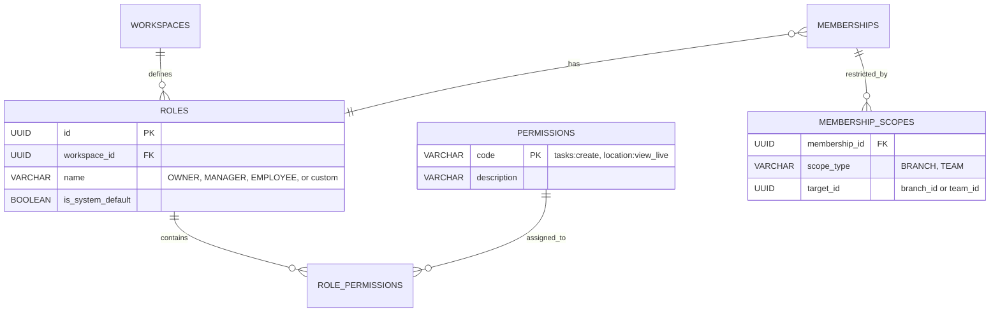

# ADR-007: Authorization & Role-Based Access Control (RBAC)

**Status:** Proposed / Recommended for Phase 01A  
**Date:** October 2026  
**Deciders:** Lead Systems Architect, Security Engineering  
**Controlling Document:** Phase 00 Approved Product Baseline ([`docs/product/ROLES-AND-PERMISSIONS-PLAN.md`](../product/ROLES-AND-PERMISSIONS-PLAN.md))

---

## 1. Context & Problem Statement

Oprino requires an authorization engine that cleanly balances immediate out-of-the-box simplicity with enterprise extensibility:
- **Default V1 Roles:** Three foundational defaults (`Owner/Admin`, `Manager`, `Employee`) requiring zero configuration.
- **Hierarchical Scoping:** A Manager’s authority is vertically bounded by their assigned branches or teams (e.g., viewing attendance and tasks only for direct reports).
- **Extensible Custom Roles:** Architecture must seamlessly accommodate future roles (`Supervisor`, `Area Manager`, `Dispatcher`, `Team Lead`) with configurable permission sets.
- **Inviolable Duty-Hours Privacy Boundary:** Location telemetry access must be strictly governed by server authorization rules—preventing unauthorized peer-to-peer tracking and off-duty location access.
- **Server Authority:** While Mobile and Web UIs adapt their presentation based on user permissions, the server and database must remain the absolute, authoritative enforcement boundary.

---

## 2. Alternatives Evaluated

### Alternative A: Role-Attribute Scoped Model ("Domain:Action:Scope")
- **Overview:** Roles are defined as collections of discrete permission strings (`domain:action`), while user membership carries an organizational scope (`scope_type` and `scope_ids` such as branch or team IDs).
- **Mechanism:**
  - Permissions format: `tasks:create`, `tasks:approve`, `attendance:view_team`, `location:view_live`.
  - Scoping rules:
    - `GLOBAL`: Full organization scope (Owner / Admin).
    - `HIERARCHICAL`: Restricted to assigned branches or teams (Manager, Supervisor).
    - `SELF`: Restricted strictly to records where `user_id = :current_user` (Employee).
- **Pros:** Highly intuitive, fast database evaluation via standard SQL `WHERE` clauses, easily stored in relational tables, zero external rule-engine overhead.

### Alternative B: Complex Policy Engine (Casbin / Open Policy Agent / OPA)
- **Overview:** Integrating a dedicated external authorization engine evaluating policies via a custom domain-specific language (e.g., Rego).
- **Pros:** Extreme policy flexibility for complex enterprise setups.
- **Cons:** High operational complexity, latency overhead on every API request, challenging to translate into high-performance SQL query filters across large datasets.

### Alternative C: Database-Only Row-Level Security (Pure RLS Authorization)
- **Overview:** Relying exclusively on PostgreSQL RLS policies to enforce all RBAC rules without backend middleware checks.
- **Pros:** Centralized inside the database engine.
- **Cons:** Very difficult to unit test; complex business permissions (e.g., task state transitions or verification checks) become massive SQL functions; hard to return helpful, structured 403 error messages to clients.

---

## 3. Comparative Evaluation Matrix

| Criterion | Weight | Domain:Action:Scope | Policy Engine (OPA/Casbin) | Pure DB RLS |
|---|:---:|:---:|:---:|:---:|
| **SMB Operational Simplicity & Velocity** | 25% | **9.5 / 10** | 5 / 10 | 7 / 10 |
| **Hierarchical Scoping (Team/Branch)** | 25% | **9.5 / 10** | 8 / 10 | 7 / 10 |
| **SQL Query Performance (Index Friendly)**| 20% | **9.5 / 10** | 6 / 10 | 8.5 / 10 |
| **Custom Role & Permission Extensibility**| 15% | **9 / 10** | 10 / 10 | 7 / 10 |
| **Testability & Debuggability** | 15% | **9.5 / 10** | 7 / 10 | 5 / 10 |
| **Weighted Total** | **100%** | **9.45 / 10** | **6.85 / 10** | **7.10 / 10** |

---

## 4. Decision

**Adopt the Domain:Action:Scope RBAC Model enforced authoritatively by Fastify API middleware with SQL query scope injection, backed by PostgreSQL RLS as a secondary defense layer.**

### Architectural Model & Table Schema:



### Authorization Enforcement Flow:

```mermaid
flowchart TD
    Req[Incoming API Request] --> Middleware[Authz Middleware]
    Middleware --> PermCheck{Has Required Permission?}
    PermCheck -->|No| F403[403 Forbidden Error]
    PermCheck -->|Yes| ScopeEval{Evaluate User Scope}
    
    ScopeEval -->|GLOBAL| ExecAll[Query WHERE workspace_id = :ws]
    ScopeEval -->|HIERARCHICAL| ExecTeam[Query WHERE workspace_id = :ws AND team_id IN (:user_teams)]
    ScopeEval -->|SELF| ExecSelf[Query WHERE workspace_id = :ws AND assignee_id = :user_id]
    
    ExecAll --> DB[(PostgreSQL with RLS Validation)]
    ExecTeam --> DB
    ExecSelf --> DB
    DB --> Response[Return Authorized Result]
```

### Enforcement Rules across Layers:
1. **Server API (Primary Authority):**
   - Declarative route guards (e.g., `preHandler: [requirePermission('tasks:create')]`).
   - Automatically builds parameterized SQL filters based on the user's membership scope, preventing full-table data leaks before queries execute.
2. **Database Engine (Secondary Defense):**
   - RLS policies ensure that even raw queries cannot breach workspace boundary.
3. **Web & Mobile Clients (Presentation Only):**
   - User permissions are sent upon login (`permissions: string[]`).
   - UI conditionally renders action buttons (`Create Task`, `Approve Proof`) or navigation tabs (`Live Map`) based on client permissions. The client-side check is purely cosmetic; all operations are strictly verified by the API.

---

## 5. Consequences & Mitigations

- **Consequence:** Hierarchical scoping requires joining `membership_scopes` for branch/team-restricted managers.  
  *Mitigation:* Cache active user scope (`assigned_branch_ids`, `assigned_team_ids`, `permissions`) in the Fastify request session or Redis token cache for 15 minutes, avoiding repetitive scope lookups on every query.
- **Consequence:** Custom roles require UI for permission assignment in Business/Enterprise tiers.  
  *Mitigation:* In V1, expose only the 3 immutable default roles. Custom role creation will be enabled in Phase V2 using the same underlying database schema without migrations.
- **Reversal Cost:** Low. The `domain:action` convention is a clean industry standard.
