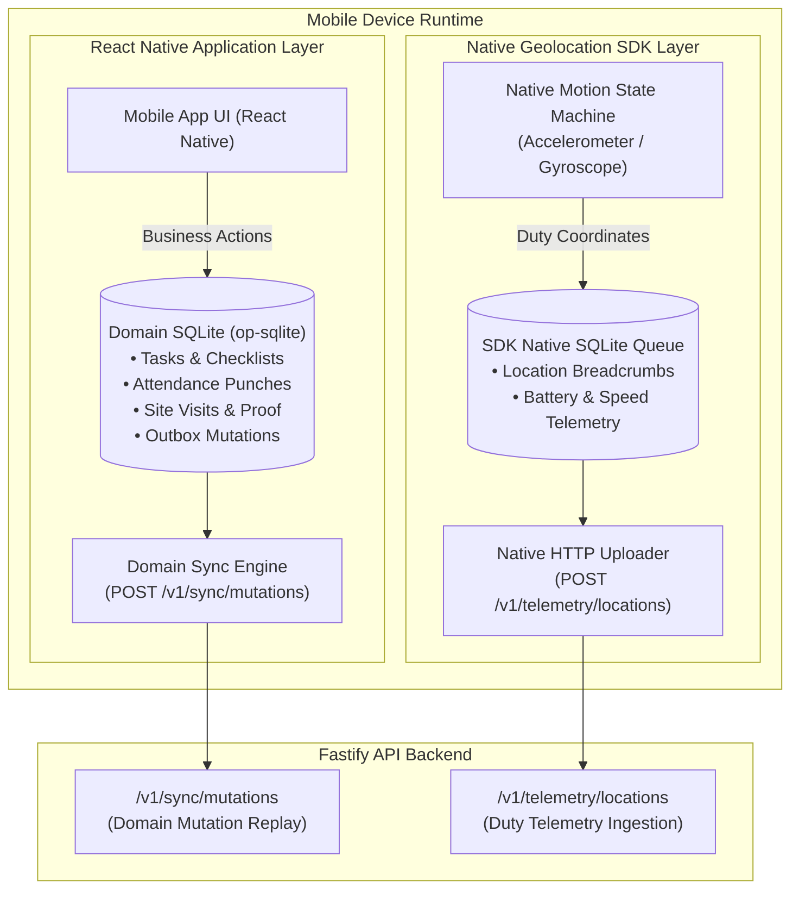
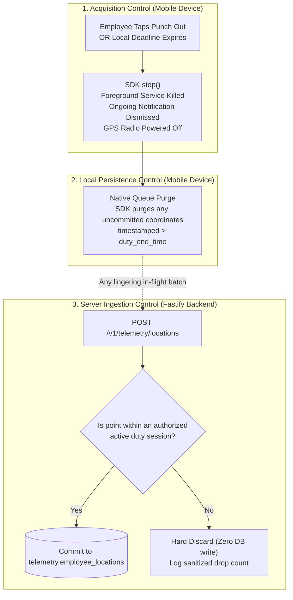

# ADR-008: Mobile Background Location & Duty-Hours Tracking Architecture (Re-evaluated)

**Status:** Updated & Recommended for Phase 01A  
**Date:** October 2026 (Reconciled)  
**Deciders:** Lead Systems Architect, Mobile Engineering, Privacy Officer  
**Controlling Document:** Phase 00 Approved Product Baseline ([`docs/product/OPRINO-MASTER-PRD.md`](file:///workspace/oprino/docs/product/OPRINO-MASTER-PRD.md))

---

## 1. Context & Problem Statement

Background location tracking is the core technical challenge for mobile workforce applications. The architecture must satisfy rigorous, non-negotiable operational and platform constraints:
- **Inviolable Product Rule:** Off-duty employee location tracking must **NEVER** be an intended Oprino behavior. Tracking initiates only upon explicit or authorized duty start (punch-in) and halts immediately upon duty end (punch-out).
- **Mobile OS Background Constraints (Android & iOS):**
  - Android 14/15/16 strictly terminates background location unless an explicit Foreground Service with `android:foregroundServiceType="location"` and a visible, ongoing notification is active.
  - iOS 17/18/19 enforces strict power management, app suspension, and user transparency notifications (`showsBackgroundLocationIndicator = true`).
  - Aggressive OEM battery killers (Xiaomi/MIUI, Samsung/OneUI, Oppo/ColorOS, Vivo) kill background processes unless native motion-triggered stationary sleep and OEM battery exemption configurations are applied.
- **Battery & Data Efficiency:** Unbounded continuous GPS polling rapidly drains phone batteries and consumes mobile data. The engine must adapt dynamically based on movement.
- **Architectural Separation:** Avoid creating two competing GPS sync engines. Clearly delineate application domain storage from native geolocation SDK persistence.

---

## 2. Alternatives Evaluated

### Alternative A: Enterprise Geolocation SDK (Transistor Software `react-native-background-geolocation`)
- **Overview:** Specialized native background geolocation engine for React Native with built-in native motion-detection state machine and independent native SQLite persistence.
- **Key Capabilities:**
  - Hardware motion recognition (accelerometer/gyroscope) switches between stationary sleep and active tracking.
  - Native SQLite queue inside the native C++/Kotlin/Swift layer: buffers breadcrumbs even if React Native JavaScript is suspended or killed.
  - Direct native HTTP upload pipeline (`autoSync: true`) directly streaming batches to `/v1/telemetry/locations`.
- **Pros:** Unrivaled survivability across OEM Android variants; offloads low-level OS lifecycle handling from JS thread; eliminates double-queuing in domain SQLite.
- **Cons:** Commercial platform license fee ($300–$600 one-time per platform, budgeted in infra model).

### Alternative B: Hand-Crafted Native Service (Custom Kotlin + Swift CoreLocation)
- **Overview:** Writing custom Android foreground services and iOS location delegates from scratch.
- **Pros:** Zero commercial license fee.
- **Cons:** Astronomical engineering maintenance; high vulnerability to OEM battery-killer updates; high risk of background execution drops on budget devices.

### Alternative C: Basic Open-Source (`expo-location` TaskManager)
- **Overview:** Standard Expo background location wrapper.
- **Pros:** Open-source.
- **Cons:** Lacks motion-triggered stationary geofence sleep; high battery drain; prone to OS termination during 8-hour shifts.

---

## 3. Decision

**Adopt Transistor Software `react-native-background-geolocation` with Clean Engine Separation and Multi-Tier Duty Control.**

---

## 4. Separation of Responsibilities: Domain SQLite vs. Geolocation Persistence

To avoid competing sync queues, data corruption, and duplicate uploads:

### Explicit Boundary Definitions:
1. **Domain SQLite (`op-sqlite`):**
   - **Responsibility:** Pure business entities: tasks, checklists, attendance punch records, customer site visits, proof photos, notes, signatures, and `outbox_mutations`.
   - **Exclusion:** Does **NOT** store high-frequency continuous location breadcrumbs.
2. **SDK Native Persistence (Transistor SQLite):**
   - **Responsibility:** High-frequency GPS coordinates, heading, speed, altitude, accuracy, and battery state.
   - **Upload Responsibility:** Transistor SDK's native HTTP client uploads directly to `POST /v1/telemetry/locations` with native network reachability listeners.
   - **Deduplication & Idempotency:** Every breadcrumb carries a client UUIDv4. The backend telemetry table has a unique constraint `(workspace_id, recorded_at, id)`, guaranteeing zero duplicate points on network retries.

---

## 5. Three-Layer Duty-Hours Privacy Enforcement Architecture

The non-negotiable rule is enforced across three distinct control points:

### 5.1 Mobile OS Timing Realities & Safe Local Deadline Strategy
- **OS Reality:** Mobile operating systems (Android Doze, iOS background app suspension) **cannot guarantee** executing an automatic schedule boundary at an exact second while an app is suspended or offline.
- **Explicit Employee Punch-Out:** Invokes immediate, synchronous `BackgroundGeolocation.stop()`. The foreground notification disappears instantly; location hardware halts.
- **Safe Local Deadline Strategy:** 
  - Upon punching in or synchronizing shift schedules, the app configures a **local hard deadline timestamp** in the native SDK configuration (`stopAfterElapsedMinutes` / native OS AlarmManager alarm).
  - If the employee loses network connectivity or forgets to punch out, the native SDK autonomously executes a local shutdown when the deadline timestamp is reached, even if the main JavaScript app is suspended.
  - Server-side validation drops any point timestamped after the scheduled shift window + grace buffer.

---

## 6. Measurable Target SLOs & Device Validation Matrix

Architectural claims must be grounded in measurable Service Level Objectives (SLOs) rather than marketing assertions.

### 6.1 Performance & Power Target SLOs
- **Battery Drain Target SLO:**
  - *Stationary Mode:* < 0.5% battery drain per hour.
  - *Active Travel Mode (Driving/Walking):* < 1.5% – 2.5% battery drain per active hour on mid-tier hardware.
- **Live-Map Delivery Target SLO:**
  - Under stable cellular/Wi-Fi coverage, 95% of transmitted breadcrumbs reach the manager web dashboard within **< 3.0 seconds (p95)**.
- **Motion Transition Target SLO:**
  - Stationary geofence engages after 5 minutes of stillness within a 30m radius; wakes up within 50m of displacement.

### 6.2 Representative Device Validation Matrix
Prior to production sign-off, the background tracking pipeline must be benchmarked and validated across the following hardware/OS profiles:

| OEM / Brand | Test Device Profiles | Operating System | Critical Test Focus |
|---|---|---|---|
| **Samsung** | Galaxy A15 (Low), Galaxy A54 (Mid), S24 (High) | OneUI 6 (Android 14) / OneUI 7 (Android 15) | Battery optimization whitelist, foreground service stability. |
| **Xiaomi / Redmi** | Redmi Note 12/13 (Low/Mid), Xiaomi 13 (High) | HyperOS / MIUI 14 (Android 13/14) | Aggressive autostart restrictions, memory cleaner whitelist. |
| **Oppo / Realme** | Realme C-series (Budget), Reno 11 (Mid) | ColorOS 14 / Realme UI 5.0 | Background freeze prevention, deep sleep wakeups. |
| **Vivo / iQOO** | Vivo Y27 (Budget), V29 (Mid) | Funtouch OS 14 | "High background power consumption" permission toggle. |
| **Google Pixel** | Pixel 7a (Mid), Pixel 8 (High) | Stock Android 14 / 15 | Reference baseline: foreground service notifications, Doze mode. |
| **Apple iPhone** | iPhone 11 (Legacy), iPhone 14 (Mid), iPhone 16 (Current)| iOS 17 / iOS 18 | `showsBackgroundLocationIndicator`, Significant Motion API. |

---

## 7. Compliance with Phase 00 Approved Scope

- Strictly guarantees that off-duty employee tracking is technically impossible and never an intended behavior.
- Separates domain business persistence from native location SDK persistence, eliminating competing sync queues.
- Replaces unverified marketing claims with measurable engineering SLOs and an exhaustive OEM validation matrix.
