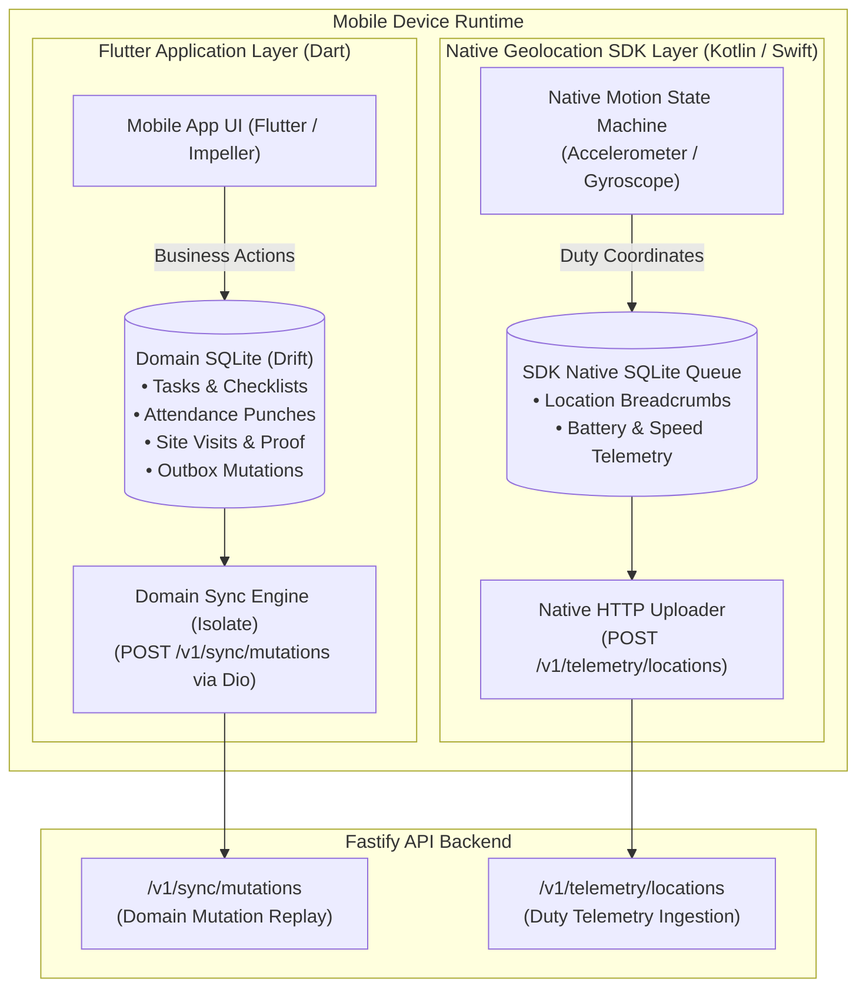
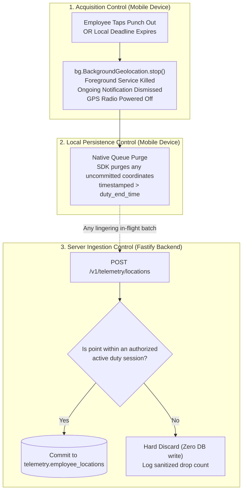

# ADR-008: Mobile Background Location & Duty-Hours Tracking Architecture (Flutter Baseline)

**Status:** APPROVED (Updated for Final Flutter Baseline & Empirical Spike Scope)  
**Date:** October 2026 (Revised & Re-Architected)  
**Deciders:** Lead Systems Architect, Mobile Engineering, Privacy Officer  
**Controlling Document:** Phase 00 Approved Product Baseline ([`docs/product/OPRINO-MASTER-PRD.md`](../product/OPRINO-MASTER-PRD.md))\
**Underlying Framework:** Flutter Stable (Phase 01C Scaffolding; Reference Baseline: Flutter 3.47 / Stable Dart Toolchain) ([`ADR-001`](./ADR-001-mobile-framework.md))

---

## 1. Context & Problem Statement

Background location tracking is the core technical challenge for mobile workforce applications. The architecture must satisfy rigorous, non-negotiable operational and platform constraints:
- **Inviolable Product Rule:** Off-duty employee location tracking must **NEVER** be an intended Oprino behavior. Tracking initiates only upon explicit or authorized duty start (punch-in) and halts immediately upon duty end (punch-out).
- **Mobile OS Background Constraints (Android & iOS):**
  - Android 14/15/16 strictly terminates background location unless an explicit Foreground Service with `android:foregroundServiceType="location"` and a visible, ongoing notification is active.
  - iOS 17/18/19 enforces strict power management, app suspension, and user transparency notifications (`showsBackgroundLocationIndicator = true`).
  - Aggressive OEM battery killers (Xiaomi/MIUI/HyperOS, Samsung/OneUI, Oppo/ColorOS, Vivo/Funtouch) kill background processes unless native motion-triggered stationary sleep and OEM battery exemption configurations are applied.
- **Battery & Data Efficiency:** Unbounded continuous GPS polling rapidly drains phone batteries and consumes mobile data. The engine must adapt dynamically based on movement.
- **Architectural Separation:** Avoid creating two competing GPS sync engines. Clearly delineate application domain storage from native geolocation SDK persistence.

---

## 2. Alternatives Evaluated

### Alternative A: Enterprise Geolocation SDK (Transistor Software `flutter_background_geolocation`)
- **Overview:** Specialized native background geolocation engine for Flutter with built-in native motion-detection state machine and independent native SQLite persistence.
- **Key Capabilities:**
  - Hardware motion recognition (accelerometer/gyroscope) switches between stationary sleep and active tracking.
  - Native SQLite queue inside the native C++/Kotlin/Swift layer: buffers breadcrumbs even if the Flutter Dart isolate is suspended or killed.
  - Direct native HTTP upload pipeline (`autoSync: true`) directly streaming batches to `/v1/telemetry/locations`.
- **Pros:** Unrivaled survivability across OEM Android variants; offloads low-level OS lifecycle handling from Flutter Dart UI isolate; eliminates double-queuing in domain SQLite.
- **Cons:** Commercial platform license fee (Current planning reference: Starter at $399 one-time perpetual license covering iOS and Android under a single application bundle ID `com.oprino.app`, including 1 year of vendor updates/support).

### Alternative B: Hand-Crafted Native Service (Custom Kotlin + Swift CoreLocation via Flutter Platform Channels)
- **Overview:** Writing custom Android foreground services and iOS location delegates from scratch.
- **Pros:** Zero commercial license fee.
- **Cons:** Astronomical engineering maintenance; high vulnerability to OEM battery-killer updates; high risk of background execution drops on budget devices.

### Alternative C: Basic Open-Source (`geolocator` / `flutter_background_service`)
- **Overview:** Standard community background location wrappers.
- **Pros:** Open-source.
- **Cons:** Lacks motion-triggered stationary geofence sleep; high battery drain; prone to OS termination during 8-hour shifts on budget Android hardware.

---

## 3. Decision

**Adopt Transistor Software `flutter_background_geolocation` with Clean Engine Separation and Multi-Tier Duty Control.**

---

## 4. Separation of Responsibilities: Domain SQLite vs. Geolocation Persistence

To avoid competing sync queues, data corruption, and duplicate uploads:

### Explicit Boundary Definitions:
1. **Domain SQLite (`package:drift` + `package:sqlite3` with bundled native SQLite):**
   - **Responsibility:** Pure business entities: tasks, checklists, attendance punch records, customer site visits, proof photos, notes, signatures, and `outbox_mutations`.
   - **Exclusion:** Does **NOT** store high-frequency continuous location breadcrumbs.
2. **SDK Native Persistence (Transistor SQLite):**
   - **Responsibility:** High-frequency GPS coordinates, heading, speed, altitude, accuracy, and battery state.
   - **Upload Responsibility:** Transistor SDK's native HTTP client uploads directly to `POST /v1/telemetry/locations` with native network reachability listeners.
   - **Deduplication & Idempotency:** Every breadcrumb carries a client UUIDv4. The backend telemetry table has a unique constraint `(workspace_id, recorded_at, id)`, guaranteeing zero duplicate points on network retries.

---

## 5. Three-Layer Duty-Hours Privacy Enforcement Architecture

The non-negotiable rule is enforced across three distinct control points:

### 5.1 Mobile OS Timing Realities & Safe Local Deadline Strategy
- **OS Reality & Unmeasured Timing Invariant:** Mobile operating systems (Android Doze, OEM battery optimizations, iOS suspended states) **cannot guarantee** executing an automatic schedule boundary at an exact second while an app is suspended, in deep sleep, or without network connectivity. Exact automatic cutoff timing must **not** be claimed as a mathematical certainty until empirically measured during Phase 01B prototyping.
- **Explicit Employee Punch-Out:** Invokes immediate, synchronous `bg.BackgroundGeolocation.stop()`. The foreground notification disappears; native location hardware powers down. Exact hardware shutdown latency is a validation target to be measured in Phase 01B rather than presumed.
- **Automatic Shift Expiry as a Defense Safety Mechanism:**
  - Automatic shift expiry is an operational safety mechanism subject to OS constraints, backed redundantly by local queue purge and server ingestion rejection.
  - Upon punching in or synchronizing shift schedules, the app configures a **local safe deadline timestamp** in the native SDK configuration (`stopAfterElapsedMinutes` / native OS AlarmManager alarm).
  - If the employee forgets to punch out or loses connectivity, the native SDK executes a local shutdown when the deadline timestamp is reached or upon the next OS scheduler wake.
  - **Local Persistence & Server Rejection Backing:** Any lingering coordinates timestamped past duty end are purged from the local native SQLite queue prior to upload, and the server zero-trust ingestion boundary (`POST /v1/telemetry/locations`) unconditionally drops any points outside an authorized shift window.

---

## 6. Measurable Target SLOs & Phase 01B Spike Scope

Architectural targets must be grounded in measurable Service Level Objectives (SLOs) and empirical validation rather than marketing assertions. All numbers below are **targets to validate**, not guaranteed baselines prior to measurement:

### 6.1 Performance & Power Target SLOs (To Be Validated)
- **Battery Drain Target SLO:**
  - *Stationary Mode Target:* < 0.5% battery drain per hour.
  - *Active Travel Mode Target (Driving/Walking):* < 1.5% – 2.5% battery drain per active hour on mid-tier hardware.
- **Live-Map Delivery Target SLO:**
  - Fastify SSE live operational map delivery latency target: **< 2.0 to 3.0 seconds (p95)** from physical coordinate capture to dashboard map render under standard 4G/LTE connectivity.

### 6.2 Baseline Device Validation Matrix
Empirical verification of battery and tracking continuity during Phase 01B must validate the following device spectrum:
1. **Samsung Galaxy A-Series / S-Series (Android 14/15, One UI 6+):** Deep Sleep & App Standby Buckets.
2. **Xiaomi Redmi / Note Series (HyperOS / MIUI 14):** Aggressive MIUI battery saver and background task killing.
3. **Oppo / Vivo (ColorOS / Funtouch OS):** Strict background freeze and memory management policies.
4. **Google Pixel (Stock Android 14/15/16):** Standard Android Doze and Foreground Service compliance.
5. **Apple iPhone 13/14/15/16 (iOS 17/18):** CoreLocation background modes and user location indicator compliance.

### 6.3 Phase 01B Location Spike Scope (Android & iOS)
The Phase 01B location spike must validate both operating systems under real-world conditions:
1. **Android Aggressive OEM & Doze Behavior:**
   - Measure stationary geofence exit latency and active tracking continuity across Samsung, Xiaomi, and Vivo devices.
   - Measure behavior during deep Doze mode when the phone is motionless for > 60 minutes.
   - Validate foreground service sticky restart behavior (`START_STICKY`) after OS memory eviction.
2. **iOS Suspended & Background Scheduler Behavior:**
   - Validate CoreLocation tracking reliability when the Flutter app is in the `Suspended` state.
   - Measure background execution budget and wake-up reliability using `allowsBackgroundLocationUpdates` and `pausesLocationUpdatesAutomatically = false`.
   - Test wake-up recovery from Significant Location Change (SLC) service after device reboots.
3. **Duty Boundary Validation:**
   - Verify that explicit punch-out halts hardware GPS polling immediately, measuring the exact shutdown latency during Phase 01B prototyping.
   - Empirically benchmark automatic cutoff timing (`safe_local_deadline_utc`) across both OSes without speculative claims.
   - Verify that any coordinates recorded past duty expiration are purged locally and authoritatively rejected by Fastify (`telemetry_ingest_rejected_off_duty`).

---

## 7. Consequences & Trade-offs

- **Positive:**
  - Complete elimination of off-duty tracking liability via 3 independent privacy barriers.
  - Zero double-queuing: domain mutations use Drift SQLite; location points use native Transistor SQLite.
  - Battle-tested OEM survivability on frontline Android hardware.
- **Negative:**
  - Commercial platform license fee (Current planning reference: Starter at $399 one-time perpetual license, decoupled from monthly cloud hosting; future update/support renewals TBD / verified with vendor at purchase time).
- **Compliance:**
  - Strictly adheres to Phase 00 frozen privacy baseline. Off-duty location tracking remains strictly non-existent.
