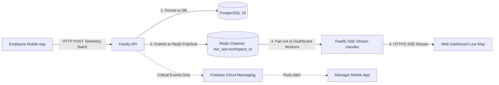

# ADR-010: Realtime Operational Visibility Architecture

**Status:** Proposed / Recommended for Phase 01A  
**Date:** October 2026  
**Deciders:** Lead Systems Architect, Frontend & Backend Engineering  
**Controlling Document:** Phase 00 Approved Product Baseline ([`docs/product/APP-SURFACES.md`](file:///workspace/oprino/docs/product/APP-SURFACES.md))

---

## 1. Context & Problem Statement

Oprino's operations managers and business owners require operational visibility into their distributed workforce during duty hours:
- Live operational map on Web Dashboard showing on-duty workers, duty status, active task, and recent location pings.
- Instant push notifications for critical field events (proof submitted, task overdue, emergency exception).
- Fast UI status updates when a field technician changes state (`En Route` → `Arrived` → `Completed`).

However, blindly making every piece of data "realtime" causes severe technical and commercial issues:
- Excessive mobile battery drain from maintaining persistent TCP/WebSocket connections.
- Cloud infrastructure cost spikes from hundreds of idle persistent connections and high message-throughput billing (a major trap with commercial BaaS platforms).
- Unnecessary complexity in managing bidirectional state synchronization.

---

## 2. Latency Classification Framework

To engineer a cost-effective and battery-efficient architecture, Oprino categorizes all operational data into three strict **Latency Classes**:

```
┌─────────────────────────────────────────────────────────────────────────────┐
│ CLASS 1: IMMEDIATE (< 1 Second Latency)                                     │
│ • Emergency broadcast alerts                                                │
│ • Urgent task reassignments & cancellations                                 │
│ Transport: Push Notifications (FCM / APNs) + In-App Event Hook              │
├─────────────────────────────────────────────────────────────────────────────┤
│ CLASS 2: NEAR-REALTIME (2 to 5 Seconds Latency)                             │
│ • Live Operational Map: On-duty employee markers & status                   │
│ • Manager Approvals Inbox badge counter                                     │
│ • Field task lifecycle chips (En Route, Arrived, In Progress)               │
│ Transport: Server-Sent Events (SSE) on Web; Smart Polling / Push on Mobile  │
├─────────────────────────────────────────────────────────────────────────────┤
│ CLASS 3: EVENTUAL (Minutes to On-Demand Refresh)                            │
│ • Historical route trails & breadcrumb scrubbers                            │
│ • Daily attendance summary grids & timesheets                               │
│ • Operational SLA reports, audit logs & conveyance calculations             │
│ Transport: Standard HTTP GET with TanStack Query caching                    │
└─────────────────────────────────────────────────────────────────────────────┘
```

---

## 3. Alternatives Evaluated for Web Live Map (Class 2)

### Alternative A: Server-Sent Events (SSE) via Fastify HTTP/2 Stream
- **Overview:** Standard W3C streaming protocol over HTTP/2 where the server pushes lightweight JSON events (`event: location_update`, `data: {...}`) to the browser client.
- **Pros:**
  - Unidirectional: Web map viewing is purely read-only (server pushing coordinates to the dashboard); bidirectional protocol is completely unnecessary.
  - Native browser support (`EventSource`) with automatic reconnection and event ID replay built in.
  - Runs over standard HTTP/2, sharing connection pools with regular REST API requests; effortlessly traverses enterprise firewalls and corporate proxies.
  - Extremely lightweight on server memory (~15 KB per active dashboard connection).
- **Cons:** Does not support binary streaming (not required for JSON telemetry coordinates).

### Alternative B: Bidirectional WebSockets (`ws` / Socket.IO)
- **Overview:** Persistent full-duplex TCP connection between client and server.
- **Pros:** Ultra-low latency bidirectional message passing.
- **Cons:** Overkill for a read-only dashboard map stream; requires maintaining a separate WebSocket gateway, sticky sessions, heartbeat ping-pongs, and complex reconnection logic.

### Alternative C: Third-Party Realtime Channels (Supabase Realtime / Pusher / Ably)
- **Overview:** Commercial cloud pub/sub broker broadcasting database row changes.
- **Pros:** Zero backend WebSocket code to write.
- **Cons:** Very expensive variable cost pricing at scale (e.g., millions of location pings broadcast across multiple open browser tabs quickly exceed free and low-tier quotas).

---

## 4. Comparative Evaluation Matrix

| Criterion | Weight | Server-Sent Events (SSE) | WebSockets (`ws`) | Commercial Realtime (Pusher/Ably) |
|---|:---:|:---:|:---:|:---:|
| **Fit for Read-Only Operational Map** | 25% | **10 / 10 (Perfect fit)** | 8 / 10 (Overengineered) | 8.5 / 10 |
| **Infrastructure Simplicity & Memory**| 25% | **10 / 10 (Native HTTP/2)** | 7 / 10 (Stateful gateway) | 8 / 10 |
| **Cost Predictability at SMB Scale** | 20% | **10 / 10 ($0 extra fees)** | 9 / 10 | 4 / 10 (Message quota bill shock)|
| **Firewall & Corporate Proxy Traversal**| 15% | **10 / 10 (Standard HTTP)** | 7.5 / 10 | 9 / 10 |
| **Auto-Reconnection & Simplicity** | 15% | **10 / 10 (Built-in)** | 7 / 10 (Custom retry) | 9 / 10 |
| **Weighted Total** | **100%** | **10.0 / 10** | **7.78 / 10** | **7.55 / 10** |

---

## 5. Decision

**Adopt a Purpose-Fit Hybrid Realtime Model: Server-Sent Events (SSE) for the Owner/Manager Web Dashboard Live Operations Map, paired with Push Notifications and Adaptive Polling for Mobile Clients.**

### Architectural Data Flow:



### Technical Implementation Details:
1. **Web Dashboard Realtime Stream (`/api/v1/realtime/stream`):**
   - The web dashboard opens an `EventSource` connection scoped to the active workspace.
   - The API subscribes to an internal Redis pub/sub channel: `live_ops:{workspace_id}`.
   - When a field worker’s location or task state is ingested, the server publishes a compact JSON payload to Redis, which fans out to all active dashboard SSE connections for that workspace with a target delivery SLO of < 2.0 to 3.0 seconds (p95) under normal network conditions.
2. **Mobile Clients (Battery Preservation Strategy):**
   - Mobile apps **do NOT** maintain persistent open SSE or WebSocket streams while in the background. Doing so causes aggressive mobile OS battery termination.
   - Mobile apps receive critical updates (new tasks, approvals) via **high-priority Push Notifications** (FCM/APNs) and refresh their local active cache when opened by the user.
3. **Graceful Degradation:**
   - If SSE connection is disrupted, the Web Dashboard automatically falls back to lightweight HTTP polling every 10 seconds until the SSE stream reconnects.

---

## 6. Consequences & Mitigations

- **Consequence:** SSE connections are persistent HTTP requests that occupy an open HTTP connection slot.  
  *Mitigation:* HTTP/2 multiplexing allows hundreds of SSE streams to share single underlying TCP connections without connection starvation.
- **Consequence:** Multi-server deployments require fan-out coordination.  
  *Mitigation:* Redis Pub/Sub acts as the lightweight backplane: whichever API server instance receives the mobile location POST immediately publishes to Redis, and all API server instances stream it down to their respective SSE clients.
- **Reversal Cost:** Very Low. Fastify SSE and browser EventSource use standard HTTP request/response semantics; switching to WebSockets later would require changing only the transport adapter.
