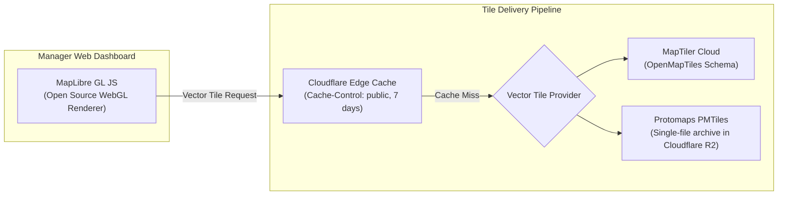

# ADR-011: Maps & Geospatial Services Architecture, Provider Strategy & Cost Model (Re-evaluated)

**Status:** Updated & Recommended for Phase 01A  
**Date:** October 2026 (Reconciled)  
**Deciders:** Lead Systems Architect, Frontend Engineering, Mobile Engineering  
**Controlling Document:** Phase 00 Approved Product Baseline ([`docs/product/APP-SURFACES.md`](../product/APP-SURFACES.md))

---

## 1. Context & Problem Statement

Oprino relies on geospatial capabilities across five distinct operational functions:
1. **Mobile Map Rendering:** Field workers viewing assigned site locations, task pins, and travel routes on Android and iOS.
2. **Web Dashboard Live Operations Map:** Managers monitoring real-time field staff markers, duty states, and recent trails.
3. **Geocoding & Reverse Geocoding:** Converting customer site addresses into latitude/longitude during site creation, and reverse-geocoding photo watermarks.
4. **Geofencing & Distance Calculations:** Checking proximity to customer sites and calculating conveyance travel mileage.
5. **Turn-by-Turn Navigation:** Guiding field workers to client facilities.

**Stakeholder Review Directive:**  
Do **NOT** label mapping as universally "$0". MapLibre GL is a client-side renderer, not a free production tile infrastructure. Clearly separate mobile rendering, web vector tiles, geocoding, reverse geocoding, routing, and static maps with exact provider assumptions and cost boundaries.

---

## 2. Granular Geospatial Capability Breakdown & Provider Selection

| Geospatial Capability | Primary Strategy & Provider | Production Cost Model & Provider Boundaries | Fallback / Alternative |
|---|---|---|---|
| **1. Mobile Map Rendering (iOS)** | **Apple MapKit SDK** (Native) | **Included with Apple Developer Account ($0.00/load)**. Native vector rendering on iOS hardware. | Google Maps SDK for iOS |
| **2. Mobile Map Rendering (Android)** | **Google Maps SDK for Android** (Native via Play Services) | **Included under Google Mobile SDK native terms ($0.00/map load)**. Unlimited native device views. | MapLibre Native |
| **3. Web Dashboard Vector Tiles** | **MapLibre GL JS + Protomaps / MapTiler** | **MapLibre is a renderer only.** Vector tiles sourced via: MapTiler Flex Tier (100k requests/mo free, then $0.05 per 1,000) or self-hosted Protomaps PMTiles on Cloudflare R2 (~$5.00/mo storage + ops). Budgeted: **$15.00–$30.00/month**. | Mapbox GL ($5.00/1k after 50k) |
| **4. Geocoding (Address -> Lat/Lng)** | **Hybrid Radar.com / Mapbox + PostgreSQL Cache** | Radar.com (100,000 requests/mo included free tier; then $0.50/1k) with strict database coordinate caching (`geocoding_cache`). Budgeted: **$0.00 – $10.00/mo**. | Google Geocoding ($5.00/1k) |
| **5. Reverse Geocoding (Watermarking)**| **Offline Local Reverse Geocoding + Radar API** | Reverse geocoding for photo watermarks checks local customer site name first (e.g. "At Site: Acme Corp"); falls back to cached API. | OpenStreetMap Nominatim (Dev only) |
| **6. Turn-by-Turn Navigation** | **OS Deep-Link Handoff (Native Apps)** | **$0.00 Cost.** Mobile app launches native Google Maps or Apple Maps app via standard URL scheme (`geo:lat,lng` / `maps://`). | In-app turn-by-turn SDK (Rejected: Costly) |
| **7. Spatial Math & Geofencing** | **PostgreSQL PostGIS Engine** | **$0.00 API Cost.** Handled entirely in-database using `ST_DWithin` and `ST_Length`. | Google Distance Matrix (Rejected: $5–$10/1k) |

---

## 3. Web Vector Tile Infrastructure Strategy

Because MapLibre GL is exclusively a client-side rendering library, production vector tiles require an explicit hosting and delivery architecture:



### Tile Strategy Evaluation:
1. **Phase V1 Launch Baseline:** **MapTiler Cloud**. Provides commercial OpenMapTiles vector styles with global coverage. The free tier covers 100,000 monthly requests, with subsequent volume at $0.05 per 1,000 requests. For 50 SMB tenants, web tile costs are modeled at **~$15.00 to $25.00 per month**.
2. **Scale Path (V1.5+):** Self-hosted **Protomaps (PMTiles)** stored directly in Cloudflare R2. Delivers zero-egress, serverless vector tiles directly from R2 byte-range requests, reducing tile hosting to under **$5.00 per month** regardless of request volume.

---

## 4. Address Geocoding & Coordinate Caching Pipeline

To prevent repeated API calls when multiple employees visit the same customer locations:

```sql
CREATE TABLE public.geocoding_cache (
    id UUID PRIMARY KEY DEFAULT gen_random_uuid(),
    normalized_address TEXT UNIQUE NOT NULL,
    latitude DOUBLE PRECISION NOT NULL,
    longitude DOUBLE PRECISION NOT NULL,
    provider VARCHAR(32) NOT NULL,
    raw_response JSONB,
    created_at TIMESTAMPTZ NOT NULL DEFAULT NOW()
);

CREATE INDEX idx_geocoding_address ON public.geocoding_cache(normalized_address);
```

### Workflow:
1. When a business manager creates or updates a Customer Site, the system hashes and normalizes the street address.
2. The server queries `public.geocoding_cache`:
   - If present: Returns cached coordinates instantly ($0 API cost, 2ms latency).
   - If missing: Queries Radar / Mapbox geocoding API, stores result in `geocoding_cache`, and saves coordinates to `customer_sites.location`.
3. Customer site addresses are geocoded **exactly once**. Subsequent visits and task dispatches generate zero third-party geocoding API requests.

---

## 5. Turn-by-Turn Routing & Directions Strategy

Field workers frequently need navigation to client facilities. 
- **In-App Navigation Trap:** Embedding an interactive turn-by-turn navigation engine inside the app (e.g. Mapbox Navigation SDK or Google Navigation SDK) costs **$0.02 to $0.04 per active trip**, creating massive recurring cost drain.
- **Oprino Deep-Link Handoff Pattern:**
  - Field worker taps "Navigate" on a task card.
  - The mobile app invokes the native OS map intent:
    - Android: `intent:geo:lat,lng?q=lat,lng(Site+Name)` (Opens Google Maps).
    - iOS: `maps://?daddr=lat,lng&dirflg=d` (Opens Apple Maps).
  - The worker gets world-class turn-by-turn voice navigation with live traffic for **$0.00**.
  - Oprino continues background duty-hours tracking via Transistor Software in the background.

---

## 6. Budgeted Geospatial Cost Summary (2,500 Active Platform Users)

| Service Item | Monthly Volume Estimate | Provider & Unit Rate | Total Monthly Cost |
|---|---|---|:---:|
| **Mobile Map Views (iOS & Android)** | ~300,000 loads | Native MapKit / Google SDKs | **$0.00** |
| **Web Map Vector Tiles** | ~350,000 tile requests | MapTiler / Protomaps on R2 | **$25.00** |
| **Address Geocoding** | ~5,000 new sites/mo | Radar API (100k free tier + cache)| **$0.00** |
| **Geofencing & Conveyance** | ~4,500,000 distance checks| In-Database PostGIS Engine | **$0.00** |
| **Navigation & Routing** | ~40,000 trips | Native OS Deep-Link Handoff | **$0.00** |
| **Total Monthly Geospatial Cost** | — | — | **$25.00 / month** |

---

## 7. Compliance with Phase 00 Approved Scope

- Formulates a realistic, parameterized cost model separating mobile rendering from web tile infrastructure.
- Preserves high visual fidelity and smooth vector performance without falling into Google Maps Platform bill shock traps.
