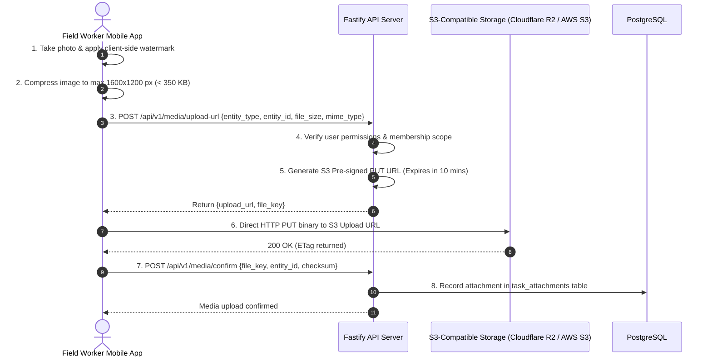

# ADR-012: Object Storage & Media Processing Architecture

**Status:** Proposed / Recommended for Phase 01A  
**Date:** October 2026  
**Deciders:** Lead Systems Architect, Security Engineering  
**Controlling Document:** Phase 00 Approved Product Baseline ([`docs/product/OPRINO-MASTER-PRD.md`](../product/OPRINO-MASTER-PRD.md))

---

## 1. Context & Problem Statement

Oprino handles critical operational media assets:
- **Proof-of-Work Photos:** Before-and-after field servicing images, equipment photos, and installation proofs.
- **Customer Signatures:** On-glass sign-offs captured on mobile touchscreens.
- **Work Orders & Documents:** PDF schematics, client contracts, and inspection attachments.
- **Attendance Selfies:** Verification photos captured during mobile punch-in.

Key technical requirements:
- Large photo uploads must **never route through or block** API server application threads.
- Strict multi-tenant security: Tenant A must never be able to access or guess the URL of Tenant B’s signed proof photos.
- Mobile data efficiency: Field workers on limited cellular plans must not upload raw 12-megapixel (5 MB+) images.
- Immutability and audit integrity: Photos must embed verifiable cryptographic watermarks (timestamp, coordinates, task ID).

---

## 2. Alternatives Evaluated

### Alternative A: Pre-Signed S3-Compatible Object Storage (AWS S3 / Cloudflare R2)
- **Overview:** Mobile and web clients upload binaries directly to an S3-compatible bucket using short-lived, pre-signed `PUT` URLs generated by the Fastify backend.
- **Pros:**
  - Zero API server bandwidth or memory consumed by binary file transfers.
  - Cloudflare R2 offers **zero egress bandwidth fees**, saving hundreds of dollars monthly on photo proof viewing.
  - Native multi-tenant isolation via prefix path policies (`/{workspace_id}/...`).
  - Pre-signed `GET` URLs (15-minute expiry) prevent unauthorized public access to sensitive customer photos and signatures.
- **Cons:** Requires a 2-step handshake: client requests URL from API → uploads binary directly to storage.

### Alternative B: API Multipart Form Upload to Server Disk / Local Mount
- **Overview:** Uploading files directly to the Node.js backend using `multipart/form-data`, which writes to local disk or network volume.
- **Pros:** Single-step API call.
- **Cons:** Consumes heavy API server RAM and CPU; blocks Node.js event loop during image parsing; does not scale across multiple server instances.

---

## 3. Decision

**Adopt Pre-Signed S3-Compatible Object Storage (Cloudflare R2 or AWS S3) combined with Client-Side Image Compression and Timestamp Watermarking.**

### Architectural Workflow:



---

## 4. Technical Specifications & Guardrails

1. **Storage Path Partitioning (Tenant Isolation):**
   - All object keys are strictly namespaced by workspace UUID:
     ```text
     /{workspace_id}/proofs/{year}/{month}/{task_id}/{file_id}.jpg
     /{workspace_id}/signatures/{year}/{month}/{task_id}/sig_{file_id}.png
     /{workspace_id}/attendance/{year}/{month}/{attendance_id}/selfie.jpg
     ```
   - Cloudflare R2 / S3 IAM policies restrict access strictly via signed URLs.
2. **Access Control (Zero Public Buckets):**
   - The S3 storage bucket is **100% private** with all public read access blocked.
   - When a manager views a proof photo in the Web Dashboard or Manager App, the API generates a pre-signed `GET` URL valid for **15 minutes**. Unauthenticated users cannot view media even if they guess the key.
3. **Client-Side Compression & Optimization:**
   - Prior to upload, the mobile app resizes images to a maximum bounding box of `1600 x 1200 px` at `80% JPEG quality`.
   - File size is reduced from ~5 MB to ~200–350 KB with zero loss of operational clarity for equipment inspection.
4. **Watermarking Engine:**
   - In-app camera module burns a permanent text watermark onto the bottom edge of the photo canvas before compression:
     ```text
     OPRINO VERIFIED PROOF • 2026-10-04 14:32:10 UTC
     LAT: 28.5355° N, LONG: 77.3910° E • ACCURACY: 8m
     TASK: #1049 • USER: Rajesh Kumar (EMP-042)
     ```
   - This watermark becomes an immutable part of the raster pixels, preventing visual tampering.

---

## 5. Consequences & Mitigations

- **Consequence:** Pre-signed upload URLs could be requested but never used (abandoned uploads).  
  *Mitigation:* A daily BullMQ cleanup cron queries unconfirmed S3 uploads older than 24 hours and purges orphaned objects.
- **Consequence:** Cloudflare R2 vs. AWS S3 choice.  
  *Mitigation:* Both use identical standard S3 APIs via `@aws-sdk/client-s3`. Switching between AWS S3 and Cloudflare R2 requires changing only 3 environment variables (`S3_ENDPOINT`, `S3_ACCESS_KEY`, `S3_SECRET_KEY`) with zero code changes.
- **Reversal Cost:** Very Low.
