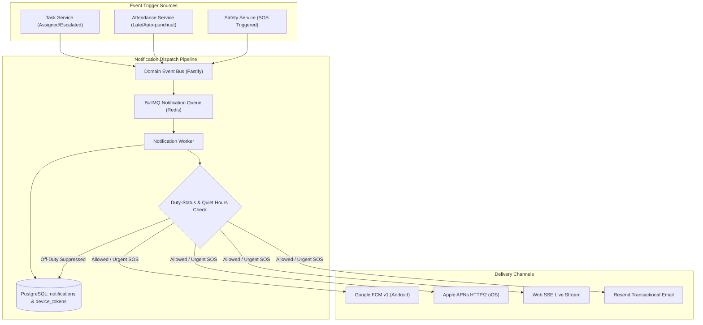

# ADR-013: Push Notification, In-App Alerting & Messaging Architecture

**Status:** Proposed / Recommended for Phase 01A  
**Date:** October 2026  
**Deciders:** Lead Systems Architect, Mobile Engineering, Backend Engineering  
**Controlling Document:** Phase 00 Approved Product Baseline ([`docs/product/OPRINO-MASTER-PRD.md`](file:///workspace/oprino/docs/product/OPRINO-MASTER-PRD.md))

---

## 1. Context & Problem Statement

Oprino operates across dynamic operational contexts where field personnel and management require prompt, reliable notifications:
- **Immediate Task Alerts:** New task assignment, task reassignment, emergency priority escalations, customer visit reschedules.
- **Operational Exceptions:** Late arrival, geofence departure during active task, missed check-in SLA, unacknowledged high-priority work.
- **Approvals & Governance:** Leave requests, attendance regularizations, manual expense claims, proof-of-work rejections.
- **Safety & SOS:** Immediate high-priority notification to assigned managers upon field worker SOS trigger.

Critical technical requirements:
1. **Multi-Channel Delivery:** Native mobile push (APNs for iOS, FCM HTTP v1 for Android), in-app notification inbox (synced across devices), and transactional email/digests for managers.
2. **Duty-State Awareness & Quiet Hours:** Field workers must not receive routine work-related push notifications while OFF-DUTY, respecting labor compliance and employee privacy (emergency SOS/critical system alerts exempt).
3. **Delivery Reliability & Battery Friendliness:** High-priority FCM/APNs data payloads for urgent alerts; silent data pushes minimized to prevent OS background execution kills.
4. **Tenant Isolation:** Notifications must never cross workspace boundaries; recipient tokens and notification payloads must strictly belong to the authenticated workspace.

---

## 2. Alternatives Evaluated

### Alternative A: Unified Multi-Channel Orchestrator (Firebase Cloud Messaging [FCM v1] + APNs via Node.js + Resend for Email + In-App DB Table)
- **Architecture:** 
  - Backend uses native Firebase Admin SDK (FCM HTTP v1) for Android and APNs direct/HTTP/2 for iOS (or via FCM for both).
  - Web & Mobile in-app notifications stored in PostgreSQL `notifications` table with tenant scoping, unread badges, and SSE push for web dashboard.
  - Transactional email digests dispatched via Resend / SendGrid through background BullMQ workers.
- **Pros:** Zero third-party SaaS per-message surcharge; complete data sovereignty; zero vendor lock-in for critical operational data; direct control over quiet hours and duty-state filtering before dispatch.
- **Cons:** Requires managing APNs certificates/keys and FCM service credentials directly in Oprino backend infrastructure.

### Alternative B: Commercial Push & Alert Platforms (OneSignal / Knock / Courier)
- **Architecture:** Route all events to a third-party notification management platform which handles templates, user preferences, and multi-channel routing.
- **Pros:** Pre-built notification center UI components, visual workflow builders.
- **Cons:** High variable cost per active user ($0.03–$0.05/MAU adding up significantly for 500-employee SMBs); data privacy risk (routing field employee names, task addresses, and operational events through third-party servers); vendor lock-in.

### Alternative C: Expo Push Notification Service
- **Architecture:** Route mobile push through Expo's hosted push relay.
- **Pros:** Fast to set up in early development.
- **Cons:** Dependent on Expo cloud infrastructure uptime; rate limits; unsuited for mission-critical enterprise/B2B operational and SOS alerts.

---

## 3. Comparative Evaluation Matrix

| Criterion | Weight | Alternative A: Direct FCM v1/APNs + Resend | Alternative B: Commercial SaaS (OneSignal/Knock) | Alternative C: Expo Push Relay |
|---|:---:|:---:|:---:|:---:|
| **SMB Unit Economics & Cost Scaling** | 25% | **10 / 10 ($0 marginal push cost)** | 4 / 10 (Scales per MAU) | 7 / 10 |
| **Data Privacy & Operational Confidentiality** | 20% | **10 / 10 (Zero third-party telemetry)** | 6 / 10 (External data routing) | 6 / 10 |
| **Duty-Hours & Quiet-Hours Filtering Control** | 20% | **10 / 10 (Native SQL query guard)** | 7 / 10 (External rules sync) | 6 / 10 |
| **Reliability on Budget Android Devices** | 15% | **9 / 10 (Direct FCM v1)** | 8.5 / 10 | 7 / 10 |
| **Operational Maintenance Overhead** | 20% | 8 / 10 (Cred management) | 9 / 10 | 8.5 / 10 |
| **Weighted Total** | **100%** | **9.45 / 10** | **6.75 / 10** | **6.95 / 10** |

---

## 4. Decision & Rationale

**Selected Architecture: Alternative A — Direct FCM HTTP v1 / APNs Integration + In-App PostgreSQL Store + BullMQ Async Dispatch + Resend for Email.**

### Rationale:
1. **Unit Economics:** For an SMB SaaS platform supporting 10–200 employees per company across hundreds of tenants, paying third-party notification SaaS fees per active seat destroys margins. FCM v1 and APNs provide direct, free notification infrastructure.
2. **Privacy & Compliance:** Push payloads for field operations frequently contain sensitive metadata (e.g., customer address, assigned technician, ticket priority). Keeping delivery internal to Oprino prevents customer PII leaks to third-party ad/analytics networks.
3. **Duty-Hours Gating:** Oprino's strict core principle prohibits off-duty tracking and harassment. Direct dispatch allows our BullMQ notification worker to query `employees.duty_status` and employee notification preferences prior to queuing push tokens.

---

## 5. Architecture & Implementation Guidelines

### 5.1 Push Notification Payloads & Priority Classification
- **High Priority (`priority: "high"`, APNs `apns-priority: 10`):**
  - Used strictly for SOS alerts, immediate safety hazards, and real-time manager approvals.
  - Bypasses battery doze mode where permitted.
- **Normal Priority (`priority: "normal"`, APNs `apns-priority: 5`):**
  - Task assignments, status changes, schedule updates.
  - Batched if device is asleep to conserve field battery life.
- **Data-Only vs Notification-Display Payloads:**
  - Android & iOS notifications display standard system alerts with title, body, sound, and deep-link payload (`{ screen: "TASK_DETAIL", taskId: "uuid" }`).
  - Raw background data messages are strictly minimized to preserve battery and prevent OS background crash penalties.

### 5.2 Device Token Management & Lifecycle
- Table: `user_device_tokens`
  - `id`: UUID (Primary Key)
  - `workspace_id`: UUID (Tenant isolation)
  - `user_id`: UUID (Foreign Key)
  - `platform`: `android` | `ios` | `web`
  - `token`: Text (FCM registration token or APNs hex token)
  - `app_version`: String
  - `is_active`: Boolean
  - `last_seen_at`: Timestamptz
  - `created_at`: Timestamptz
- **Token Invalidation:** On FCM `UNREGISTERED` or APNs `BadDeviceToken` (HTTP 410 Gone), the worker immediately marks `is_active = false` to prevent delivery stalls.
- **Logout Cleansing:** Explicit logout revokes the specific device token from the active session.

### 5.3 In-App Notification Center
- Table: `notifications`
  - `id`: UUID
  - `workspace_id`: UUID
  - `recipient_user_id`: UUID
  - `category`: `task` | `attendance` | `safety` | `system` | `approval`
  - `title`: String
  - `body`: Text
  - `data`: JSONB (Deep-link payload)
  - `is_read`: Boolean (Default: false)
  - `read_at`: Timestamptz nullable
  - `created_at`: Timestamptz
- Delivered instantly to active web sessions via Server-Sent Events (ADR-010) and polled/fetched on mobile app resume.

---

## 6. Consequences & Trade-offs

- **Positive:**
  - Zero recurring message-count SaaS billing.
  - Full adherence to off-duty communication privacy.
  - Native deep-linking directly into mobile task views.
  - Resilient retry and dead-letter queue handling in BullMQ.
- **Negative:**
  - Requires maintaining Apple Developer Push Certificates / Auth Keys and Google Service Account JSONs per deployment environment.
  - Mobile developers must handle push notification permission dialogs and native channel configurations (Android 13+ runtime permissions).
- **Mitigation:**
  - Use Expo Config Plugins (`@react-native-firebase/app`, `@react-native-firebase/messaging`) to cleanly automate native Android/iOS push setup during prebuild.

---

## 7. Compliance with Phase 00 Approved Scope

- Enforces employee off-duty privacy by filtering work notifications during off-duty hours.
- Supports instant Owner/Manager exception alerting (late arrivals, missed check-ins, SOS).
- Fully multi-tenant isolated by `workspace_id`.
