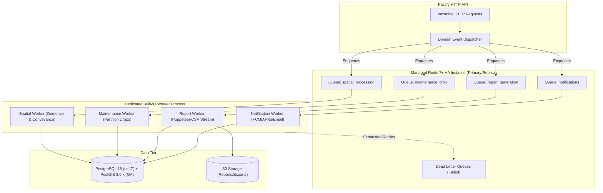

# ADR-014: Background Job Processing, Schedulers & Asynchronous Workflows

**Status:** Proposed / Recommended for Phase 01A  
**Date:** October 2026  
**Deciders:** Lead Systems Architect, Backend Engineering  
**Controlling Document:** Phase 00 Approved Product Baseline ([`docs/product/OPRINO-MASTER-PRD.md`](file:///workspace/oprino/docs/product/OPRINO-MASTER-PRD.md))

---

## 1. Context & Problem Statement

Oprino requires an enterprise-grade asynchronous processing and scheduling backbone to execute tasks outside the synchronous HTTP request-response cycle:
1. **Periodic Scheduled Operations:**
   - 30-day location history partition rotation and automated drop (Phase 00 mandatory compliance).
   - Daily shift auto-punchout for forgotten shift ends (preventing runaway tracking).
   - Overdue task SLA monitoring and managerial escalation triggers.
   - Nightly conveyance mileage calculations from duty location breadcrumbs.
2. **Asynchronous Event-Driven Workflows:**
   - Multi-channel notification delivery (FCM v1, APNs, Resend email).
   - Webhook deliveries to third-party SMB systems (ERP/HRMS in V1.5+).
   - Heavy operational report generation (PDF rendering, large multi-site CSV streaming).
   - Geofence entry/exit validation for site visits.

Key requirements:
- **Zero Event-Loop Starvation:** Heavy CPU workloads (PDF rendering, complex spatial math) must never block the Fastify API process serving HTTP requests.
- **Idempotency & Deduplication:** Network retries or re-queued jobs must never create duplicate notifications, double-punch attendance, or corrupt audit trails.
- **Multi-Tenant Context:** Every queued job payload must explicitly carry `workspace_id` to guarantee tenant isolation throughout asynchronous execution.
- **Observability:** Job status, execution latencies, failure rates, and dead-letter queues (DLQ) must be observable in real-time.

---

## 2. Alternatives Evaluated

### Alternative A: BullMQ + Redis (Isolated Node.js Worker Process)
- **Architecture:** Node.js TypeScript job queue backed by Redis 7+ Streams and Lua scripts. Scheduled recurring jobs driven by BullMQ repeatable cron jobs. Workers executed in a dedicated Node.js OS process separate from Fastify HTTP API.
- **Pros:**
  - Native TypeScript ecosystem: 100% shared business logic, database models, and validation schemas with Fastify API.
  - Battle-tested performance: Capable of 10,000+ jobs/sec, far exceeding SMB platform demands.
  - Native support for retries with exponential backoff, rate limiting per tenant, job deduplication via `jobId`, parent-child job flows, and dead-letter queues.
  - Lightweight operational footprint: Leverages the managed Redis HA instance (Primary/Replica with persistence) already deployed for cache/session management.
- **Cons:** Requires Redis persistence (AOF/RDB) configuration to prevent job loss during restarts.

### Alternative B: Temporal.io / Cadence (Orchestration Engine)
- **Architecture:** Distributed workflow engine with durable execution, state preservation, and complex activity orchestration.
- **Pros:** Unmatched durability and complex long-running state machine orchestration.
- **Cons:** Extreme architectural complexity and operational overhead; requires running dedicated Temporal clusters and Cassandra/PostgreSQL storage; over-engineered for SMB field operations workloads; steep learning curve.

### Alternative C: PostgreSQL-Based Job Queues (Graphile Worker / pg-boss)
- **Architecture:** Uses PostgreSQL `SKIP LOCKED` queries for message queues.
- **Pros:** Single database technology stack (no Redis required for queuing).
- **Cons:** Higher write amplification and connection pool contention on the primary relational database; vacuum overhead on high-frequency notification queues; lacks built-in Redis memory speed and complex rate-limiting primitives.

---

## 3. Comparative Evaluation Matrix

| Criterion | Weight | Alternative A: BullMQ + Redis | Alternative B: Temporal.io | Alternative C: pg-boss (PostgreSQL) |
|---|:---:|:---:|:---:|:---:|
| **SMB Operational Simplicity & Cost** | 25% | **9.5 / 10** | 3 / 10 (High overhead) | 8.5 / 10 |
| **Throughput & Low Latency** | 20% | **9.5 / 10** | 8 / 10 | 6.5 / 10 (DB lock contention) |
| **TypeScript / Zod Model Sharing** | 20% | **10 / 10** | 8 / 10 | 10 / 10 |
| **Deduplication & Idempotency** | 15% | **9 / 10 (`jobId` dedup)** | 10 / 10 | 8 / 10 |
| **Scheduled Recurring Jobs (Cron)** | 20% | **9 / 10 (Repeatable jobs)** | 9.5 / 10 | 8 / 10 |
| **Weighted Total** | **100%** | **9.40 / 10** | **7.15 / 10** | **8.25 / 10** |

---

## 4. Decision & Rationale

**Selected Architecture: Alternative A — BullMQ + Redis with Process-Level Separation.**

### Rationale:
1. **Separation of Concerns:** The Fastify HTTP API process and the BullMQ Background Worker process run as distinct OS containers/processes sharing the same codebase (`apps/api` and `apps/worker` in the monorepo). Fastify handles low-latency HTTP/REST requests, while the worker pool processes compute-intensive and deferred workloads.
2. **Unified TypeScript Stack:** Allows worker processors to import the exact same domain entities, Drizzle/Prisma database repositories, and Zod schemas used in the API, eliminating serialization/typing discrepancies.
3. **Cost Efficiency:** Redis is already required for session caching, rate-limiting, and real-time SSE presence. Utilizing Redis for BullMQ avoids adding complex third-party workflow infrastructure.

---

## 5. Architecture & Implementation Guidelines

### 5.1 Standard Queue Taxonomy

| Queue Name | Concurrency | Priority | Retry Strategy | Purpose |
|---|:---:|:---:|---|---|
| `notifications` | 20 | High | Exponential (3 attempts, 5s initial) | FCM, APNs, Resend email dispatch |
| `spatial_processing` | 10 | Medium | Exponential (3 attempts, 10s initial) | Daily conveyance calculation, geofence audit |
| `report_generation` | 2 (CPU-bound) | Low | Fixed (2 attempts, 30s delay) | Headless PDF rendering, CSV export generation |
| `maintenance_cron` | 1 (Singleton) | High | Immediate (5 attempts) | Partition creation/dropping, auto-punchout |

### 5.2 Scheduled Cron Jobs (Repeatable Jobs)

1. **Daily Location Partition Maintenance (02:00 UTC):**
   - Creates future 1-day or 7-day partitions for `employee_locations`.
   - Identifies partitions older than the workspace's retention policy (default: 30 days per frozen policy; or 7/90/180 days) and executes the security-definer procedure `telemetry.prune_expired_partitions()` ([`ADR-004`](file:///workspace/oprino/docs/architecture/ADR-004-database-geospatial.md), [`RETENTION-ARCHITECTURE.md`](file:///workspace/oprino/docs/architecture/RETENTION-ARCHITECTURE.md)).
2. **Auto-Punchout Engine (Every 15 minutes):**
   - Queries open attendance records where `shift_end_time + max_overtime_buffer < NOW()`.
   - Automatically punches out abandoned shifts with `punch_out_reason = 'AUTO_SYSTEM_SHIFT_LIMIT'`.
   - Triggers native command to terminate background tracking for the mobile client.
3. **Overdue Task SLA Evaluator (Every 5 minutes):**
   - Scans active tasks where `due_date < NOW()` and `status != 'COMPLETED'`.
   - Flags task as `OVERDUE` and enqueues manager escalation notification.

### 5.3 Idempotency & Fault Tolerance
- **Idempotent Job IDs:** Every job enqueued from an event constructs a deterministic `jobId`:
  - Notification: `jobId: notif-${workspaceId}-${recipientId}-${eventId}`
  - Report: `jobId: report-${workspaceId}-${reportRequestId}`
  - Partition Drop: `jobId: partition-drop-${partitionName}-${dateString}`
- Duplicate enqueue requests with identical `jobId` are silently deduplicated by BullMQ within their TTL window.
- **Dead-Letter Queue (DLQ):** Jobs failing all retry attempts are routed to `failed-jobs` with full error stack traces and payload inspection for developer debugging.

---

## 6. Consequences & Trade-offs

- **Positive:**
  - Prevents Fastify API latency degradation under heavy export or notification loads.
  - Complete control over retry backoff, concurrency limits, and scheduled tasks.
  - Deterministic partition pruning guarantees zero 30-day retention policy violations.
- **Negative:**
  - Requires maintaining Redis high availability (failover via Redis Sentinel or AWS ElastiCache / Redis Cloud).
  - Background worker memory must be monitored, especially when generating PDF reports with headless Chromium.
- **Mitigation:**
  - Limit concurrent PDF worker jobs to 2, and use memory limits (`max-old-space-size=1024`) with automatic process recycling on leak detection.

---

## 7. Compliance with Phase 00 Approved Scope

- Directly implements the automated 30-day default location history retention purge without manual intervention.
- Enforces shift-boundary duty tracking limits via automated shift auto-punchout.
- Supports manager exception alerting with deterministic SLA evaluation.
