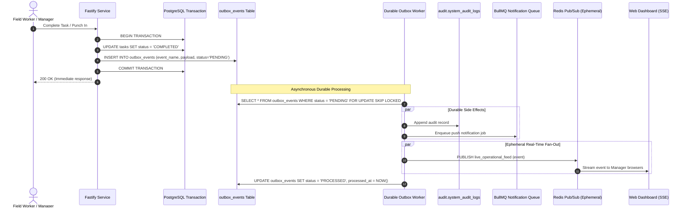

# ADR-015: Durable Domain Events & Transactional Outbox Architecture (Re-evaluated)

**Status:** Updated & Recommended for Phase 01A  
**Date:** October 2026 (Reconciled)  
**Deciders:** Lead Systems Architect, Backend Engineering  
**Controlling Document:** Phase 00 Approved Product Baseline ([`docs/product/OPRINO-MASTER-PRD.md`](../product/OPRINO-MASTER-PRD.md))

---

## 1. Context & Problem Statement

In Oprino, core business mutations trigger multiple mission-critical downstream side effects:
- **Task Assigned / Status Transition:**
  1. Primary state change (e.g. `tasks` table status updated to `IN_PROGRESS` or `COMPLETED`).
  2. Side effect A: Append to immutable `audit.system_audit_logs`.
  3. Side effect B: Dispatch push notification to assigned worker or manager.
  4. Side effect C: Broadcast real-time SSE update to connected web dashboards.
  5. Side effect D: Evaluate SLA breach timers.
- **Attendance Punch-In / Punch-Out:**
  1. Primary state change (update `attendance_records`).
  2. Side effect A: Start/stop duty session tracking.
  3. Side effect B: Enqueue travel mileage calculation.
  4. Side effect C: Update live map status on manager dashboard.
  5. Side effect D: Create audit log entry.

**Critical Defect in Pure In-Memory / Redis Pub-Sub Models:**  
If a server process crashes or restarts immediately after a database commit, an in-memory event bus or volatile Redis Pub/Sub channel permanently loses the event. Notifications are never sent, audit records are missing, and workflows stall.

**Durable Events Include At Minimum:**
- Attendance state transitions (punch-in, punch-out, regularization)
- Task state transitions (created, assigned, in-progress, completed, approved, reworked)
- Customer site visit state transitions (check-in, check-out)
- Proof-of-work submission and approval/rejection
- Audit-relevant policy and configuration updates
- All notification-generating operational events

---

## 2. Alternatives Evaluated

### Alternative A: PostgreSQL Transactional Outbox Pattern + BullMQ Dispatcher + Redis Pub/Sub (Ephemeral Fan-Out Only)
- **Architecture:** 
  1. The business mutation and an event record in `public.outbox_events` are inserted **inside the same ACID database transaction**.
  2. Once committed, the event is durably stored in PostgreSQL.
  3. A durable dispatcher worker (triggered via immediate in-process notification or BullMQ outbox processor) processes events with at-least-once delivery semantics.
  4. Downstream side effects (audit log writes, notification queueing, SLA scheduling) execute durably.
  5. Redis Pub/Sub is utilized **strictly as an ephemeral transport** for real-time live map / SSE dashboard broadcasting.
- **Pros:** 
  - 100% crash durability: a server crash cannot lose committed events.
  - Zero dual-write failure windows; atomic with business state.
  - Redis Pub/Sub kept to its appropriate role (ephemeral real-time fan-out).
  - No distributed streaming infrastructure (Kafka/RabbitMQ) required.
- **Cons:** Outbox table requires periodic pruning of processed events.

### Alternative B: Direct In-Process Event Dispatcher + Redis Pub/Sub Only
- **Architecture:** After DB commit, events emitted to `EventEmitter3` and Redis Pub/Sub.
- **Pros:** Low implementation effort.
- **Cons:** **Rejected.** Process failure or Redis restart after DB commit causes silent loss of audit records and notifications.

### Alternative C: Distributed Streaming Bus (Apache Kafka / Redpanda)
- **Architecture:** Change Data Capture (Debezium) streaming WAL logs to Kafka.
- **Pros:** High event replay capability.
- **Cons:** Extreme operational overhead, high infrastructure cost, and unnecessary complexity for SMB scale (10–200 employees).

---

## 3. Comparative Evaluation Matrix

| Criterion | Weight | Alt A: Transactional Outbox + BullMQ | Alt B: In-Process + Redis Pub/Sub | Alt C: Kafka / Debezium |
|---|:---:|:---:|:---:|:---:|
| **Event Durability & Zero Loss Guarantee** | 35% | **10 / 10 (ACID Atomic)** | 3 / 10 (Process crash loss) | 10 / 10 |
| **SMB Operational Simplicity & Cost** | 25% | **9.5 / 10 ($0 additional infra)** | 9 / 10 | 2 / 10 (Heavy cluster) |
| **Separation of Durable vs Ephemeral** | 20% | **10 / 10 (DB durable, Redis live)** | 4 / 10 (Conflated) | 8 / 10 |
| **Developer Velocity & Testing** | 20% | **9.5 / 10 (Standard SQL tables)** | 9 / 10 | 4 / 10 (Complex setup) |
| **Weighted Total** | **100%** | **9.75 / 10** | **6.15 / 10** | **6.40 / 10** |

---

## 4. Decision & Rationale

**Selected Architecture: Alternative A — PostgreSQL Transactional Outbox Pattern for Authoritative Durable Events + BullMQ Dispatcher + Redis Pub/Sub strictly for Ephemeral Real-Time Fan-Out.**

### Rationale:
1. **Zero Dual-Write Race Condition:** Writing the domain event into `public.outbox_events` inside the exact same database transaction that updates the entity (`tasks`, `attendance_records`, `customer_visits`) guarantees atomicity. If the transaction rolls back, no phantom event is created. If it commits, the event cannot be lost.
2. **Crash Resilience:** If the Node.js API process crashes immediately after `COMMIT`, the BullMQ outbox processor reads uncompleted outbox rows upon restart and executes side effects with guaranteed at-least-once delivery.
3. **Correct Role for Redis Pub/Sub:** Redis Pub/Sub is never used as an authoritative event store. It serves exclusively as a high-speed, volatile message bus to broadcast real-time updates to connected Web SSE clients. If an SSE connection drops or Redis blips, the authoritative state remains intact in PostgreSQL.

---

## 5. Architecture & Implementation Guidelines



### 5.1 Outbox Schema (`public.outbox_events`)
```sql
CREATE TABLE public.outbox_events (
    id UUID PRIMARY KEY DEFAULT gen_random_uuid(),
    workspace_id UUID NOT NULL REFERENCES public.workspaces(id) ON DELETE CASCADE,
    event_name VARCHAR(128) NOT NULL, -- 'task.completed', 'attendance.punched_in'
    aggregate_type VARCHAR(64) NOT NULL, -- 'task', 'attendance', 'visit'
    aggregate_id UUID NOT NULL,
    actor_id UUID NOT NULL,
    payload JSONB NOT NULL,
    metadata JSONB,
    status VARCHAR(32) NOT NULL DEFAULT 'PENDING', -- 'PENDING', 'PROCESSING', 'PROCESSED', 'FAILED'
    attempts INT NOT NULL DEFAULT 0,
    last_error TEXT,
    created_at TIMESTAMPTZ NOT NULL DEFAULT NOW(),
    processed_at TIMESTAMPTZ
);

CREATE INDEX idx_outbox_pending ON public.outbox_events(created_at) WHERE status = 'PENDING';
CREATE INDEX idx_outbox_workspace ON public.outbox_events(workspace_id, created_at DESC);
```

### 5.2 Outbox Event Pruning
- A scheduled BullMQ maintenance worker cleans up processed outbox rows older than 7 days:
  `DELETE FROM public.outbox_events WHERE status = 'PROCESSED' AND processed_at < NOW() - INTERVAL '7 days';`

---

## 6. Consequences & Trade-offs

- **Positive:**
  - Absolute data durability for critical operational events.
  - Zero lost notifications or missing audit trails during server restarts.
  - Clear architectural decoupling between durable state and volatile real-time streams.
- **Negative:**
  - Slightly higher database write I/O (one extra row insert per business mutation).
- **Mitigation:**
  - `outbox_events` is lean and indexed; processed records are purged regularly to keep table size minimal (< 100 MB).

---

## 7. Compliance with Phase 00 Approved Scope

- Ensures reliable audit logging and managerial exception alerting across all multi-tenant SMB operations.
- Guarantees zero loss of duty state changes.
