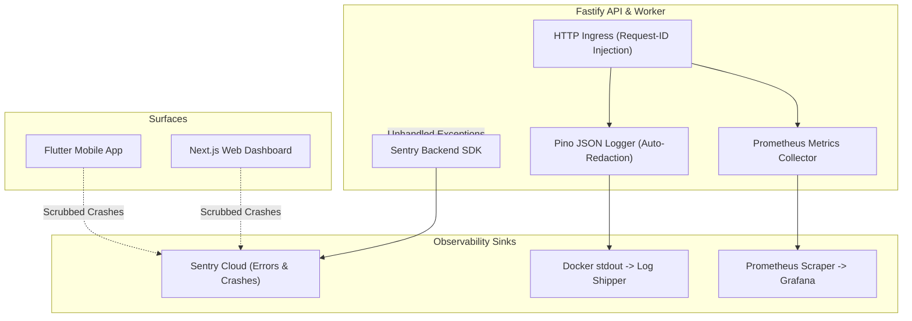

# ADR-016: Observability, Structured Logging, Metrics & Error Tracking Architecture

**Status:** Proposed / Recommended for Phase 01A  
**Date:** October 2026  
**Deciders:** Lead Systems Architect, DevOps, Security & Privacy Officer  
**Controlling Document:** Phase 00 Approved Product Baseline ([`docs/product/OPRINO-MASTER-PRD.md`](file:///workspace/oprino/docs/product/OPRINO-MASTER-PRD.md))

---

## 1. Context & Problem Statement

Oprino operates a multi-tenant operational SaaS environment spanning mobile field workers on unpredictable cellular networks, real-time live map dashboards, and background scheduled jobs. Effective observability is critical for:
- Detecting mobile sync failures, offline mutation queue stalls, and GPS permission revocations.
- Monitoring API latencies, database connection pool health, and Redis/BullMQ queue bottlenecks.
- Rapid incident triage across distributed components (Web, Mobile, API, Worker).

However, field workforce software presents unique **Privacy & Compliance Challenges**:
- **Zero PII & Location Leakage in Logs:** Precise employee GPS coordinates (lat/lng), customer street addresses, phone numbers, and employee credentials must **NEVER** be leaked into application logs, error trackers, or APM traces.
- **Multi-Tenant Context:** Every log entry and metric must carry tenant context (`workspace_id`) without leaking cross-tenant data.
- **Resource Constraints:** Observability tooling must not burden budget Android devices or inflate cloud infrastructure bills for SMB margins.

---

## 2. Alternatives Evaluated

### Alternative A: Unified Open-Source & Privacy-Scrubbed Stack (Pino + Sentry + OpenTelemetry / Prometheus)
- **Logging:** Fastify native `pino` with JSON structured logging, automatic request-id correlation, and built-in redacting serializers for sensitive fields (`latitude`, `longitude`, `password`, `token`, `phone`).
- **Error Tracking:** Sentry across Web, Mobile (Flutter), and Backend API with client-side beforeSend scrubbing hooks.
- **Metrics & Health:** Fastify Prometheus metrics endpoint (`fastify-metrics`) exposing standard HTTP latencies, status codes, active SSE streams, BullMQ queue depths, and DB pool stats. Kubernetes/Docker liveness & readiness probes.
- **Pros:** Industry standard, zero performance overhead (Pino is the fastest Node.js logger), unified error aggregation in Sentry, complete privacy control via redactors.
- **Cons:** Requires configuring Sentry project keys and Prometheus scrapers.

### Alternative B: Commercial All-in-One Cloud APM (Datadog / New Relic)
- **Architecture:** Commercial proprietary agents installed across all hosts and applications.
- **Pros:** Turnkey dashboards, out-of-the-box APM traces.
- **Cons:** Astronomical pricing model ($15–$23 per host + $0.10/GB log ingest + per-trace fees) that quickly exceeds SMB SaaS margins; high risk of inadvertently ingesting PII/location data to third-party US cloud data stores.

---

## 3. Comparative Evaluation Matrix

| Criterion | Weight | Alternative A: Pino + Sentry + Prometheus | Alternative B: Commercial APM (Datadog/New Relic) |
|---|:---:|:---:|:---:|
| **SMB Cost & Margin Preservation** | 30% | **9.5 / 10 (Free open metrics + modest Sentry tier)** | 3 / 10 (Prohibitive log/host billing) |
| **Privacy Redaction & Compliance** | 30% | **10 / 10 (Granular regex & key redaction)** | 6 / 10 (High risk of unscrubbed leaks) |
| **Runtime Performance Overhead** | 20% | **9.5 / 10 (Pino asynchronous logging)** | 7 / 10 (Heavy APM agent monkey-patching) |
| **Unified Cross-Platform Coverage (Mobile/Web/API)** | 20% | **9 / 10 (Sentry native RN/Web/Node)** | 8.5 / 10 |
| **Weighted Total** | **100%** | **9.55 / 10** | **5.75 / 10** |

---

## 4. Decision & Rationale

**Selected Architecture: Alternative A — Pino Structured JSON Logging + Sentry Error Tracking with Privacy Scrubbers + Prometheus Metrics & Dual Health Probes.**

### Rationale:
1. **Privacy Invariance:** Privacy is a core product tenet of Oprino. Pino's native redaction paths (`redact: ['req.headers.authorization', 'payload.latitude', 'payload.longitude', 'payload.phone', 'payload.password']`) ensure zero telemetry leaks at the serialization level before log lines reach stdout.
2. **Predictable Cloud Costs:** By utilizing Prometheus/Grafana for infrastructure metrics and standard log aggregation (Loki or CloudWatch), infrastructure monitoring costs scale predictably rather than exponentially per log line.
3. **Cross-Platform Exception Visibility:** Sentry provides first-class support for Flutter Impeller crash reporting, Next.js source-mapped exceptions, and Node.js unhandled rejections under a single dashboard.

---

## 5. Architecture & Implementation Guidelines



### 5.1 Privacy Redaction Rules (Mandatory Pino Configuration)
In Fastify API and background workers, Pino MUST be instantiated with explicit redaction paths:

```typescript
export const loggerConfig = {
  level: process.env.LOG_LEVEL || 'info',
  redact: {
    paths: [
      'req.headers.authorization',
      'req.headers.cookie',
      '*.password',
      '*.token',
      '*.refreshToken',
      '*.secret',
      '*.latitude',
      '*.longitude',
      '*.coordinates',
      '*.customerPhone',
      '*.customerEmail',
      '*.address',
    ],
    censor: '[REDACTED_PRIVACY]',
  },
  formatters: {
    level: (label: string) => ({ level: label }),
  },
};
```

### 5.2 Request Correlation & Context Enrichment
- Every incoming HTTP request is assigned a unique `x-request-id` (UUIDv4) by Fastify hook if not supplied by the client.
- The request ID is attached to the request context and injected into all log statements, error events, and response headers (`X-Request-Id`).
- For authenticated requests, `workspace_id` and `user_id` are automatically bound to the child logger, enabling immediate per-tenant filtering without logging personal identifiers.

### 5.3 Health Check Endpoints
Fastify exposes two dedicated zero-overhead health check endpoints:
1. `GET /health/liveness`: Returns `200 OK { status: "UP", timestamp }`. Verifies the Node.js process is responsive and event-loop is healthy.
2. `GET /health/readiness`: Returns `200 OK` or `503 Service Unavailable`. Tests active connectivity to:
   - Primary PostgreSQL database (`SELECT 1;`)
   - Managed Redis HA instance (`PING`)
   - If either dependency fails, returns `503` so Kubernetes / load balancers route traffic away from the instance.

### 5.4 Prometheus Metrics Catalog (`/metrics`)
- `http_requests_total{method, route, status_code}`
- `http_request_duration_seconds{method, route, status_code}` (p50, p95, p99)
- `active_sse_connections{workspace_id}`
- `bullmq_queue_depth{queue_name}`
- `bullmq_job_duration_seconds{queue_name, status}`
- `db_pool_active_connections` / `db_pool_idle_connections`
- `mobile_offline_sync_batches_total{status}`

---

## 6. Consequences & Trade-offs

- **Positive:**
  - Complete compliance with privacy guidelines: no raw GPS or customer PII in logs.
  - Sub-millisecond logging performance using Pino's sonic-boom asynchronous writes.
  - Uniform error tracking across Mobile, Web, and Backend with full stack traces.
- **Negative:**
  - Redaction rules require strict enforcement during code reviews to ensure new sensitive property names are added to the redact list.
- **Mitigation:**
  - Automated linting rule / test suite that verifies no unredacted GPS coordinate patterns appear in sample logger outputs.

---

## 7. Compliance with Phase 00 Approved Scope

- Strictly enforces employee privacy by preventing duty location breadcrumbs from escaping into developer logs or APM dashboards.
- Provides health monitoring for mission-critical mobile sync and live map operational views.
- Fully isolated multi-tenant logging with `workspace_id` scoping.
