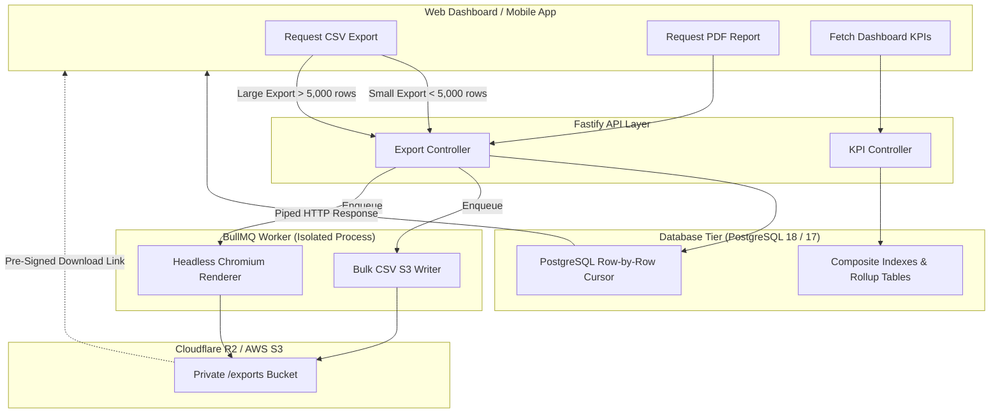

# ADR-019: Operational Reporting, Data Aggregation & Export Architecture

**Status:** Proposed / Recommended for Phase 01A  
**Date:** October 2026  
**Deciders:** Lead Systems Architect, Backend Engineering, Product  
**Controlling Document:** Phase 00 Approved Product Baseline ([`docs/product/OPRINO-MASTER-PRD.md`](../product/OPRINO-MASTER-PRD.md))

---

## 1. Context & Problem Statement

Oprino provides operational analytics and governance reports for SMB business owners and managers:
1. **Attendance & Hours Reports:** Daily punch-in/out times, late arrivals, early departures, total duty hours, overtime, leave days.
2. **Task Performance & SLA Metrics:** Completion rates, on-time percentage, first-time-fix rates, task distribution per employee, overdue escalations.
3. **Conveyance & Mileage Logs:** Approved duty-travel distances calculated from GPS breadcrumbs for expense reimbursements.
4. **Site Visit & Proof-of-Work Audits:** Completed customer visits, verified location stamps, customer signatures, watermarked site photos.

Technical challenges:
- **Low-Latency Dashboard Aggregations:** Summary cards and KPI widgets must load in < 500ms on the web dashboard.
- **Memory Safety During Bulk Exports:** Exporting 6 months of attendance or 20,000 task records to CSV must never crash the Node.js API process via Out-Of-Memory (OOM) errors.
- **PDF Generation Overhead:** Rendering complex multi-page operational inspection reports with embedded images is CPU-heavy.
- **Data Retention Boundary:** Location breadcrumbs are automatically purged after 30 days (default retention policy). Mileage and visit summaries must be aggregated and preserved independently before raw coordinates are deleted.

---

## 2. Alternatives Evaluated

### Alternative A: Hybrid In-Engine Aggregation (PostgreSQL + Node.js Streaming CSV + BullMQ Headless PDF)
- **Live Aggregations:** Executed directly in PostgreSQL 18 (or 17) using composite indexes, materialized rollups (`daily_attendance_summaries`, `daily_conveyance_summaries`), and window functions.
- **CSV Exports:** Streamed asynchronously from PostgreSQL cursors using Node.js streams to standard HTTP download or uploaded to S3 if requested as an asynchronous background batch.
- **PDF Generation:** Executed in the dedicated BullMQ background worker using headless Chromium (Puppeteer) rendering HTML/Tailwind templates, saved to private S3 storage with temporary signed download links.
- **Pros:** Zero additional database infrastructure; zero data synchronization lag; leverages existing relational indexes; streaming CSV requires < 25 MB RAM regardless of row count.
- **Cons:** Long-range analytical queries across 500+ employees require careful indexing.

### Alternative B: Dedicated Analytical Data Warehouse (ClickHouse / Snowflake / BigQuery)
- **Architecture:** Change Data Capture (CDC) pipelines streaming all database events to an external columnar database.
- **Pros:** Blazing-fast aggregations on billions of rows.
- **Cons:** Massive operational overhead, pipeline maintenance complexity, high monthly minimum infrastructure costs, complete overkill for SMBs with 10–200 employees.

---

## 3. Comparative Evaluation Matrix

| Criterion | Weight | Alternative A: PostgreSQL + Streams + BullMQ | Alternative B: Dedicated OLAP (ClickHouse) |
|---|:---:|:---:|:---:|
| **SMB Infrastructure Cost & Simplicity** | 35% | **9.5 / 10 ($0 additional infra)** | 3 / 10 (High cluster & pipeline cost) |
| **Real-Time Data Freshness** | 25% | **10 / 10 (Direct relational query)** | 7 / 10 (CDC replication delay) |
| **Memory Safety for Large Exports** | 20% | **9.5 / 10 (Cursor stream to S3)** | 9 / 10 |
| **PDF Generation Quality & Layout** | 20% | **9.5 / 10 (HTML/CSS Puppeteer)** | N/A (Requires external renderer) |
| **Weighted Total** | **100%** | **9.60 / 10** | **5.90 / 10** |

---

## 4. Decision & Rationale

**Selected Architecture: Alternative A — Hybrid In-Engine Relational Aggregation + Node.js Cursor Streaming + BullMQ PDF Generation Worker.**

### Rationale:
1. **Right-Sized for SMB Economics:** A 200-employee company generates ~5,000 attendance records, ~3,000 tasks, and ~600 visits per month. PostgreSQL 18 (or 17) handles queries across this dataset in < 15ms when properly indexed. Adding a columnar OLAP database would add needless operational failure points.
2. **Memory-Safe Streaming:** By piping PostgreSQL query cursors directly into `fast-csv` and writing directly to the HTTP response stream (or S3 multipart upload), memory consumption remains flat at ~15MB regardless of dataset size.
3. **Preserving Mileage Under 3-Year Operational Policy:** Raw GPS coordinates are dropped after 30 days per Phase 00 privacy policy. A nightly BullMQ worker computes total daily duty mileage and stores it in `daily_travel_summaries (workspace_id, employee_id, date, total_km, approved_by)`. This ensures business conveyance reporting remains accessible under the 3-year operational retention policy ([`RETENTION-ARCHITECTURE.md`](./RETENTION-ARCHITECTURE.md)) while respecting privacy limits.

---

## 5. Implementation Guidelines



### 5.1 Pre-Aggregated Summary Rollups
To guarantee instant dashboard response times for managers, nightly scheduled jobs maintain lightweight rollup tables:
- `daily_attendance_summaries`: `(workspace_id, employee_id, date, total_duty_minutes, status, late_minutes, overtime_minutes)`
- `daily_travel_summaries`: `(workspace_id, employee_id, date, total_distance_meters, calculated_conveyance_amount)`
- `monthly_employee_kpis`: `(workspace_id, employee_id, month, tasks_completed, on_time_rate, attendance_percentage)`

### 5.2 Streaming CSV Pipeline (Zero-OOM Guarantee)
```typescript
// Fastify controller handling CSV streaming
fastify.get('/v1/reports/attendance/csv', async (request, reply) => {
  const { workspaceId } = request.tenant;
  const { startDate, endDate } = request.query;

  reply.header('Content-Type', 'text/csv');
  reply.header('Content-Disposition', 'attachment; filename="attendance-report.csv"');

  const queryStream = await db.attendance.getCursorStream({ workspaceId, startDate, endDate });
  const csvTransformer = format({ headers: true });

  return reply.send(queryStream.pipe(csvTransformer));
});
```

### 5.3 PDF Generation Engine
- **Renderer:** Isolated BullMQ worker running `@sparticuz/chromium` with Puppeteer.
- **Templates:** Server-side rendered HTML using Handlebars / React templates styled with Oprino brand typography and colors (Inter, Deep Slate, Electric Cyan accents).
- **Security:** Headless browser runs in sandbox mode (`--no-sandbox`, `--disable-setuid-sandbox`, `--disable-dev-shm-usage`) with network egress restricted to internal asset proxies.
- **Storage & Delivery:** Generated PDF is uploaded to S3 `/exports/{workspace_id}/{export_id}.pdf` with an encrypted 15-minute pre-signed download URL dispatched via in-app notification.

---

## 6. Consequences & Trade-offs

- **Positive:**
  - High-performance, low-cost operational reporting without complex external ETL pipelines.
  - Zero memory blowups or server crashes during large data exports.
  - Long-term conveyance mileage records preserved permanently even after 30-day location history is purged.
- **Negative:**
  - Headless Chromium requires ~300MB of RAM in the worker container.
- **Mitigation:**
  - Concurrency limit of 2 simultaneous PDF render jobs per worker container; queue buffers excess requests.

---

## 7. Compliance with Phase 00 Approved Scope

- Strictly aligns with the 30-day location retention baseline by permanently storing calculated summary mileage while allowing underlying breadcrumbs to be safely purged.
- Provides business owners and managers with actionable operational reports across attendance, tasks, visits, and conveyance.
