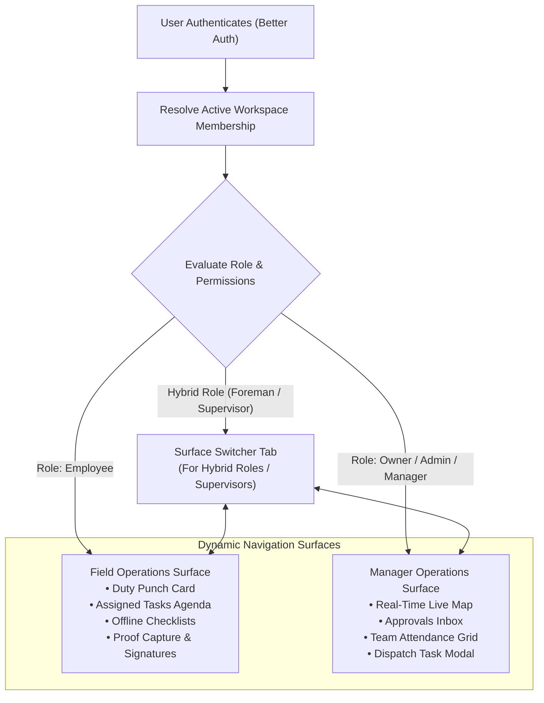

# ADR-020: Mobile Application Packaging Strategy (Unified Role-Aware App vs. Separate Binaries)

**Status:** Proposed / Recommended for Phase 01A  
**Date:** October 2026  
**Deciders:** Lead Systems Architect, Mobile Engineering, Product  
**Controlling Document:** Phase 00 Approved Product Baseline ([`docs/product/APP-SURFACES.md`](file:///workspace/oprino/docs/product/APP-SURFACES.md))

---

## 1. Context & Problem Statement

Phase 00 PRD defines two core mobile operational experiences:
1. **Employee Mobile Surface:** Punch-in/out, agenda, task checklists, photo proof capture, customer signature on glass, and duty-hours background location tracking.
2. **Owner / Manager Mobile Surface:** Live operational map, team attendance oversight, instant proof-of-work approvals, exception alerts, and rapid task creation/dispatch.

The architectural question is how to package these surfaces for distribution on Google Play Store and Apple App Store:
- **Option A:** A **single, unified, role-aware mobile application** ("Oprino") that adapts its UI, navigation, and background services based on the user's active authenticated role.
- **Option B:** **Two separate mobile applications** ("Oprino Field" and "Oprino Manager") published as distinct store listings.

Key evaluation dimensions:
- Frontline user experience (UX) and navigation clarity.
- Security and permission segregation.
- Release management, CI/CD, and App Store review overhead.
- Background location permissions and App Store compliance.
- Frontline operational realities: **SMB Working Foremen and Managers who perform field tasks** (hybrid roles).
- Transistor Software commercial licensing implications.

---

## 2. Alternatives Evaluated

### Option A: Unified Role-Aware Mobile Application (`com.oprino.app`)
- **Architecture:** A single React Native codebase and store binary. Upon login, the app inspects `workspace_memberships.role_id` and the user's active permissions:
  - Employees enter the **Field Workspace** (Tasks, Attendance, Checklists, Proof).
  - Owners/Managers enter the **Operations Management Workspace** (Live Map, Approvals, Team Status).
  - Hybrid users (e.g. working foremen, lead technicians, site supervisors) are provided a seamless top-bar surface switcher ("Field Mode" ↔ "Manager Mode").
- **Background Location:** Permission is requested **contextually** only when an employee or field-active user begins an on-duty shift, with prominent disclosure.

### Option B: Separate Binaries ("Oprino Field" & "Oprino Manager")
- **Architecture:** Two distinct mobile apps built from separate entry points in the monorepo, published under separate Bundle IDs (`com.oprino.field` and `com.oprino.manager`).
- **Employee App:** Contains background location foreground services and field task workflows.
- **Manager App:** Contains zero background location capabilities; focused purely on dashboard maps, team tracking, and approvals.

---

## 3. Comparative Evaluation Matrix

| Evaluation Criterion | Weight | Option A: Unified Role-Aware Application | Option B: Separate Store Binaries |
|---|:---:|:---:|:---:|
| **SMB Hybrid User Workflow (Working Foremen)** | 20% | **10 / 10** (Seamless surface switch in 1 app) | 3 / 10 (Must juggle & install 2 apps) |
| **Release Management & CI/CD Overhead** | 20% | **10 / 10** (1 build, 1 review, 1 release) | 4 / 10 (2x builds, 2x reviews, store drift) |
| **Multi-Company Tenancy (Technician & Owner)** | 15% | **10 / 10** (Row-level switch in 1 app) | 3 / 10 (Confusing cross-app conflicts) |
| **Code Sharing & Monorepo Simplicity** | 15% | **9.5 / 10** (Shared components, 1 bundle) | 7 / 10 (Separate bundle entry points) |
| **Commercial Licensing (Transistor Geolocation)**| 10% | **10 / 10** (Single App ID / 1 license) | 5 / 10 (Requires dual license registration) |
| **Brand Identity & App Store Optimization (ASO)**| 10% | **9.5 / 10** (Single canonical listing & reviews)| 6 / 10 (Split brand equity & reviews) |
| **App Store Background Review Scrutiny** | 10% | 8 / 10 (Contextual disclosure required) | **9.5 / 10** (Manager app has no GPS review) |
| **Weighted Total** | **100%** | **9.60 / 10** | **5.00 / 10** |

---

## 4. Decision & Rationale

**Selected Architecture: Option A — One Unified Role-Aware Mobile Application ("Oprino") with Dynamic Role-Based Surface Switching.**

### Decisive Rationale:
1. **The SMB "Working Foreman" Reality:** In 10–200 employee SMBs, job boundaries are fluid. A plumbing supervisor, electrical lead, or field sales manager frequently inspects jobs and manages a crew while also performing field tasks and signing for materials. Forcing these users to switch between two different mobile apps on the same physical phone is an intolerable user experience.
2. **Multi-Company Switching Parity:** A user can be a field contractor in Company A and an owner of Company B. A single app allows instant company switching via the profile header, dynamically adapting between Field Mode and Manager Mode.
3. **App Store Review & Release Velocity:** Maintaining two separate mobile applications doubles the CI/CD compilation matrix, doubles TestFlight/Internal Track distributions, and doubles the frequency of App Store review delays.
4. **Licensing Efficiency:** Transistor Software background geolocation licenses are bound by application package name / bundle ID. A single app ID (`com.oprino.app`) avoids doubled commercial licensing costs.
5. **Contextual Permission Governance:** Apple and Google guidelines explicitly allow role-conditional background location. The app requests `ACCESS_BACKGROUND_LOCATION` / `Always Allow` strictly when a user initiates an on-duty shift, preceded by an in-app prominent disclosure explaining duty tracking. Managers who do not punch into field shifts are never prompted for background location.

---

## 5. Architectural Implementation Guidelines



### 5.1 Role-Based Route Navigation
- Navigation tree is dynamically mounted based on authenticated `activeWorkspaceRole`:
  - `FieldNavigator`: Punch card, My Tasks, Task Detail, Proof Camera, Offline Outbox Status.
  - `ManagerNavigator`: Live Map, Approvals, Team Status, Quick Dispatch.
- Deep links (e.g. from push notifications: `oprino://task/123`) resolve to the appropriate screen regardless of active surface.

### 5.2 Background Location Activation Guard
- `BackgroundGeolocation.start()` is gated by a client permission check:
  ```typescript
  if (!activeShift || !userHasPermission('location:track:duty')) {
    // Zero background location tracking registered or initialized
    return;
  }
  ```
- Pure management users viewing live maps never initialize or start the native background tracking service on their personal phones.

---

## 6. Consequences & Trade-offs

- **Positive:**
  - Single mobile app to install, update, and review on App Store & Google Play.
  - Perfect fit for SMB supervisors and working foremen.
  - Single Transistor license; single CI/CD build pipeline.
- **Negative:**
  - The single binary contains both the field workflow and the manager dashboard UI components, slightly increasing binary size (~2–4 MB).
- **Mitigation:**
  - Modern React Native bundle splitting and Hermes bytecode compilation ensure minimal impact on app launch time.

---

## 7. Compliance with Phase 00 Approved Scope

- Fully satisfies the requirement for both Employee and Owner/Manager mobile surfaces while dramatically simplifying mobile distribution and user onboarding.
