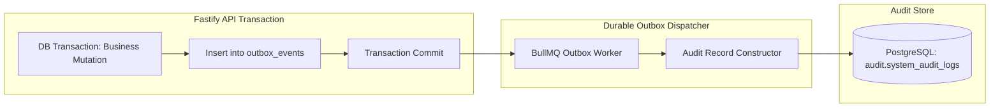

# Oprino Append-Only Operational Audit Logging Architecture

**Status:** Updated & Recommended for Phase 01A  
**Date:** October 2026 (Reconciled)  
**Controlling Documents:** 
- Phase 00 Approved PRD ([`docs/product/OPRINO-MASTER-PRD.md`](../product/OPRINO-MASTER-PRD.md))
- [`ADR-005: Multi-Tenancy Architecture & Tenant Isolation`](./ADR-005-multitenancy.md)
- [`ADR-015: Domain Events & Transactional Outbox Architecture`](./ADR-015-domain-events.md)

---

## 1. Purpose & Operational Context

In SMB workforce and field operations, operational trust requires an indisputable, tamper-resistant record of activities. Operational audit logs serve critical governance and dispute resolution needs:
- **Dispute Resolution:** Verifying whether a customer site visit occurred, when proof of work was submitted, and whether a customer signed on glass.
- **Attendance & Shift Integrity:** Documenting manager regularizations, manual attendance adjustments, overtime approvals, and leave requests.
- **Security & Authorization Governance:** Tracking role assignments, user invitations, device revocations, policy reconfigurations, and bulk data exports.
- **Operational Policy Enforcement:** Recording shifts, tracking policy updates, and geofence boundary adjustments.

---

## 2. Accurate Terminology & Access Model ("Append-Only" vs. "Immutable")

To maintain technical accuracy, Oprino characterizes its audit log as **Append-Only for Application Roles** rather than claiming absolute hardware WORM (Write Once Read Many) immutability.

### Granular Privilege & Access Matrix:

| Role / Principal | Can Insert | Can Read | Can Update / Delete | Administration & Maintenance Scope |
|---|:---:|:---:|:---:|---|
| **Application Runtime (`oprino_app_user`)** | **YES** (Via outbox event processor) | **NO** (Direct access blocked; read via API guards) | **STRICTLY BLOCKED** (Zero `UPDATE` or `DELETE` SQL permissions) | Standard application connection pool. |
| **Field Employee** | **NO** (Automated by system) | **NO** (Zero audit log read access) | **STRICTLY BLOCKED** | Frontline workers cannot view audit trails. |
| **Owner / Operations Manager** | **NO** (Automated by system) | **YES** (Tenant-filtered via API: `audit:read:workspace`) | **STRICTLY BLOCKED** | View-only audit log dashboard in web UI. |
| **Infrastructure DBA / Cloud Admin** | YES (Direct SQL) | YES (Direct SQL) | **Technically Capable** (Holds superuser/DBA credentials) | Cloud infrastructure administrators can administer the table. |
| **Privileged Break-Glass Account** | Emergency only | Emergency only | Requires dual-authorization logging | Dedicated break-glass credential stored in vault with audit alerts. |

---

## 3. Audit Log Schema Design

```sql
CREATE TABLE audit.system_audit_logs (
    id UUID PRIMARY KEY DEFAULT gen_random_uuid(),
    workspace_id UUID NOT NULL REFERENCES public.workspaces(id),
    actor_id UUID NOT NULL, -- User UUID or '00000000-0000-0000-0000-000000000000' for SYSTEM
    actor_role VARCHAR(32) NOT NULL, -- 'OWNER', 'MANAGER', 'EMPLOYEE', 'SYSTEM'
    actor_name VARCHAR(255) NOT NULL,
    actor_ip INET,
    user_agent TEXT,
    
    entity_type VARCHAR(64) NOT NULL, -- 'task', 'attendance', 'user', 'policy', 'visit', 'role'
    entity_id UUID NOT NULL,
    action VARCHAR(64) NOT NULL, -- 'CREATED', 'UPDATED', 'DELETED', 'STATUS_TRANSITION', 'REGULARIZED', 'EXPORTED'
    
    summary TEXT NOT NULL, -- Human-readable description: "Manager John Doe regularized punch-in time for Jane Smith"
    diff JSONB, -- { before: { status: "OPEN" }, after: { status: "COMPLETED" } }
    metadata JSONB, -- { client_version: "1.2.0", platform: "iOS", reason: "Hardware malfunction" }
    
    created_at TIMESTAMPTZ NOT NULL DEFAULT NOW()
);

-- Grant minimal permissions to application connection pool
REVOKE ALL ON TABLE audit.system_audit_logs FROM oprino_app_user;
GRANT INSERT, SELECT ON TABLE audit.system_audit_logs TO oprino_app_user;

-- Indices for high-speed tenant retrieval and filtering
CREATE INDEX idx_audit_workspace_created ON audit.system_audit_logs(workspace_id, created_at DESC);
CREATE INDEX idx_audit_workspace_entity ON audit.system_audit_logs(workspace_id, entity_type, entity_id);
CREATE INDEX idx_audit_workspace_actor ON audit.system_audit_logs(workspace_id, actor_id);
```

---

## 4. Ingestion Architecture: Transactional Outbox Integration

Per [`ADR-015`](./ADR-015-domain-events.md), audit log generation is driven by the **Durable Transactional Outbox**:



### Ingestion Workflow:
1. Business mutation and outbox event are committed atomically in PostgreSQL.
2. The asynchronous outbox dispatcher reads pending events with `SELECT ... FOR UPDATE SKIP LOCKED`.
3. The dispatcher constructs the structured `diff` and writes to `audit.system_audit_logs`.
4. If an audit write encounters a database error, the outbox processor retries with exponential backoff, guaranteeing zero dropped audit trails.

---

## 5. Audited Operational Domains Catalog

| Operational Domain | Trigger Actions Audited | Key Data Captured in Diff |
|---|---|---|
| **Attendance & Shifts** | Punch-in, Punch-out, Shift auto-stop, Manager time regularization, Geofence punch override | Original punch time vs Regularized punch time, Approving manager, Justification note |
| **Tasks & Visits** | Creation, Assignment, Reassignment, Status transitions, Proof of work approval/rejection, Task cancellation | Previous assignee vs New assignee, Proof media URLs, Rejection reason, Cancellation notes |
| **User & Access Control** | User invite, Role assignment, Custom permission modifications, Password reset, Session revocation, Employee deactivation | Previous role vs New role, Permissions granted/revoked, Admin performing action |
| **System Governance** | Tracking policy updates, Geofence radius adjustments, Bulk data CSV/PDF export generation | Previous policy value vs New policy value, Export filters applied, Rows exported |
| **Safety & SOS** | SOS trigger, SOS acknowledgment, SOS resolution | Emergency timestamp, Resolving manager, Emergency notes |

---

## 6. Retention, Archival & Privileged Break-Glass Process

1. **Active Online Storage:** Kept in active PostgreSQL storage for **365 days (1 year)**.
2. **Cold Storage Archival:** After 1 year, a scheduled maintenance job exports records older than 365 days to compressed, read-only JSONL files in private Cloudflare R2 / S3 storage (`/archives/{workspace_id}/audit-YYYY.jsonl.gz`).
3. **Database Backup Retention:** Point-in-Time Recovery (PITR) WAL segments and daily automated backups capture audit table states on a rolling 35-day retention cycle.
4. **Privileged Break-Glass Procedure:**
   - Database Superuser / DBA access is protected by MFA and restricted to emergency recovery.
   - Any manual execution of DDL or DML against the `audit` schema generates an automated high-priority alert to Sentry and security operations channels.

---

## 7. Compliance with Phase 00 Approved Scope

- Provides complete operational transparency for Owners and Managers without infringing on employee off-duty privacy.
- Uses technically precise "append-only" terminology and documents infrastructure privilege boundaries accurately.
