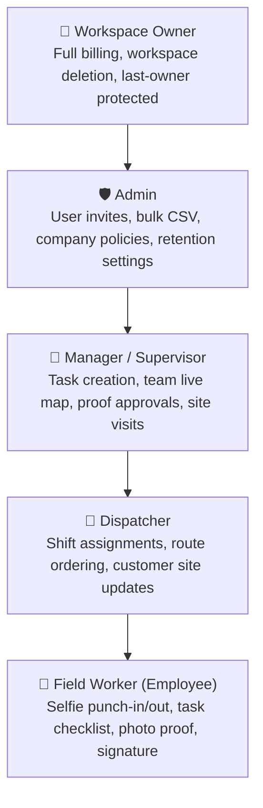

# Oprino — Authentication, Roles & Permissions Specification

**Document:** Authoritative Identity & Access Control Architecture  
**Auditor:** Principal Security Engineer  
**Branch:** `release/v1-stabilization`  
**Framework:** Better Auth + PostgreSQL Session Store  
**ADR Reference:** [`ADR-006`](./ADR-006-authentication.md) & [`ADR-007`](./ADR-007-authorization.md)  

---

## 1. Authentication Mechanics & Dual-Surface Strategy

Oprino employs a unified Better Auth core supporting both web and mobile clients:

| Surface | Client Technology | Transport Protocol | Storage Medium | Lifecycle |
|---|---|---|---|---|
| **Web Dashboard** | Next.js 15 App Router | HTTPS `HttpOnly`, `SameSite=Lax`, `Secure` Cookies | Browser Cookie Jar | 30-day sliding window; invalidates on logout |
| **Mobile App** | Flutter 3.47 / Dio | HTTPS `Authorization: Bearer <token>` + `X-Installation-Id` | `flutter_secure_storage` (Keychain / KeyStore) | Retained across app restarts; revokable remotely |

---

## 2. Role Hierarchy & Built-In Roles

Oprino defines 5 standard roles suited for SMB operations:



---

## 3. RBAC Model (`Domain:Action:Scope`)

Fastify route guards enforce fine-grained scopes before any business service executes:

```
<domain>:<action>:<scope>
Examples:
  - attendance:punch:write
  - attendance:team:read
  - tasks:manage:workspace
  - tasks:execute:assigned
  - workspaces:settings:manage
  - location:read:team
```

### Permission Matrix by Role

| Permission Scope | Owner | Admin | Manager | Dispatcher | Field Worker |
|---|:---:|:---:|:---:|:---:|:---:|
| `workspaces:delete` | ✅ | ❌ | ❌ | ❌ | ❌ |
| `workspaces:settings:manage` | ✅ | ✅ | ❌ | ❌ | ❌ |
| `members:invite` / `members:bulk` | ✅ | ✅ | ❌ | ❌ | ❌ |
| `members:role:update` | ✅ | ✅ | ❌ | ❌ | ❌ |
| `tasks:create` / `tasks:assign` | ✅ | ✅ | ✅ | ✅ | ❌ |
| `tasks:verify` (Approve/Reject) | ✅ | ✅ | ✅ | ❌ | ❌ |
| `tasks:execute:assigned` | ✅ | ✅ | ✅ | ✅ | ✅ |
| `location:read:team` (Live Map) | ✅ | ✅ | ✅ | ✅ | ❌ (Off by default) |
| `attendance:team:read` | ✅ | ✅ | ✅ | ❌ | ❌ |
| `attendance:punch:write` | ✅ | ✅ | ✅ | ✅ | ✅ |

---

## 4. Mobile Device Governance & Revocation (`ADR-006`)

To prevent unauthorized access from lost, stolen, or rogue employee handsets:
1. **Device Registration:** On initial sign-in, the mobile app generates a cryptographically random UUID stored in hardware-backed secure storage.
2. **Installation Header:** Every API request sends `X-Installation-Id: <uuid>`.
3. **Manager Revocation Action:** An Admin or Manager can click "Revoke Device" on the web dashboard.
4. **Instant Invalidation:** The server records the installation status as `REVOKED`. The next API request from that handset immediately returns HTTP 401 `DEVICE_REVOKED`.
5. **App Lockout:** The mobile app intercepts `DEVICE_REVOKED`, wipes local authentication tokens, halts GPS tracking, and navigates to the `DeviceRevokedScreen`.
