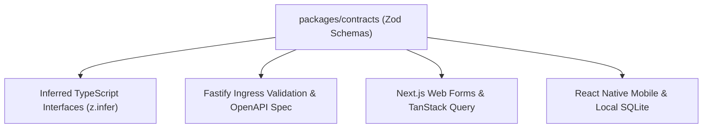

# Oprino Type Contracts & Schema Strategy Specification

**Status:** Proposed / Recommended for Phase 01A  
**Date:** October 2026  
**Controlling Documents:** 
- Phase 00 Approved PRD ([`docs/product/OPRINO-MASTER-PRD.md`](file:///workspace/oprino/docs/product/OPRINO-MASTER-PRD.md))
- [`ADR-017: Monorepo Architecture`](file:///workspace/oprino/docs/architecture/ADR-017-monorepo.md)
- [`ADR-018: API Architecture & Contracts`](file:///workspace/oprino/docs/architecture/ADR-018-api-style.md)

---

## 1. Overview & "Single Source of Truth" Paradigm

In a distributed multi-platform platform (Web, Mobile Android/iOS, Fastify API, BullMQ Workers), data contract drift is a major source of bugs and deployment friction. 

Oprino resolves this by establishing **`packages/contracts`** as the absolute, single source of truth across the monorepo.
- **Zod Schemas** define runtime validation rules, data coercion, and type constraints.
- **TypeScript Types** are inferred automatically via `z.infer<typeof Schema>`.
- **Fastify Route Validators** consume Zod schemas directly via `@fastify/type-provider-zod` for zero-overhead HTTP serialization.
- **OpenAPI 3.1 Specs** are auto-generated directly from the route schemas.
- **Client Forms** (Web and Mobile) import the exact same Zod schemas for instant client-side validation.



---

## 2. Package Structure (`packages/contracts`)

```
packages/contracts/
├── src/
│   ├── auth/              # Login, token refresh, session models
│   ├── tasks/             # Task CRUD, state transitions, priorities, checklists
│   ├── attendance/        # Punch-in, punch-out, shift models, regularizations
│   ├── locations/         # GPS breadcrumbs, telemetry batch DTOs, live map SSE
│   ├── sync/              # Offline mutation envelopes, replay batch DTOs
│   ├── proof/             # Watermarked photos, signatures, checklists
│   ├── visits/            # Customer sites, check-in/out records
│   ├── common/            # Pagination, sorting, standard error envelopes
│   ├── events/            # Strongly-typed domain event contracts
│   └── index.ts           # Central export barrel
├── package.json
└── tsconfig.json
```

---

## 3. Core Contract Examples

### 3.1 Standard Response & Error Envelopes (`common/envelope.ts`)

```typescript
import { z } from 'zod';

export const errorDetailSchema = z.object({
  field: z.string().optional(),
  issue: z.string(),
});

export const apiErrorResponseSchema = z.object({
  error: z.object({
    code: z.string(),
    message: z.string(),
    statusCode: z.number().int(),
    requestId: z.string().uuid(),
    timestamp: z.string().datetime(),
    details: z.array(errorDetailSchema).optional(),
  }),
});

export const paginationMetaSchema = z.object({
  nextCursor: z.string().nullable(),
  hasMore: z.boolean(),
  totalCount: z.number().int().optional(),
});

export function createPaginatedResponseSchema<T extends z.ZodTypeAny>(itemSchema: T) {
  return z.object({
    data: z.array(itemSchema),
    pagination: paginationMetaSchema,
  });
}
```

### 3.2 Task Creation & State Transition Contract (`tasks/task.contract.ts`)

```typescript
import { z } from 'zod';

export const taskPriorityEnum = z.enum(['LOW', 'MEDIUM', 'HIGH', 'URGENT']);
export const taskStatusEnum = z.enum([
  'ASSIGNED',
  'ACCEPTED',
  'IN_PROGRESS',
  'ON_HOLD',
  'COMPLETED',
  'CANCELLED',
  'APPROVED',
  'REJECTED_REWORK',
]);

export const createTaskSchema = z.object({
  title: z.string().min(3).max(255),
  description: z.string().max(2000).optional(),
  priority: taskPriorityEnum.default('MEDIUM'),
  assigneeId: z.string().uuid().optional(),
  customerId: z.string().uuid().optional(),
  siteId: z.string().uuid().optional(),
  dueAt: z.string().datetime().optional(),
  estimatedDurationMinutes: z.number().int().positive().optional(),
  checklist: z.array(z.object({
    id: z.string().uuid(),
    title: z.string().min(1),
    isRequired: z.boolean().default(false),
  })).optional(),
});

export type CreateTaskDTO = z.infer<typeof createTaskSchema>;
```

### 3.3 Telemetry Ingestion Contract (`locations/telemetry.contract.ts`)

```typescript
import { z } from 'zod';

export const locationBreadcrumbSchema = z.object({
  recordedAt: z.string().datetime(),
  latitude: z.number().min(-90).max(90),
  longitude: z.number().min(-180).max(180),
  accuracy: z.number().nonnegative(),
  altitude: z.number().optional(),
  speed: z.number().nonnegative().optional(),
  heading: z.number().min(0).max(360).optional(),
  batteryLevel: z.number().min(0).max(1).optional(),
  isCharging: z.boolean().optional(),
  activity: z.string().optional(),
});

export const locationBatchIngestSchema = z.object({
  batchId: z.string().uuid(),
  employeeId: z.string().uuid(),
  points: z.array(locationBreadcrumbSchema).min(1).max(500),
});

export type LocationBatchIngestDTO = z.infer<typeof locationBatchIngestSchema>;
```

---

## 4. Contract Evolution & Compatibility Rules

1. **Additive Changes Only:** Fields added to request bodies must be optional or provide safe default values. Fields added to response schemas must be tolerated by client parsers (Zod `.passthrough()` or standard non-strict object parsing).
2. **Never Rename Existing Fields:** If a field name must change, support both the legacy and new field names across at least one minor release cycle before deprecating.
3. **Strict Path Versioning:** Breaking schema alterations require incrementing the API path version (`/v1/` to `/v2/`).

---

## 5. Compliance with Phase 00 Approved Scope

- Ensures full data contract synchronization between Web, Mobile, and Backend.
- Enforces strict input validation across all SMB tenant interactions.
