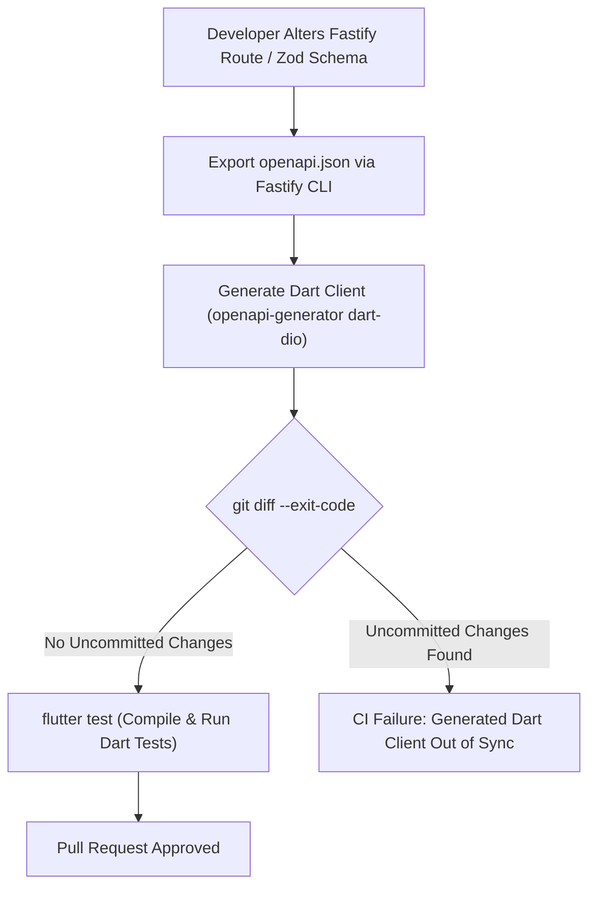

# Oprino Type Contracts & Polyglot Schema Strategy Specification

**Status:** APPROVED (Updated for Polyglot Flutter + TypeScript Monorepo)  
**Date:** October 2026 (Revised & Re-Architected)  
**Controlling Documents:** 
- Phase 00 Approved PRD ([`docs/product/OPRINO-MASTER-PRD.md`](file:///workspace/oprino/docs/product/OPRINO-MASTER-PRD.md))
- [`ADR-001: Mobile Application Framework Selection (Flutter)`](file:///workspace/oprino/docs/architecture/ADR-001-mobile-framework.md)
- [`ADR-017: Monorepo Architecture & Workspace Layout`](file:///workspace/oprino/docs/architecture/ADR-017-monorepo.md)
- [`ADR-018: API Architecture & Contracts`](file:///workspace/oprino/docs/architecture/ADR-018-api-style.md)

---

## 1. Overview & The Polyglot Contract Paradigm

In a polyglot architecture featuring a **Next.js Web Dashboard** (TypeScript), a **Fastify Backend API** (TypeScript), **BullMQ Workers** (TypeScript), and a **Flutter Mobile App** (Dart), direct TypeScript/Zod schema imports into mobile are no longer possible. 

To eliminate cross-language contract drift, Oprino establishes **OpenAPI 3.1** as the formal, authoritative cross-language contract boundary.

```text
Backend Schemas (Zod / Type Provider in packages/contracts)
                        ↓
            Fastify API Routes & Ingress
                        ↓
             OpenAPI 3.1 Specification (openapi.json)
           ↙                                     ↘
Next.js Web Client                        openapi-generator-cli (dart-dio)
(TanStack Query / Direct TS)                             ↓
                                           Generated Dart Client & Models
                                                (generated/dart-api)
                                                         ↓
                                              Flutter Mobile Application
```

### Architectural Principles:
1. **Single Source of Truth on Backend:** All HTTP schemas, DTOs, query parameters, and error envelopes originate in `packages/contracts` using Zod schemas.
2. **Authoritative OpenAPI 3.1 Specification:** Fastify extracts schemas via `@fastify/type-provider-zod` and compiles the canonical `openapi.json` via `@fastify/swagger`.
3. **Automated Dart Code Generation:** `openapi-generator-cli` with the `dart-dio` generator compiles `openapi.json` into a versioned Dart package (`oprino_api`) located at `generated/dart-api`.
4. **Compile-Time Drift Elimination:** `apps/mobile` imports `oprino_api` via a local path dependency. Any breaking change to a backend schema causes an immediate compile-time error in the Flutter app during local builds and CI verification.

---

## 2. Monorepo Package & Generation Layout

```
oprino/
├── packages/
│   ├── contracts/                # Backend TypeScript source of truth
│   │   ├── src/
│   │   │   ├── auth/             # Login, session, device registration DTOs
│   │   │   ├── tasks/            # Task CRUD, state transitions, checklists
│   │   │   ├── attendance/       # Punch-in/out, shift models, regularizations
│   │   │   ├── locations/        # Breadcrumbs, telemetry batch DTOs
│   │   │   ├── sync/             # Offline mutation envelopes, replay batches
│   │   │   ├── proof/            # Photo metadata, signatures, checklists
│   │   │   ├── visits/           # Customer sites, check-in records
│   │   │   └── common/           # Pagination, error envelopes, UUIDs
│   │   ├── openapi.json          # Compiled canonical OpenAPI 3.1 specification
│   │   └── package.json
│   └── tokens/                   # Design token source (JSON)
│
├── generated/
│   └── dart-api/                 # Compiled Dart Client & Models (Git tracked or CI generated)
│       ├── lib/
│       │   ├── api/              # Strongly typed API classes (TasksApi, AuthApi, etc.)
│       │   ├── model/            # Strongly typed Dart DTOs (TaskDTO, LocationDTO, etc.)
│       │   └── oprino_api.dart   # Main library export
│       └── pubspec.yaml          # Standalone Dart package
│
├── apps/
│   ├── web/                      # Next.js 15+ Dashboard (imports packages/contracts)
│   └── mobile/                   # Flutter Unified Mobile App (pub; Reference Baseline: Flutter 3.47)
│
└── services/
    ├── api/                      # Fastify REST API (validates against packages/contracts)
    └── worker/                   # BullMQ Background Worker
```

---

## 3. OpenAPI Dart Code Generation Pipeline

### 3.1 Tooling Selection: `openapi-generator-cli` with `dart-dio`
Following evaluation of Dart generation options:
- **`dart-dio` (Selected):** Generates robust Dart classes using the enterprise-standard `dio` HTTP client. Provides native interceptors (for auth bearer tokens and installation IDs), timeout management, file upload streams (for photo proofs), and JSON serialization.
- **Alternatives Rejected:**
  - *`dart` (built-in http):* Lacks interceptor chains and advanced cancellation tokens; cumbersome for multipart file uploads.
  - *Hand-written Dart DTOs:* Unacceptable risk of contract drift across 50+ endpoints.

### 3.2 Automated Generation Command
```bash
# Executed via root Turborepo pipeline: pnpm run generate:dart-api
npx @openapitools/openapi-generator-cli generate \
  -i packages/contracts/openapi.json \
  -g dart-dio \
  -o generated/dart-api \
  --additional-properties=\
pubName=oprino_api,\
pubVersion=1.0.0,\
pubDescription="Generated Oprino API Client for Flutter",\
serializationLibrary=json_serializable,\
dateLibrary=core
```

### 3.3 Flutter Consumption via Path Dependency
In `apps/mobile/pubspec.yaml`:
```yaml
name: oprino_mobile
description: "Oprino Unified Mobile Application"

environment:
  sdk: '^3.6.0'
  flutter: ">=3.47.0"

dependencies:
  flutter:
    sdk: flutter
  oprino_api:
    path: ../../generated/dart-api
  dio: ^5.7.0
  drift: ^2.24.0
  sqlite3: ^2.5.0
  flutter_secure_storage: ^9.2.2
```

---

## 4. Cross-Platform Contract Drift CI Verification

To guarantee that the backend API, web frontend, and Flutter mobile client never desynchronize:



1. **Step 1:** Developer updates a Zod schema in `packages/contracts`.
2. **Step 2:** Fastify route types update automatically; `pnpm run openapi:export` regenerates `packages/contracts/openapi.json`.
3. **Step 3:** Generator updates `generated/dart-api`.
4. **Step 4:** CI executes `flutter test` in `apps/mobile`. If a required field was removed or altered, the Flutter build fails at compile time with a clear type error.

---

## 5. Contract Evolution & Compatibility Rules

1. **Additive Changes Only:** Fields added to request bodies must be optional or provide safe defaults. Fields added to response schemas must be tolerated by client parsers.
2. **Never Rename Existing Fields:** If a field name must change, support both legacy and new field names across at least one minor release cycle before deprecating.
3. **Strict Path Versioning:** Breaking schema alterations require incrementing the API path version (`/v1/` to `/v2/`).

---

## 6. Compliance with Phase 00 Approved Scope

- Ensures 100% data contract synchronization between TypeScript Web/API and Dart Flutter clients.
- Enforces strict input validation and compile-time type safety across all multi-tenant boundaries.
