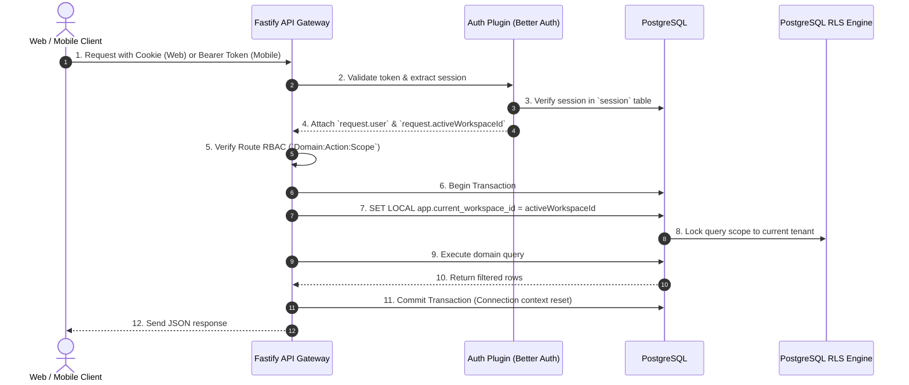
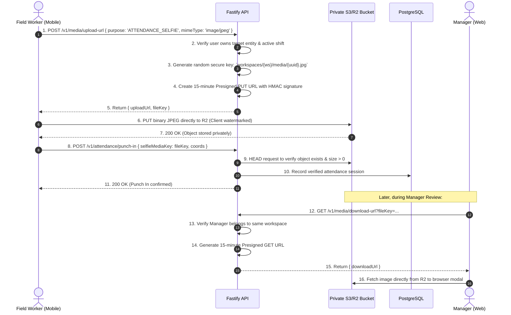
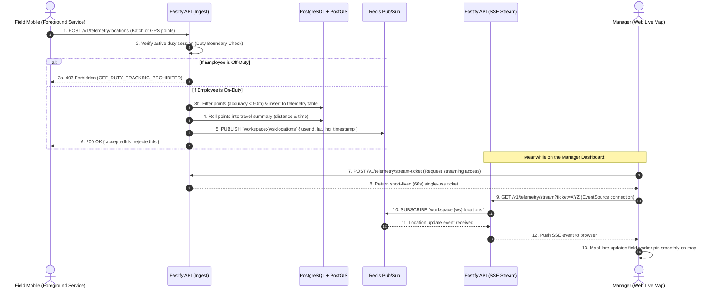
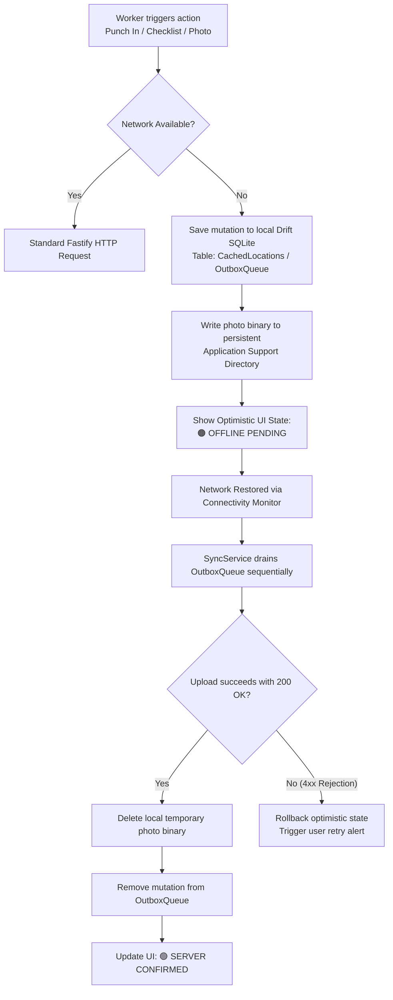

# Oprino — Data Flow Architecture

**Document:** Complete Monorepo Data Flow Specification  
**Auditor:** Principal Software Architect  
**Branch:** `release/v1-stabilization`  

---

## 1. Authentication & Session Resolution Flow

---

## 2. Media Upload & Verification Flow (Direct Presigned Upload)

To protect API servers from high-bandwidth image payloads, all media (attendance selfies, task photo proofs, digital signatures) follows a direct S3/R2 presigned upload pattern:

---

## 3. Real-Time Telemetry & Live Map Streaming Flow

---

## 4. Offline Queue & Reconciliation Flow

When a field employee operates in zero-connectivity areas:

