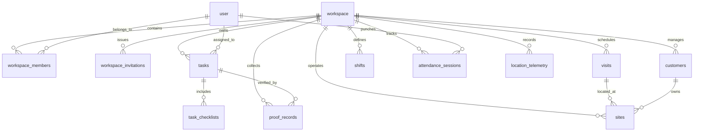

# Oprino — Database Architecture & Schema Overview

**Document:** Authoritative Database Specification  
**Auditor:** Principal Database Architect  
**Branch:** `release/v1-stabilization`  
**Database Engine:** PostgreSQL 17/18 with PostGIS 3.x Spatial Extension  
**ORM & Migration Tool:** Drizzle ORM (`drizzle-kit`)  

---

## 1. Schema Entity Relationship Diagram



---

## 2. Migration History & Table Inventory

| Migration | Release Phase | Key Tables Introduced | Responsibilities |
|---|---|---|---|
| `0000_phase_01c_scaffolding.sql` | Phase 01C | `user`, `session`, `account`, `verification`, `workspace`, `workspace_members` | Core identity, authentication, session tokens, tenant workspaces. |
| `0001_phase_02b_tasks_attendance.sql` | Phase 02B | `tasks`, `task_checklists`, `attendance_sessions`, `shifts`, `shift_assignments` | Core operational tasks, checklist items, attendance shifts, biometric punches. |
| `0002_phase_02c_location_pipeline.sql` | Phase 02C | `location_telemetry`, `geofences`, `telemetry_rollups` | PostGIS spatial points, site boundary polygons, daily travel aggregates, pruning procedure. |
| `0003_phase_03_field_operations.sql` | Phase 03 | `customers`, `sites`, `visits`, `proof_records` | Customer sites, field visits, watermarked photo proofs, customer digital signatures. |
| `0004_phase_04_advanced_operations.sql` | Phase 04 | `recurring_task_templates`, `notifications`, `audit_logs` | Recurring cron templates, operational alerts, immutable audit log entries. |
| `0005_v1_blockers_remediation.sql` | V1 Blockers | `workspace_invitations`, plus columns on `workspace_members`, `attendance_sessions`, `workspaces` | Single-use invite tokens, bulk CSV tracking, attendance policies, configurable retention (7–90 days). |

---

## 3. PostgreSQL Row-Level Security (RLS) Architecture

Every tenant-scoped table enforces strict PostgreSQL Row-Level Security:

```sql
-- Standard RLS declaration pattern across all Oprino tables
ALTER TABLE tasks ENABLE ROW LEVEL SECURITY;
ALTER TABLE tasks FORCE ROW LEVEL SECURITY;

CREATE POLICY tasks_tenant_isolation ON tasks
    FOR ALL
    USING (workspace_id = NULLIF(current_setting('app.current_workspace_id', true), '')::uuid)
    WITH CHECK (workspace_id = NULLIF(current_setting('app.current_workspace_id', true), '')::uuid);
```

### Safety Invariants:
1. **Default-Deny:** If a query executes without `app.current_workspace_id` set (e.g. ad-hoc script or developer bug), `NULLIF(..., '')` evaluates to `NULL`, returning **0 rows** and preventing unauthorized insertions.
2. **Transaction Scoping:** Fastify services set RLS context using `SET LOCAL`:
   ```typescript
   await db.transaction(async (tx) => {
     await tx.execute(sql`SET LOCAL app.current_workspace_id = ${workspaceId}`);
     // All queries executed within this transaction block are strictly isolated
   });
   ```
   When the transaction ends, PostgreSQL automatically clears the local variable, ensuring pooled connections returned to Neon/Postgres poolers never leak tenant state.

---

## 4. Geospatial Architecture & PostGIS

* **Data Type:** `geography(Point, 4326)` for WGS84 latitude and longitude coordinates.
* **Spatial Indexing:** Spatial columns indexed using **GIST** (Generalized Search Tree) for sub-millisecond proximity lookups:
  ```sql
  CREATE INDEX idx_sites_location ON sites USING GIST (location);
  CREATE INDEX idx_telemetry_location ON location_telemetry USING GIST (location);
  ```
* **Geofence Matching:** Customer site geofence verification executed in-database via `ST_DWithin`:
  ```sql
  SELECT id, name FROM sites
  WHERE ST_DWithin(location, ST_SetSRID(ST_MakePoint(:lng, :lat), 4326)::geography, radius_meters);
  ```

---

## 5. Automated Telemetry Retention & Partition Pruning

To keep infrastructure costs at ~$0.40/user/month and adhere to data privacy regulations:
* **Procedure:** `telemetry_prune_expired_records(retention_days integer)`
* **Logic:**
  1. Identifies location telemetry rows older than `retention_days` (workspace default: 30 days).
  2. Rolls up travel summaries (distance traveled, point counts, active hours) into `telemetry_rollups` so business reporting remains intact.
  3. Purges raw granular breadcrumbs in batches to avoid locking active ingest tables.
  4. Scheduled to run automatically via BullMQ worker.
