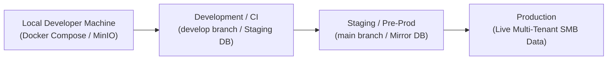

# Oprino Environment Strategy & Secrets Management Specification

**Status:** Proposed / Recommended for Phase 01A  
**Date:** October 2026  
**Controlling Documents:** 
- Phase 00 Approved PRD ([`docs/product/OPRINO-MASTER-PRD.md`](../product/OPRINO-MASTER-PRD.md))
- [`ADR-017: Monorepo Architecture`](./ADR-017-monorepo.md)
- [`docs/architecture/SECURITY-ARCHITECTURE.md`](./SECURITY-ARCHITECTURE.md)

---

## 1. Overview & Multi-Environment Topology

Oprino utilizes a standardized four-tier environment progression designed to ensure security, predictable deployments, and total isolation between development, testing, and production tenant data.



---

## 2. Environment Matrix & Capabilities

| Feature / Resource | Local (`local`) | Development (`dev`) | Staging (`staging`) | Production (`prod`) |
|---|---|---|---|---|
| **API Host** | `http://localhost:4000` | `https://api.dev.oprino.com` | `https://api.staging.oprino.com` | `https://api.oprino.com` |
| **Web Dashboard** | `http://localhost:3000` | `https://app.dev.oprino.com` | `https://app.staging.oprino.com` | `https://app.oprino.com` |
| **Database** | Docker Compose PostgreSQL 18 (or 17) + PostGIS | Managed Cloud PostgreSQL (Shared Burstable) | Managed Cloud PostgreSQL (Dedicated Mirror) | High-Availability PostgreSQL 18 (or 17) + Standby Replica |
| **Redis Broker** | Docker Compose Redis 7 (Standalone) | Managed Redis (Single Node) | Managed Redis (Primary/Replica) | Managed Redis 7+ High-Availability (Primary/Replica) |
| **File Storage** | MinIO (S3-compatible local Docker) | Cloudflare R2 (`oprino-dev-media`) | Cloudflare R2 (`oprino-staging-media`) | Cloudflare R2 (`oprino-prod-media` - Private) |
| **Mobile Push** | Mock Push Logger (stdout) | FCM / APNs Sandbox / TestFlight | FCM / APNs Sandbox / TestFlight | FCM HTTP v1 / Apple Production APNs |
| **Transactional Email**| Resend Test Mode / MailHog | Resend Sandbox | Resend Staging (Whitelisted) | Resend Production Verified Domain |
| **Error Tracking** | Console / Disabled Sentry | Sentry (`environment: dev`) | Sentry (`environment: staging`) | Sentry (`environment: prod`) |

---

## 3. Secrets Management Architecture

### 3.1 Zero Plaintext In Git
- `.env` and all variation files (`.env.local`, `.env.production`) are strictly blocked by `.gitignore`.
- Pre-commit hooks (`git-secrets` / `detect-secrets`) prevent accidental commits of API keys or private keys.

### 3.2 Centralized Secrets Provider (Infisical / Doppler / AWS Secrets Manager)
All secrets across environments are managed centrally with strict role-based access:
- **Developer Access:** Engineers receive access to `local` and `dev` secrets only.
- **Production Access:** Production secrets are injected exclusively into CI/CD deployment runners (e.g. GitHub Actions Environments with required approvals) and production container orchestration.
- Developers never have direct access to production database credentials or private master keys.

### 3.3 Strict Runtime Environment Validation with Zod
The API process and workers will **refuse to start** if any required environment variable is missing, malformed, or using insecure defaults in production.

```typescript
// packages/contracts/src/env.ts
import { z } from 'zod';

export const serverEnvSchema = z.object({
  NODE_ENV: z.enum(['development', 'test', 'staging', 'production']),
  PORT: z.coerce.number().default(4000),
  DATABASE_URL: z.string().url(),
  REDIS_URL: z.string().url(),
  JWT_SECRET: z.string().min(32),
  REFRESH_TOKEN_SECRET: z.string().min(32),
  S3_ENDPOINT: z.string(),
  S3_BUCKET: z.string(),
  S3_ACCESS_KEY: z.string(),
  S3_SECRET_KEY: z.string(),
  FCM_SERVICE_ACCOUNT_JSON: z.string().optional(),
  SENTRY_DSN: z.string().url().optional(),
});
```

---

## 4. Local Developer Experience (`pnpm dev`)

To provide frictionless onboarding for developers:
1. `docker compose up -d`: Boots PostgreSQL 18 (or 17, with PostGIS enabled), Redis 7, and MinIO in 5 seconds.
2. `pnpm db:seed`: Seeds sample SMB workspaces:
   - **Acme Facility Services** (15 employees, maintenance workflows)
   - **Apex Field Sales** (80 employees, distributed visit routes)
3. `pnpm dev`: Turborepo launches Fastify API (`apps/api`), Next.js Web (`apps/web`), and BullMQ Worker (`apps/worker`) concurrently with hot-reloading.

---

## 5. Mobile Build & Deployment Pipeline (Flutter CI/CD & Fastlane)

Mobile application releases follow a structured release channel strategy:
- **Internal Builds (Daily):** GitHub Actions with Flutter CLI compiles Android APKs and iOS simulator builds for internal team testing upon merge to `develop`.
- **Preview Builds (Release Candidates):** Automated Fastlane builds distributed to internal stakeholders and QA testers via Google Play Internal Track and Apple TestFlight.
- **Production Store Builds:** Promoted to Google Play Store and Apple App Store upon passing all release checklists.

---

## 6. Compliance with Phase 00 Approved Scope

- Ensures full operational isolation between test environments and live SMB production data.
- Guarantees production secrets cannot be compromised by development environments.
