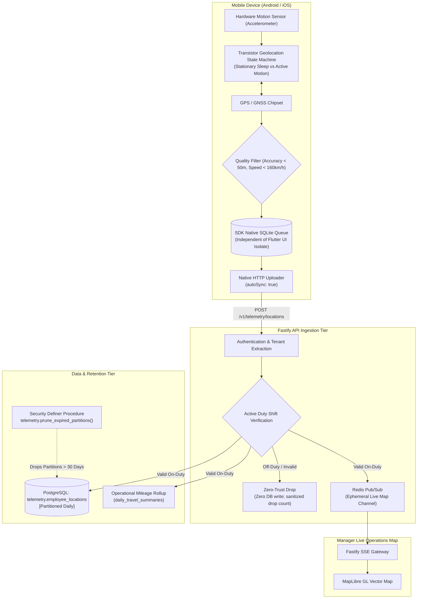

# Oprino Location Tracking Pipeline Architecture (Re-evaluated)

**Status:** Updated & Recommended for Phase 01A  
**Date:** October 2026 (Reconciled)  
**Controlling Documents:** 
- Phase 00 Approved PRD ([`docs/product/OPRINO-MASTER-PRD.md`](file:///workspace/oprino/docs/product/OPRINO-MASTER-PRD.md))
- [`ADR-008: Mobile Background Location Tracking Architecture`](file:///workspace/oprino/docs/architecture/ADR-008-background-location.md)
- [`ADR-004: Database Engine & Geospatial Data Architecture`](file:///workspace/oprino/docs/architecture/ADR-004-database-geospatial.md)
- [`ADR-010: Real-Time Operational Architecture & Live Map Pipeline`](file:///workspace/oprino/docs/architecture/ADR-010-realtime.md)

---

## 1. Overview & Operational Principles

The Oprino Location Pipeline is engineered around three foundational requirements:
1. **Duty-Hours-Only Tracking:** Off-duty employee location tracking must **NEVER** be an intended Oprino behavior.
2. **Measurable Battery & Delivery SLOs:** Replacing unverified marketing assertions with explicit, testable Service Level Objectives across diverse OEM hardware.
3. **Multi-Tier Retention & Automated Purge:** Raw coordinates are isolated in daily partitions and physically dropped via automated least-privileged maintenance jobs when retention expires (default: 30 days; configurable to 7, 30, 90, 180 days).

---

## 2. End-to-End Pipeline Architecture



---

## 3. Mobile Acquisition, Power Management & Measurable Target SLOs

### 3.1 Stationary State Machine & Adaptive Motion
Continuous GNSS chipset activation causes high battery consumption. Oprino leverages native hardware motion recognition:
- **Stationary State:** When the employee remains stationary within a configurable radius (~30–50 meters) for > 5 minutes, continuous GPS radio shuts down, and a low-power stationary geofence is armed.
- **Moving State:** Accelerometer displacement beyond the stationary threshold wakes the GPS radio, dynamically emitting coordinates based on movement profile (walking vs. driving).

### 3.2 Measurable Target SLOs
All architectural claims are defined as testable targets rather than absolute guarantees:
- **Battery Drain Target SLO:**
  - Stationary: < 0.5% battery drain per hour.
  - Active Movement: < 1.5% to 2.5% battery drain per active travel hour under standard testing profiles.
- **Delivery Latency Target SLO:**
  - Ingestion to Dashboard: p95 delivery latency < 3.0 seconds under stable cellular/Wi-Fi coverage.
- **Accuracy Filter:** Points with horizontal accuracy `accuracy > 50 meters` or speed > 160 km/h (teleportation anomaly) are dropped.

### 3.3 Representative Device Validation Matrix
Prior to production deployment, performance must be benchmarked across:
- **Samsung:** Galaxy A15 (Low), Galaxy A54 (Mid), S24 (High) on OneUI 6/7.
- **Xiaomi / Redmi:** Redmi Note 12/13 (Low/Mid) on HyperOS / MIUI 14.
- **Oppo / Realme:** Realme C-series, Reno 11 on ColorOS 14.
- **Vivo / iQOO:** Vivo Y27, V29 on FuntouchOS 14.
- **Google Pixel:** Pixel 7a, Pixel 8 on Stock Android 14/15.
- **Apple iPhone:** iPhone 11, iPhone 14, iPhone 16 on iOS 17/18.

---

## 4. Duty-Hours Privacy Enforcement Boundaries

| Control Boundary | Execution Point | Technical Mechanism |
|---|---|---|
| **1. Acquisition Control** | Mobile Device (Flutter) | **Explicit Punch-Out:** Synchronously calls `bg.BackgroundGeolocation.stop()`; destroys foreground service notification; unhooks GPS hardware.<br>**Safe Local Deadline:** Configures a native timer/alarm for the scheduled shift end. If connectivity is lost or punch-out forgotten, the native SDK self-terminates tracking offline. |
| **2. Local Persistence Control** | Mobile Device | **Queue Purging:** Upon shift end, the native queue scans for any uncommitted points timestamped after the duty end time and deletes them from local device storage before upload. |
| **3. Server Ingestion Control** | Fastify API | **Zero-Trust Validation:** `POST /v1/telemetry/locations` joins active shifts in PostgreSQL. Coordinates timestamped outside an active shift window are dropped immediately (`200 OK { accepted: 0, dropped: N, reason: 'OFF_DUTY_FILTER' }`). |

---

## 5. Daily Range Partitioning & Least-Privileged Purge

### 5.1 Partitioned Telemetry Storage
```sql
CREATE TABLE telemetry.employee_locations (
    id UUID NOT NULL,
    workspace_id UUID NOT NULL,
    employee_id UUID NOT NULL,
    recorded_at TIMESTAMPTZ NOT NULL,
    coordinates GEOMETRY(Point, 4326) NOT NULL,
    accuracy REAL NOT NULL,
    speed REAL,
    heading REAL,
    battery_level REAL,
    is_charging BOOLEAN,
    created_at TIMESTAMPTZ NOT NULL DEFAULT NOW(),
    PRIMARY KEY (workspace_id, recorded_at, id)
) PARTITION BY RANGE (recorded_at);
```

### 5.2 Least-Privileged Maintenance Execution
- General API workers **cannot** issue `DROP TABLE`.
- A dedicated BullMQ maintenance worker calls security-definer procedure `telemetry.prune_expired_partitions(retention_days)` nightly at 02:00 UTC.
- Partitions older than the workspace retention limit (default: 30 days) are dropped via instant DDL in < 15ms.
- Pre-purge aggregation commits aggregated daily mileage totals to `daily_travel_summaries` under a separate 3-year operational retention policy.

---

## 6. Compliance with Phase 00 Approved Scope

- Strictly enforces the frozen 30-day default location retention baseline.
- Guarantees zero off-duty employee tracking across native acquisition, local queueing, and server ingestion.
- Eliminates dual-engine GPS synchronization conflicts by establishing single-path native persistence.
