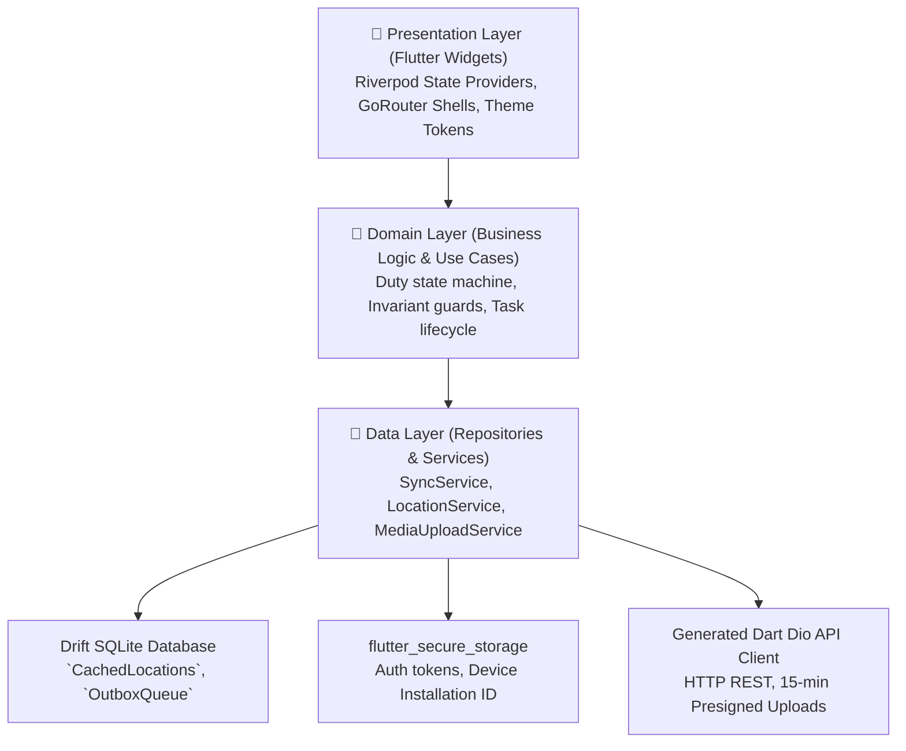

# Oprino — Mobile Application Architecture (Flutter)

**Document:** Authoritative Mobile Technical Architecture  
**Auditor:** Principal Flutter Engineer  
**Branch:** `release/v1-stabilization`  
**Framework:** Flutter 3.47 / Dart 3.x (Stable)  
**Platforms:** Android (API 24–36, TargetSdk 35, CompileSdk 36) & iOS (iOS 15+)  
**ADR References:** [`ADR-001`](./ADR-001-mobile-framework.md), [`ADR-008`](./ADR-008-background-location.md), [`ADR-009`](./ADR-009-offline-sync.md), [`ADR-020`](./ADR-020-mobile-packaging.md), [`ADR-021`](./ADR-021-zero-cost-gps-pipeline.md)  

---

## 1. High-Level Mobile Layer Architecture



---

## 2. Core Mobile Subsystems

### A. Offline-First Drift SQLite Engine (`ADR-009`)
* **Database File:** Managed by Drift via `package:sqlite3` / bundled native SQLite.
* **Tables:**
  - `CachedLocations`: Stores on-duty GPS points when offline, tagged with `workspaceId`, `userId`, `lat`, `lng`, `accuracy`, and `recordedAt`.
  - `OutboxMutations`: Stores pending entity changes (checklists, punch actions, task status) with client-generated UUIDs.
* **Auto-Drain (`SyncService`):** Monitors network connectivity. Upon reconnect, drains the queue in chronological order, verifies server receipts, and cleans up local temporary state.

### B. Duty-Hours Location Engine (`ADR-021`)
* **Foreground Service:** Uses an Android Foreground Service displaying a persistent notification while active.
* **Duty State Machine:**
  - `NOT_STARTED` -> `PUNCH_PENDING` -> `ON_DUTY` -> `OFF_DUTY`.
  - Location tracking starts strictly upon reaching `ON_DUTY`.
  - When the user punches out, the service is terminated immediately.
* **Privacy Guarantee:** Zero off-duty location fixes are captured, queued, or transmitted.

### C. Media Capture & Proof-of-Work Pipeline (`ADR-012`)
* **Camera Capture:** Uses `image_picker` configured for physical camera acquisition.
* **Client Watermarking:** Overlays an authoritative watermark directly onto the JPEG bitmap before upload:
  - Timestamp (UTC & local format).
  - Geotagged coordinates (Latitude, Longitude).
  - Task ID and Worker Name.
* **Persistent Storage:** Un-synced media is saved in `getApplicationSupportDirectory()`, surviving Doze mode and OS cache purges.
* **Customer Signature Pad:** Hand-drawn vector signature captured on glass, converted to PNG binary, and submitted with the proof bundle.

---

## 3. Android Native Configuration & Build Hardening

* **SDK Levels:** `minSdk = 24`, `targetSdk = 35`, `compileSdk = 36`.
* **Cross-Drive Windows Guard:** [`apps/mobile/android/build.gradle.kts`](../../apps/mobile/android/build.gradle.kts) guards subproject `buildDirectory` overrides against drive-letter mismatch crashes:
  ```kotlin
  subprojects {
      val projectRoot = project.projectDir.toPath().root
      val buildRoot = newBuildDir.asFile.toPath().root
      if (projectRoot == buildRoot) {
          project.layout.buildDirectory.value(newBuildDir.dir(project.name))
      }
  }
  ```
* **Network Security Isolation:**
  - `src/debug/AndroidManifest.xml`: Permits `usesCleartextTraffic="true"` solely for local test server connectivity (`10.0.2.2:3001`).
  - `src/main/` & `src/release/`: Strictly prohibits cleartext HTTP.
* **Fail-Closed Release Signing:** If release keystore environment variables are missing, release builds fail closed instead of silently falling back to insecure debug keystores.
