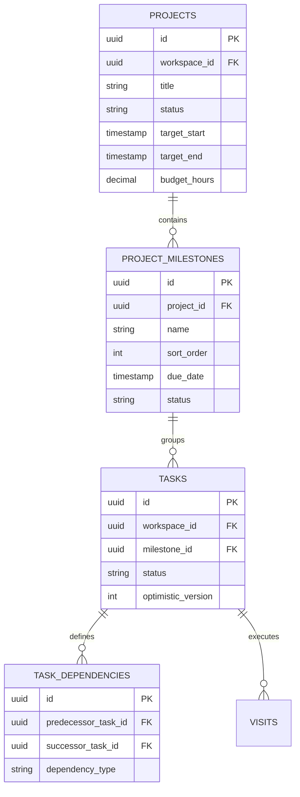
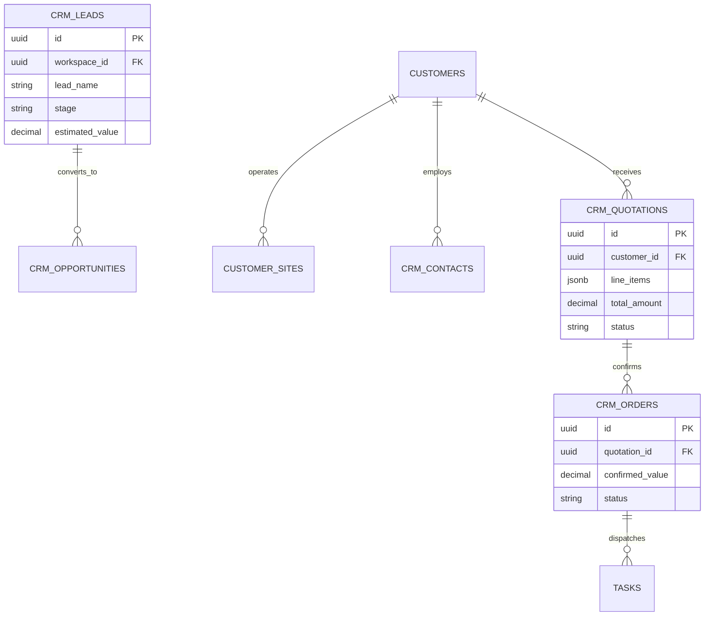

# OPRINO Technical Architecture Document (v2)

**Document Status:** CANONICAL DRAFT — PENDING OWNER APPROVAL  
**Version:** 2.0 (Phase 0 Rework Baseline)  
**Target Infrastructure:** Single Oracle Cloud Infrastructure (OCI) ARM VM  
**Branch:** `docs/phase-0-documentation-reconciliation`  
**Date:** October 17, 2026  
**Auditor:** Principal Architect & Engineering Lead  

---

## 1. Executive Architectural Overview

OPRINO is a monorepo platform engineered using Turborepo and pnpm 11. It provides a hardened, multi-tenant, offline-first system across three distinct surfaces:
1. **Unified Mobile Application (`apps/mobile`):** Single cross-platform Flutter 3.47 app with Drift SQLite outbox supporting all 4 company roles (`OWNER`, `ADMIN`, `MANAGER`, `FIELD_WORKER`).
2. **Web Management Console (`apps/web`):** Next.js 15 App Router console with React 19, Tailwind CSS, and Server-Side Rendering (SSR).
3. **Platform Super Admin Portal (`apps/super-admin`):** Standalone Next.js 15 console for global platform operations, tenant health, and billing metrics.
4. **Backend REST API (`services/api`):** Fastify 5 runtime with schema-driven serialization and Better Auth.
5. **Background Task Worker (`services/worker`):** BullMQ 5 worker for recurring tasks, SLA monitoring, and 90-day retention pruning.

---

## 2. Security, Multi-Tenancy & Data Isolation

### 2.1 Single-Company Mathematical PostgreSQL RLS
- Strict **1-User-to-1-Company** tenancy model:
  ```sql
  -- Scoped per database transaction
  BEGIN;
  SET LOCAL app.current_workspace_id = :workspaceId;
  -- All queries automatically filtered by PostgreSQL RLS
  SELECT * FROM tasks WHERE ...;
  COMMIT;
  ```
- No cross-tenant data leakage or global account switching. Connection-pool-safe `SET LOCAL` ensures discarded context on transaction completion.

### 2.2 Device Security & Token Governance
- Mobile installation ID: Cryptographically random UUIDv4 token stored in `flutter_secure_storage`.
- Web session security: HttpOnly, `SameSite=Lax`, `Secure` cookies managed via Better Auth BFF.

---

## 3. Target Infrastructure Topology: Single Oracle ARM VM

```mermaid
graph TB
    subgraph Cloudflare Edge
        DNS[Cloudflare DNS + SSL Termination: app.oprino.com / api.oprino.com]
    end

    subgraph Oracle Cloud Infrastructure (OCI) ARM VM [Ampere A1 - 4 OCPU / 24GB RAM]
        Caddy[Caddy Reverse Proxy: Auto-HTTPS / TLS 1.3]

        subgraph Docker Stack: Production [Isolated Bridge Network]
            FastifyProd[Fastify 5 API: Port 3001]
            WorkerProd[BullMQ Background Worker]
            WebProd[Next.js 15 Web Console: Port 3000]
            PostgresProd[(PostgreSQL 17 + PostGIS 3.5)]
            RedisProd[(Redis 7.2 Cache & PubSub)]
        end

        subgraph Docker Stack: Staging [Isolated Bridge Network]
            FastifyStg[Fastify 5 API: Port 3011]
            WorkerStg[BullMQ Background Worker]
            WebStg[Next.js 15 Web Console: Port 3010]
            PostgresStg[(PostgreSQL 17 + PostGIS 3.5)]
            RedisStg[(Redis 7.2 Cache & PubSub)]
        end

        Caddy -->|app.oprino.com| WebProd
        Caddy -->|api.oprino.com| FastifyProd
        Caddy -->|staging-app.oprino.com| WebStg
        Caddy -->|staging-api.oprino.com| FastifyStg

        FastifyProd --> PostgresProd
        FastifyProd --> RedisProd
        WorkerProd --> RedisProd
        WorkerProd --> PostgresProd

        FastifyStg --> PostgresStg
        FastifyStg --> RedisStg
        WorkerStg --> RedisStg
        WorkerStg --> PostgresStg
    end

    subgraph OCI Cloud Storage
        OCIObject[(OCI Object Storage: S3-Compatible Media Bucket)]
    end

    FastifyProd -->|Presigned S3 API| OCIObject
    FastifyStg -->|Presigned S3 API| OCIObject
```

### 3.1 Dual-Stack Container Isolation
- **Production Stack:** `docker-compose.prod.yml` runs on isolated bridge network `oprino-prod-net`.
- **Staging Stack:** `docker-compose.staging.yml` runs on isolated bridge network `oprino-stg-net`.
- Zero database or cache sharing between production and staging stacks.

### 3.2 OCI Object Storage Adapter
- Media proofs, watermarked photos, and digital signatures utilize OCI Object Storage with an S3-compatible API adapter in [`services/api/src/storage/s3-driver.ts`](../../services/api/src/storage/s3-driver.ts).
- Presigned direct upload URLs eliminate container memory bloat during media transmission.

### 3.3 Safe Migration Strategy
- **Phase A (Current):** Render, Vercel, Neon, and Upstash services remain 100% active and untouched.
- **Phase B (Staging Deploy):** Deploy Docker Compose staging stack on Oracle VM; execute automated regression test suites.
- **Phase C (Owner Staging Review):** Validate staging environment with real mobile app builds.
- **Phase D (Production Cutover):** Execute database sync from Neon, switch Cloudflare DNS records, and verify production health probes.

### 3.4 Disaster Recovery & Backup Topology (Calibrated for Pilot)
- **Approved Planning Targets (Pilot Planning Targets, Not Guaranteed SLAs):**
  - **Recovery Point Objective (RPO):** 4 hours
  - **Recovery Time Objective (RTO):** 8 hours
- **Automated Backup Pipeline:** Scheduled cron executes `pg_dump` every 4 hours, encrypts archives via GPG, and uploads to an off-VM OCI Object Storage bucket.
- **Verified Restore Drills:** Periodic simulated VM recovery drills documented in operational runbooks.
- **SLA Clarification:** These targets are operational benchmarks calibrated for pilot validation and disaster recovery drills; they are not contractually guaranteed customer SLAs.

---

## 4. Project Management Architecture



---

## 5. Sales CRM Architecture



---

## 6. HR, Expenses & Conveyance Pipeline

- **Haversine Distance Rollup:** BullMQ worker computes duty-hours travel distances daily from verified coordinates and records totals in `daily_travel_summaries`.
- **Payout Computation:** `distance_km * vehicle_rate` generates verifiable conveyance claims linked to attendance shifts.

---

## 7. Integrations & External Interoperability

- **WhatsApp Business API:** Async queue worker dispatches dispatch alerts with technician ETA.
- **Tally / Accounting Adapters:** Memory-efficient streaming CSV generator formats ledger logs for external payroll systems.
- **Outbound Webhooks:** HMAC-SHA256 signed event delivery to external tenant systems.

---

## 8. Billing & Subscription Architecture

- **Trial Lifecycle:** 7-day free trial enforced via database timestamp. Upon expiration without an active Razorpay subscription, Fastify route middleware intercepts mutations and enforces **read-only mode**.
- **Active-Seat Metering:** BullMQ worker calculates active billable users monthly:
  - **Starter:** ₹129 / user / month
  - **Growth:** ₹249 / user / month
  - **Business:** ₹449 / user / month
  - **Enterprise:** Custom negotiated rate
- **Grace Period:** 7-day renewal grace period before subscription suspension.

---

## 9. Governance & Phased Execution Gates

- **Phase 0:** Master documentation baseline approved by owner.
- **Phase 1:** Full Google Stitch UI/UX design baseline (104 screens) approved by owner.
- **Phase 2:** Phased feature coding in Antigravity.
- **Phase 3:** Multi-OEM physical field testing.
- **Phase 4:** Controlled Oracle ARM VM migration.
