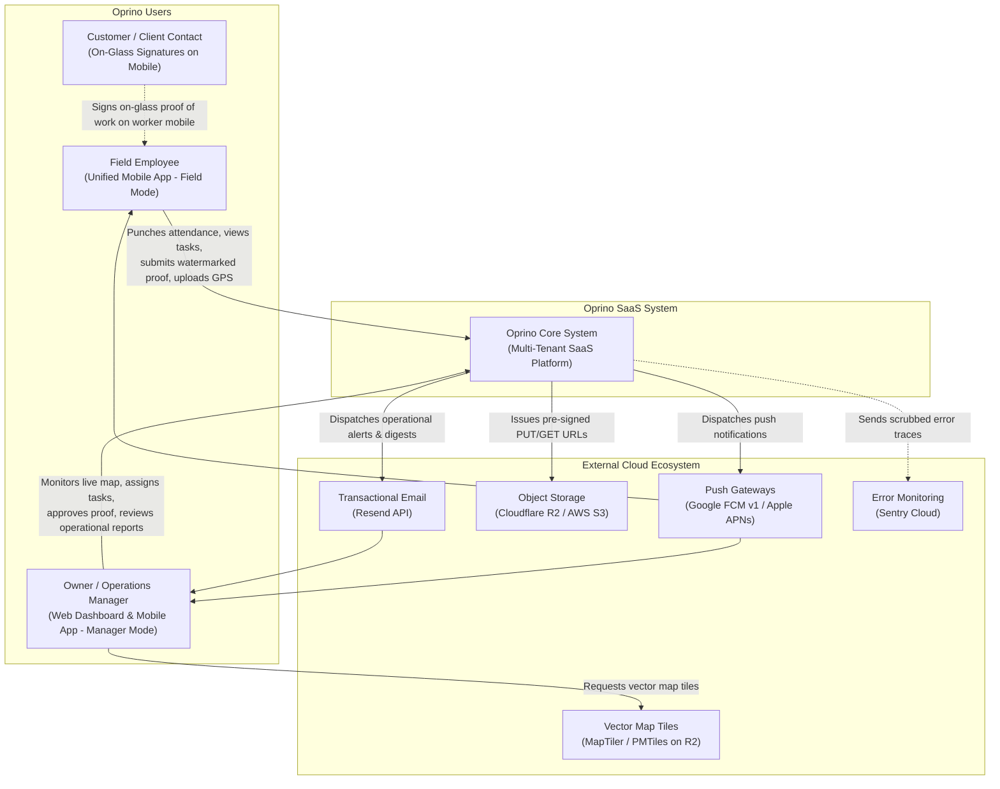
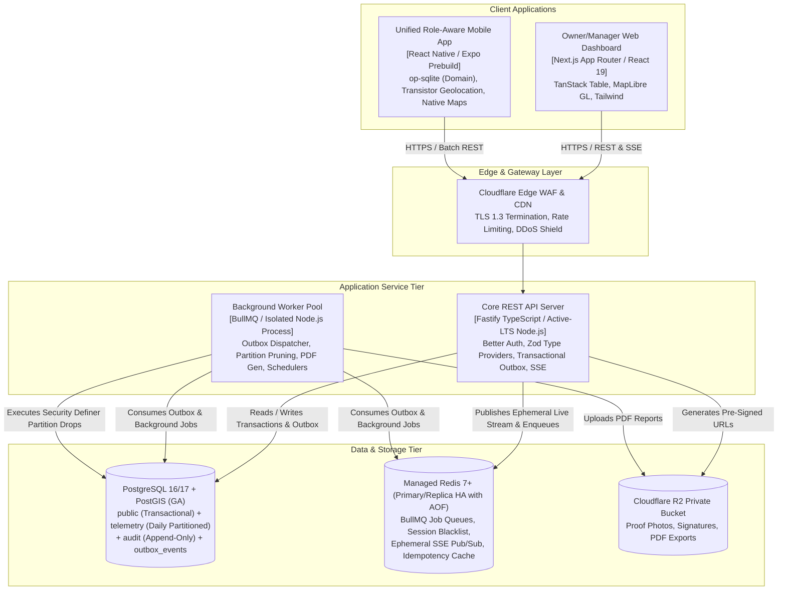
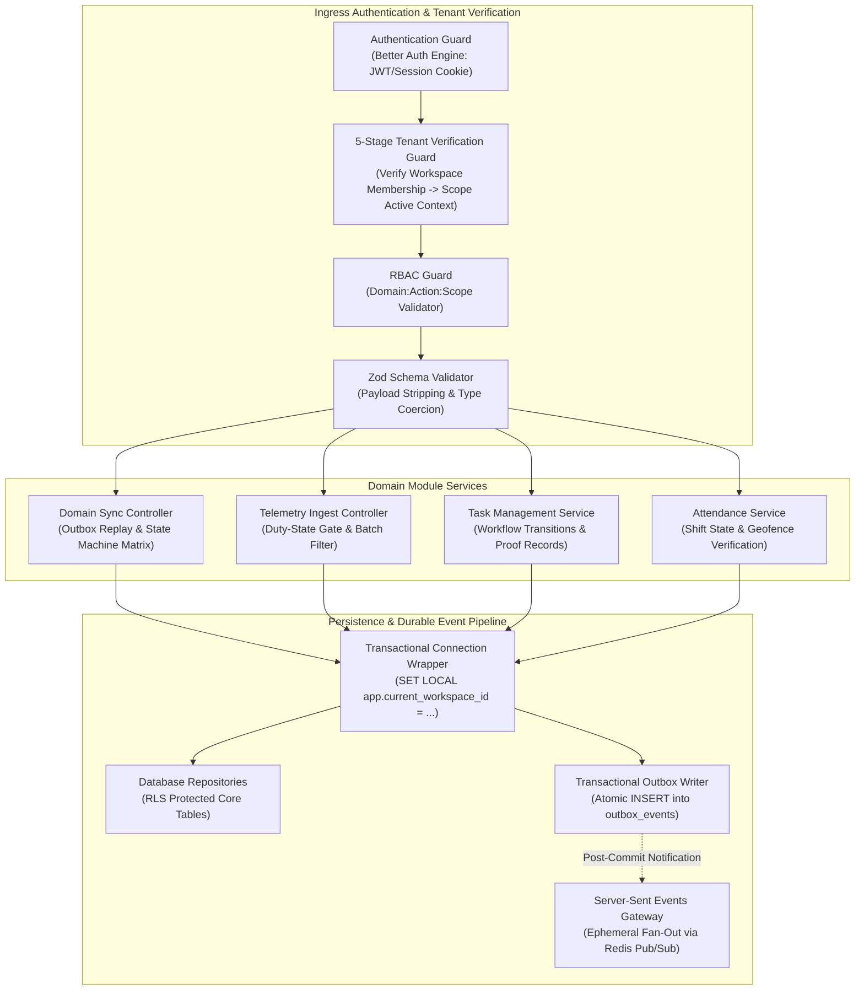

# Oprino Master Technical Architecture Document (Re-evaluated)

**Status:** Updated & Recommended for Phase 01A  
**Date:** October 2026 (Reconciled)  
**System Architecture Version:** 1.1  
**Controlling Documents:** 
- Phase 00 Approved PRD ([`docs/product/OPRINO-MASTER-PRD.md`](file:///workspace/oprino/docs/product/OPRINO-MASTER-PRD.md))
- ADR Register ([`docs/architecture/ADR/README.md`](file:///workspace/oprino/docs/architecture/ADR/README.md))

---

## 1. Executive System Overview & Mission

**Oprino** is a multi-industry Task Management + Workforce Management + Field Operations SaaS platform built specifically for SMBs (5–500 employees, optimized for 10–200). 

The platform bridges real-time managerial visibility with field operational autonomy across a **unified role-aware mobile application** (Android and iOS) and a high-density **Owner/Manager Web Dashboard**.

### Core Architectural Mandates:
1. **Duty-Hours-Only Tracking:** Off-duty employee location tracking must **NEVER** be an intended Oprino behavior. Guaranteed across native OS acquisition control, local queue persistence purging, and server-side zero-trust active shift validation.
2. **Offline-First Field Autonomy:** Full mobile operational continuity in zero-connectivity environments via embedded SQLite (`op-sqlite`) and deterministic mutation replay.
3. **Automated 30-Day Retention Pruning:** High-frequency GPS telemetry is isolated in daily partitions and physically dropped via automated least-privileged maintenance jobs (`telemetry.prune_expired_partitions()`).
4. **Peer Location Privacy:** Employee-to-employee live location visibility is **OFF BY DEFAULT**.
5. **Durable Business Events:** Core mutations commit atomically with an outbox record in PostgreSQL (`outbox_events`); Redis Pub/Sub is scoped strictly to ephemeral real-time fan-out.
6. **Robust Multi-Tenant Security:** 5-stage tenant verification pipeline backed by transaction-scoped PostgreSQL Row-Level Security (`SET LOCAL`) ensuring complete connection pool safety.

---

## 2. C4 Model — Level 1: System Context Diagram

The System Context diagram illustrates how Oprino interacts with internal human actors and external cloud service providers.

---

## 3. C4 Model — Level 2: Container Diagram

The Container diagram breaks down the high-level executable applications, data stores, and background workers that constitute Oprino.

---

## 4. C4 Model — Level 3: Component Diagram (Core API)

Inside the Fastify API container, services are structured as clean, decoupled domain modules:

---

## 5. Master Data Architecture & Physical Layout

The database architecture is strictly separated into four logical schemas/tables in PostgreSQL:

1. **`public` Schema (Transactional Core):**
   - Workspaces, users, workspace memberships, roles, permissions, tasks, task proofs, customer sites, and attendance records.
   - Protected by Row-Level Security (RLS) enforcing `workspace_id = NULLIF(current_setting('app.current_workspace_id', true), '')::uuid`.
2. **`public.outbox_events` (Durable Event Store):**
   - Atomic domain event queue capturing state transitions, actor ID, payload, and status (`PENDING`, `PROCESSED`).
3. **`telemetry` Schema (Ephemeral High-Frequency GPS):**
   - Table `telemetry.employee_locations` partitioned by range on `recorded_at` (`PARTITION BY RANGE (recorded_at)`).
   - Daily partitions dropped automatically via least-privileged security-definer procedure `telemetry.prune_expired_partitions(retention_days)`.
4. **`audit` Schema (Append-Only Operational Logs):**
   - Append-only table `audit.system_audit_logs`. Normal application connection pool holds strictly `INSERT` and `SELECT` permissions. Zero `UPDATE` or `DELETE` permissions granted.

---

## 6. Real-Time & Offline Operational Pipelines

### 6.1 Real-Time Live Map Pipeline
1. Active on-duty mobile workers acquire GPS fixes (power-managed by Transistor stationary geofences).
2. Transistor SDK native HTTP uploader transmits batches directly to `POST /v1/telemetry/locations`.
3. Fastify verifies active duty shift; inserts points into `telemetry.employee_locations`.
4. Fastify publishes latest coordinate to Redis Pub/Sub channel `workspace:{id}:live_locations`.
5. SSE Gateway broadcasts coordinate to authenticated Owner/Manager web dashboards with a target delivery SLO of < 2–3s (p95).
6. Web dashboard MapLibre GL layer smoothly animates marker position using requestAnimationFrame interpolation.

### 6.2 Offline-First Sync & Mutation Replay Pipeline
1. Worker executes actions offline (accept task, complete checklist, customer signature on glass).
2. Actions write immediately to local encrypted SQLite `outbox_mutations` using client-generated UUIDv4s.
3. Upon network reconnection, client replays mutations to `POST /v1/sync/mutations`.
4. Server reconciles each mutation against the **Conflict Resolution Matrix** ([`SYNC-CONFLICT-MATRIX.md`](file:///workspace/oprino/docs/architecture/SYNC-CONFLICT-MATRIX.md)).
5. Decoupled Media Queue requests pre-signed R2 PUT URLs and streams watermarked photos in the background.

---

## 7. Compliance with Phase 00 Approved Scope

The Oprino Technical Architecture satisfies 100% of the Phase 00 product requirements, incorporates all stakeholder review directives, respects the frozen 30-day default retention and peer visibility OFF mandates, and provides the definitive technical foundation for implementation.
