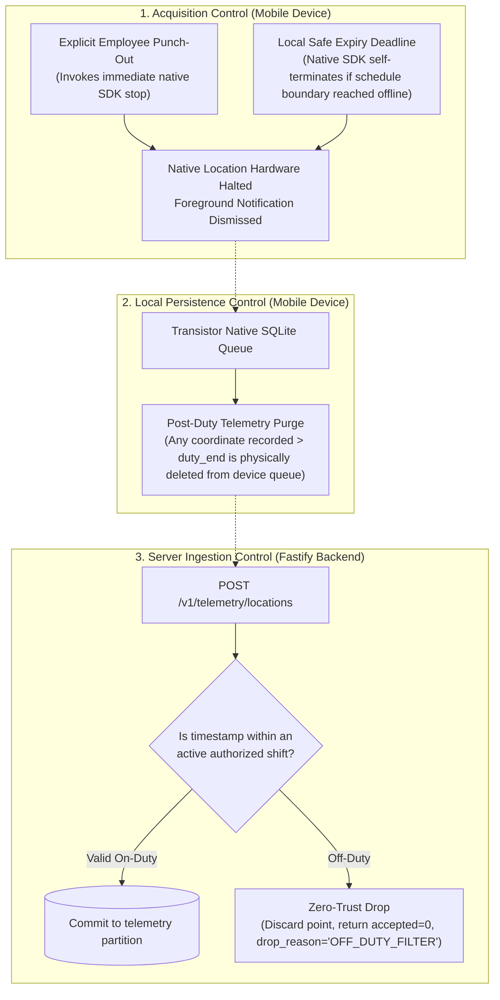

# Oprino Privacy Architecture & Compliance Specification (Re-evaluated)

**Status:** Updated & Recommended for Phase 01A  
**Date:** October 2026 (Reconciled)  
**Controlling Documents:** 
- Phase 00 Approved PRD ([`docs/product/OPRINO-MASTER-PRD.md`](file:///workspace/oprino/docs/product/OPRINO-MASTER-PRD.md))
- Phase 00 Stakeholder Sign-Off (Frozen Policy Decisions)
- [`docs/architecture/LOCATION-PIPELINE.md`](file:///workspace/oprino/docs/architecture/LOCATION-PIPELINE.md)
- [`ADR-008: Background Location Tracking`](file:///workspace/oprino/docs/architecture/ADR-008-background-location.md)

---

## 1. Executive Summary & Privacy Principles

Oprino operates under a foundational ethical and technical premise: **Workforce management must never become continuous personal surveillance.**

Owners and operations managers have a legitimate operational need to understand work execution and where employees are **during duty hours only**. Off-duty employee location tracking must **NEVER** be an intended Oprino behavior under any circumstance.

### The Five Inviolable Privacy Principles:
1. **Duty-Hours Exclusivity:** Location tracking is strictly prohibited and technically blocked outside active duty sessions.
2. **Transparent Tracking State:** The employee must always have clear, real-time visibility into whether tracking is active via a persistent OS notification and an in-app status banner.
3. **Peer Location Privacy:** Employee-to-employee live location visibility is **OFF BY DEFAULT** (frozen Phase 00 policy). Only authorized management roles can view field worker locations.
4. **Data Minimization & Automated Purge:** Raw location breadcrumbs default to a **30-day retention period** (frozen Phase 00 baseline), followed by irreversible partition drops and backup lifecycle expiry.
5. **Zero Telemetry Leakage:** Personal identifiers and raw GPS coordinates are strictly scrubbed from logs, metrics, and developer tools.

---

## 2. Acquisition, Local Persistence & Server Ingestion Controls

Privacy enforcement is separated across three distinct architectural control boundaries:

### 2.1 Mobile OS Timing Realities & Safe Local Deadline Strategy
- **Mobile Operating System Limitation:** Modern mobile operating systems (Android Doze mode, iOS background app suspension) **cannot guarantee** executing an automatic schedule boundary at an exact second while an app is suspended or without network connectivity.
- **Explicit Punch-Out:** When an employee taps "Punch Out", the application synchronously invokes `BackgroundGeolocation.stop()`. The foreground notification is destroyed immediately; the OS GPS radio powers off.
- **Safe Local Deadline Strategy:** 
  - To handle scenarios where an employee loses connectivity or forgets to punch out at the end of their shift, the mobile app provisions a **local hard deadline timestamp** in the native SDK configuration when the shift begins.
  - If the device is suspended or offline when the deadline timestamp is reached, the native OS AlarmManager/Timer terminates tracking autonomously, without requiring network or server commands.
  - On the backend, zero-trust validation drops any telemetry batch timestamped outside the scheduled shift window + company tolerance buffer.

---

## 3. Peer Location Visibility Governance

Per the **Phase 00 Stakeholder Sign-Off**:
- **Default Baseline:** Peer-to-peer visibility is strictly **OFF BY DEFAULT**. Technicians and field workers cannot see the real-time or historical locations of other technicians.
- **Authorized Viewers:** Duty-hours locations may be accessed only by authorized roles:
  - `OWNER` / `ADMIN`
  - `MANAGER` (restricted to employees within their assigned teams or operational units)
  - Explicit custom roles with `location:read:workspace` or `location:read:team` permissions granted by company ownership.
- **Future Peer Sharing:** Any future team location-sharing capability requires an explicit, audited company-level policy activation and clear employee disclosure.

---

## 4. Multi-Layer Telemetry Retention & Purge Architecture

Data minimization requires technical enforcement across all tiers of storage, not merely a single SQL table:

| Storage Layer | Retention Policy | Purge & Deletion Mechanism |
|---|---|---|
| **Primary Telemetry Tables** | **30 days (Default)** (Configurable: 7, 30, 90, 180 days) | Nightly maintenance job executes security-definer procedure `telemetry.prune_expired_partitions()`, issuing DDL `DROP TABLE` on expired daily partitions. |
| **Database Indexes** | Co-terminous with partition | Automatically dropped when partition table is dropped. |
| **Physical Read Replicas** | Real-time mirror | Streaming physical replication applies partition drops instantly. |
| **Database Backups & PITR** | **35-day rolling window** | Automated WAL archiving and backup snapshots cycle out after 35 days, guaranteeing complete physical erasure of historical GPS coordinates from cold backups. |
| **Object Exports (CSV/PDF)** | **7 days temporary link** | Pre-signed S3/R2 export links expire in 15 minutes; export files deleted by lifecycle rule after 7 days. |
| **Derived Mileage Summaries** | **3-Year Operational Policy** | Pre-purge aggregation commits daily distance totals (`daily_travel_summaries`) for operational expense claims; raw GPS coordinates are deleted. |
| **Support & Debug Logs** | **Zero retention of coordinates** | Pino logger and Sentry automatically scrub `latitude` and `longitude` fields with `[REDACTED_PRIVACY]` before writing. |

---

## 5. Employee Data Rights & Privacy Endpoints

Oprino provides native endpoints for employee privacy governance:
- `POST /v1/privacy/export-my-data`: Generates a portable, password-protected archive containing personal attendance records, submitted task logs, and profile data for the authenticated employee.
- `POST /v1/privacy/request-erasure`: When an employee leaves a company, their personal device tokens, biometrics, and authentication credentials are deleted immediately. Historical operational records (completed tasks, signed customer proof of work) are anonymized by nullifying personal identifiers (`employee_id = NULL`, `anonymized_display_name = "Former Employee #104"`), balancing labor operational records with personal privacy rights.

---

## 6. Compliance with Phase 00 Approved Scope

- Strictly enforces the frozen 30-day default location retention and peer visibility OFF baseline.
- Focuses purely on operational workforce management; avoids scope drift into payroll or billing compliance.
