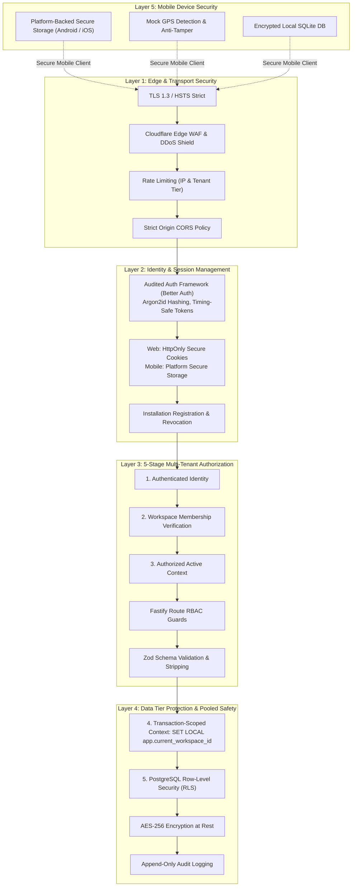

# Oprino Security Architecture & Defense-in-Depth Specification (Re-evaluated)

**Status:** Updated & Recommended for Phase 01A  
**Date:** October 2026 (Reconciled)  
**Controlling Documents:** 
- Phase 00 Approved PRD ([`docs/product/OPRINO-MASTER-PRD.md`](../product/OPRINO-MASTER-PRD.md))
- [`ADR-005: Multi-Tenancy Architecture`](./ADR-005-multitenancy.md)
- [`ADR-006: Authentication Architecture`](./ADR-006-authentication.md)
- [`ADR-007: Authorization Model`](./ADR-007-authorization.md)
- [`ADR-012: File Storage Architecture`](./ADR-012-file-storage.md)

---

## 1. Overview & Security Principles

Oprino manages sensitive business operations: real-time employee locations, customer site coordinates, proof-of-work media, and workforce operational data. Security is designed into every layer rather than treated as an afterthought.

The security architecture is founded on five core principles:
1. **Zero-Trust Multi-Tenancy:** A tenant identifier (`workspace_id`) is strictly verified at identity level, resolved against active memberships, and enforced via transaction-scoped PostgreSQL Row-Level Security (`SET LOCAL`).
2. **Duty-Bound Data Minimization:** Location tracking is strictly prohibited and technically blocked outside of active duty sessions.
3. **Defense-in-Depth:** Multiple redundant controls protect every critical asset; if one layer fails, subsequent layers prevent breach.
4. **Least Privilege by Default:** Users, services, and database connection pools operate with the absolute minimum permissions required.
5. **Fail Closed:** Any authorization ambiguity, corrupted signature, or expired session immediately results in an access denial.

---

## 2. Multi-Layer Defense-in-Depth Model



---

## 3. Layer Specifications

### 3.1 Layer 1: Edge, Network & Transport Security
- **Transport Encryption:** All traffic over public networks is strictly encrypted using **TLS 1.3** (TLS 1.2 minimum fallback). HTTP requests are permanently redirected to HTTPS with `Strict-Transport-Security: max-age=63072000; includeSubDomains; preload`.
- **WAF & DDoS Mitigation:** Cloudflare edge shields the Fastify ingress from SYN floods, slowloris attacks, and automated vulnerability scanners.
- **Granular Rate Limiting:**
  - Public Auth Routes (`/v1/auth/login`, `/v1/auth/otp`): 5 attempts per minute per IP.
  - Authenticated API Routes: 300 requests per minute per user.
  - Batch Telemetry Ingestion: 60 batches per minute per active mobile device.
  - Tenant Global Cap: Proportional to subscribed user seat count.
- **CORS & Headers:** Explicitly restricted to authorized dashboard domains (`app.oprino.com`). Employs strict CSP, `X-Content-Type-Options: nosniff`, `X-Frame-Options: DENY`, and `Referrer-Policy: strict-origin-when-cross-origin`.

### 3.2 Layer 2: Identity & Session Security (Audited Framework)
Per [`ADR-006`](./ADR-006-authentication.md), authentication is handled via an established, audited framework (Better Auth / audited engine) with PostgreSQL storage:
- **Credential Storage:** User passwords hashed using **Argon2id** (memory cost: 64MB, iterations: 3, parallelism: 4). Plaintext passwords are never logged, cached, or transmitted after hashing.
- **Dual Surface Session Handling:**
  - **Web Dashboard:** Secure, HttpOnly, SameSite=Lax, encrypted session cookies protecting against JavaScript XSS token theft.
  - **Mobile Apps:** Secure opaque session tokens stored in platform-backed secure storage (Android Keystore / iOS Keychain) under namespaced keys.
- **Installation Registration & Revocation:** Sessions are bound to Oprino-generated Installation IDs (`installation_id`). Deactivating an employee or revoking an installation flushes session records immediately from Redis and PostgreSQL.

### 3.3 Layer 3 & 4: Zero-Trust 5-Stage Multi-Tenancy & Pooled RLS Safety
Per [`ADR-005`](./ADR-005-multitenancy.md):
1. **Authenticated Identity:** User identity verified via signed token or session cookie.
2. **Workspace Membership Verification:** Backend queries `workspace_memberships` to verify user holds an active membership in the requested workspace.
3. **Authorized Active Context:** Binds validated `workspace_id` to request scope.
4. **Transaction-Scoped Database Context (`SET LOCAL`):** In pooled connection environments (PgBouncer in transaction mode or Fastify pg-pool), the database connection **MUST** set the tenant variable inside a transaction block using `SET LOCAL`:
   ```sql
   BEGIN;
   SELECT set_config('app.current_workspace_id', $1, true); -- true = transaction scope
   -- Application queries executed here
   COMMIT; -- set_config automatically clears upon commit/rollback
   ```
   *Session-level `SET` is strictly prohibited to prevent cross-tenant connection pool leaks.*
5. **PostgreSQL RLS Enforcement:** Acts as an invariant defense-in-depth safety net. Even if application SQL omits a tenant filter, RLS culls rows outside `current_setting('app.current_workspace_id')`.

### 3.4 Automated Negative Isolation Test Suite
CI/CD enforces automated regression tests against cross-tenant attacks:
- Cross-workspace row reads -> Assert HTTP 404 / empty set.
- Cross-workspace mutations -> Assert HTTP 404 / 403.
- Forged tenant headers (`X-Workspace-Id`) -> Assert HTTP 403.
- Stale or suspended workspace membership -> Assert HTTP 403.
- Removed employee -> Assert HTTP 403.
- Role downgrade in-flight -> Assert HTTP 403.
- Rapid workspace switching over pooled connections -> Assert zero state bleed.

### 3.5 Layer 5: Mobile Client Security
- **Android Backup & Migration Security (Cloud Backup & D2D Transfer Protection):**
  - Oprino does not rely solely on `android:allowBackup="false"`. Defense-in-depth rules must be codified across all supported API levels in `AndroidManifest.xml`:
    - `android:dataExtractionRules="@xml/data_extraction_rules"` (Android 12+ / API 31+)
    - `android:fullBackupContent="@xml/backup_rules"` (Android 11 and below / API <= 30)
  - **Android 12+ (`res/xml/data_extraction_rules.xml`):** Explicitly defines extraction policies governing both `<cloud-backup>` and `<device-transfer>`:
    ```xml
    <?xml version="1.0" encoding="utf-8"?>
    <data-extraction-rules>
        <cloud-backup>
            <exclude domain="sharedpref" path="FlutterSecureStorage"/>
            <exclude domain="sharedpref" path="oprino_auth_session.xml"/>
            <exclude domain="sharedpref" path="oprino_installation.xml"/>
            <exclude domain="database" path="oprino.sqlite"/>
            <exclude domain="database" path="oprino.sqlite-wal"/>
            <exclude domain="database" path="oprino.sqlite-shm"/>
        </cloud-backup>
        <device-transfer>
            <exclude domain="sharedpref" path="FlutterSecureStorage"/>
            <exclude domain="sharedpref" path="oprino_auth_session.xml"/>
            <exclude domain="sharedpref" path="oprino_installation.xml"/>
            <exclude domain="database" path="oprino.sqlite"/>
            <exclude domain="database" path="oprino.sqlite-wal"/>
            <exclude domain="database" path="oprino.sqlite-shm"/>
        </device-transfer>
    </data-extraction-rules>
    ```
  - **Android 11 and Below (`res/xml/backup_rules.xml`):** Explicit legacy backup rules specifying equivalent exclusions for Google Drive Auto Backup:
    ```xml
    <?xml version="1.0" encoding="utf-8"?>
    <full-backup-content>
        <exclude domain="sharedpref" path="FlutterSecureStorage"/>
        <exclude domain="sharedpref" path="oprino_auth_session.xml"/>
        <exclude domain="sharedpref" path="oprino_installation.xml"/>
        <exclude domain="database" path="oprino.sqlite"/>
        <exclude domain="database" path="oprino.sqlite-wal"/>
        <exclude domain="database" path="oprino.sqlite-shm"/>
    </full-backup-content>
    ```
  - Guarantees that neither Google Drive cloud backups nor cable/Wi-Fi Device-to-Device (D2D) migrations can restore invalidated tokens, clone installation identities, or leak cached customer data to a new device.
- **Remote Wipe Semantics:** When an administrator revokes a device or session on the backend, the next application contact receives HTTP 401/403. The mobile client intercepts this response and immediately executes an application-scoped local wipe: clearing session credentials from secure storage and purging protected domain database tables. The architecture does not claim ungrounded OS-level deletion or immediate wipe while a device is permanently offline.
- **Mock Location & Jailbreak Telemetry:**
  - Android: Detects `location.isFromMockProvider()` and test provider flags.
  - iOS: Detects simulated coordinates and root/jailbreak markers.
  - Suspicious coordinates are tagged as an anomaly/risk for manager review (never automatically treated as proven fraud) and raise operational exception alerts without disrupting field emergencies.
- **Local Database Encryption:** Client SQLite database encrypted using `SQLCipher` with an encryption key derived from hardware Keystore/Keychain primitives.

---

## 4. Vulnerability Management & Secure Supply Chain

1. **Deterministic Dependency Locking:** Monorepo strictly managed with `pnpm` and frozen `pnpm-lock.yaml`.
2. **Automated Dependency Auditing:** GitHub Dependabot and `pnpm audit` run on every pull request to detect known CVEs in upstream packages.
3. **Container Hardening:** Backend Docker containers run on minimal Alpine/Debian-slim base images, executed as an unprivileged non-root user (`USER node`). Zero shell tools (`curl`, `wget`) shipped in production images.

---

## 5. Compliance with Phase 00 Approved Scope

- Ensures complete data isolation for all SMB tenants (5–500 employees).
- Strictly prevents unauthorized off-duty employee tracking or cross-employee location spying.
- Protects operational records and customer proof of work from unauthorized disclosure or tampering.
