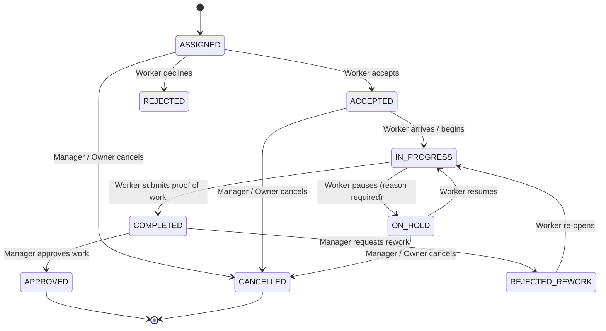
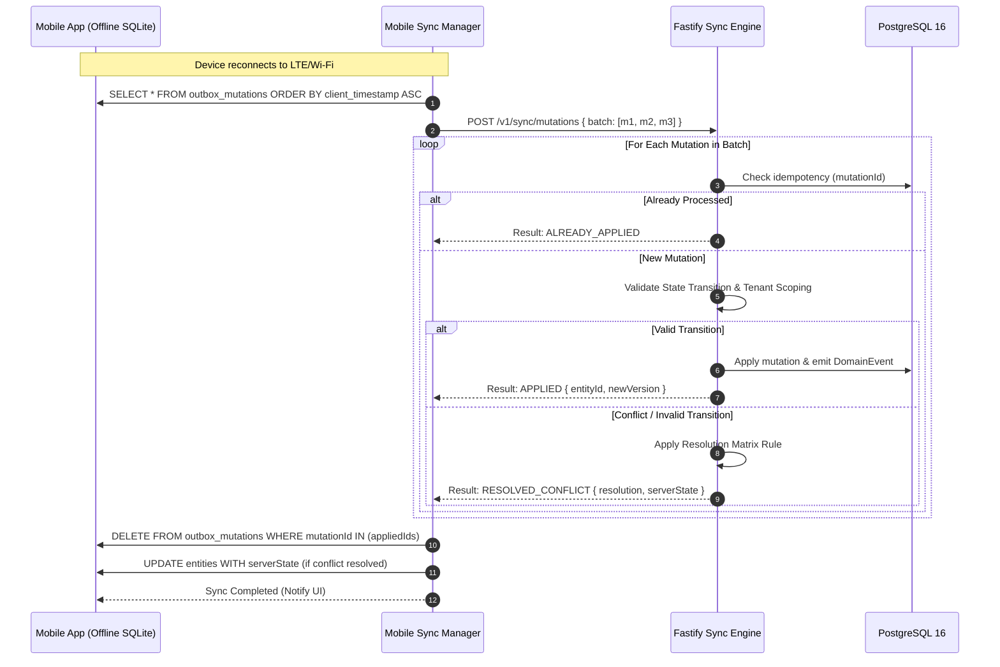

# Oprino Sync Conflict Resolution Matrix & Offline Data Strategy

**Status:** Proposed / Recommended for Phase 01A  
**Date:** October 2026  
**Controlling Documents:** 
- Phase 00 Approved PRD ([`docs/product/OPRINO-MASTER-PRD.md`](file:///workspace/oprino/docs/product/OPRINO-MASTER-PRD.md))
- [`ADR-009: Offline-First Architecture & Sync Protocol`](file:///workspace/oprino/docs/architecture/ADR-009-offline-sync.md)

---

## 1. Executive Summary & Philosophy

In field workforce management, network disconnection is an ordinary operational state, not an anomaly. Technicians, auditors, and drivers work in basements, rural sites, aircraft hangars, and elevator shafts without cellular connectivity for hours.

Oprino employs an **Offline-First, Optimistic Local-Write, Deterministic Server-Replay** model:
1. **Client-Generated UUIDs:** Every entity created offline is given a cryptographically random UUIDv4 on the client, eliminating ID reassignment upon sync.
2. **Append-Only Queuing:** Mutations are captured as immutable operational intents in the client SQLite `outbox_mutations` table.
3. **Partitioned Conflict Categories:** Not all data behaves identically. We classify entities into:
   - **Append-Only Streams** (Zero-Conflict)
   - **Monotonic State Machines** (Formal Transition Matrix)
   - **Server-Authoritative Governance** (Manager/Owner Wins)
   - **Field-Authoritative Execution** (Worker Truth Wins)
   - **Mergeable Attribute Sets** (Field-Level Merge)

---

## 2. Sync Mutation Envelope Contract

Every client mutation sent in batch replay adheres to the standard schema:

```typescript
export interface SyncMutationEnvelope {
  mutationId: string;       // Client UUIDv4 (deduplication key)
  workspaceId: string;      // Tenant ID
  entityType: string;       // 'task' | 'attendance' | 'visit' | 'proof' | 'expense'
  entityId: string;         // Target entity UUIDv4
  action: 'CREATE' | 'UPDATE' | 'TRANSITION_STATUS' | 'APPEND';
  clientTimestamp: string;  // Device UTC ISO8601 when action was taken
  payload: Record<string, unknown>;
  expectedVersion?: number; // Optimistic concurrency control counter
}
```

---

## 3. Entity-by-Entity Conflict Resolution Matrix

| Entity & Action | Conflict Scenario | Resolution Rule | Server Action | Client Local DB Behavior |
|---|---|---|---|---|
| **Attendance: Punch-In** | Worker punches in offline; duplicate punch-in attempted on second device. | **Single-Active-Shift Rule.** If an open shift already exists for the employee, server attaches punch-in as duplicate heartbeat or returns existing shift ID. | `MERGED_EXISTING` (HTTP 200) | Local SQLite reconciles `shift_id` to server record; keeps original local punch timestamp. |
| **Attendance: Punch-Out** | Worker punches out offline at 17:00, but sync occurs at 21:00 after server auto-punched out at 19:00. | **Worker Hardware Reality Wins.** Worker's local device punch-out at 17:00 supersedes the automated system timeout. Shift duration adjusted. | `APPLIED_OVERRIDE` | Shift end time updated to 17:00; audit log records offline reconciliation. |
| **Location Breadcrumbs** | Mobile uploads batch of 150 offline GPS points recorded during 3-hour coverage outage. | **Append-Only Time Series.** Points inserted into partition based on `recorded_at`. Invalid/off-duty points dropped. | `APPLIED_BATCH` | Mutations marked as synced; local storage pruned. |
| **Task Status: Transition** | Worker marks task `COMPLETED` offline; Manager simultaneously marked task `CANCELLED` online. | **Managerial Cancellation Wins.** A cancelled task cannot be completed. However, worker's submitted proof/time is preserved as an audit attachment. | `REJECTED_STALE_STATE` | Local task status changes to `CANCELLED`; worker notified: *"Task was cancelled by Manager. Your work notes have been archived."* |
| **Task Reassignment** | Manager reassigns task to Worker B online; original Worker A completes work offline unaware of reassignment. | **Dual Completion Audit.** Worker A's proof of work and completion notes are preserved. Task is marked `COMPLETED` by Worker A; Worker B's pending assignment is revoked. | `APPLIED_WITH_AUDIT` | Manager dashboard displays alert: *"Task completed offline by original assignee before reassignment synced."* |
| **Task Fields: Priority/Notes** | Manager updates task instructions online; Worker edits local task checklist offline. | **Field-Level Granular Merge.** Manager's changes to `description` and `priority` apply. Worker's changes to `checklist_items` apply. Neither overwrites the other. | `MERGED_PARTIAL` | Local task updates merged fields; version counter increments. |
| **Proof of Work (Photo/Sig)** | Worker submits watermarked photo and signature offline. | **Append-Only Immutable Proof.** Proof records are strictly additive. Once submitted, they cannot be updated or deleted by field workers. | `APPLIED` | Media marked uploaded once S3 pre-signed upload confirms hash match. |
| **Site Visit: Check-In/Out** | Worker checks into site offline at 10:00; checks out at 11:30; syncs at 14:00. | **Chronological Truth Wins.** Site visit record created with verified offline hardware timestamps. Geofence distance evaluated post-facto. | `APPLIED` | Local visit marked synced; conveyance distance appended. |
| **Task Comments / Chat** | Multiple workers comment on shared task concurrently offline. | **Monotonic Append-Only Log.** Comments are sorted and displayed chronologically by `client_timestamp`. No collision possible. | `APPLIED` | New server comments fetched and appended to local view. |
| **Leave Request** | Worker submits leave offline; manager has marked day as mandatory working day. | **Workflow State Machine.** Leave request is created as `PENDING_APPROVAL`. Manager approval policies evaluate normally on server. | `APPLIED_PENDING` | Local leave request shows `PENDING_APPROVAL`. |
| **Expense Claim** | Worker submits fuel expense offline; daily allowance budget exceeded. | **Policy Evaluation on Ingest.** Expense created as `SUBMITTED_FLAGGED`. Flag indicates policy exceedance for manager review. | `APPLIED_FLAGGED` | Local expense shows `FLAGGED_FOR_REVIEW`. |

---

## 4. State Machine Transition Guard Rails

To prevent state corruption, the backend enforces a strict state machine validator:



### Transition Validation Rules:
1. An offline transition from `IN_PROGRESS` to `COMPLETED` is **ALWAYS VALID** unless the task is in `CANCELLED` state.
2. A transition backwards (e.g., `COMPLETED` to `ACCEPTED`) attempted by a field worker is **STRICTLY REJECTED**.
3. If an invalid transition arrives from offline outbox, the server returns `REJECTED_INVALID_TRANSITION` and provides the current server entity state in the payload so the mobile client can cleanly reset its UI.

---

## 5. Client Outbox Replay & Reconciliation Flow



---

## 6. Media & Binary Sync Decoupling

A critical failure mode in offline systems is queuing multi-megabyte photo uploads directly inside database transaction queues.

**Oprino Decoupling Rule:**
1. Offline photo capture writes the compressed image (1600x1200 JPEG with metadata watermark) directly to the mobile device file system.
2. The database mutation payload records only the local URI and SHA-256 hash:
   `{ type: "PHOTO", localUri: "file:///...", sha256: "9f83a...", timestamp: "..." }`.
3. The sync engine processes metadata mutations **FIRST** via HTTP JSON.
4. Once metadata is committed, the separate `MediaUploadQueue` requests pre-signed S3 PUT URLs and streams the image binaries in the background.
5. If binary upload fails due to spotty signal, the task metadata is already safe on the server, marked with `media_status: "PENDING_UPLOAD"`.

---

## 7. Compliance with Phase 00 Approved Scope

- Ensures full offline autonomy for mobile field workers without losing work.
- Respects managerial authority while preserving worker proof and execution reality.
- Maintains multi-tenant boundaries and audit logs across all offline reconciliations.
