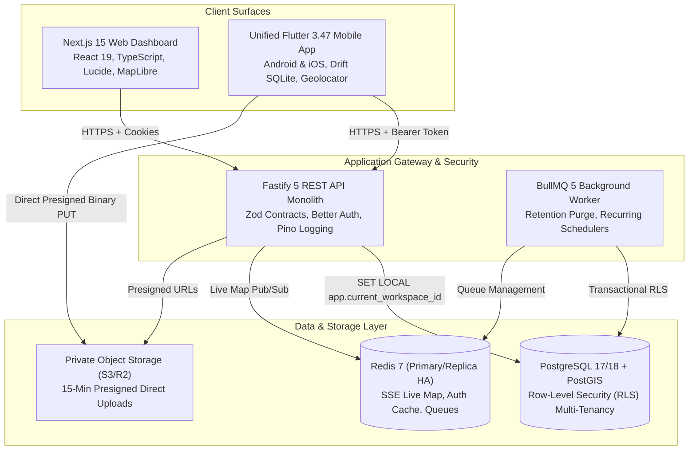

# Oprino — System Architecture Overview

**Author:** Principal Software Architect  
**Status:** Approved & Frozen (Phase 01A & V1 Stabilization)  
**Controlling PRD:** [`docs/product/OPRINO-MASTER-PRD.md`](../product/OPRINO-MASTER-PRD.md)  
**ADR Register:** [`docs/architecture/ADR/README.md`](./ADR/README.md)  

---

## 1. System Topology & Tiering

Oprino is architected as a high-performance, cost-effective polyglot system designed for SMB task and field workforce operations (5–500 employees, optimized for 10–200).



---

## 2. Core Architectural Pillars

### A. Strict Polyglot Contract Boundary
- **Source of Truth:** `@oprino/contracts` defines all domain models, DTOs, and validation schemas via Zod.
- **OpenAPI 3.1 Compilation:** Turbo compiles Zod schemas into `dist/openapi.json`.
- **Automated Client Generation:** `generated/dart-api` generates strongly-typed Dart Dio client classes directly from OpenAPI 3.1, eliminating API/client drift.

### B. Zero-Trust Multi-Tenancy with Transactional RLS
- **Gateway Stage:** Validates token, resolves active workspace membership, and verifies RBAC permissions (`Domain:Action:Scope`).
- **Database Stage:** Every SQL query executes inside a transaction preceded by:
  ```sql
  SET LOCAL app.current_workspace_id = 'ws-xxxx-xxxx';
  ```
- **Connection Pool Safety:** `SET LOCAL` is automatically cleared upon commit or rollback, preventing cross-tenant connection pool leaks in pooled drivers.

### C. Duty-Hours-Only Location Privacy Invariant
- **OS Boundary:** Mobile foreground location service executes strictly between active Punch In and Punch Out.
- **Server Boundary:** Ingest endpoint validates active duty status; off-duty breadcrumbs are immediately dropped (HTTP 403 `OFF_DUTY_TRACKING_PROHIBITED`) with 0 database writes.
- **Data Lifecycle:** Automated PostgreSQL procedure purges location points older than the workspace retention limit (default 30 days).

### D. Offline-First Mutation Engine
- **Local Persistence:** Drift + SQLite outbox queue on mobile.
- **Durability:** Photos and biometric selfies written to persistent app-support storage before upload.
- **Idempotency:** Client-generated UUIDs ensure retried network requests never create duplicate database rows.

---

## 3. Technology Stack Summary

| Layer | Primary Technology | Rationale & Reference |
|---|---|---|
| **Mobile Client** | Flutter 3.47 (Stable Dart) | High-performance, cross-platform Android & iOS rendering, unified role-aware app ([`ADR-001`](./ADR-001-mobile-framework.md)). |
| **Web Dashboard** | Next.js 15 (React 19) | React App Router, Server Components, TanStack Table, MapLibre Web cartography ([`ADR-002`](./ADR-002-web-stack.md)). |
| **Backend API** | Fastify 5 (TypeScript) | High-throughput, low-overhead REST engine with strict schema validation ([`ADR-003`](./ADR-003-backend-platform.md)). |
| **Database** | PostgreSQL 17/18 + PostGIS | Enterprise spatial queries (`ST_DWithin`), robust Row-Level Security, partition pruning ([`ADR-004`](./ADR-004-database-geospatial.md)). |
| **Authentication** | Better Auth + Session Store | Secure cookie and token-based sessions, Argon2id passwords, single-use invites ([`ADR-006`](./ADR-006-authentication.md)). |
| **Object Storage** | Cloudflare R2 / AWS S3 API | Zero-egress cost, 100% private bucket, 15-minute presigned PUT/GET URLs ([`ADR-012`](./ADR-012-file-storage.md)). |
| **Cache & Realtime** | Redis 7 + Server-Sent Events | Fast ephemeral live location pub/sub, single-use ticket streaming ([`ADR-010`](./ADR-010-realtime.md)). |
| **Job Processing** | BullMQ 5 | Asynchronous scheduled maintenance, retention purges, SLA alerts ([`ADR-014`](./ADR-014-background-jobs.md)). |

---

## 4. Key Cross-References

* **Repository Structure & Map:** [`docs/architecture/REPOSITORY-MAP.md`](./REPOSITORY-MAP.md)
* **Data Flow Architecture:** [`docs/architecture/DATA-FLOW.md`](./DATA-FLOW.md)
* **Database Overview & RLS:** [`docs/architecture/DATABASE-OVERVIEW.md`](./DATABASE-OVERVIEW.md)
* **Auth & RBAC Specification:** [`docs/architecture/AUTH-AND-PERMISSIONS.md`](./AUTH-AND-PERMISSIONS.md)
* **Mobile Architecture:** [`docs/architecture/MOBILE-ARCHITECTURE.md`](./MOBILE-ARCHITECTURE.md)
