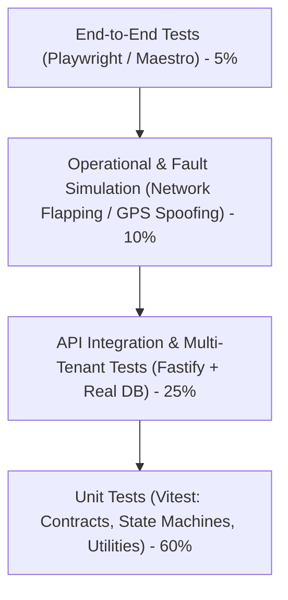

# Oprino Engineering Testing Strategy & Quality Assurance Framework

**Status:** Proposed / Recommended for Phase 01A  
**Date:** October 2026  
**Controlling Documents:** 
- Phase 00 Approved PRD ([`docs/product/OPRINO-MASTER-PRD.md`](../product/OPRINO-MASTER-PRD.md))
- [`ADR-005: Multi-Tenancy Architecture`](./ADR-005-multitenancy.md)
- [`ADR-009: Offline-First Architecture & Sync Protocol`](./ADR-009-offline-sync.md)

---

## 1. Overview & Quality Assurance Philosophy

Oprino operates in demanding real-world conditions: field technicians with dirty hands, intermittent connectivity, budget smartphones with aggressive battery-killing OS modifications, and mission-critical business SLAs.

Our testing strategy follows the **Practical Testing Pyramid**:
- **Broad, Blazing-Fast Unit Tests** for contracts, math, state transitions, and date calculations.
- **Deep Integration Tests with Real Ephemeral Databases** to guarantee multi-tenant security, RBAC enforcement, and offline mutation replay.
- **Specialized Operational Simulations** for background location tracking, mock GPS, and network flapping.
- **End-to-End Flow Tests** across Web and Mobile for critical path workflows.

---

## 2. The Oprino Testing Pyramid

---

## 3. Test Layers & Tools

### 3.1 Unit Testing (Vitest)
- **Scope:** Pure functions, domain contracts, Zod schemas, state machine transition validators, date/shift calculations, geohash math.
- **Speed:** Entire monorepo unit test suite runs in < 5 seconds.
- **Key Test Suites:**
  - `packages/contracts`: Validates schema parsing and error formatting.
  - `packages/utils`: Validates distance calculations (`ST_DistanceSphere` equivalents), geofencing math, watermarking string formatting.
  - State Machine Unit Tests: Proves every valid and invalid transition in `SYNC-CONFLICT-MATRIX.md`.

### 3.2 Backend Integration Testing (Fastify + Testcontainers / Ephemeral PostgreSQL)
- **Scope:** Fastify routes, middleware, authentication, RBAC, domain event dispatch, database queries.
- **Execution:** Runs against a real PostgreSQL 18 (or 17) instance with PostGIS and Redis enabled.
- **Multi-Tenant Invariant Matrix:**
  Every route test suite includes explicit negative tests:
  1. User from Workspace A requests resource from Workspace B -> **Assert 404 or 403**.
  2. User modifies task with `workspace_id` in payload -> **Assert server ignores payload workspace and scopes to authenticated token**.
  3. Bulk query without explicit tenant filter -> **Assert PostgreSQL RLS blocks cross-tenant rows**.

### 3.3 Offline Sync & Mutation Replay Testing
- **Simulation Harness:** Simulates mobile client generating offline mutations across hours of disconnection.
- **Scenarios Verified:**
  1. Single-device sequential replay: Verifies outbox batches apply in monotonic order.
  2. Concurrent dual-device mutation: Verifies conflict matrix resolutions (e.g. offline completion vs online cancellation).
  3. Network drop mid-batch: Re-sending an identical batch asserts idempotency (zero duplicated tasks, zero duplicated shift records).

### 3.4 Mobile Location & Power Management Simulation
- **Background Location Harness:**
  - Mock coordinate generator feeds realistic GPS sequences (walking, driving, stationary) into the mobile test runtime.
  - Verifies stationary geofence engages when velocity < 1 km/h for > 4 minutes.
  - **Duty Cutoff Verification:** Injects punch-out action; asserts location tracker stops immediately and no further coordinates are added to local SQLite.
  - **Mock GPS Test:** Injects mock provider coordinates; asserts client flags point and alerts manager.

### 3.5 End-to-End (E2E) Testing
- **Web Dashboard (Playwright):**
  - Owner onboarding flow.
  - Task dispatch and real-time live map rendering via SSE.
  - Proof of work review, image modal inspection, approval/rework workflow.
  - Attendance regularization approval.
  - Large CSV export triggering and download verification.
- **Mobile Apps (Maestro):**
  - Employee login via phone OTP / credentials.
  - Punch-in with camera selfie capture.
  - Task acceptance, offline checklist completion, customer signature on glass.
  - Punch-out with shift summary verification.

### 3.6 Performance & Load Testing (k6)
- **Target Profiles:**
  - **Telemetry Ingestion:** 2,000 concurrent mobile clients transmitting location batches every 30 seconds (66 req/sec sustained) with p95 latency < 50ms.
  - **Live Map SSE Broadcast:** 500 concurrent manager browser sessions receiving real-time SSE coordinate streams with < 500ms end-to-end fan-out latency.
  - **Large Export Streaming:** 50 concurrent CSV export requests streaming 20,000 rows without API memory exceeding 150MB.

---

## 4. Continuous Integration (CI) Pipeline Enforcement

In Turborepo CI (`.github/workflows/ci.yml`):
1. **Lint & Typecheck:** `pnpm turbo run lint typecheck` (zero TypeScript errors allowed).
2. **Unit Tests:** `pnpm turbo run test:unit --filter=@oprino/*`.
3. **Integration Tests:** Launches Docker PostgreSQL + PostGIS + Redis; runs `pnpm turbo run test:integration`.
4. **Contract Verification:** Verifies no breaking changes between `@oprino/contracts` and API routes.

---

## 5. Compliance with Phase 00 Approved Scope

- Formally verifies the 30-day location retention automated purge.
- Rigorously validates duty-hours cutoff across all mobile and server tiers.
- Enforces strict multi-tenant data boundaries across all tests.
