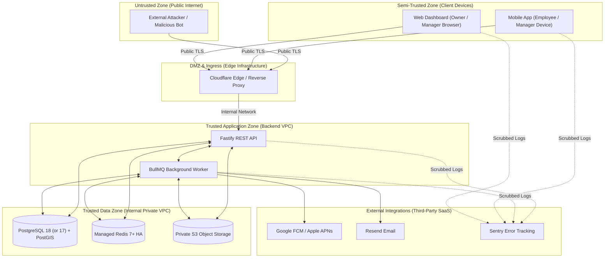

# Oprino STRIDE Threat Model & Risk Analysis

**Status:** Proposed / Recommended for Phase 01A  
**Date:** October 2026  
**Controlling Documents:** 
- Phase 00 Approved PRD ([`docs/product/OPRINO-MASTER-PRD.md`](../product/OPRINO-MASTER-PRD.md))
- [`docs/architecture/SECURITY-ARCHITECTURE.md`](./SECURITY-ARCHITECTURE.md)
- [`ADR-005: Multi-Tenancy Architecture`](./ADR-005-multitenancy.md)
- [`ADR-008: Background Location Tracking`](./ADR-008-background-location.md)

---

## 1. System Boundary & Trust Zones

---

## 2. STRIDE Threat Analysis Matrix

| ID | STRIDE Category | Threat Description | Attack Surface | Severity | Mitigation Architecture | Residual Risk |
|---|---|---|---|:---:|---|:---:|
| **T-01** | **Spoofing** | Field worker uses mock GPS software (e.g., Fake GPS app) to fake presence at a customer site or punch in remotely. | Mobile GNSS Ingest | **High** | 1. Android `isFromMockProvider()` detection. 2. Accelerometer/speed correlation (detects instant teleportation). 3. Cell tower / Wi-Fi BSSID sanity validation. 4. Geofence violation flags. | Low (Flagged as suspicious) |
| **T-02** | **Spoofing** | Attacker steals an expired access token or attempts session replay. | API Auth Endpoints | **Medium** | 1. Opaque Better Auth session credential with sliding TTL. 2. Instant Redis session invalidation on logout/revocation. 3. Binding session to registered Oprino Installation ID. | Low |
| **T-03** | **Tampering** | Employee roots phone, alters local SQLite `outbox_mutations` to change punch timestamps or task completion times. | Mobile Local SQLite | **Medium** | 1. SQLCipher local database encryption. 2. Server-side timestamp reconciliation (server checks delta between client timestamp and server arrival time). 3. Outlier timestamps flagged for audit. | Low |
| **T-04** | **Tampering** | User attempts parameter tampering to modify an entity belonging to another company by altering `workspace_id` in request body. | Fastify REST API | **Critical** | 1. `workspace_id` extracted strictly from validated session, NEVER accepted from client body/query. 2. PostgreSQL RLS enforces tenant isolation at SQL layer. | Negligible |
| **T-05** | **Repudiation** | Field worker denies completing a visit or claims manager modified their attendance record without consent. | Operational Audit | **Medium** | 1. Immutable append-only audit trail (`audit.system_audit_logs`). 2. Cryptographic SHA-256 photo hashing with burned-in timestamp watermark. 3. Manager regularizations require mandatory reason notes. | Negligible |
| **T-06** | **Information Disclosure** | Off-duty employee location is accidentally recorded, stored, or displayed on the manager live map. | Mobile Tracking & Live Map Pipeline | **Critical** | 1. Native foreground service termination on punch-out. 2. Client-side local post-duty point deletion. 3. Server-side zero-trust attendance shift check (drops off-duty coordinates). 4. 30-day automated partition purge. | Negligible |
| **T-07** | **Information Disclosure** | Peer employees view each other's live locations on mobile map without authorization. | Real-Time SSE / Mobile Map | **High** | 1. Phase 00 Sign-Off Rule: Peer location visibility is **OFF BY DEFAULT**. 2. SSE streams strictly enforce RBAC (`location:read:team` / `location:read:workspace`). | Negligible |
| **T-08** | **Information Disclosure** | Raw GPS coordinates or customer PII leaks into application logs or Sentry error dashboards. | Observability Pipeline | **High** | 1. Pino automatic redaction (`redact: ['payload.latitude', 'payload.longitude', 'payload.phone']`). 2. Sentry client-side `beforeSend` data scrubbing. | Low |
| **T-09** | **Information Disclosure** | Attacker guesses S3 bucket URLs to view confidential customer site photos or signed proof of work. | S3 Object Storage | **Critical** | 1. S3 bucket is 100% private with Zero Public Access. 2. Files accessed exclusively via pre-signed GET URLs with 15-minute expiration. 3. Pre-signed URLs generated only after workspace RBAC check. | Negligible |
| **T-10** | **Denial of Service** | Malicious tenant issues massive CSV export or complex spatial queries to exhaust database connection pool. | Reporting Engine | **High** | 1. Export jobs > 5,000 rows offloaded to isolated BullMQ worker process. 2. Node.js cursor streaming ensures memory usage < 25MB. 3. Tenant rate-limiting and query timeout guards (15 seconds max). | Low |
| **T-11** | **Elevation of Privilege** | Standard field employee modifies their role or assigns themselves managerial approval permissions. | RBAC Authorization | **Critical** | 1. Route-level authorization guards verify role scopes on every request. 2. Role assignment restricted strictly to `OWNER` / `ADMIN` roles. 3. Fastify hooks fail closed. | Negligible |

---

## 3. High-Priority Mitigation Architecture Deep-Dive

### 3.1 Mitigating GPS Spoofing & Teleportation (T-01)
Field workers may attempt to use mock GPS applications on Android to pretend they are at a client facility:
1. **OS Mock Detection:** The mobile background plugin evaluates `location.mock = true` or `isFromMockProvider`. If true, the coordinates are flagged with `telemetry_quality = 'MOCK_DETECTED'`.
2. **Speed & Acceleration Invariant:** If a coordinate pair indicates displacement exceeding 160 km/h (or instant 5km jump in 10 seconds), the pipeline tags the point as `ANOMALY_TELEPORTATION`.
3. **Operational Consequence:** The system **DOES NOT** crash or lock the worker out (which could disrupt legitimate field emergencies). Instead, it quietly flags the record as an anomaly/risk for manager review (not automatically treated as proven fraud) and notifies the assigned manager via an Operational Exception Alert on their dashboard.

### 3.2 Mitigating Cross-Tenant Data Leaks (T-04)
The highest risk in SaaS is multi-tenant data leakage. The platform enforces the 5-stage zero-trust verification pipeline ([`ADR-005`](./ADR-005-multitenancy.md), [`SECURITY-ARCHITECTURE.md`](./SECURITY-ARCHITECTURE.md)):
1. **Authenticated Identity:** Verifies cryptographic signature of JWT or session cookie to resolve canonical `userId`.
2. **Workspace Membership Verification:** Validates that user holds an active membership record in the target workspace in `workspace_memberships`.
3. **Authorized Active Context:** Binds validated `workspace_id` to request scope; arbitrary client tenant claims are rejected.
4. **Transaction-Scoped Tenant Context (`SET LOCAL`):** The backend opens a database transaction and executes `SET LOCAL app.current_workspace_id = 'verified_workspace_id'`, safely isolating pooled connections (PgBouncer) with zero cross-tenant session leaks.
5. **PostgreSQL RLS Fallback:** As defense in depth, PostgreSQL Row-Level Security automatically restricts all table queries strictly to `current_setting('app.current_workspace_id')`.

---

## 4. Verification & Security Testing Strategy

- **Automated Penetration Test Suite:** Integration tests simulate tenant cross-access attacks (Tenant A attempting to fetch Tenant B's tasks or locations) and assert HTTP 403/404 responses.
- **Mock GPS Simulation Tests:** Mobile unit tests verify that simulated location flags correctly trigger exception alerts.
- **Static Analysis (SAST):** Automated ESLint security rules (`eslint-plugin-security`) flag unsafe regex, prototype pollution, or unescaped queries.

---

## 5. Compliance with Phase 00 Approved Scope

- Ensures complete adherence to frozen privacy policies (peer visibility OFF by default, off-duty tracking impossible).
- Protects operational records against internal employee fraud and external cyber threats.
