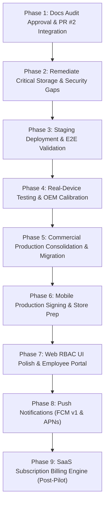

# Oprino Production Readiness & Next Steps Roadmap

**Document:** Prioritized Engineering Roadmap, Dependencies & Acceptance Criteria  
**Audit Date:** October 14, 2026  
**Auditor Roles:** Principal Software Architect, Engineering Project Manager, DevOps Lead  
**Governing Standard:** Staging-first, risk-mitigated sequential path to commercial production release. Critical security and media storage issues must be resolved and validated in staging BEFORE any commercial production merge or migration.

---

## 1. Prioritized Roadmap Overview (Staging-First)



---

## 2. Five-Tier Verification Architecture

Every operational gate must be validated against its designated verification tier:

| Tier | Verification Level | Target Environment | Scope & Evidence |
|---|---|---|---|
| **Tier 1** | **Local Integration Tests** | Local Workstation / Docker Containers | `pnpm test` (122/122 backend tests green), `pnpm typecheck` (8/8 packages), `pnpm lint` (0 errors), Next.js local build, `pnpm docs:check-links`. |
| **Tier 2** | **Vercel Preview Checks** | Ephemeral Cloud Web Environments | Vercel preview deployment builds from branch pushes, validating Next.js App Router bundling, SSR/SSG rendering, and static asset distribution. |
| **Tier 3** | **GitHub Actions CI** | Hosted Ubuntu Runners + Ephemeral Services | Automated matrix pipeline (`.github/workflows/ci.yml`) spinning up isolated Postgres 17 (PostGIS) and Redis 7 containers; runs lint, typecheck, build, test, and E2E smoke tests on PRs and main. |
| **Tier 4** | **Real-Device Testing** | Physical Android & iOS Hardware | Physical OEM hardware (Samsung One UI, Xiaomi HyperOS, Google Pixel) testing GPS foreground services, Doze mode battery drain, Drift SQLite offline queueing, camera permissions, and network recovery. |
| **Tier 5** | **Production Cloud Verification** | Live Multi-Cloud Infrastructure | Live production services: Neon PostgreSQL (PostGIS), Render Web Service (`https://oprino-api.onrender.com`), Vercel Production (`https://oprino.vercel.app`), Cloudflare R2 / AWS S3, and Upstash Redis. Validated with `/health/ready` probe and live smoke test. |

---

## 3. Detailed Phase Specifications

### Phase 1: Documentation Audit Approval & PR #2 Integration (Immediate)
- **Objective:** Finalize documentation organization audit PR #2, preserve Git mode `120000` ADR symlinks, resolve link warnings, and integrate documentation corrections into `feat/v1-blockers-remediation`.
- **Dependencies:** None.
- **Key Tasks:**
  - Convert PR #2 to Draft during review; ensure all documentation is accurate and evidence-based.
  - Preserve canonical ADRs in `docs/architecture/` and mode `120000` symlinks in `docs/architecture/ADR/` (including `ADR-021`).
  - Verify portable relative links in `docs/README.md` and repository documents.
  - Configure `.github/workflows/ci.yml` to safely validate feature PRs without triggering deployments.
- **Verification Tier:** **Tier 1 (Local)** & **Tier 3 (GitHub Actions CI)**.
- **Acceptance Criteria:**
  - Automated link check passes with 0 broken links (`pnpm docs:check-links`).
  - Monorepo typecheck, lint, and 122 tests pass cleanly.

---

### Phase 2: Remediate Critical Storage & Security Gaps (Pre-Staging)
- **Objective:** Replace mock media upload endpoints with real pre-signed cloud blob storage (Cloudflare R2 or AWS S3) and implement automated transactional email delivery.
- **Dependencies:** Phase 1 complete.
- **Key Tasks:**
  - **Real Cloud Media Storage (S3 / R2):**
    - Install AWS S3 SDK client (`@aws-sdk/client-s3`, `@aws-sdk/s3-request-presigner`) in `services/api`.
    - Update `MediaService.ts` to replace the `/v1/media/mock-upload/*` stub with authentic pre-signed PUT URLs (10-minute expiry) and pre-signed GET URLs (15-minute expiry).
    - Enforce tenant isolation object key paths: `${workspaceId}/proofs/${taskId}/${timestamp}_${random}.${ext}`.
    - Validate MIME types (`image/jpeg`, `image/png`, `image/webp`) and file size limits (<= 10MB) before signing.
  - **Transactional Email Delivery (Resend / SMTP):**
    - Wire Resend SDK or SMTP transporter in `services/api/src/services/email.service.ts`.
    - Automatically deliver employee activation emails containing the single-use token link upon member creation.
  - **Dart API Client Synchronization (`punchIn` contract):**
    - Update `packages/contracts/scripts/generate-dart-client.ts` to accept `selfieMediaKey`, `latitude`, `longitude`, and `accuracy` parameters on `client.punchIn()`.
    - Regenerate `generated/dart-api` and verify `flutter analyze` passes 100% green in CI.
- **Verification Tier:** **Tier 1 (Local Integration Tests)** & **Tier 3 (GitHub Actions CI Mobile Matrix)**.
- **Acceptance Criteria:**
  - Integration tests verify presigned URL generation, tenant prefix boundaries, and upload confirmation.
  - Mock media upload endpoint `/v1/media/mock-upload/*` is completely eliminated.
  - `flutter analyze` passes with 0 errors in CI.

---

### Phase 3: Staging Deployment & End-to-End Cloud Validation (Staging-First Gate)
- **Objective:** Deploy unified feature branches to an isolated **Staging** environment, apply migration `0005`, and execute end-to-end automated verification **BEFORE touching production**.
- **Dependencies:** Phase 2 complete.
- **Key Tasks:**
  - Provision isolated Staging infrastructure: Staging Neon database branch, Staging Render service (`oprino-api-staging`), Staging Vercel project, and Staging R2 bucket (`oprino-media-staging`).
  - Apply migration `0005_v1_blockers_remediation.sql` to the Staging Neon database.
  - Verify schema additions: `workspaces.location_retention_days`, `attendance_punches.selfie_media_key`, and invitation verification indices.
  - Execute live cloud smoke test against Staging API:
    ```bash
    API_BASE_URL=https://oprino-api-staging.onrender.com node scripts/smoke_test.mjs
    ```
- **Verification Tier:** **Tier 2 (Vercel Preview)** & **Tier 5 (Staging Cloud Verification)**.
- **Acceptance Criteria:**
  - Staging `/health/ready` returns `HTTP 200 OK` with database and Redis connected.
  - Staging smoke test passes 10/10 domain flows without regressions.
  - Selfie photos and customer signatures upload directly to Staging R2 and render in the Web Proof Inspector modal.

---

### Phase 4: Real-Device Testing & OEM Calibration (Physical Field Gate)
- **Objective:** Validate Android foreground location tracking, battery drain, and Drift SQLite offline queueing on physical hardware against the Staging environment.
- **Dependencies:** Phase 3 complete.
- **Key Tasks:**
  - Deploy release APK configured with Staging API URL onto at least 3 distinct physical OEM smartphones:
    - Samsung (One UI battery management).
    - Xiaomi / Poco (HyperOS / MIUI aggressive background killing).
    - Google Pixel (Stock Android battery optimization).
  - Execute a 4-hour active field route with multiple customer visit check-ins, transit through zero-connectivity areas (subways/tunnels), and screen-off pocket transit.
  - Measure battery consumption (target: < 3.5% battery drain per hour of continuous duty tracking).
  - Test offline queue resilience: punch attendance and check in to visits with Airplane Mode enabled; confirm mutations queue losslessly in Drift SQLite and flush immediately upon reconnecting.
- **Verification Tier:** **Tier 4 (Real-Device Physical Testing)**.
- **Acceptance Criteria:**
  - Zero off-duty location points recorded (duty invariant preserved).
  - No background service terminations by OEM battery managers.
  - Zero loss of offline task updates, attendance selfies, or signatures upon network recovery.

---

### Phase 5: Commercial Production Consolidation, Migration & Deployment
- **Objective:** Safely merge verified feature branches into `main`, apply schema migration `0005` to production Neon database, and deploy live production services.
- **Dependencies:** Phases 1 through 4 successfully validated and signed off.
- **Key Tasks:**
  - Review and merge PR #1 (`feat/zero-cost-gps-field-ops`) into `main`.
  - Review and merge `feat/v1-blockers-remediation` into `main`.
  - Apply migration `0005_v1_blockers_remediation.sql` to live production Neon database:
    ```bash
    pnpm --filter @oprino/database migrate
    ```
  - Provision production Cloudflare R2 bucket (`oprino-media-prod`) with private access and inject production credentials into Render environment variables.
  - Trigger production deployment of `oprino-api` on Render and `oprino-web` on Vercel from `main`.
  - Execute live production smoke test:
    ```bash
    API_BASE_URL=https://oprino-api.onrender.com node scripts/smoke_test.mjs
    ```
- **Verification Tier:** **Tier 3 (GitHub Actions CI on Main)** & **Tier 5 (Production Cloud Verification)**.
- **Acceptance Criteria:**
  - Production `/health/ready` returns `HTTP 200 OK`.
  - 10/10 live smoke test flows pass on production infrastructure.
  - Live Web dashboard displays Member Activation, Bulk CSV import, Selfie Attendance, and Settings retention controls.

---

### Phase 6: Mobile Production Signing & Store Preparation
- **Objective:** Transition mobile packaging from debug signing to production-grade application distribution for Google Play Console and Apple App Store.
- **Dependencies:** Phase 5 complete.
- **Key Tasks:**
  - Generate official Android production upload keystore:
    ```bash
    keytool -genkey -v -keystore oprino-release.jks -alias oprino -keyalg RSA -keysize 2048 -validity 10000
    ```
  - Store keystore binary and credentials securely in GitHub Actions encrypted secrets (`OPRINO_KEYSTORE_BASE64`, `OPRINO_KEYSTORE_PASSWORD`, `OPRINO_KEY_ALIAS`).
  - Configure Fastlane for automated build distribution to Google Play Console Internal Testing track and Apple TestFlight.
- **Verification Tier:** **Tier 3 (CI Mobile Pipeline)** & **Tier 4 (Internal Testing Track Installation)**.
- **Acceptance Criteria:**
  - GitHub Actions `mobile-release.yml` produces an authentic production-signed AAB/APK accepted by Google Play Console without signature warnings.

---

### Phase 7: Web RBAC UI Polish & Employee Portal
- **Objective:** Implement client-side role guards to hide manager tabs from employee accounts and provide an Employee Self-Service view.
- **Dependencies:** Phase 5 complete.
- **Key Tasks:**
  - Update `apps/web/src/components/HeaderNav.tsx` to read the authenticated user's workspace role.
  - Hide supervisory routes (`/live-map`, `/team`, `/settings`, `/reports`) if the user's role is `Employee`.
  - Provide employees with a dedicated self-service view: assigned tasks, personal attendance calendar, and profile.
- **Verification Tier:** **Tier 1 (Local Tests)** & **Tier 2 (Vercel Preview)**.
- **Acceptance Criteria:**
  - Logging in as an Employee renders only permitted self-service views; zero 403 Forbidden navigation errors.

---

### Phase 8: Push Notifications (FCM v1 & APNs)
- **Objective:** Wire native OS push notifications so field workers receive instant background alerts when tasks are assigned or updated.
- **Dependencies:** Phase 6 complete.
- **Key Tasks:**
  - Install Firebase Admin SDK in `services/api` and `firebase_messaging` in `apps/mobile`.
  - Create database table `device_push_tokens` to associate FCM/APNs registration tokens with user sessions.
  - Dispatch push notifications via BullMQ worker on task assignment, route changes, and proof rejection.
- **Verification Tier:** **Tier 4 (Physical Device Push Receipt)**.
- **Acceptance Criteria:**
  - Assigning a task triggers an audible OS push notification on the assigned worker's physical smartphone.

---

### Phase 9: Commercial SaaS Subscription Billing Engine (Post-Pilot)
- **Objective:** Implement automated payment processing, recurring subscriptions, and seat management.
- **Dependencies:** Phase 8 pilot validation complete.
- **Key Tasks:**
  - Create database tables: `subscriptions`, `plans`, `invoices`.
  - Integrate Stripe Checkout / Lemon Squeezy / Razorpay for self-service tier upgrades (`Starter`, `Growth`, `Business`).
  - Implement webhooks to automatically adjust seat limits and handle subscription renewals or cancellations.
- **Verification Tier:** **Tier 1 (Webhook Integration Tests)** & **Tier 5 (Stripe Sandbox Verification)**.
- **Acceptance Criteria:**
  - Business owners can subscribe to a paid tier via credit card and receive automated tax invoices.

