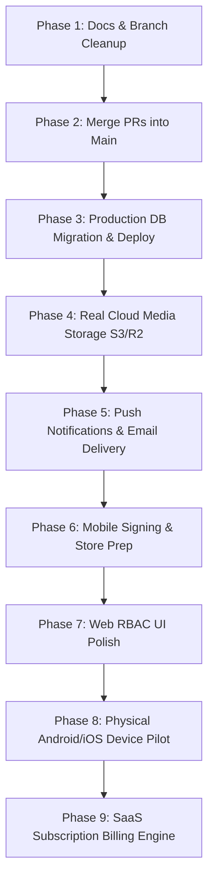

# Oprino Production Readiness & Next Steps Roadmap

**Document:** Prioritized Engineering Roadmap, Dependencies & Acceptance Criteria  
**Audit Date:** October 14, 2026  
**Auditor Roles:** Principal Software Architect, Engineering Project Manager, DevOps Lead  
**Governing Standard:** Sequential, risk-mitigated path to commercial production release.  

---

## 1. Prioritized Roadmap Overview



---

## 2. Detailed Phase Specifications

### Phase 1: Documentation Cleanup & Link Normalization (Immediate)
- **Objective:** Fix all 328 broken `../../` links, replace outdated root README, add historical banner to stale audits, and establish clean documentation indexes.
- **Dependencies:** None.
- **Key Tasks:**
  - Convert absolute local links to GitHub-compatible relative Markdown links.
  - Deploy modern root `README.md` and `docs/README.md`.
  - Add supersession notice in `ADR-008` pointing to `ADR-021`.
  - Add archival banner to `docs/audits/PROJECT-INVENTORY.md`.
- **Acceptance Criteria:**
  - Automated link validation script passes with 0 broken links.
  - Working tree clean on `docs/v1-repo-and-documentation-audit`.

---

### Phase 2: Feature Branch Consolidation & CI Verification
- **Objective:** Safely merge validated feature branches into the production baseline `main`.
- **Dependencies:** Phase 1 complete.
- **Key Tasks:**
  - Review and merge PR #1 (`feat/zero-cost-gps-field-ops` commit `8fc880c`) into `main`.
  - Merge `feat/v1-blockers-remediation` (commit `44cd88c`) into `main`.
  - Verify GitHub Actions CI pipelines (`ci.yml` and `mobile-release.yml`) execute 100% green on `main`.
- **Acceptance Criteria:**
  - `main` contains zero-cost GPS pipeline and BLK-002 through BLK-006.
  - 122 backend integration tests pass in CI.

---

### Phase 3: Cloud Database Migration & Deployment
- **Objective:** Bring the live cloud backend (Neon, Render, Vercel) into sync with `main`.
- **Dependencies:** Phase 2 complete.
- **Key Tasks:**
  - Apply migration `0005_v1_blockers_remediation.sql` to production Neon PostgreSQL:
    ```bash
    pnpm --filter @oprino/database migrate
    ```
  - Verify new columns exist in production database: `workspaces.location_retention_days`, `attendance_punches.selfie_media_key`.
  - Trigger deployment of `oprino-api` on Render and `oprino-web` on Vercel from `main`.
  - Execute live cloud smoke test:
    ```bash
    node scripts/smoke_test.mjs
    ```
- **Acceptance Criteria:**
  - Live API `/health/ready` probe returns `HTTP 200 OK`.
  - Live smoke test passes 10/10 domain flows against `https://oprino-api.onrender.com`.

---

### Phase 4: Production Cloud Media Storage (S3 / Cloudflare R2)
- **Objective:** Replace the mock direct-upload endpoint with real pre-signed cloud blob storage.
- **Dependencies:** Phase 3 complete.
- **Key Tasks:**
  - Provision a Cloudflare R2 bucket (`oprino-media-prod`) or AWS S3 bucket with private ACLs.
  - Add AWS S3 client SDK (`@aws-sdk/client-s3`, `@aws-sdk/s3-request-presigner`) to `services/api`.
  - Update `MediaService.generateUploadUrl()` to return authenticated presigned PUT URLs with 10-minute expiry.
  - Update `MediaService.confirmUpload()` to issue presigned GET URLs with 15-minute expiry.
  - Enforce tenant isolation key format: `${workspaceId}/proofs/${taskId}/...`.
- **Acceptance Criteria:**
  - A photo uploaded from the mobile app or browser is stored in R2/S3 and can be retrieved and viewed in the web proof inspector modal.

---

### Phase 5: Push Notifications (FCM v1) & Email Delivery (Resend)
- **Objective:** Wire external notification delivery so field workers receive background alerts when tasks are assigned.
- **Dependencies:** Phase 4 complete.
- **Key Tasks:**
  - Install Firebase Admin SDK in `services/api` and `firebase_messaging` in `apps/mobile`.
  - Add `device_push_tokens` table in PostgreSQL to store FCM device registration tokens per user/installation.
  - Hook task assignment and verification rejection events to FCM push dispatcher in BullMQ worker.
  - Install Resend SDK or SMTP transporter to automatically send employee activation emails instead of requiring manual link copying.
- **Acceptance Criteria:**
  - Assigning a task to a field worker triggers a native OS push notification on their Android phone.
  - Inviting an employee sends an automated activation email with their single-use activation link.

---

### Phase 6: Mobile Production Signing & Store Preparation
- **Objective:** Transition mobile packaging from debug signing to production-grade application distribution.
- **Dependencies:** Phase 5 complete.
- **Key Tasks:**
  - Generate official Android production upload keystore:
    ```bash
    keytool -genkey -v -keystore oprino-release.jks -alias oprino -keyalg RSA -keysize 2048 -validity 10000
    ```
  - Store keystore binary and credentials securely in GitHub Actions encrypted secrets (`OPRINO_KEYSTORE_BASE64`, `OPRINO_KEYSTORE_PASSWORD`, etc.).
  - Set up Fastlane for automated build distribution to Google Play Console Internal Testing track and Apple TestFlight.
- **Acceptance Criteria:**
  - GitHub Actions `mobile-release.yml` produces an authentic production-signed AAB/APK accepted by Google Play Console without signature warnings.

---

### Phase 7: Web Dashboard RBAC UI Polish & Employee Portal
- **Objective:** Implement client-side role guards to hide manager tabs from employee accounts.
- **Dependencies:** Phase 3 complete.
- **Key Tasks:**
  - Update `apps/web/src/components/HeaderNav.tsx` to read the user's role from context.
  - Hide `/live-map`, `/team`, `/settings`, and `/reports` if the user's role is `Employee`.
  - Provide employees with a dedicated self-service view: their assigned tasks, personal attendance calendar, and profile.
- **Acceptance Criteria:**
  - Logging in as an Employee renders only relevant self-service views; zero 403 Forbidden errors encountered during navigation.

---

### Phase 8: Physical Device Field Pilot & OEM Calibration
- **Objective:** Validate Android background location tracking and battery consumption under real operational field conditions.
- **Dependencies:** Phases 4, 5, and 6 complete.
- **Key Tasks:**
  - Deploy release APK onto at least 3 distinct physical OEM devices (e.g., Samsung One UI, Xiaomi HyperOS, Google Pixel).
  - Execute a 4-hour active field route with multiple stop check-ins, poor connectivity tunnels, and screen-off pocket transit.
  - Measure battery drain (target < 3.5% per hour of continuous duty tracking).
  - Verify that the Drift SQLite outbox queues points during subway/offline transit and flushes losslessly upon network recovery.
- **Acceptance Criteria:**
  - Zero off-duty location points recorded.
  - No background service kills by OEM battery optimization.
  - Proof of work photos, signatures, and attendance punches sync losslessly to the web dashboard.

---

### Phase 9: Commercial SaaS Subscription Billing Engine (Post-Pilot)
- **Objective:** Introduce automated payment processing, recurring subscriptions, and seat management.
- **Dependencies:** Phase 8 pilot validation complete.
- **Key Tasks:**
  - Create database tables: `subscriptions`, `plans`, `invoices`.
  - Integrate Stripe Checkout / Lemon Squeezy / Razorpay for self-service tier upgrades (`Starter`, `Growth`, `Business`).
  - Implement webhooks to automatically adjust seat limits and handle subscription renewals or cancellations.
- **Acceptance Criteria:**
  - Business owners can enter credit card details, subscribe to the Growth tier, and receive automated tax invoices.
