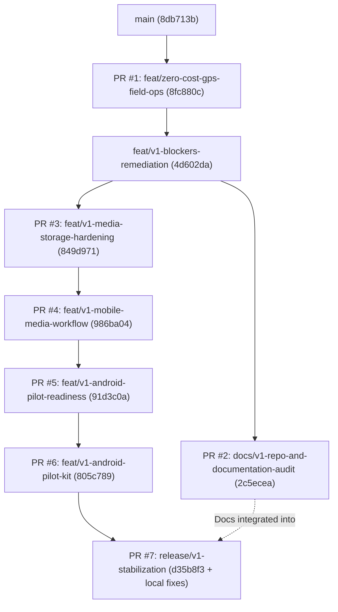

# Oprino — PR & Branch Dependency Matrix

**Date:** October 15, 2026  
**Auditor:** Principal Software Architect & Release Manager  
**Baseline:** `main` (`8db713b38a2acf4f4baa12d137b31e47f698c131`)  
**Target Integration Branch:** `release/v1-stabilization`

---

## 1. High-Level Dependency Graph

---

## 2. Exhaustive PR & Branch Dependency Table

| Source Branch / PR | Target Base Branch | Required Changes (In-Scope V1) | Duplicates Identified | Merge / Integration Conflicts | Integration Decision |
| :--- | :--- | :--- | :--- | :--- | :--- |
| **PR #1: `feat/zero-cost-gps-field-ops`** (`8fc880c`) | `main` | Zero-cost duty-hours GPS telemetry, Drift SQLite offline queue, MapLibre radar map, compileSdk 36 fix | None (Foundational layer) | None against `main` | **CONSOLIDATED**: Core foundation for all subsequent feature work. |
| **`feat/v1-blockers-remediation`** (`4d602da`) | `feat/zero-cost-gps-field-ops` | BLK-002 (invitations), BLK-003 (bulk CSV), BLK-004 (attendance selfie), BLK-005 (lifecycle), BLK-006 (retention), migration `0005` | None | None against PR #1 | **CONSOLIDATED**: Essential P0/P1 commercial release blocker fixes. |
| **PR #2: `docs/v1-repo-and-documentation-audit`** (`2c5ecea`) | `feat/v1-blockers-remediation` | Relative ADR links, link validation scripts, audit documents, README improvements | Superseded CI workflow triggers (older than PR #6) | Minor divergence on `ci.yml` and `package.json` | **INTEGRATED**: Documentation fixes and link validation scripts integrated into PR #7. |
| **PR #3: `feat/v1-media-storage-hardening`** (`849d971`) | `feat/v1-blockers-remediation` | Real private object storage (S3/R2 drivers), HMAC signature mandate, entity ownership verification, staging suite | None | None against `v1-blockers-remediation` | **CONSOLIDATED**: Critical security hardening closing media bypass. |
| **PR #4: `feat/v1-mobile-media-workflow`** (`986ba04`) | `feat/v1-media-storage-hardening` | Mobile selfie upload, offline media queue, proof viewer sheet, supervisor verification UI | None | None against PR #3 | **CONSOLIDATED**: Critical mobile user journey workflow. |
| **PR #5: `feat/v1-android-pilot-readiness`** (`91d3c0a`) | `feat/v1-mobile-media-workflow` | Real location hardware adapter, permission handling, attendance rejection rollback | None | None against PR #4 | **CONSOLIDATED**: High-priority reliability and privacy enforcement. |
| **PR #6: `feat/v1-android-pilot-kit`** (`805c789`) | `feat/v1-android-pilot-readiness` | Automated isolated pilot server, APK build workflow, network security isolation (debug cleartext only) | None | None against PR #5 | **CONSOLIDATED**: Test harness and pilot packaging gates. |
| **PR #7: `release/v1-stabilization`** (`d35b8f3` + fixes) | `main` | Consolidated candidate: fixes stack trace leak (P0), worker RLS (P1), CORS (P1), reports crash (P2), mobile real camera proof (P1), Windows cross-drive build crash (P1), 54 doc links | None | Linearly targets `main` with 0 conflicts | **ACTIVE RELEASE CANDIDATE (DRAFT)**: The single authoritative target for review and owner UAT. |

---

## 3. Critical Findings Regarding Direct PR Merging

1. **Sequential Coupling:** PR #6 depends on PR #5, which depends on PR #4, which depends on PR #3, which depends on `v1-blockers-remediation`, which depends on PR #1. None of these PRs can be merged independently into `main` without pulling in their ancestors or causing major compile/schema breakages.
2. **Intermediate PR Bases:** PR #3, #4, #5, #6 are configured in GitHub targeting their immediate parent branches rather than `main`.
3. **Docs Branch Divergence:** PR #2 branched off `v1-blockers-remediation` and did not pull in PR #3..#6. Directly merging PR #2 into `main` would omit all media hardening and pilot readiness, while merging it into `v1-blockers-remediation` would keep it trapped in a non-main branch.
4. **Resolution:**
   Create a single clean stabilization branch `release/v1-stabilization` from `main`. Integrate the complete cumulative chain `feat/v1-android-pilot-kit` (which encompasses PR #1, blockers, PR #3, PR #4, PR #5, PR #6). Integrate the documentation and script enhancements from PR #2 without regressing CI or code changes. Perform full verification and create one Draft PR targeting `main`.
