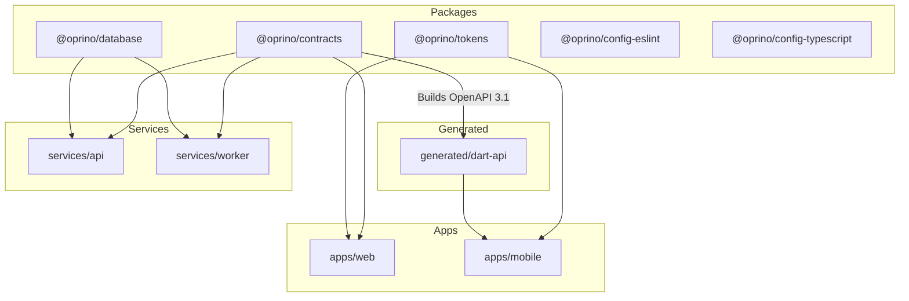

# Oprino Monorepo Structure & Organization Audit

**Document:** Comprehensive Repository Inventory & Directory Organization Audit  
**Audit Date:** October 14, 2026  
**Auditor Roles:** Principal Software Architect, Repository Maintainer, DevOps Lead  
**Repository Branch:** `docs/v1-repo-and-documentation-audit`  
**Base Commit:** `44cd88c`  

---

## 1. Monorepo Architecture Overview

Oprino is structured as a polyglot monorepo powered by **Turborepo** and **pnpm 11** for TypeScript workspaces, paired with native **Flutter / Dart** tooling for the mobile application.

```
oprino/
├── .github/workflows/          # Automated GitHub Actions CI/CD pipelines
├── apps/
│   ├── mobile/                 # Cross-platform Flutter mobile client (iOS & Android)
│   └── web/                    # Next.js 15 App Router web management dashboard
├── services/
│   ├── api/                    # Fastify 5 TypeScript REST API service
│   └── worker/                 # BullMQ 5 asynchronous job processing service
├── packages/
│   ├── config-eslint/          # Shared ESLint 9 configuration
│   ├── config-typescript/      # Shared tsconfig base profiles
│   ├── contracts/              # Zod domain schemas, OpenAPI 3.1 & Dart generator
│   ├── database/               # PostgreSQL schema, Drizzle ORM, RLS migrations
│   └── tokens/                 # Design token compiler (CSS, Dart, JSON)
├── generated/
│   └── dart-api/               # Generated Dart Dio client (from OpenAPI 3.1)
├── docs/                       # Architecture, product, audits, deployment specifications
├── Oprino-Brand-Kit/           # Authoritative, immutable brand assets (v1.3)
├── research/
│   └── archived-spikes/        # Historical Phase 01B technical validation spikes
└── scripts/                    # Smoke testing and release build utility scripts
```

---

## 2. Workspace & Module Breakdown

### 2.1 Services Layer

| Workspace Path | Name | Primary Technologies | Purpose & Invariants |
|---|---|---|---|
| `services/api` | `@oprino/api` | Fastify 5, Better Auth, Drizzle ORM, Pino | Authoritative REST API gateway. Implements 5-stage tenant verification, transactional `SET LOCAL` RLS execution, Better Auth session resolution, SSE live location streaming, and REST endpoints for all 10 domain models. |
| `services/worker` | `@oprino/worker` | BullMQ 5, Redis 7, Drizzle ORM | Headless background worker. Handles asynchronous system tasks: nightly multi-tenant telemetry retention purge, cron-based recurring task generation, and SLA overdue alert checks. In free cloud deployments, this worker is co-located in the `oprino-api` container via `Dockerfile.api`. |

### 2.2 Packages Layer (Shared Libraries)

| Workspace Path | Name | Primary Technologies | Purpose & Invariants |
|---|---|---|---|
| `packages/contracts` | `@oprino/contracts` | TypeScript, Zod 3.24, OpenAPI 3.1 | Monorepo single source of truth for all API contracts, DTO schemas, and enum definitions. Compiles schemas to OpenAPI 3.1 JSON (`dist/openapi.json`) and triggers automated generation of `generated/dart-api`. |
| `packages/database` | `@oprino/database` | PostgreSQL 17/18, PostGIS, Drizzle ORM, postgres.js | Database schema definitions, Drizzle migrations (`0000` through `0005`), connection pooling helpers, and transactional RLS helper procedures. |
| `packages/tokens` | `@oprino/tokens` | TypeScript, CSS, Dart | Ingests tokens from `Oprino-Brand-Kit/05-Design-Tokens/` and compiles them into web CSS variables (`tokens.css`), Flutter Dart theme constants (`oprino_tokens.dart`), and structured JSON. |
| `packages/config-eslint` | `@oprino/config-eslint` | ESLint 9 (Flat Config), Prettier | Unified linting rules enforced across all TypeScript packages and services. |
| `packages/config-typescript` | `@oprino/config-typescript` | TypeScript 5.8 | Standardized `tsconfig` presets for base, React/Next.js, and Node.js targets. |

### 2.3 Applications Layer

| Workspace Path | Name | Primary Technologies | Purpose & Invariants |
|---|---|---|---|
| `apps/web` | `@oprino/web` | Next.js 15, React 19, TypeScript, Lucide | Operations command dashboard for owners and managers. Provides live map visualization, task dispatch, attendance review, customer/site directories, employee onboarding, retention settings, and report exports. |
| `apps/mobile` | `oprino_mobile` | Flutter 3.x, Dart 3.x, Riverpod, Drift SQLite, Geolocator | Unified mobile app for field employees. Implements offline-first execution via Drift SQLite outbox, duty-hours GPS foreground tracking, camera selfie capture, signature pad, and automatic sync on reconnect. |

### 2.4 Supporting & Generated Directories

| Directory Path | Purpose | Maintenance Strategy |
|---|---|---|
| `generated/dart-api` | Auto-generated Dart Dio client generated from OpenAPI 3.1 specification. | **Generated Artifact:** Do not edit manually. Re-generate via `pnpm --filter @oprino/contracts build`. Tracked in Git to ensure zero-build-step mobile development. |
| `Oprino-Brand-Kit/` | Official Brand Kit v1.3 containing 16 logo variants, vector masters, fonts, templates, and guidelines. | **Immutable Asset Vault:** Must never be modified, compressed, or deleted. All runtime assets are compiled via `@oprino/tokens`. |
| `research/archived-spikes/` | Phase 01B technical validation prototypes (Fastify, PostgreSQL, mobile spikes). | **Archival Only:** Preserved for architectural history. Not referenced by active runtime builds. |
| `scripts/` | Shell scripts and node scripts: `smoke_test.mjs`, `build-release-apk.ps1`, `build-release-apk.sh`. | **Operational Tooling:** Contains end-to-end smoke test verifying 10 domain flows against live instances. |
| `docs/` | Complete architectural records, product PRDs, brand guidelines, deployment guides, and audits. | **Authoritative Specification:** Governed by strict architecture guidelines. |

---

## 3. Dependency & Monorepo Graph Analysis

Turborepo orchestrates build, typecheck, lint, and test execution across the workspace.



### Monorepo Invariant Rules:
1. `apps/web` and `apps/mobile` NEVER communicate directly with each other; both communicate exclusively with `services/api`.
2. `services/worker` and `services/api` share database models via `@oprino/database`, but maintain separate processes (or separate threads when co-located).
3. Contract updates in `@oprino/contracts` automatically ripple into both the Next.js frontend (via TypeScript types) and the Flutter app (via `dist/openapi.json` -> `generated/dart-api`).

---

## 4. Directory Inventory & Hygiene Findings

### Finding 1: ADR Directory Structure & Git Mode 120000 Symbolic Links
- Architecture Decision Records exist in both `docs/architecture/ADR-001-*.md` through `ADR-021-*.md` (canonical documents) and `docs/architecture/ADR/ADR-001-*.md` through `ADR-021-*.md`.
- In the Git index, all 21 files under `docs/architecture/ADR/` are recorded with mode `120000` (Git's native tree mode for symbolic links), pointing to `../ADR-xxx.md`.
- On Windows systems with default Git configuration (`core.symlinks = false`), Git checks out these entries as small text pointers containing the relative target path. On Linux/macOS environments, CI runners, and GitHub web, they resolve and navigate as native symbolic links.
- **Preservation Policy:** Both canonical documents in `docs/architecture/` and the mode `120000` symlinks in `docs/architecture/ADR/` are preserved. `ADR-021-zero-cost-gps-pipeline.md` has been provisioned with matching mode `120000` symlink in `docs/architecture/ADR/`, guaranteeing full consistency across platforms without destructive migrations.

### Finding 2: Ephemeral Local Build Outputs (`apps/mobile/build/`)
- During local testing, Flutter and Android Gradle generate several gigabytes under `apps/mobile/build/` and `apps/mobile/.dart_tool/`.
- **Status:** Correctly ignored in `.gitignore`, but contributors on Windows should run `flutter clean` periodically to free disk space.

### Finding 3: Missing Root `docs/README.md`
- The `docs/` directory had 8 specialized subfolders but no top-level index file `docs/README.md`.
- **Status:** Resolved in this documentation audit by creating `docs/README.md`.

### Finding 4: Obsolete Statements in `docs/audits/PROJECT-INVENTORY.md`
- Written during Phase 00 planning, stating that Git was not initialized and that no application lines of code existed.
- **Status:** Preserved as an archival milestone report with a clear header explaining its historical context, while `PROJECT-STATUS.md` and this audit provide current technical truth.

### Finding 5: Brand Kit Verification
- Cryptographic SHA-256 hashes in `Oprino-Brand-Kit/CHECKSUMS.json` confirm all 123 brand assets remain 100% intact and uncorrupted.

---

## 5. Organizational Recommendations for Production

1. **Keep `generated/dart-api` Version-Controlled:**
   Retaining the generated Dart client in Git eliminates the requirement for mobile developers or CI agents to run Node.js/Turbo build steps prior to building the mobile app.
2. **Preserve `research/archived-spikes`:**
   Keep spikes isolated in `research/` rather than moving them into `docs/` or `packages/` to avoid cluttering production build graphs.
3. **Automate Monorepo Link Checking:**
   Introduce a GitHub Actions step or pre-commit hook that verifies relative Markdown links across `docs/` to prevent nonportable link regressions.
