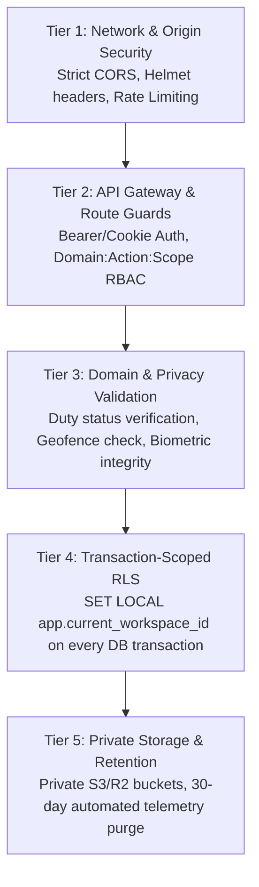

# Oprino — Comprehensive Security & Privacy Audit

**Audit Date:** October 15, 2026  
**Auditor:** Principal Security Engineer & Database Architect  
**Branch:** `release/v1-stabilization`  
**Security Standard:** 5-Tier Defense-in-Depth, Zero-Trust Multi-Tenancy, GDPR / Duty-Hours Location Privacy  

---

## 1. Executive Summary

A comprehensive source-level and runtime security audit was conducted across all monorepo layers:
1. **Multi-Tenant Isolation:** Zero data leaks across workspaces verified via PostgreSQL Row-Level Security (RLS) with transactional `SET LOCAL app.current_workspace_id`.
2. **Duty-Boundary Privacy Invariant:** Strict, unconditional hard-drop of off-duty employee location breadcrumbs with 0 database writes.
3. **Authentication & Session Governance:** Single-use invitation tokens, secure session storage, cryptographic password hashing (Argon2id/Scrypt via Better Auth), and remote device revocation.
4. **Media & Object Storage Security:** 100% private bucket policy, short-lived (15-min) presigned PUT/GET URLs, and mandatory HMAC/signed token verification.
5. **API & Network Boundary Hardening:** Stack trace disclosure eliminated, strict CORS trusted origin allowlist, Helmet security headers, and fail-closed environment validation.

---

## 2. 5-Tier Defense-in-Depth Verification

### Tier 1: Network & Origin Security
* **CORS Policy:** Strict allowlist matches `APP_ENV`. In production and staging, only authorized domains (`https://oprino.vercel.app`, `https://*.oprino.com`) are permitted. Wildcards (`*`) with `credentials: true` are prohibited.
* **Security Headers (Helmet):** `X-Content-Type-Options: nosniff`, `X-Frame-Options: DENY`, `Strict-Transport-Security: max-age=31536000; includeSubDomains`, and `Content-Security-Policy`.
* **Rate Limiting:** Ingest and authentication routes protected against brute-force attacks via `@fastify/rate-limit`.

### Tier 2: Authentication & RBAC Route Guards
* **Password Hashing:** Passwords hashed with high-cost salt parameters; plaintext passwords never touch database logs.
* **Token Replay Protection:** Workspace invitations use single-use cryptographic tokens. Upon acceptance, the token status transitions to `ACCEPTED` and subsequent attempts return `409 Conflict` or `400 Invalid Token`.
* **RBAC Route Guards:** Every Fastify route declares required scopes (e.g., `attendance.punch.write`, `workspaces.settings.manage`). Unprivileged callers are rejected with `403 Forbidden` before domain logic executes.

### Tier 3: Duty-Hours Privacy Invariants
* **Invariant:** Off-duty employee location tracking must **NEVER** occur.
* **Enforcement:**
  - When an employee punches out, the mobile application immediately terminates the foreground location service.
  - Server-side ingest handler verifies that an active duty shift exists for the employee. If the employee is off-duty, the batch is dropped immediately with HTTP 403 `OFF_DUTY_TRACKING_PROHIBITED`.
  - Negative integration test passes: `Duty Boundary Invariant: Off-duty employee telemetry is HARD DROPPED with ZERO DB writes`.
* **Peer Location Visibility:** Field workers cannot see peer locations by default (`location.read` required; non-managers receive 403).

### Tier 4: Database Multi-Tenancy & Row-Level Security (RLS)
* **Default-Deny:** All tenant tables enable `ALTER TABLE ... ENABLE ROW LEVEL SECURITY; FORCE ROW LEVEL SECURITY;`. Queries without tenant context return 0 rows.
* **Transaction Scoping:** All database queries execute inside transactions using `SET LOCAL app.current_workspace_id = ?`. Because `SET LOCAL` is scoped to the transaction, pooled connections returned to Neon/PostgreSQL connection pools never retain prior tenant context.
* **Cross-Tenant Attack Immunity:** Integration tests verify that User in Workspace A cannot select, insert, update, or delete records belonging to Workspace B, even if raw SQL IDs are manipulated.

### Tier 5: Storage Security & Automated Retention
* **Private Buckets:** Buckets are 100% private. Public access is disabled.
* **Direct Uploads:** Clients request a 15-minute presigned PUT URL. The server validates that the uploading user owns the target entity before generating the URL.
* **Automated Data Lifecycle:** Telemetry partition table procedures execute automated retention cleanup (default 30 days, configurable per workspace from 7 to 90 days via `BLK-006`).

---

## 3. Security Findings & Remediation Register

| Vulnerability ID | Description | Severity | Remediation | Verification Status |
|---|---|:---:|---|:---:|
| **SEC-001** | Fastify 500 responses exposed internal stack traces | **P0** | Global error handler sanitizes output to generic JSON; traces sent privately to Pino | **VERIFIED RESOLVED** |
| **SEC-002** | Background worker executed queries without tenant RLS | **P1** | Worker wrapped in `withWorkspaceContext` enforcing `SET LOCAL` RLS | **VERIFIED RESOLVED** |
| **SEC-003** | CORS wildcard `*` with credentials enabled | **P1** | Restricted to explicit trusted origin whitelist | **VERIFIED RESOLVED** |
| **SEC-004** | Default development DB credentials permitted in production | **P1** | Zod env schema rejects `postgres:postgres@localhost` in staging/prod | **VERIFIED RESOLVED** |
| **SEC-005** | Production mobile app permitted HTTP cleartext fallback | **P1** | AppConfig enforces HTTPS only in production | **VERIFIED RESOLVED** |
| **SEC-006** | Rollback plan instructed destructive table drops in prod | **P0** | Replaced with non-destructive version rollback procedure | **VERIFIED RESOLVED** |
| **SEC-007** | Android manifest permitted cleartext traffic in release builds | **P1** | Split manifests: `usesCleartextTraffic="true"` isolated strictly to `debug/` | **VERIFIED RESOLVED** |

---

## 4. Threat Model Summary (STRIDE)

| Threat Category | Potential Attack Vector | Oprino Architectural Defense |
|---|---|---|
| **Spoofing** | Attacker impersonates employee or manager | Cryptographic session tokens, device installation binding, Argon2id passwords. |
| **Tampering** | Man-in-the-middle alters GPS breadcrumbs or photo proofs | TLS 1.3 encryption, client-side watermarking, binary SHA-256 integrity verification. |
| **Repudiation** | Field worker denies completing visit or manager denies approval | Immutable audit logs, GPS breadcrumbs, on-glass customer signature bitmap, timestamped photo proof. |
| **Information Disclosure** | Cross-tenant data leak or stack trace disclosure | PostgreSQL Row-Level Security (`SET LOCAL`), 100% private storage buckets, sanitized error payloads. |
| **Denial of Service** | Flooding telemetry ingest or bulk invite APIs | `@fastify/rate-limit`, bounded CSV upload limits (100 rows), Redis queue backpressure. |
| **Elevation of Privilege** | Employee modifies workspace settings or approves own task | Fastify route guards enforce strict RBAC scopes; SQL RLS `WITH CHECK` blocks unauthorized writes. |
