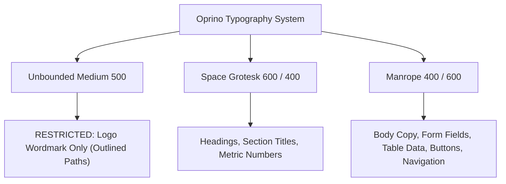

# Oprino Brand System Specification

**Version:** 1.3  
**Status:** Authoritative Brand System (Documented & Verified Against Approved Brand Assets)  
**Audience:** Product Managers, Designers, Web Developers, Mobile Engineers

---

## 1. Executive Summary & Brand Identity

**Oprino** is a modern workforce operations SaaS platform designed for multi-industry Small and Medium Businesses (SMBs). Its visual identity conveys **clarity, operational confidence, and steady progress**.

The brand identity centers around a distinctive, mathematically smooth **location-pin with an embedded check-mark** rendered in a vibrant blue-to-mint gradient with architectural deep-blue depth, paired with a lowercase, geometric, modern wordmark: **oprino**.

> [!IMPORTANT]
> **Authoritative Asset Status:**  
> All assets located in [`/workspace/oprino/Oprino-Brand-Kit`](file:///workspace/oprino/Oprino-Brand-Kit) are authoritative and approved. Developers and designers must not recreate, redraw, or recolor brand elements. Vector SVG and PDF assets use outlined paths—ensuring perfect cross-platform fidelity with zero external font dependencies.

---

## 2. Logo System & Variants

### 2.1 Canonical Logo
The canonical logo is the **Horizontal Full-Color Lockup** ([`Oprino-horizontal-full-color.svg`](file:///workspace/oprino/Oprino-Brand-Kit/01-Logos/SVG/Oprino-horizontal-full-color.svg)).
- **Symbol:** Location-pin with checkmark on the left.
- **Wordmark:** Lowercase `oprino` in Navy (`#0F172A`) on the right.
- **Recommended Surface:** Pure white (`#FFFFFF`) or soft paper (`#F8FAFC`).

### 2.2 App Icon & Symbol Mark
The stand-alone symbol mark is the **Oprino Pin-Check Symbol** ([`Oprino-icon-full-color.svg`](file:///workspace/oprino/Oprino-Brand-Kit/01-Logos/SVG/Oprino-icon-full-color.svg)).
- Used for mobile application icons, web favicons, avatars, and compact UI navigation headers.
- Features a clean white check-in / location pin with negative space separation against a gradient background spanning from deep cobalt blue to ocean and mint.

### 2.3 Logo Variations Matrix
There are **16 authoritative logo variations** covering every production scenario:

| Layout | Variant | Master Files | Intended Surface / Use Case |
|---|---|---|---|
| **Horizontal** | Full-Color | [SVG](file:///workspace/oprino/Oprino-Brand-Kit/01-Logos/SVG/Oprino-horizontal-full-color.svg) \| [PNG](file:///workspace/oprino/Oprino-Brand-Kit/01-Logos/PNG/Oprino-horizontal-full-color.png) \| [PDF](file:///workspace/oprino/Oprino-Brand-Kit/01-Logos/PDF/Oprino-horizontal-full-color.pdf) | Default for web headers, light dashboards, invoices, presentations |
| **Horizontal** | Reversed | [SVG](file:///workspace/oprino/Oprino-Brand-Kit/01-Logos/SVG/Oprino-horizontal-reversed.svg) \| [PNG](file:///workspace/oprino/Oprino-Brand-Kit/01-Logos/PNG/Oprino-horizontal-reversed.png) \| [PDF](file:///workspace/oprino/Oprino-Brand-Kit/01-Logos/PDF/Oprino-horizontal-reversed.pdf) | Dark surfaces, dark mode UI headers, Navy background marketing |
| **Horizontal** | Flat Navy | [SVG](file:///workspace/oprino/Oprino-Brand-Kit/01-Logos/SVG/Oprino-horizontal-flat-navy.svg) \| [PNG](file:///workspace/oprino/Oprino-Brand-Kit/01-Logos/PNG/Oprino-horizontal-flat-navy.png) \| [PDF](file:///workspace/oprino/Oprino-Brand-Kit/01-Logos/PDF/Oprino-horizontal-flat-navy.pdf) | Single-color navy documentation, receipts, single-color print |
| **Horizontal** | Flat Blue | [SVG](file:///workspace/oprino/Oprino-Brand-Kit/01-Logos/SVG/Oprino-horizontal-flat-blue.svg) \| [PNG](file:///workspace/oprino/Oprino-Brand-Kit/01-Logos/PNG/Oprino-horizontal-flat-blue.png) \| [PDF](file:///workspace/oprino/Oprino-Brand-Kit/01-Logos/PDF/Oprino-horizontal-flat-blue.pdf) | High-contrast brand blue digital placements |
| **Horizontal** | Black | [SVG](file:///workspace/oprino/Oprino-Brand-Kit/01-Logos/SVG/Oprino-horizontal-black.svg) \| [PNG](file:///workspace/oprino/Oprino-Brand-Kit/01-Logos/PNG/Oprino-horizontal-black.png) \| [PDF](file:///workspace/oprino/Oprino-Brand-Kit/01-Logos/PDF/Oprino-horizontal-black.pdf) | Grayscale printing, black-and-white fax/stamps |
| **Horizontal** | White | [SVG](file:///workspace/oprino/Oprino-Brand-Kit/01-Logos/SVG/Oprino-horizontal-white.svg) \| [PNG](file:///workspace/oprino/Oprino-Brand-Kit/01-Logos/PNG/Oprino-horizontal-white.png) \| [PDF](file:///workspace/oprino/Oprino-Brand-Kit/01-Logos/PDF/Oprino-horizontal-white.pdf) | Monochrome dark mode, single-color apparel / merchandise |
| **Stacked** | Full-Color | [SVG](file:///workspace/oprino/Oprino-Brand-Kit/01-Logos/SVG/Oprino-stacked-full-color.svg) \| [PNG](file:///workspace/oprino/Oprino-Brand-Kit/01-Logos/PNG/Oprino-stacked-full-color.png) \| [PDF](file:///workspace/oprino/Oprino-Brand-Kit/01-Logos/PDF/Oprino-stacked-full-color.pdf) | Mobile splash screens, centered hero cards, social banners |
| **Stacked** | Reversed | [SVG](file:///workspace/oprino/Oprino-Brand-Kit/01-Logos/SVG/Oprino-stacked-reversed.svg) \| [PNG](file:///workspace/oprino/Oprino-Brand-Kit/01-Logos/PNG/Oprino-stacked-reversed.png) \| [PDF](file:///workspace/oprino/Oprino-Brand-Kit/01-Logos/PDF/Oprino-stacked-reversed.pdf) | Dark splash screens, dark login screens |
| **Stacked** | Black | [SVG](file:///workspace/oprino/Oprino-Brand-Kit/01-Logos/SVG/Oprino-stacked-black.svg) \| [PNG](file:///workspace/oprino/Oprino-Brand-Kit/01-Logos/PNG/Oprino-stacked-black.png) \| [PDF](file:///workspace/oprino/Oprino-Brand-Kit/01-Logos/PDF/Oprino-stacked-black.pdf) | Grayscale centered documentation, physical badges |
| **Stacked** | White | [SVG](file:///workspace/oprino/Oprino-Brand-Kit/01-Logos/SVG/Oprino-stacked-white.svg) \| [PNG](file:///workspace/oprino/Oprino-Brand-Kit/01-Logos/PNG/Oprino-stacked-white.png) \| [PDF](file:///workspace/oprino/Oprino-Brand-Kit/01-Logos/PDF/Oprino-stacked-white.pdf) | High-contrast dark centered merchandise/stickers |
| **Icon Only** | Full-Color | [SVG](file:///workspace/oprino/Oprino-Brand-Kit/01-Logos/SVG/Oprino-icon-full-color.svg) \| [PNG](file:///workspace/oprino/Oprino-Brand-Kit/01-Logos/PNG/Oprino-icon-full-color.png) \| [PDF](file:///workspace/oprino/Oprino-Brand-Kit/01-Logos/PDF/Oprino-icon-full-color.pdf) | App launcher icons, collapsed sidebar, map marker pins |
| **Icon Only** | Flat Navy | [SVG](file:///workspace/oprino/Oprino-Brand-Kit/01-Logos/SVG/Oprino-icon-flat-navy.svg) \| [PNG](file:///workspace/oprino/Oprino-Brand-Kit/01-Logos/PNG/Oprino-icon-flat-navy.png) \| [PDF](file:///workspace/oprino/Oprino-Brand-Kit/01-Logos/PDF/Oprino-icon-flat-navy.pdf) | Subtle watermarks, neutral navigation buttons |
| **Icon Only** | Black | [SVG](file:///workspace/oprino/Oprino-Brand-Kit/01-Logos/SVG/Oprino-icon-black.svg) \| [PNG](file:///workspace/oprino/Oprino-Brand-Kit/01-Logos/PNG/Oprino-icon-black.png) \| [PDF](file:///workspace/oprino/Oprino-Brand-Kit/01-Logos/PDF/Oprino-icon-black.pdf) | Monochrome hardware icons, receipt stamps |
| **Icon Only** | White | [SVG](file:///workspace/oprino/Oprino-Brand-Kit/01-Logos/SVG/Oprino-icon-white.svg) \| [PNG](file:///workspace/oprino/Oprino-Brand-Kit/01-Logos/PNG/Oprino-icon-white.png) \| [PDF](file:///workspace/oprino/Oprino-Brand-Kit/01-Logos/PDF/Oprino-icon-white.pdf) | Contrast button icon, dark top bar marker |
| **Wordmark** | Flat Navy | [SVG](file:///workspace/oprino/Oprino-Brand-Kit/01-Logos/SVG/Oprino-wordmark-flat-navy.svg) \| [PNG](file:///workspace/oprino/Oprino-Brand-Kit/01-Logos/PNG/Oprino-wordmark-flat-navy.png) \| [PDF](file:///workspace/oprino/Oprino-Brand-Kit/01-Logos/PDF/Oprino-wordmark-flat-navy.pdf) | Header placements where the icon already lives elsewhere |
| **Wordmark** | White | [SVG](file:///workspace/oprino/Oprino-Brand-Kit/01-Logos/SVG/Oprino-wordmark-white.svg) \| [PNG](file:///workspace/oprino/Oprino-Brand-Kit/01-Logos/PNG/Oprino-wordmark-white.png) \| [PDF](file:///workspace/oprino/Oprino-Brand-Kit/01-Logos/PDF/Oprino-wordmark-white.pdf) | Dark mode footer or navigation bars |

---

## 3. Clear Space & Minimum Sizing Rules

### 3.1 Clear Space
The minimum exclusion zone around any logo lockup is defined by **$x = 0.25 \times \text{Icon Height}$**.
- No typography, interface buttons, borders, or graphic elements may intrude into this boundary.
- Master export files already embed this optical padding.

### 3.2 Minimum Dimensions
To prevent illegibility and pixelation, strict minimum display thresholds must be respected:

| Asset Format | Minimum Digital Width | Minimum Physical Print Width |
|---|---|---|
| **Horizontal Lockup** | 160 px | 30 mm |
| **Stacked Lockup** | 96 px | 22 mm |
| **Wordmark Only** | 120 px | 24 mm |
| **Icon Only** | 24 px | 6 mm |
| **Favicon Exception** | 16 px & 32 px | N/A (specialized native rendering) |

---

## 4. Color Palette & Accessibility Specifications

### 4.1 Master Color Specifications

```
Navy        #0F172A   rgb(15, 23, 42)      hsl(222, 47%, 11%)
Cobalt      #164CFF   rgb(22, 76, 255)     hsl(226, 100%, 54%)
Ocean       #087DE5   rgb(8, 125, 229)     hsl(208, 93%, 46%)
Mint        #20BAAA   rgb(32, 186, 170)    hsl(174, 71%, 43%)
Deep Blue   #1235A4   rgb(18, 53, 164)     hsl(226, 80%, 36%)
Slate       #475569   rgb(71, 85, 105)     hsl(215, 19%, 35%)
Paper       #F8FAFC   rgb(248, 250, 252)   hsl(210, 40%, 98%)
Border      #DDE5EF   rgb(221, 229, 239)   hsl(213, 38%, 90%)
White       #FFFFFF   rgb(255, 255, 255)   hsl(0, 0%, 100%)
```

### 4.2 Functional Roles in UI

| Role | Color Name | HEX | Usage Across Web & Mobile |
|---|---|---|---|
| **Primary Brand / Action** | **Cobalt** | `#164CFF` | Primary CTA buttons, active state indicators, key highlights, links |
| **Primary Text & Dark Surface**| **Navy** | `#0F172A` | Page headings, primary body copy, dark mode backgrounds, wordmark |
| **Secondary Brand** | **Ocean** | `#087DE5` | Secondary actions, progress bars, gradient transitions |
| **Progress / Highlight** | **Mint** | `#20BAAA` | Success badges, check-in completion, duty "ON" pill, progress fills |
| **Structural Depth** | **Deep Blue** | `#1235A4` | Internal icon shading, layered card depth, dark active borders |
| **Muted Text / Secondary** | **Slate** | `#475569` | Secondary captions, timestamps, placeholder text, table headers |
| **Soft Surface** | **Paper** | `#F8FAFC` | Main app background, table row zebra striping, card containers |
| **Borders & Dividers** | **Border** | `#DDE5EF` | Form field borders, card outlines, table gridlines, separators |
| **Base Surface** | **White** | `#FFFFFF` | Card surfaces, modal bodies, input backgrounds |

### 4.3 Contrast & WCAG 2.2 Compliance Matrix

| Foreground | Background | Contrast Ratio | WCAG 2.2 Compliance | Allowed Application |
|---|---|---|---|---|
| **Navy (`#0F172A`)** | White (`#FFFFFF`) | **17.85:1** | AAA (Pass) | Primary headings, table text, body copy |
| **Navy (`#0F172A`)** | Paper (`#F8FAFC`) | **17.10:1** | AAA (Pass) | Standard UI page content |
| **Cobalt (`#164CFF`)** | White (`#FFFFFF`) | **5.98:1** | AA (Pass) | Primary action links, bold text, buttons |
| **Slate (`#475569`)** | White (`#FFFFFF`) | **7.58:1** | AAA (Pass) | Secondary captions, timestamps, subtitles |
| **White (`#FFFFFF`)** | Cobalt (`#164CFF`) | **5.98:1** | AA (Pass) | Primary button labels |
| **White (`#FFFFFF`)** | Navy (`#0F172A`) | **17.85:1** | AAA (Pass) | Dark mode text, inverted badges |
| **Navy (`#0F172A`)** | Mint (`#20BAAA`) | **7.37:1** | AAA (Pass) | Pill badges with text inside mint pills |
| **Mint (`#20BAAA`)** | White (`#FFFFFF`) | **2.42:1** | **FAIL** (< 4.5:1) | **STRICTLY PROHIBITED for readable text** |

> [!WARNING]
> **Mint Accessibility Constraint:**  
> Mint (`#20BAAA`) has a contrast ratio of only 2.42:1 on white surfaces. It **must never** be used for typography or text links on light backgrounds. Use Mint solely for decorative fills, badges with dark Navy text inside, icon graphics, and progress bars.

---

## 5. Typography System

The Oprino type system utilizes three distinct Open Font License (OFL) typefaces, each assigned a strictly enforced structural role:



### 5.1 Typeface Roles
1. **Unbounded (Medium 500):**
   - **Exclusive Role:** Logo wordmark only (`oprino`), set with `-0.012 em` optical letter tracking.
   - **Constraint:** **Never use Unbounded for general UI text, buttons, headings, or body copy.**
2. **Space Grotesk (SemiBold 600 & Regular 400):**
   - **Role:** Display headings (H1, H2, H3), KPI metric figures, modal titles.
   - Character: High-tech, modern, architectural, crisp geometric feel.
3. **Manrope (Regular 400 & SemiBold 600):**
   - **Role:** All primary UI copy, data grids, form labels, input values, buttons, navigation items, tooltips, and toasts.
   - Line Height: Always maintain `1.5` to `1.6` for optimal readability in operational workflows.

### 5.2 Responsive Web & Mobile Scale

| Level | Size (px) | Line Height | Font Family | Weight | CSS Variable |
|---|---|---|---|---|---|
| **Display / H1** | 48 px (clamp: 32–48px) | 1.2 | Space Grotesk | 600 SemiBold | `var(--oprino-h1)` |
| **Page Title / H2** | 36 px (clamp: 26–36px) | 1.25 | Space Grotesk | 600 SemiBold | `var(--oprino-h2)` |
| **Section Title / H3** | 26 px (clamp: 20–26px) | 1.3 | Space Grotesk | 600 SemiBold | `var(--oprino-h3)` |
| **Card Header / H4** | 20 px | 1.4 | Space Grotesk | 600 SemiBold | - |
| **Body (Default)** | 16 px (clamp: 15–18px) | 1.5–1.6 | Manrope | 400 Regular | `var(--oprino-body)` |
| **Body Bold / Button**| 16 px | 1.5 | Manrope | 600 SemiBold | - |
| **Small / Label** | 14 px | 1.5 | Manrope | 500/600 Medium | - |
| **Caption / Timestamp**| 12 px | 1.4 | Manrope | 400 Regular | - |

---

## 6. Spacing, Radii & Grid System

### 6.1 Layout Grid & Spacing Steps
Oprino interfaces follow an **8 px base grid** with a **4 px micro-adjustment increment**:

```css
--oprino-space-0-5: 0.25rem; /*  4 px - micro spacing, tight badges */
--oprino-space-1:   0.5rem;  /*  8 px - icon-to-text gap, compact padding */
--oprino-space-2:   1.0rem;  /* 16 px - standard input padding, card gap */
--oprino-space-3:   1.5rem;  /* 24 px - container gutters, card padding */
--oprino-space-4:   2.0rem;  /* 32 px - section margins */
--oprino-space-6:   3.0rem;  /* 48 px - dashboard grid gap */
--oprino-space-8:   4.0rem;  /* 64 px - major section breaks */
--oprino-space-12:  6.0rem;  /* 96 px - hero banner padding */
```

### 6.2 Corner Radii
Rounded corners reflect the curved geometry of the location-pin mark:
- **Small (8 px / `0.5rem`):** Badges, tags, form input controls, dropdown items.
- **Medium (16 px / `1.0rem`):** Standard dashboard cards, modals, mobile action sheets (`--oprino-radius`).
- **Large (24 px / `1.5rem`):** Floating bottom sheets, mobile hero containers, onboarding panels.

---

## 7. Iconography & Visual Graphic Language

- **Style:** Clean, geometric line icons with an active **2 px stroke weight** and **rounded stroke terminals (`stroke-linecap="round"` and `stroke-linejoin="round"`)**.
- **Geometry:** Restrained circular arcs matching the pin-check curve.
- **Coloration:** Default to Slate (`#475569`) in inactive states, Cobalt (`#164CFF`) in active/selected states, and Mint (`#20BAAA`) for completed states.
- **Sizing:** Standard UI icons are sized at `16x16 px`, `20x20 px`, or `24x24 px` on a square bounding box.

---

## 8. Brand Voice & Tone

Oprino’s communication style is:
1. **Clear & Direct:** No tech jargon or buzzwords. SMB owners and field staff need unambiguous status updates.
2. **Confident & Operational:** Communicate reliability and precision. Every action has an immediate confirmation.
3. **Respectful & Privacy-First:** Frame duty tracking strictly around work hours and safety. Use language that protects employee trust (e.g., *"Tracking active during duty hours only"*).
4. **Naming Convention:**
   - In written text, sentences, headings, and legal documents: **Oprino** (Capitalized).
   - In the graphic logo artwork: **oprino** (all lowercase, as rendered in the vector master).

---

## 9. Brand Protection Rules (Do's and Don'ts)

| Do | Don't |
|---|---|
| Use approved SVG/PNG masters from `01-Logos/`. | **Never** trace or recreate the logo freehand. |
| Maintain the required $0.25x$ clear space around the lockup. | **Never** crowd the logo with text, icons, or borders. |
| Use the Horizontal Full-Color logo on white or light gray surfaces. | **Never** place the full-color logo on a dark background (use Reversed). |
| Keep the wordmark and icon locked in their canonical ratio. | **Never** rotate, squash, stretch, or alter proportions. |
| Use Navy, Cobalt, or Slate text on white backgrounds. | **Never** use Mint (`#20BAAA`) text on white or paper backgrounds. |
| Restrict Unbounded to the logo mark only. | **Never** use Unbounded for UI headings or buttons. |
| Render the symbol with its native vector gradient and depth. | **Never** add drop shadows, outer glows, or bevel effects. |

---

## 10. Audit of Conflicts & Reconciliation

During the brand audit of the supplied Brand Kit v1.3, the following nuances were evaluated and resolved:
1. **Unbounded in Design Tokens vs Guidelines:**  
   *Finding:* The CSS file defines `--oprino-font-wordmark: 'Unbounded'`.  
   *Reconciliation:* `Unbounded` is retained only as an asset font for the wordmark outline. The Guidelines explicitly stipulate that web UI headings must strictly use `Space Grotesk` and body copy must use `Manrope`. This rule is codified above.
2. **RGB vs CMYK in Stationery:**  
   *Finding:* The business card and letterhead PDFs use RGB color profiles.  
   *Reconciliation:* Physical print vendors must run a digital color proof against standard coated/uncoated stocks before mass printing. The digital products (Web & Mobile) will use the authoritative sRGB HEX codes.
3. **Mint Contrast Warning:**  
   *Finding:* Mint (`#20BAAA`) is widely featured in the logo gradient.  
   *Reconciliation:* Mint is codified strictly as an accent, pill background, and progress indicator. It is explicitly banned from being used as a typography color on white surfaces.

---

## 11. Flutter ThemeData & ThemeExtension Specification

To guarantee 100% brand token fidelity across the mobile application without redesigning the brand, the design tokens are codified into a strongly-typed Flutter `ThemeExtension`.

### 11.1 OprinoThemeExtension Dart Implementation

```dart
import 'package:flutter/material.dart';

@immutable
class OprinoThemeExtension extends ThemeExtension<OprinoThemeExtension> {
  // Brand Colors
  final Color navy;
  final Color cobalt;
  final Color ocean;
  final Color mint;
  final Color deepBlue;
  final Color slate;
  final Color paper;
  final Color border;
  final Color white;

  // Spacing Scale
  final double space0_5; // 4.0 px
  final double space1;   // 8.0 px
  final double space2;   // 16.0 px
  final double space3;   // 24.0 px
  final double space4;   // 32.0 px
  final double space6;   // 48.0 px
  final double space8;   // 64.0 px

  // Corner Radii
  final BorderRadius radiusSm; // 8.0 px
  final BorderRadius radiusMd; // 16.0 px
  final BorderRadius radiusLg; // 24.0 px

  const OprinoThemeExtension({
    this.navy = const Color(0xFF0F172A),
    this.cobalt = const Color(0xFF164CFF),
    this.ocean = const Color(0xFF087DE5),
    this.mint = const Color(0xFF20BAAA),
    this.deepBlue = const Color(0xFF1235A4),
    this.slate = const Color(0xFF475569),
    this.paper = const Color(0xFFF8FAFC),
    this.border = const Color(0xFFDDE5EF),
    this.white = const Color(0xFFFFFFFF),
    this.space0_5 = 4.0,
    this.space1 = 8.0,
    this.space2 = 16.0,
    this.space3 = 24.0,
    this.space4 = 32.0,
    this.space6 = 48.0,
    this.space8 = 64.0,
    this.radiusSm = const BorderRadius.all(Radius.circular(8.0)),
    this.radiusMd = const BorderRadius.all(Radius.circular(16.0)),
    this.radiusLg = const BorderRadius.all(Radius.circular(24.0)),
  });

  @override
  OprinoThemeExtension copyWith({
    Color? navy, Color? cobalt, Color? ocean, Color? mint,
    Color? deepBlue, Color? slate, Color? paper, Color? border, Color? white,
    double? space0_5, double? space1, double? space2, double? space3,
    double? space4, double? space6, double? space8,
    BorderRadius? radiusSm, BorderRadius? radiusMd, BorderRadius? radiusLg,
  }) {
    return OprinoThemeExtension(
      navy: navy ?? this.navy,
      cobalt: cobalt ?? this.cobalt,
      ocean: ocean ?? this.ocean,
      mint: mint ?? this.mint,
      deepBlue: deepBlue ?? this.deepBlue,
      slate: slate ?? this.slate,
      paper: paper ?? this.paper,
      border: border ?? this.border,
      white: white ?? this.white,
      space0_5: space0_5 ?? this.space0_5,
      space1: space1 ?? this.space1,
      space2: space2 ?? this.space2,
      space3: space3 ?? this.space3,
      space4: space4 ?? this.space4,
      space6: space6 ?? this.space6,
      space8: space8 ?? this.space8,
      radiusSm: radiusSm ?? this.radiusSm,
      radiusMd: radiusMd ?? this.radiusMd,
      radiusLg: radiusLg ?? this.radiusLg,
    );
  }

  @override
  OprinoThemeExtension lerp(ThemeExtension<OprinoThemeExtension>? other, double t) {
    if (other is! OprinoThemeExtension) return this;
    return OprinoThemeExtension(
      navy: Color.lerp(navy, other.navy, t)!,
      cobalt: Color.lerp(cobalt, other.cobalt, t)!,
      ocean: Color.lerp(ocean, other.ocean, t)!,
      mint: Color.lerp(mint, other.mint, t)!,
      deepBlue: Color.lerp(deepBlue, other.deepBlue, t)!,
      slate: Color.lerp(slate, other.slate, t)!,
      paper: Color.lerp(paper, other.paper, t)!,
      border: Color.lerp(border, other.border, t)!,
      white: Color.lerp(white, other.white, t)!,
      space0_5: space0_5, space1: space1, space2: space2,
      space3: space3, space4: space4, space6: space6, space8: space8,
      radiusSm: BorderRadius.lerp(radiusSm, other.radiusSm, t)!,
      radiusMd: BorderRadius.lerp(radiusMd, other.radiusMd, t)!,
      radiusLg: BorderRadius.lerp(radiusLg, other.radiusLg, t)!,
    );
  }
}
```

### 11.2 Master ThemeData Integration

```dart
ThemeData buildOprinoLightTheme() {
  const oprino = OprinoThemeExtension();

  return ThemeData(
    useMaterial3: true,
    fontFamily: 'Manrope',
    scaffoldBackgroundColor: oprino.paper,
    colorScheme: ColorScheme.light(
      primary: oprino.cobalt,
      onPrimary: oprino.white,
      secondary: oprino.ocean,
      onSecondary: oprino.white,
      surface: oprino.white,
      onSurface: oprino.navy,
      outline: oprino.border,
      error: const Color(0xFFE63946),
      onError: oprino.white,
    ),
    textTheme: const TextTheme(
      // Headings use Space Grotesk
      displayLarge: TextStyle(fontFamily: 'Space Grotesk', fontWeight: FontWeight.w600, color: Color(0xFF0F172A)),
      displayMedium: TextStyle(fontFamily: 'Space Grotesk', fontWeight: FontWeight.w600, color: Color(0xFF0F172A)),
      titleLarge: TextStyle(fontFamily: 'Space Grotesk', fontWeight: FontWeight.w600, color: Color(0xFF0F172A)),
      titleMedium: TextStyle(fontFamily: 'Space Grotesk', fontWeight: FontWeight.w600, color: Color(0xFF0F172A)),
      // Body & UI use Manrope
      bodyLarge: TextStyle(fontFamily: 'Manrope', fontWeight: FontWeight.w400, color: Color(0xFF0F172A)),
      bodyMedium: TextStyle(fontFamily: 'Manrope', fontWeight: FontWeight.w400, color: Color(0xFF475569)),
      labelLarge: TextStyle(fontFamily: 'Manrope', fontWeight: FontWeight.w600, color: Color(0xFF0F172A)),
    ),
    elevatedButtonTheme: ElevatedButtonThemeData(
      style: ElevatedButton.styleFrom(
        backgroundColor: oprino.cobalt,
        foregroundColor: oprino.white,
        elevation: 0,
        minimumSize: const Size(double.infinity, 48),
        shape: RoundedRectangleBorder(borderRadius: oprino.radiusSm),
        textStyle: const TextStyle(fontFamily: 'Manrope', fontWeight: FontWeight.w600, fontSize: 16),
      ),
    ),
    cardTheme: CardTheme(
      color: oprino.white,
      elevation: 0,
      shape: RoundedRectangleBorder(
        borderRadius: oprino.radiusMd,
        side: BorderSide(color: oprino.border, width: 1.0),
      ),
    ),
    extensions: const [oprino],
  );
}
```

### 11.3 Component Token Guidelines
- **Primary Action Button:** Cobalt `#164CFF` background, White `#FFFFFF` text, Manrope 600, height 48px, radius 8px (`radiusSm`).
- **Duty Active Pill:** Mint `#20BAAA` background, Navy `#0F172A` text (Contrast 7.37:1 AAA Pass), Manrope 600, height 28px, pill radius.
- **Card Container:** White `#FFFFFF` surface, Border `#DDE5EF` (1px solid), radius 16px (`radiusMd`), zero elevation.
- **Background Surface:** Paper `#F8FAFC`.

