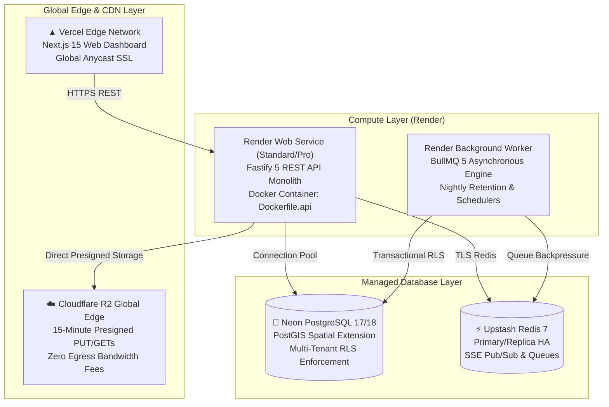

# Oprino — Production Deployment Overview

**Document:** Authoritative Cloud Hosting & Infrastructure Topology  
**Auditor:** Principal DevOps Engineer  
**Branch:** `release/v1-stabilization`  
**Infrastructure Blueprint:** [`render.yaml`](../../render.yaml) & [`vercel.json`](../../apps/web/vercel.json)  

---

## 1. Multi-Tier Production Topology

Oprino leverages a decoupled, high-availability architecture optimized for SMB economics (~$0.40/user/month at scale):

---

## 2. Service Specifications & Resource Allocations

| Service Name | Host Provider | Instance Type | Minimum Sizing | Health Check Endpoint | Scaling Strategy |
|---|---|---|---|---|---|
| **`oprino-web`** | Vercel | Serverless Edge | Standard Pro | `/` | Automatic global edge auto-scaling |
| **`oprino-api`** | Render | Docker Web Service | 1 CPU / 2 GB RAM | `/health/live`, `/health/ready` | Horizontal auto-scaling on CPU/Request count |
| **`oprino-worker`** | Render | Background Worker | 1 CPU / 1 GB RAM | Internal Heartbeat | Active/Standby or scaled concurrency |
| **`oprino-db`** | Neon | Serverless Postgres | 0.25 to 2 CU auto-scale | `SELECT 1;` | Automatic compute auto-scaling with PostGIS |
| **`oprino-redis`** | Upstash | Managed Redis HA | 10,000 req/sec | `PING` -> `PONG` | Multi-region active replication |
| **`oprino-media`** | Cloudflare | Private R2 Bucket | S3 API Compatible | S3 HeadBucket | Zero-egress serverless object storage |
