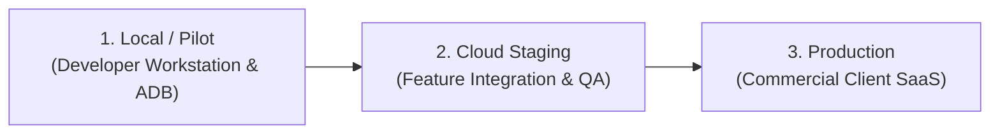

# Oprino — Multi-Tier Environment Matrix

**Document:** Environment Progression, URL Endpoints & Access Control  
**Auditor:** Principal DevOps Engineer  
**Branch:** `release/v1-stabilization`  

---

## 1. 3-Tier Environment Specification

| Tier Property | 1. Local / Pilot | 2. Staging Environment | 3. Production Environment |
|---|---|---|---|
| **Purpose** | Developer coding, unit testing, local ADB pilot | Pre-release validation, automated CI smoke testing | Live commercial SMB workforce operations |
| **API Endpoint** | `http://localhost:3001` (or `10.0.2.2:3001`) | `https://staging-api.oprino.com` | `https://api.oprino.com` |
| **Web Dashboard** | `http://localhost:3000` | `https://staging.oprino.com` (or preview Vercel) | `https://oprino.com` / `https://oprino.vercel.app` |
| **Database Engine** | Synthetic in-memory mock or local Postgres | Neon PostgreSQL 17/18 (Isolated staging branch) | Neon PostgreSQL 17/18 (Production cluster) |
| **Redis Engine** | In-memory synthetic or local Redis | Upstash Managed Redis (Staging instance) | Upstash Managed Redis HA (Production cluster) |
| **Object Storage** | Local filesystem (`.storage/pilot_media/`) | Cloudflare R2 (`oprino-staging-media`) | Cloudflare R2 (`oprino-prod-media`) |
| **Mobile Keystore** | Android Debug Keystore | Android Debug / Pilot Keystore | Dedicated Company Production Release Keystore |
| **Cleartext HTTP** | Allowed for local testing | Prohibited (Strict HTTPS only) | Prohibited (Strict HTTPS only) |
| **Data Retention** | Ephemeral / Reset on restart | 7-day retention purge | Configurable 7–90 days (default: 30 days) |
| **Access Gate** | Open to local developer | Restricted to internal QA & stakeholders | Public commercial access for paying tenants |
