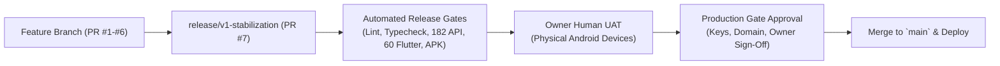

# Oprino — Commercial Release Process & Governance

**Document:** Authoritative Release Protocol, Gating & Non-Destructive Rollback  
**Auditor:** Principal Release Manager & Security Architect  
**Branch:** `release/v1-stabilization`  

---

## 1. Release Governance Principles

1. **Strict V1 Feature Freeze:** No new features or exploratory refactoring may enter release candidate branches.
2. **Owner UAT Mandatory:** Code readiness and green CI results are technical gates; commercial launch requires explicit human sign-off from the project owner.
3. **Additive-Only Migrations:** Database migrations must be strictly backward-compatible. Zero destructive column drops (`DROP COLUMN`), table drops (`DROP TABLE`), or enum removals.
4. **Non-Destructive Rollbacks:** Rollback runbooks must never issue `FLUSHDB` or drop live production tables. Rollbacks execute via container image version repinning.

---

## 2. Release Promotion Pipeline

### Gate 1: Monorepo Verification
- `pnpm install --frozen-lockfile` succeeds.
- `pnpm turbo build` completes with FULL TURBO.
- `pnpm lint` and `pnpm typecheck` pass with 0 errors.

### Gate 2: Test Suite Verification
- `pnpm test`: 182 API integration tests pass (RLS isolation, invitations, bulk CSV, biometric selfie).
- `apps/mobile`: `flutter analyze` clean, 60/60 Flutter unit & widget tests pass.
- `pnpm pilot:gates`: 5/5 security gates pass.
- `pnpm pilot:test`: 11/11 end-to-end pilot workflows pass.

### Gate 3: Android Packaging Verification
- `.\gradlew.bat :app:assembleDebug` succeeds with 0 errors.
- Split debug/release network security verified (release builds forbid cleartext HTTP).

### Gate 4: Owner Human UAT (Physical Device Gate)
- APK installed on physical Android device via ADB.
- Live camera photo proof acquisition, watermark verification, and customer signature tested.
- Walking/driving background GPS breadcrumb collection verified during active duty shift.
- Immediate GPS cutoff verified upon Punch Out.

### Gate 5: Production Deployment Gate
- Cloudflare R2 / AWS S3 production bucket credentials configured.
- Dedicated Android Release Keystore provisioned.
- Production DNS (`oprino.com`) mapped.
- Owner gives explicit written authorization to deploy.

---

## 3. Non-Destructive Rollback Runbook Summary

In the event of an operational incident following deployment:
1. **Never Drop Tables:** Destructive SQL commands (`DROP TABLE`, `TRUNCATE`) are strictly forbidden on production databases.
2. **Container Image Repin:** Revert Render web service to previous stable Docker image tag (instant recovery < 60s).
3. **Vercel Instant Rollback:** Promote previous deployment in Vercel Dashboard (instant recovery < 10s).
4. **Full Protocol Reference:** [`docs/releases/V1-ROLLBACK-PLAN.md`](../releases/V1-ROLLBACK-PLAN.md).
