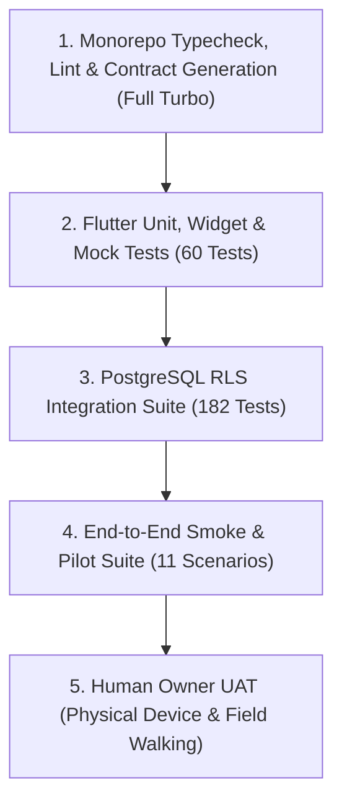

# Oprino — Automated Testing & Quality Guide

**Document:** Authoritative Quality & Verification Protocol  
**Auditor:** Principal QA Lead  
**Branch:** `release/v1-stabilization`  

---

## 1. Testing Pyramid Overview



---

## 2. Test Execution Commands

### A. Monorepo Quality Checks
```bash
# Static analysis and formatting
pnpm lint
pnpm typecheck

# Full monorepo build
pnpm build
```

### B. Backend API Integration & RLS Tests
```bash
# Runs 182 Fastify, Better Auth, and PostgreSQL RLS tests
pnpm --filter @oprino/api test
```
*Tests cover tenant isolation, single-use invites, bulk CSV, biometric selfie rules, and duty boundary cutoffs.*

### C. Flutter Mobile Test Suite
```bash
cd apps/mobile
flutter analyze
flutter test
```
*Runs all 60 unit and widget tests across auth, offline Drift SQLite storage, media queue, and duty invariants.*

### D. Automated Pilot Scenarios & Hardening Gates
```bash
# Terminal 1: Start isolated pilot test server
pnpm pilot:server

# Terminal 2: Run 5 security and regression gates
pnpm pilot:gates

# Terminal 2: Run 11 end-to-end operational scenarios
pnpm pilot:test
```

### E. Documentation Link Integrity
```bash
node scripts/validate-doc-links.mjs
```
*Validates that all 473 relative markdown links across the repository resolve to existing target files.*

### F. Android Native Compilation Check
```bash
cd apps/mobile/android
.\gradlew.bat tasks
.\gradlew.bat :app:assembleDebug
```
*Compiles the full Android debug APK (193 tasks) verifying CMake C++ binaries, AGP plugins, and packaging.*
